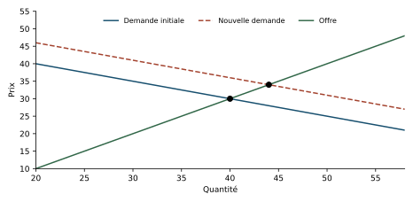
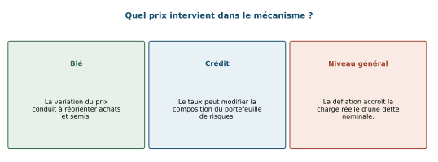

# ENS de Cachan D1 — Composition d’ordre économique 2011 · Corrigé guidé

*Corrigé rédigé par IA, non officiel. Signalez toute erreur.*

**Rédaction** · GPT-6.2 Astra Ultra · vitesse non renseignée

## Prix et équilibre économique

### Introduction

> [!INDICATION]
> Séparer prix d’une marchandise et niveau général. Préciser également si « équilibre » désigne l’égalité des quantités, la stabilité dynamique ou l’efficacité.

Une mauvaise récolte de blé peut accroître le prix bien avant que la quantité produite ne se redresse. Le prix plus élevé limite certaines demandes, attire des livraisons depuis d’autres marchés et incite à semer davantage la saison suivante. À l’inverse, au sortir d’une crise financière, la baisse des prix peut aggraver le poids réel des dettes et décourager la dépense. Une variation de prix rétablit donc certains équilibres, mais peut en éloigner d’autres.

Le prix relatif mesure la valeur d’un bien dans un autre. Le niveau général des prix mesure le pouvoir d’achat de l’unité monétaire. Un équilibre de marché rend les projets d’achat et de vente compatibles, éventuellement sous des contraintes de quantité. Un équilibre macroéconomique exprime une cohérence des décisions agrégées et ne garantit ni le plein emploi ni l’efficacité. Comment le système de prix peut-il coordonner les plans individuels, et dans quelles circonstances le retour à l’équilibre dépend-il d’autres mécanismes ? Le modèle concurrentiel éclaire la fonction d’information et d’ajustement des prix. La stabilité de cet ajustement, ses propriétés sociales et son efficacité macroéconomique sont toutefois des questions distinctes.

### I. Les prix relatifs rendent compatibles des décisions décentralisées

#### A. L’ajustement d’un marché est à la fois informatif et incitatif

> [!INDICATION]
> Calculer les demandes et offres prévues au prix ancien. Distinguer l’identité des transactions réalisées de l’égalité des quantités désirées.

Prenons une demande $Q_D=100-2p$ et une offre $Q_O=10+p$. L’égalité donne $p^*=30$ et $Q^*=40$. Si la demande devient $112-2p$ à offre inchangée, au prix antérieur les acheteurs demandent 52 et les vendeurs offrent 40. Le nouvel équilibre est $p=34$, $Q=44$. Le supplément de prix modère la demande et augmente l’offre. Il transmet aux acheteurs comme aux producteurs une information sur la rareté sans que chacun connaisse l’origine exacte du choc. La règle de réaction et la mobilité des quantités importent. Si l’offre est tout à fait fixe à court terme, l’effet immédiat porte davantage sur le prix.

Un prix plafond de 30 après le déplacement de la demande laisse un excès de demande de douze unités dans cet exemple. Une file d’attente, une règle d’attribution ou une qualité réduite peut répartir les quarante unités disponibles. La quantité effectivement achetée égale toujours celle effectivement vendue, mais cette identité comptable n’est pas un équilibre où tous les projets sont réalisés. Inversement, une baisse de prix peut écouler des stocks seulement si la demande réagit et si les vendeurs acceptent de modifier leurs conditions. L’exemple donne un mécanisme, non une loi d’ajustement instantané.

#### B. L’équilibre général replace chaque prix dans un système de raretés

> [!INDICATION]
> Comparer trois affirmations logiquement différentes, un équilibre existe, un seul équilibre est possible, une économie partie ailleurs parvient à cet équilibre.

La hausse du prix du blé affecte le coût de la farine, la demande d’autres céréales et le revenu des producteurs. Dans la représentation walrasienne, les ménages arbitrent sous leur contrainte budgétaire et les entreprises choisissent leurs facteurs et leur production en fonction des prix. Un vecteur de prix d’équilibre annule simultanément les excès de demande des marchés, avec les conditions adaptées aux biens libres. Un numéraire fixe l’unité dans laquelle ces prix relatifs sont exprimés. Multiplier tous les prix et tous les revenus nominaux correspondants par la même constante ne change pas ces arbitrages réels dans ce cadre.

La loi de Walras découle des contraintes budgétaires satisfaites. La somme des valeurs des excès de demande est nulle lorsque ces contraintes sont agrégées dans le modèle approprié. Si tous les marchés sauf un sont équilibrés et que le prix du dernier est positif, celui-ci doit aussi l’être. Cette identité ne prouve ni l’existence d’un vecteur d’équilibre pour n’importe quelle économie, ni sa stabilité. Les théorèmes d’existence imposent des hypothèses sur les préférences, les possibilités de production et les ressources. Le tâtonnement illustre une règle possible d’ajustement des prix. Une démonstration d’existence n’établit pas que ce processus y converge.

### II. Un prix qui équilibre des échanges ne suffit pas à assurer un résultat souhaitable ou stable

#### A. La structure du marché détermine le sens du prix observé

> [!INDICATION]
> Comparer le prix au coût marginal privé puis au coût marginal social. Sur le crédit, se demander si le bien échangé reste de même qualité lorsque son prix augmente.

Avec concurrence parfaite, marchés complets et absence d’effets externes, l’équilibre peut être efficace au sens de Pareto. Cela signifie qu’aucune réallocation faisable n’améliore le sort de l’un sans réduire celui d’un autre, à dotations et institutions données. Cela ne dit rien de suffisant sur l’égalité. Un ménage sans revenu peut renoncer à un bien essentiel dans un marché en équilibre. Un monopole peut, lui aussi, trouver des acheteurs pour sa quantité offerte tout en fixant un prix supérieur au coût marginal. Les échanges sont compatibles, mais certaines transactions potentiellement avantageuses sont perdues.

Si la production pollue une rivière, le coût supporté par les riverains peut manquer dans le prix privé. Une taxe correspondant au dommage marginal au niveau efficace modifie le signal vu par le producteur. L’autorité doit néanmoins évaluer ce dommage et les réactions des intéressés. Un prix très élevé peut aussi signaler une information défavorable. Sur le crédit, relever le taux peut attirer des emprunteurs plus risqués ou encourager des projets plus risqués. Une banque peut alors préférer rationner les prêts au taux affiché. L’analyse de Stiglitz et Weiss montre comment un rationnement peut être compatible avec l’optimisation lorsque le prix modifie la qualité du portefeuille.

#### B. Le niveau général des prix interagit avec l’emploi, les dettes et les anticipations

> [!INDICATION]
> Calculer le poids réel d’une créance nominale inchangée. Préciser ensuite quel comportement du créancier pourrait ou non compenser celui du débiteur.

À salaire nominal donné, une hausse du niveau des prix réduit le salaire réel. Mais on ne peut en conclure qu’une baisse générale des salaires et des prix rétablira nécessairement le plein emploi. Les revenus salariaux alimentent les dépenses et les entreprises déterminent leur production en fonction des débouchés attendus. Avec prix ou salaires peu flexibles, la contraction de la demande peut réduire la production et l’emploi avant de faire baisser fortement les prix. Une économie peut donc connaître un équilibre de sous-emploi. Stabiliser la demande peut alors agir sur les quantités.

Même avec des prix mobiles, l’ajustement dépend des bilans. Si une dette de 100 doit être payée en monnaie et que le niveau des prix passe de 100 à 90, sa valeur réelle exprimée en pouvoir d’achat initial augmente d’environ 11,1 %. Un emprunteur contraint réduit sa dépense. Si le créancier n’augmente pas la sienne à due concurrence, la demande globale diminue et la déflation peut se nourrir d’elle-même, selon le mécanisme de dette-déflation analysé par Fisher. À taux nominal donné, une inflation anticipée plus faible élève aussi le taux d’intérêt réel anticipé. L’ancrage des anticipations et la stabilité monétaire facilitent donc la lecture des prix relatifs, tout en réduisant les risques d’un ajustement agrégé déstabilisant.

### Conclusion

> [!INDICATION]
> Rendre compte à la fois de la réussite du signal local et de la fragilité d’une généralisation à l’ensemble de l’économie.

Le prix est un moyen puissant de coordination parce qu’il révèle une rareté et change les incitations à y répondre. Il faut toutefois vérifier la nature du prix, la structure du marché et le régime monétaire avant d’en tirer une conclusion d’équilibre. Le prix du blé peut orienter efficacement des semis, tandis qu’une baisse de tous les prix alourdit les dettes et pèse sur l’activité. L’économie n’accorde donc au système de prix une propriété de stabilité ou d’efficacité qu’après avoir précisé les institutions et les hypothèses qui la rendent possible.

[Sujet de la session](https://www.ens-rennes.fr/medias/fichier/se1a_11a_d1_dissertation_1304088307217.pdf)
