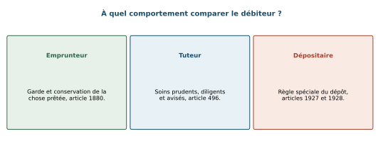
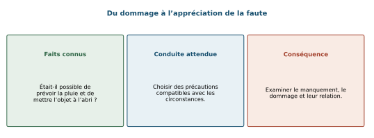

# ENS de Cachan D1 — Droit civil 2011 · Corrigé guidé

*Corrigé rédigé par IA, non officiel. Signalez toute erreur.*

**Lecture du rapport du jury** · GPT-6.2 Astra Ultra · vitesse non renseignée

**Rédaction** · GPT-6.2 Astra Ultra · vitesse non renseignée

## Le « bon père de famille »

### Introduction

> [!INDICATION]
> Tester le modèle sur un emprunteur dépourvu d’expérience ou de lien familial. Demander en quoi sa conduite se mesure à autre chose qu’à sa propre bonne volonté.

Un emprunteur laisse sous la pluie un instrument que son ami lui a prêté. Il affirme qu’il traite habituellement ses propres instruments de la même manière. Cette réponse serait pertinente si le contrat n’exigeait que ses habitudes personnelles. L’article 1880, dans sa rédaction applicable en 2011, lui demande cependant de veiller à la garde et à la conservation de la chose prêtée en « bon père de famille ». L’exemple révèle un étalon extérieur à son comportement ordinaire.

Le sujet porte sur cette expression historique du droit civil français. Elle désigne un modèle de conduite prudente et diligente, applicable indépendamment du sexe, de la parentalité ou du statut familial de l’intéressé. Elle diffère de la « destination du père de famille », mode de constitution de certaines servitudes. Elle ne se confond pas davantage avec la bonne foi, qui peut exprimer une croyance légitime ou la loyauté. Pourquoi employer un standard ouvert pour apprécier des obligations déterminées, et comment éviter qu’il serve seulement à habiller la préférence personnelle du juge ? Les textes en font d’abord la mesure d’une gestion ou d’une conservation pour autrui. La jurisprudence en tire ensuite une méthode générale, objective dans son principe et adaptée aux circonstances.

### I. Les textes décrivent une diligence requise dans l’exercice d’un pouvoir sur le bien d’autrui

#### A. La pluralité des applications révèle la fonction commune du standard

> [!INDICATION]
> Identifier pour chaque texte le pouvoir accordé, le bien concerné et l’intérêt de la personne dont la valeur doit être protégée.

L’usufruitier dispose d’une jouissance étendue, mais doit conserver la substance du bien. En 2011, l’article 601 envisage en principe la caution de jouir en bon père de famille, sous les dispenses légales ou conventionnelles. L’article 627 emploie la formule pour les droits d’usage et d’habitation. De son côté, le preneur à bail doit selon l’article 1728 user de la chose louée en bon père de famille et suivant la destination déterminée par le bail ou les circonstances. Dans ces cas, l’utilisateur bénéficie de la chose sans pouvoir consommer à son gré la valeur que le propriétaire doit retrouver.

Le même mécanisme opère en droit des obligations. L’ancien article 1137 impose à celui qui doit veiller à la conservation d’une chose d’y apporter tous les soins d’un bon père de famille. Son second alinéa admet que l’étendue de l’obligation varie selon le contrat. L’emprunteur tenu de restituer la chose prêtée répond du défaut de garde dans les conditions du prêt à usage. Le gérant d’affaires, intervenu sans mandat dans l’intérêt d’autrui, doit en vertu de l’ancien article 1374 apporter à la gestion les soins attendus du modèle. Les circonstances ayant conduit à la prise en charge peuvent permettre au juge de modérer les dommages-intérêts dus pour les fautes ou négligences. L’étalon fixe une exigence, son application demeure articulée au régime propre de chaque situation.

#### B. Une formule ancienne renvoie à des exigences qui peuvent être exprimées autrement

> [!INDICATION]
> Confronter les mots réellement en vigueur en 2011 à l’ancien texte sur le tuteur. Distinguer objectivité du standard et éventuel renvoi légal à la conduite personnelle.

Le vocabulaire familial hérité de l’histoire du droit évoque une position sociale déterminée. Pourtant, les textes l’utilisent à propos d’un preneur, d’un emprunteur, d’un séquestre ou d’un gestionnaire qui n’agissent pas comme chefs de famille. Le modèle opère par les qualités attendues de l’action, notamment l’entretien, la prudence et la prévoyance proportionnée au risque. L’adjectif « bon » introduit une appréciation normative. Le droit ne demande pas à un sondage d’établir ce que la majorité des personnes font habituellement. Une négligence répandue peut demeurer fautive.

Le droit de la protection des personnes montre que la rédaction peut évoluer. L’ancien article 450 évoquait la gestion du tuteur en bon père de famille. En 2011, il faut tenir compte de la réforme des tutelles. L’article 408 renvoie pour la gestion des biens du mineur aux règles du titre relatif aux mesures de protection. L’article 496 exige du tuteur des soins prudents, diligents et avisés dans le seul intérêt de la personne protégée. L’objet de l’obligation se comprend sans recourir à la formule familiale. À l’inverse, lorsqu’un texte prévoit spécialement une comparaison avec les soins que le débiteur apporte à ses propres affaires, comme l’article 1927 pour le dépositaire, il faut respecter cette spécificité et les correctifs de l’article 1928. Toutes les références à la prudence ne commandent donc pas la même comparaison.

### II. Le juge compare des conduites sans imposer une perfection abstraite

#### A. Une appréciation objective peut tenir compte de circonstances précises

> [!INDICATION]
> Modifier une seule circonstance du prêt et vérifier si la précaution exigible change. Éviter d’invoquer les habitudes personnelles comme excuse générale.

Pour apprécier une faute de négligence, le juge compare le comportement constaté à celui qu’aurait adopté une personne normalement prudente placée dans des circonstances semblables. L’appréciation est dite in abstracto parce que la norme ne dépend pas des seules habitudes du défendeur. Elle tient pourtant compte de la situation extérieure. La difficulté du geste, l’urgence, l’information accessible, les exigences propres à une profession et la gravité du risque modifient les précautions raisonnablement attendues. Le sauvetage improvisé d’un bien menacé par un orage ne s’apprécie pas comme un stockage professionnel de longue durée.

Reprenons l’instrument prêté. Le laisser une nuit à découvert après un avis de pluie, alors qu’une pièce sèche est accessible, peut révéler un défaut de diligence. Le conserver dans un local approprié qui subit un sinistre imprévisible pose une question différente. Le seul dommage matériel ne suffit pas à choisir entre les deux récits. La qualification repose sur des faits établis, tels que les conditions du rangement, les avertissements reçus et les moyens disponibles. Le travail d’appréciation des juges du fond et le contrôle de la qualification juridique favorisent une application cohérente du standard tout en laissant place à la diversité des faits.

#### B. Le modèle aide à identifier la faute, mais n’épuise pas le régime de responsabilité

> [!INDICATION]
> Comparer une obligation de soins à une obligation de résultat, puis une négligence à une dissimulation. Nommer ce qu’il reste à prouver dans chaque cas.

Dans une obligation de moyens, l’écart à la diligence normalement attendue peut établir une faute. Le créancier qui invoque la responsabilité doit articuler les règles de preuve applicables et établir, selon le cas, le défaut de soins, le dommage et le lien causal. Lorsque le débiteur s’est engagé à obtenir un résultat déterminé, la seule preuve qu’il a pris des précautions ne suffit pas nécessairement à écarter les conséquences du résultat manqué. Il faut d’abord qualifier l’obligation, examiner les présomptions et les causes d’exonération. Le « bon père de famille » fournit un instrument de comparaison qui ne remplace pas l’analyse du contrat.

La loyauté, l’intention et la preuve du dommage restent également distinctes. Le dépositaire ou le preneur peut être sincèrement persuadé d’agir correctement et avoir manqué de diligence. À l’inverse, un manquement au devoir de loyauté peut être établi par une dissimulation calculée sans que la difficulté principale soit l’entretien d’un bien. Un juge qui invoque le standard doit donc expliciter l’exigence accessible au moment des faits et les conséquences de sa violation. Sans cette motivation, une formule ouverte pourrait masquer un jugement rétrospectif à partir du seul dommage. Avec elle, l’étalon permet au droit de tenir compte de l’évolution des techniques et des usages sans modifier la loi à chaque précaution nouvelle.

### Conclusion

> [!INDICATION]
> Terminer en énonçant la conduite attendue dans l’exemple et le rôle précis qu’elle joue dans une demande de réparation.

En 2011, la formule conserve une présence textuelle importante, mais sa fonction dépasse son imagerie familiale. Elle établit ce qu’une personne placée dans une situation donnée devait raisonnablement faire pour conserver, administrer ou protéger. Dans l’exemple du prêt, la responsabilité se discute à partir des précautions normalement accessibles à l’emprunteur et de la cause de la détérioration. C’est cette comparaison motivée, et non une appréciation de sa vie familiale ou de sa seule sincérité, qui fait la valeur juridique du standard.

[Sujet de la session](https://www.ens-rennes.fr/medias/fichier/se1a_11d1_droit_civil_1304088246685.pdf) · [Rapport du jury](https://www.ens-rennes.fr/medias/fichier/re-11d1-droit-civil_1421751212036-pdf) · [Code civil en avril 2011](https://www.legifrance.gouv.fr/codes/texte_lc/LEGITEXT000006070721/2011-04-01/)
