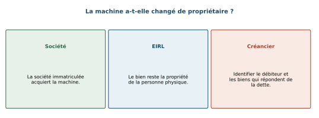
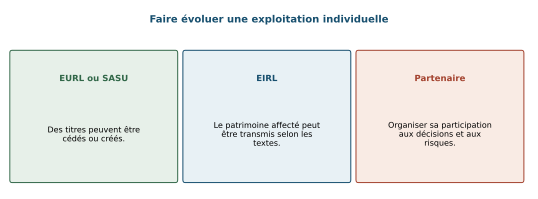

# ENS de Cachan D1 — Droit commercial 2011 · Corrigé guidé

*Corrigé rédigé par IA, non officiel. Signalez toute erreur.*

**Lecture du rapport du jury** · GPT-6.2 Astra Ultra · vitesse non renseignée

**Rédaction** · GPT-6.2 Astra Ultra · vitesse non renseignée

## Comparez la société unipersonnelle et l’E.I.R.L.

### Introduction

> [!INDICATION]
> Placer le même emprunt pour la machine dans les deux structures. Déterminer qui signe, qui doit rembourser et quelle personne possède la machine.

Une artisane qui entreprend seule veut acheter une machine à crédit et préserver son logement en cas de difficultés. En 2011 elle peut constituer une société à associé unique, par exemple une EURL ou une SASU. Depuis la loi du 15 juin 2010, elle peut aussi adopter le statut d’entrepreneur individuel à responsabilité limitée. Dans les deux cas, les créanciers doivent savoir quels biens répondent de leurs créances. Pourtant, l’une des techniques crée une société distincte et l’autre conserve une seule personne physique.

Un patrimoine comprend un actif et un passif. Le droit de gage général soumet en principe aux engagements d’une personne ses biens présents et à venir, sous les causes légales de préférence et les règles de saisissabilité. La protection de l’entrepreneur consiste à tracer une frontière dans ce gage. Une société unipersonnelle est une technique d’organisation juridique susceptible de prendre plusieurs formes. L’EIRL, telle qu’elle existe à la session 2011, est un statut d’entreprise individuelle reposant sur un patrimoine affecté. Comment ces deux techniques atteignent-elles une finalité voisine, et pourquoi produisent-elles des effets différents sur le crédit, la transmission et le développement de l’activité ?

### I. Deux constructions patrimoniales différentes assurent une protection conditionnelle

#### A. La personnalité morale et l’affectation dessinent deux frontières juridiques

> [!INDICATION]
> Distinguer l’apport en propriété, qui fait changer le titulaire du bien, et l’affectation, qui modifie la répartition des gages sans créer un nouveau propriétaire.

Le droit français a d’abord choisi de distinguer les personnes. La loi du 11 juillet 1985 a permis la SARL à associé unique, couramment appelée EURL. L’article 1832 du Code civil admet l’institution d’une société par la volonté d’une seule personne dans les cas prévus par la loi. La SAS peut aussi compter un associé unique. Après immatriculation, la société possède son patrimoine. Les biens que l’associée lui apporte en propriété et ceux qu’elle acquiert répondent de ses dettes. Si la société emprunte pour la machine, elle est le débiteur de la banque. Dans l’EURL et la SASU, l’associée supporte en cette qualité les pertes à concurrence de ses apports, sous réserve d’engagements distincts ou de règles spéciales.

L’EIRL procède autrement. L’entrepreneuse reste le sujet de droit, acquiert les biens et contracte en son nom. Par déclaration d’affectation conforme aux textes de 2010 et aux formalités applicables en 2011, elle constitue un patrimoine professionnel séparé de son patrimoine personnel, sans nouvelle personne morale. Le patrimoine affecté comprend les biens, droits, obligations ou sûretés nécessaires à l’exercice professionnel et peut, dans les conditions légales, inclure d’autres éléments utilisés pour l’activité. Une artisane, un commerçant, un agriculteur ou un professionnel libéral peuvent être concernés selon leur activité. L’innovation touche donc au lien entre personne et patrimoine, alors que la société résout le problème en ajoutant un sujet de droit.

#### B. Les créanciers doivent pouvoir identifier et opposer la séparation

> [!INDICATION]
> Classer le créancier par date, cause de la dette et formalités accomplies avant de désigner ses possibilités de poursuite.

Dans la société, l’immatriculation, la comptabilité, les règles sur les apports et la publicité permettent aux tiers d’identifier leur débiteur. L’associé qui agit pour la société en formation doit respecter les conditions de reprise des engagements. Comme dans toute opération avec une personne morale, il importe de vérifier si le dirigeant a vraiment traité au nom de celle-ci ou contracté personnellement. La valeur du gage social dépend ensuite de la situation réelle de l’actif et du rang des créanciers. Le capital inscrit dans les statuts ne garantit pas à lui seul le paiement de toutes les dettes.

L’EIRL exige aussi publicité et discipline comptable. Dans le droit initial, les créanciers professionnels auxquels la déclaration est opposable disposent en principe du patrimoine affecté comme gage général. Les autres ont pour gage le patrimoine non affecté, avec les précisions et exceptions de l’article L. 526-12 de l’époque. L’opposabilité aux créanciers antérieurs obéit à des conditions particulières, notamment mention dans la déclaration, information individuelle et possibilité d’opposition selon le texte. On ne peut soustraire mécaniquement un actif à un créancier déjà engagé. Les formalités attachées à certains biens, le compte bancaire dédié et les sanctions de la fraude ou des manquements graves soutiennent la crédibilité de la séparation. La loi donne une frontière juridique, mais il appartient à l’entrepreneur de la rendre lisible dans ses opérations.

### II. L’efficacité du crédit et l’évolution de l’entreprise différencient les deux techniques

#### A. La protection formelle rencontre les exigences du financement et de la responsabilité

> [!INDICATION]
> Séparer caution personnelle d’une dette sociale, sûreté réelle sur un bien, et responsabilité consécutive à un comportement fautif.

Dans les deux systèmes, la banque évalue les actifs disponibles, la viabilité de l’activité et les sûretés. Si elle prête à une société, elle peut demander que l’associée garantisse personnellement la dette sociale. C’est alors un engagement distinct, puisque la débitrice principale et la caution sont deux personnes. La qualité d’associée unique ne vaut pas par elle-même cautionnement. Si l’artisane est EIRL, elle ne peut se porter caution de sa propre dette comme s’il existait deux personnes. Il faut analyser les sûretés réelles éventuellement consenties, les règles spéciales du crédit professionnel et les garanties de tiers. Un nantissement portant sur la machine donne à la banque un avantage déterminé sans transformer l’ensemble des créanciers professionnels en créanciers privilégiés.

Une faute de gestion, une fraude ou une confusion des mouvements patrimoniaux peuvent également modifier l’exposition de l’intéressée, sous les conditions du régime applicable. Il faut distinguer le risque de perdre l’apport, le risque pris par une sûreté personnelle ou réelle, et une action en responsabilité reposant sur des faits distincts. Les procédures relatives aux difficultés de l’entreprise doivent elles aussi identifier le patrimoine concerné et la qualité au titre de laquelle la personne intervient. La protection n’abolit donc pas le risque économique d’une activité sous-capitalisée. Elle le distribue entre acteurs et rend leur consentement aux garanties particulièrement important.

#### B. Une société facilite l’entrée de partenaires, l’affectation privilégie l’exercice individuel

> [!INDICATION]
> Comparer l’arrivée d’un nouvel investisseur et la vente de toute l’exploitation. Dans un cas, on peut céder des titres. Dans l’autre, il faut identifier le patrimoine et la personne qui exploite.

Une société a des titres et des organes. L’associée unique peut céder une fraction de ses titres ou accueillir un nouvel apporteur de capital sous les conditions de sa forme sociale. Une EURL ou une SASU peut ainsi devenir pluripersonnelle sans création nécessaire d’un nouvel exploitant pour le seul passage à plusieurs associés. Les contrats et autorisations demeurent à analyser, mais la personnalité de l’entreprise sociale peut durer au-delà des changements de bénéficiaires des titres. Le prix à payer est une organisation spécifique, avec des statuts, des décisions formalisées et des comptes distincts, que les activités les plus modestes ne jugeront pas toutes souhaitable.

L’EIRL ne crée aucun titre social permettant d’introduire un associé par simple cession de parts. Pour accueillir un investisseur qui veut participer aux décisions comme associé, il faut envisager une mise en société ou une autre réorganisation. Pour autant, le patrimoine affecté peut faire l’objet des opérations de cession, transmission ou apport prévues par les textes de l’époque, assorties de publicité et de protection des créanciers. Il serait donc excessif de prétendre qu’il est intransmissible. La différence tient à l’objet transmis et à la continuité de la personne exploitante. Une activité qui restera individuelle et une entreprise destinée à accueillir des capitaux extérieurs n’ont pas nécessairement intérêt à recourir à la même technique dès leur création.

Le fascicule d’options 2011 donne cet intitulé en page 2. Le rapport conservé dans les archives de cette session le reprend explicitement, bien que sa garde indique par erreur « session 2010 ».

### Conclusion

> [!INDICATION]
> Répondre à la comparaison par deux critères communs et par un cas dans lequel la différence de technique change concrètement la solution.

L’EIRL de 2011 et les sociétés unipersonnelles à risque limité répondent à un même besoin de protection par deux voies autonomes. L’une distingue deux masses de biens rattachées à une personne et l’autre crée une personne morale avec ses propres comptes et ses titres. L’entrepreneuse qui finance sa machine doit donc considérer ensemble le gage de la banque, les engagements effectivement consentis et le développement envisagé, au lieu de déduire son exposition de la seule appellation « responsabilité limitée ».

[Sujet de la session](https://www.ens-rennes.fr/medias/fichier/se1a_11d1_epreuve_a_option_1304088228843.pdf#page=2) · [Rapport du jury](https://www.ens-rennes.fr/medias/fichier/re-11d1-droit-commercial_1421751217280-pdf) · [Code civil en avril 2011](https://www.legifrance.gouv.fr/codes/texte_lc/LEGITEXT000006070721/2011-04-01/) · [Code de commerce en avril 2011](https://www.legifrance.gouv.fr/codes/texte_lc/LEGITEXT000005634379/2011-04-01/) · [Directive 2009/102/CE sur les sociétés à un seul associé](https://eur-lex.europa.eu/legal-content/FR/TXT/?uri=CELEX:32009L0102)
