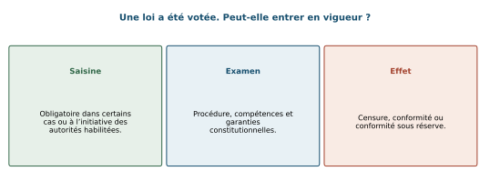
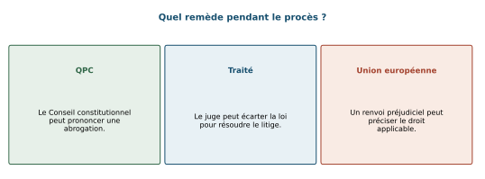

# ENS de Cachan D1 — Droit public 2011 · Corrigé brut

*Corrigé rédigé par IA, non officiel. Signalez toute erreur.*

**Lecture du rapport du jury** · GPT-6.2 Astra Ultra · vitesse non renseignée

**Rédaction** · GPT-6.2 Astra Ultra · vitesse non renseignée

## Le contrôle de la loi sous la cinquième République

### Introduction

Une disposition législative peut être empêchée d’entrer en vigueur, écartée dans un litige ou abrogée avec effet pour tous. Ces trois verbes correspondent, sous la Ve République, à des contrôles exercés par des juges différents ou à des moments différents. Une loi régulièrement promulguée n’est donc plus assurée de demeurer applicable à toute situation du seul fait du vote parlementaire.

Contrôler la loi peut signifier maîtriser son élaboration, apprécier sa conformité à une norme supérieure ou en surveiller l’application. La consultation du Conseil d’État sur les projets du gouvernement, les règles de procédure parlementaire et le contrôle politique du Parlement participent à sa préparation, sans avoir les mêmes effets qu’une décision juridictionnelle. Le cœur de la difficulté concerne la vérification de la loi elle-même. Comment la Ve République a-t-elle organisé ce contrôle tout en distribuant entre institutions la compétence pour censurer, écarter ou abroger ? La Constitution fonde un contrôle concentré qui, en 2011, peut atteindre aussi la loi en vigueur. Les engagements internationaux complètent cette protection en confiant un rôle propre au juge du litige.

### I. Le contrôle constitutionnel concentré atteint désormais la loi avant et après sa promulgation

#### A. Le contrôle préalable protège la procédure, les compétences et les droits

La Constitution de 1958 circonscrit le domaine de la loi et organise le travail du Parlement. Le contrôle a priori de l’article 61 permet au Conseil constitutionnel d’examiner une loi avant sa promulgation. Il est obligatoire notamment pour les lois organiques et facultatif pour les lois ordinaires sur saisine des autorités habilitées. La révision de 1974 a ajouté soixante députés ou soixante sénateurs aux autorités de saisine, ouvrant le recours à l’opposition parlementaire. Une loi ordinaire votée échappe donc au contrôle préalable si aucune saisine n’a lieu. L’intervention du Conseil d’État en amont sur un projet de loi reste un avis, même si son raisonnement peut prévenir une inconstitutionnalité.

Le contrôle a changé d’ampleur avec Liberté d’association du 16 juillet 1971. Le Préambule de 1958 et les normes auxquelles il renvoie permettent de contrôler les atteintes aux droits et libertés, en plus des règles de compétence et de procédure. Le Conseil peut prononcer une censure totale ou partielle, lorsqu’une disposition censurée est séparable, ou déclarer conforme sous une réserve d’interprétation. Dans ce dernier cas, le maintien du texte est lié à une lecture constitutionnellement admise. Une disposition déclarée inconstitutionnelle sur le fondement de l’article 61 ne peut être promulguée ni mise en application. Cette maîtrise n’est pas générale. Par sa décision du 6 novembre 1962, le Conseil a jugé qu’il n’était pas compétent pour contrôler dans ce cadre la loi adoptée directement par référendum.

#### B. La question prioritaire introduit un contrôle de la disposition déjà applicable

La révision de 2008 et la mise en œuvre de l’article 61-1 le 1er mars 2010 changent la situation du justiciable. À l’occasion d’une instance, une partie peut faire valoir, dans un écrit distinct et motivé, qu’une disposition législative porte atteinte aux droits et libertés que la Constitution garantit. Le litige donne accès au contrôle d’une norme générale, mais ne transforme pas le Conseil constitutionnel en juge de tous les faits de l’affaire. L’initiative appartient à une partie et le grief doit entrer dans le champ des droits et libertés garantis. La seule irrégularité de la procédure parlementaire n’ouvre en principe pas cette voie.

La juridiction saisie apprécie notamment l’applicabilité du texte au litige, l’absence de déclaration antérieure de conformité dans les motifs et le dispositif sauf changement des circonstances, et le fait que la question n’est pas dépourvue de caractère sérieux. Le Conseil d’État ou la Cour de cassation décident ensuite du renvoi en examinant notamment la nouveauté ou le caractère sérieux. Le Conseil constitutionnel peut prononcer une abrogation à compter de sa publication ou d’une date ultérieure et régler les conditions dans lesquelles les effets passés pourront être remis en cause. Le juge d’origine statue sur l’affaire en tenant compte de cette décision. Le contrôle se généralise ainsi dans ses occasions sans devenir diffus dans son pouvoir d’abrogation.

### II. Le contrôle de conventionnalité complète ce dispositif tout en produisant d’autres effets

#### A. Le juge ordinaire vérifie la compatibilité de la loi avec les engagements applicables

L’article 55 confère aux traités ou accords régulièrement ratifiés ou approuvés une autorité supérieure à celle des lois dès leur publication, sous la condition de réciprocité prévue par le texte et selon le régime de l’engagement concerné. Dans sa décision IVG du 15 janvier 1975, le Conseil constitutionnel distingue le contrôle constitutionnel de l’examen de compatibilité de la loi avec un traité et refuse d’exercer ce dernier dans le cadre de l’article 61. La Cour de cassation, dans Société des cafés Jacques Vabre du 24 mai 1975, puis le Conseil d’État, dans Nicolo du 20 octobre 1989, admettent qu’une loi, même postérieure, puisse être écartée si elle est incompatible avec un engagement international pertinent.

Le contrôle porte notamment sur les droits garantis par la Convention européenne des droits de l’homme et sur les normes de l’Union applicables. Il faut établir que le texte international invoqué peut être opposé dans le litige. Si la loi est écartée, elle demeure formellement en vigueur, bien que d’autres juridictions puissent être conduites à faire de même et que le législateur puisse la modifier. La Cour européenne des droits de l’homme peut constater une violation imputable à la France, dans les conditions de recevabilité de la Convention, sans annuler la loi française. La Cour de justice de l’Union peut notamment préciser par renvoi préjudiciel le sens du droit de l’Union dont le juge national tirera les conséquences. Les deux cours européennes n’exercent donc pas un pouvoir général de censure du texte national.

#### B. La pluralité des contrôles protège le justiciable à condition d’en préciser l’articulation

Une même différence de traitement peut être contestée au regard de l’égalité constitutionnelle et au regard d’un droit conventionnel pertinent. Dans le premier cas, la partie soulève une QPC, les juridictions suprêmes filtrent, et le Conseil constitutionnel peut abroger la disposition erga omnes. Dans le second, le juge saisi apprécie lui-même la compatibilité de la disposition avec l’engagement applicable et peut l’écarter pour trancher le litige. Une déclaration de conformité n’emporte donc pas déclaration de compatibilité avec tous les traités. L’article 62 confère aux décisions du Conseil constitutionnel une autorité propre qui s’impose aux pouvoirs publics et aux autorités administratives et juridictionnelles.

La priorité d’examen de la QPC règle un ordre procédural. Elle ne supprime ni la compétence de conventionnalité du juge ni les nécessités de l’effectivité du droit de l’Union. Dans l’arrêt Melki et Abdeli du 22 juin 2010, la Cour de justice précise en substance que le mécanisme national ne doit pas priver les juridictions de la faculté de saisir la Cour, de prendre les mesures provisoires nécessaires ni d’écarter ensuite la loi contraire au droit de l’Union. Cette articulation évite de confondre la protection constitutionnelle offerte par une éventuelle abrogation et la protection immédiate dont peut avoir besoin la personne dans le litige. Elle explique pourquoi une loi peut, suivant la procédure, être maintenue sous réserve, écartée dans l’affaire ou retirée de l’ordre juridique.

### Conclusion

Le contrôle de la loi ne s’analyse plus comme une frontière unique entre parlement et juge. En 2011, le contrôle préalable protège la Constitution avant la promulgation, la QPC ouvre un examen de la loi applicable et le contrôle de conventionnalité protège le justiciable contre l’application d’une loi incompatible avec un engagement supérieur. La portée du contrôle dépend donc autant du moment et de l’auteur de la saisine que de la norme de référence et des pouvoirs conférés au juge.

[Sujet de la session](https://www.ens-rennes.fr/medias/fichier/se1a_11d1_epreuve_a_option_1304088228843.pdf#page=3) · [Rapport du jury](https://www.ens-rennes.fr/medias/fichier/re-11d1-droit-public_1421751222256-pdf) · [Constitution en avril 2011](https://www.legifrance.gouv.fr/loda/id/JORFTEXT000000571356/2011-04-01/) · [Conseil constitutionnel, Liberté d’association, 16 juillet 1971](https://www.conseil-constitutionnel.fr/decision/1971/7144DC.htm) · [Conseil constitutionnel, IVG, 15 janvier 1975](https://www.conseil-constitutionnel.fr/decision/1975/7454DC.htm) · [Conseil constitutionnel, 6 novembre 1962](https://www.conseil-constitutionnel.fr/decision/1962/6220DC.htm) · [CE, Nicolo, 20 octobre 1989](https://www.conseil-etat.fr/fr/arianeweb/CE/decision/1989-10-20/108243)
