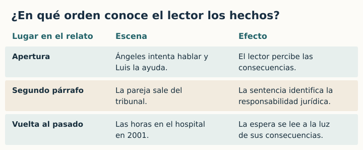

# ENS Rennes · D1 · Espagnol 2011 — Corrigé guidé

*Corrigé rédigé par IA, non officiel. Signalez toute erreur.*

**Rédaction** · GPT-6.2 Astra Ultra · vitesse non renseignée

Le feuillet de l’École normale supérieure de Cachan est conservé dans les archives du concours D1 de Rennes. D’après El País · 24 janvier 2011.

## Version française

**La vie brisée d’Ángeles**

Parfois, Luis termine les phrases de sa femme, Ángeles. Elle essaie, mais elle a du mal à se faire comprendre. Les verbes lui résistent. L’infinitif lui sert à parler aussi bien au présent qu’au passé. Heureusement, il y a le regard. « Parfois, la nuit, je rêve que j’arrive à marcher normalement, que je joue avec mon fils, que je vais à l’école et que je demande à son maître si ça va pour lui », dit-elle à sa manière, d’une voix hésitante et hachée. « Et maintenant… » Elle se montre du doigt, les yeux embués. « À quoi bon ? » Luis vient à son aide. « Ces médecins lui ont brisé la vie et ce n’est pas juste. »

C’est vendredi matin et ils viennent de quitter le tribunal correctionnel, munis du jugement qu’ils attendaient depuis neuf ans et demi. On y lit que les deux médecins qui ont soigné Ángeles à l’hôpital Gregorio Marañón ont commis un délit de blessures involontaires par imprudence grave. Le juge les condamne chacun à un an de prison.

Le 27 août 2001, elle avait 36 ans et un petit garçon de deux ans. C’était le soir et elle a commencé à se sentir mal. Elle n’avait plus de force dans le bras droit, elle avait des vertiges et mal à la tête. Une ambulance l’a conduite au Marañón et le psychiatre de garde l’a laissée rentrer chez elle avec du Lexatín et du paracétamol.

Le lendemain, la même chose, en pire. Ángeles perd connaissance, elle ne sent plus le côté droit de son corps et elle ne peut pas parler. Le médecin responsable n’est pas descendu l’examiner et n’a pas demandé le compte rendu de la veille.

Voilà presque vingt-quatre heures qu’Ángeles est à l’hôpital quand on finit par diagnostiquer un accident vasculaire cérébral qui évolue depuis de nombreuses heures, alors qu’il faut intervenir avant la sixième heure pour réduire ou éviter les séquelles. Pour Ángeles, il était trop tard. Elle ne le savait pas, mais ce 27 août, elle était enceinte. Il a fallu procéder à une interruption thérapeutique de grossesse.

## Expression en espagnol

Identifier le point de vue du journaliste et montrer comment il apparaît dans le texte à travers des exemples précis · au moins 100 mots.

El periodista adopta una perspectiva cercana a Ángeles y a su familia. La primera escena sitúa al lector ante una dificultad cotidiana que ninguna fórmula jurídica puede expresar por sí sola. Cuando Luis termina las frases de su mujer, vemos cuánto ha cambiado su relación. Los verbos que ella no consigue conjugar contrastan con la precisión de las fechas y de la condena en el párrafo siguiente. Después de conocer las consecuencias, volvemos a la noche del diagnóstico fallido. Así, cada hora de espera adquiere un peso distinto. El periodista atribuye el juicio penal al juez y deja a Luis la frase más acusadora. La selección de voces permite expresar compasión sin confundir el testimonio familiar con el contenido de la sentencia.

*122 mots, comptés par espaces.*

## Comment construire la réponse

Le pronom *le* dans l’ouverture dit à qui Luis rend service en terminant les phrases. L’entrée par le dialogue fait éprouver au lecteur la difficulté de communiquer avant toute qualification pénale. Le rapport demande de soigner cette première phrase. *Dar el alta* signifie autoriser la sortie de l’hôpital. Dans la dernière phrase complexe, le premier *cuando* situe le moment du diagnostic et le second fait entendre une opposition. La version traduit fidèlement l’explication médicale donnée par l’article de 2011.

La question porte sur le point de vue du journaliste. Le mot d’accusation le plus direct est prononcé par Luis. La peine est prononcée par le juge. Le journaliste agit par le choix de l’ouverture, de l’ordre du récit et des détails de langage. Pour une réponse de plus de cent mots, appuyez chacun de ces trois procédés sur un repère concret, puis dites quel effet il produit.

[Feuillet original, p. 4](https://www.ens-rennes.fr/medias/fichier/se1a_11d1_lve_1304088323768.pdf#page=4) · [Rapport du jury, partie écrite](https://www.ens-rennes.fr/medias/fichier/reo1a-11d1-esp_1421751252119-pdf#page=1)
