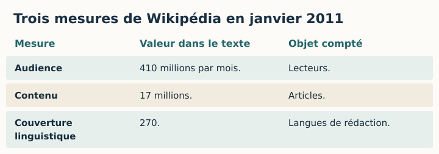

# ENS Rennes · D1 · Italien 2011 — Corrigé guidé

*Corrigé rédigé par IA, non officiel. Signalez toute erreur.*

**Rédaction** · GPT-6.2 Astra Ultra · vitesse non renseignée

Le feuillet de l’École normale supérieure de Cachan est conservé dans les archives du concours D1 de Rennes. Manuela Di Pasqua · Corriere della Sera · 14 janvier 2011.

## Version française

**Le 15 janvier, anniversaire de l’encyclopédie en ligne. 414 manifestations aux quatre coins de la planète**

Milan. Le 15 janvier 2011, Wikipédia fête ses dix ans. Le monde entier se prépare à une longue série de célébrations qui se tiendront aussi bien ce jour-là que tout au long de l’année. On fêtera le succès de l’encyclopédie collaborative, mais aussi, plus généralement, le libre accès au savoir, le plaisir de partager et l’appartenance au domaine public de tant d’œuvres de l’esprit humain. C’est pourquoi, en plus des toasts et des rassemblements prévus pour souffler les bougies lors de l’anniversaire officiel, d’autres festivités viendront peu à peu se greffer sur des manifestations consacrées au partage des connaissances.

Une fête à Milan, une autre à Vicence et une sortie commémorative aux Forums impériaux de Rome. Le tout au nom de l’un des anniversaires les plus célèbres de l’histoire d’Internet, celui des dix ans de Wikipédia. Fondée par Jimmy Wales en 2001, Wikipédia est devenue le cinquième site le plus visité au monde avec 410 millions de lecteurs par mois. L’encyclopédie compte aujourd’hui 17 millions d’articles rédigés dans 270 langues, et leur nombre ne cesse de croître. Mais elle s’enorgueillit surtout d’une première, ou plutôt d’une particularité unique. Cette encyclopédie en ligne, multilingue et à contenu libre est le seul des dix premiers sites mondiaux à être « créé, soutenu et entretenu par ses propres utilisateurs ». Il y a dix ans, le projet semblait merveilleux mais aussi visionnaire. Lorsque, dans le prolongement de Bomis, portail de recherche sur la musique pop créé au milieu des années quatre-vingt-dix par Jimmy Wales et Tim Shell, sont nées d’abord Nupedia, encyclopédie à contenu libre rédigée par des experts, puis Wikipédia, bien des gens n’auraient pas parié sur son succès. Le fait que, ces dernières années, des milliers de personnes aient contribué gratuitement et généreusement à cette idée de partage des connaissances, aussi utopique que séduisante, donne tort à ceux qui prédisaient un échec mémorable à la création de Wales.

## Expression en italien

Expliquer l’importance des réseaux sociaux dans sa propre vie · 100 mots.

Nella mia vita i social network contano soprattutto quando mi aiutano a fare qualcosa insieme ad altre persone. Per esempio, il gruppo della classe permette di organizzare un incontro e di mandare gli appunti a chi è rimasto a casa. Apprezzo anche la possibilità di seguire un museo lontano e di scoprire opere che altrimenti non conoscerei. Tuttavia, una notifica può interrompere una lettura importante. Quando studio preferisco chiudere le applicazioni e rispondere più tardi. Un messaggio permette di mantenere un legame a distanza, mentre una conversazione di persona mi offre tempo per capire meglio come sta il mio interlocutore.

*100 mots, comptés par espaces.*

## Comment construire la réponse

Gardez les chiffres tels que les donnait l’article en janvier 2011. Les 410 millions sont des lecteurs mensuels, les 17 millions des articles et les 270 des langues. *Anzi* rectifie le premier terme pour le préciser. L’autrice passe de l’idée d’un record à celle d’un mode de réalisation sans équivalent parmi les dix sites cités. *Tante opere dell’ingegno umano* demande « tant d’œuvres de l’esprit humain ».

Dans la longue période sur Bomis, repérez d’abord le sujet de *nacque*, puis la succession de Nupedia et de Wikipédia. Le rapport conseille de restituer tous les éléments de sens et d’adapter à la syntaxe française l’ordre du sujet et du verbe. La question d’expression porte sur une pratique personnelle des réseaux sociaux. Un récit à la première personne peut partir d’un groupe de classe, préciser le bénéfice qu’on en tire et expliquer une limite concrète.

[Feuillet original, p. 5](https://www.ens-rennes.fr/medias/fichier/se1a_11d1_lve_1304088323768.pdf#page=5) · [Rapport du jury, partie écrite](https://www.ens-rennes.fr/medias/fichier/re-11d1-italien_1421751228454-pdf#page=1)
