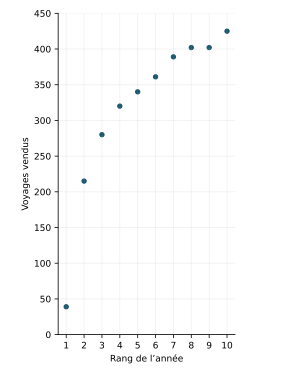
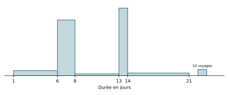
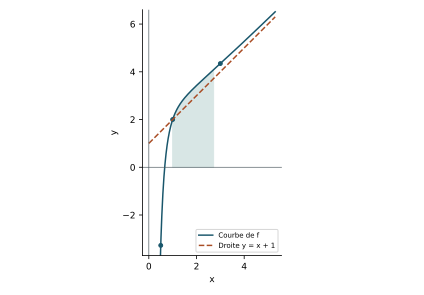

# ENS de Cachan D1 — Mathématiques appliquées et statistiques 2011 · Corrigé brut

*Corrigé rédigé par IA, non officiel. Signalez toute erreur.*

**Rédaction** · GPT-6.2 Astra Ultra · vitesse non renseignée

**Révision** · GPT-6.2 Astra Ultra · vitesse non renseignée

Les cinq exercices portent sur une agence de voyage, deux protocoles d’urnes, une courbe à asymptote oblique et un modèle normal. Les 372 voyages détaillés sont distingués des 425 annoncés dans le premier tableau.

## Exercice 1. L’agence de voyage

### Question 1.1.a

Associer successivement aux abscisses entières de 1 à 10 les ventes 39, 215, 280, 320, 340, 361, 389, 402, 402 et 425. La copie demande 1 cm par année et 2 cm pour 50 voyages.

### Question 1.1.b

Les rangs ont pour moyenne $5{,}50$ et variance $8{,}25$. Les ventes ont pour moyenne $\bar y=3173/10=317{,}30$ et variance $V_y=\sum y_i^2/10-\bar y^2=12\,282{,}81$.

### Question 1.1.c

La covariance est $C_{xy}=281{,}05$. On en déduit $r=C_{xy}/\sqrt{V_xV_y}\simeq0{,}88$. La croissance est nette mais le nuage se courbe fortement après la première année : l’ajustement affine direct est imparfait.

### Question 1.1.d

Les valeurs de $z_i=\exp(y_i/100)$ au centième sont les suivantes.

| Rang | 1 | 2 | 3 | 4 | 5 |
|---|---:|---:|---:|---:|---:|
| $z_i$ | 1,48 | 8,58 | 16,44 | 24,53 | 29,96 |
| Rang | 6 | 7 | 8 | 9 | 10 |
| $z_i$ | 36,97 | 48,91 | 55,70 | 55,70 | 70,11 |

### Question 1.1.e

$\bar z\simeq34{,}84$, $V_z\simeq458{,}74$ et $C_{xz}\simeq61{,}19$. Ainsi $r_{xz}\simeq0{,}99473$, soit $0{,}99$ au centième. L’ajustement affine de $z$ en $x$ est bien justifié.

### Question 1.1.f

La pente vaut $a=C_{xz}/V_x\simeq7{,}417509$ et l’ordonnée à l’origine $b=\bar z-a\bar x\simeq-5{,}957530$. Donc $z\simeq7{,}42x-5{,}96$.

### Question 1.1.g

La prévision est $\widehat y(x)=100\ln(ax+b)$ pour les rangs où $ax+b>0$.

### Question 1.1.h

Pour 2011, $x=11$. Les coefficients non arrondis donnent $\widehat y(11)\simeq432{,}59$, soit environ 433 voyages.

### Question 1.2.a

Pour les 372 voyages détaillés, les fréquences dans l’ordre du tableau sont 23,12 %, 6,18 %, 25,54 %, 16,67 %, 21,77 % et 6,72 %. L’Andalousie est le mode avec 95 voyages. Moyenne et médiane d’un nom de destination n’ont pas de sens.

### Question 1.2.b

La moyenne du tableau est $(86\times620+23\times560+95\times730+62\times680+81\times700+25\times620)/372\simeq671{,}80$ euros par personne. Le premier tableau annonçait 425 ventes pour 2010. Si ces effectifs sont tous exacts, 53 voyages restent sans prix documenté et la moyenne de l’ensemble des 425 n’est pas identifiable.

### Question 1.2.c

Le tableau ne livre que des moyennes par destination. La médiane, les quartiles, le mode et la variance des prix individuels ne sont donc pas déterminés. On peut décrire la dispersion **entre** destinations : les moyennes s’échelonnent de 560 à 730 euros et leur variance pondérée vaut environ $2622{,}83$ euros². La variance totale ajoute à ce nombre la moyenne pondérée des variances internes, inconnues.

Par exemple, deux ventes à 620 euros ont le même prix moyen qu’une vente à 600 euros et une autre à 640 euros. La variance de ces deux prix vaut respectivement 0 et 400 euros². Appliquer ce remplacement à deux des 86 voyages à destination du Maroc laisse intacte la moyenne du groupe et peut donc changer la dispersion individuelle sans modifier le tableau fourni.

### Question 1.3.a

La durée est un caractère quantitatif regroupé en classes d’inégales amplitudes. On la traite ici comme une durée continue mesurée en jours.

### Question 1.3.b

Les bases mesurent $5,2,5,1,7$ jours. Les hauteurs sont respectivement $8{,}20$, $89$, $3$, $108$, $30/7\simeq4{,}29$ voyages par jour de largeur. Les aires des rectangles restituent les effectifs.

### Question 1.3.c

La classe modale est $[13,14[$. Sa hauteur 108 dépasse 89 pour $[6,8[$, malgré l’effectif brut plus élevé de cette dernière classe.

## Exercice 2. Couleurs dans une urne

### Question 2.1.a

La remise maintient la probabilité de rouge à $4/9$ et les douze tirages sont indépendants. Donc $X\sim\mathcal B(12,4/9)$, $\mathbb EX=12(4/9)=16/3$ et $V(X)=12(4/9)(5/9)=80/27$.

### Question 2.1.b.i

La première rouge peut occuper tout rang de 1 à 12 et le code 0 correspond à son absence. Ainsi $Y$ prend les valeurs entières de 0 à 12.

### Question 2.1.b.ii

$Y=0$ signifie qu’aucune rouge n’apparaît. Par indépendance, $P(Y=0)=(5/9)^{12}$.

### Question 2.1.b.iii

$Y=5$ impose quatre boules non rouges puis une rouge. Le résultat des sept derniers tirages est libre, donc $P(Y=5)=(5/9)^4(4/9)$.

### Question 2.2.a

Les tirages unicolores ont probabilité $(4^3+3^3+2^3)/9^3=11/81$. Pour trois couleurs, il y a $3!$ ordres possibles des couleurs, de probabilité commune $(4/9)(3/9)(2/9)$. D’où $P(\text{tricolore})=16/81$.

### Question 2.2.b

Le nombre total est $\binom93=84$. Les triples de même couleur sont au nombre de $\binom43+\binom33=5$. Les triples tricolores sont au nombre de $4\cdot3\cdot2=24$. Ainsi $P(\text{unicolore})=5/84$ et $P(\text{bicolore})=(84-5-24)/84=55/84$.

## Exercice 3. Trois urnes conditionnées

### Question 3.1

Notons $B_i$ la sortie d’une blanche dans l’urne $i$, et $N_i$ celle d’une noire. Si $B_1$ survient (probabilité $1/2$), l’urne 2 reste entièrement blanche et l’urne 3 contient une blanche et deux noires. Les trois blanches ont donc probabilité $(1/2)\cdot1\cdot(1/3)=1/6$.

### Question 3.2

Sous $N_1$, l’urne 2 contient deux blanches et une noire. Sous $B_1$, elle contient deux blanches. Ainsi $P(B_2)=(1/2)(2/3)+(1/2)\cdot1=5/6$. La formule de Bayes donne $P(N_1\mid B_2)=[(1/2)(2/3)]/(5/6)=2/5$.

## Exercice 4. Asymptote oblique et aire

### Question 4.A.1

On a $P(1)=0$. En développant, $P(x)=(x-1)(3x^2+3x+2)$, donc $a=3,b=3,c=2$.

### Question 4.A.2

Son discriminant est $9-24=-15<0$ et sa dominante est positive. Ainsi $P$ est négatif pour $x<1$, nul pour $x=1$ et positif pour $x>1$.

### Question 4.A.3

Pour $x>0$, les termes de $g$ sont dérivables, et $g'(x)=3x^2-1-2/x=(3x^3-x-2)/x=P(x)/x$.

### Question 4.A.4

$g$ décroît strictement de $+\infty$ à $g(1)=3$ sur $]0,1]$, puis croît strictement vers $+\infty$ sur $[1,+\infty[$. En zéro, $-2\ln x$ tend vers $+\infty$, et en l’infini le cube domine.

### Question 4.A.5

Pour tout $x>0$, $g(x)\ge3>0$.

### Question 4.B.1

En $0^+$, $x-1+\ln x\to-\infty$ et $x^2\to0^+$, tandis que $x+1\to1$. Ainsi $f(x)\to-\infty$ et l’axe $x=0$ est asymptote verticale.

### Question 4.B.2.a

En $+\infty$, $(x-1+\ln x)/x^2\to0$ puisque chacun des trois termes après division tend vers zéro. Par conséquent $f(x)\to+\infty$.

### Question 4.B.2.b

Le calcul précédent donne $f(x)-(x+1)\to0$ lorsque $x\to+\infty$. La droite $\Delta$ d’équation $y=x+1$ est asymptote oblique.

### Question 4.B.2.c

Pour $x\ge1$, $x-1\ge0$ et $\ln x\ge0$. La courbe est sur ou au-dessus de $\Delta$ et l’égalité n’a lieu qu’en $x=1$.

### Question 4.B.3

Pour $x>0$, $f'(x)=1+(1+1/x)/x^2-2(x-1+\ln x)/x^3$. Le numérateur commun est $x^3+x+1-2x+2-2\ln x=g(x)$, donc $f'(x)=g(x)/x^3$.

### Question 4.B.4

$g(x)>0$ et $x^3>0$, donc $f$ est strictement croissante sur $]0,+\infty[$, de $-\infty$ à $+\infty$.

### Question 4.B.5

Tracer dans un repère orthonormé la droite $y=x+1$, le point commun $(1,2)$ et les points approximatifs $(0{,}5,-3{,}3)$ et $(3,4{,}3)$. La branche part vers $-\infty$ au voisinage de l’axe vertical, puis s’approche de la droite par-dessus à droite.

### Question 4.B.6.a

$H'(x)=(\ln x)/x^2+(1-1/x)/x=(x-1+\ln x)/x^2$ pour $x>0$.

### Question 4.B.6.b

Une primitive de $f$ est $F(x)=x^2/2+x+H(x)$ sur $]0,+\infty[$.

### Question 4.B.6.c

On a $H(e)=1-1/e$ et $H(1)=0$, donc $I=\int_1^e f(x)\,dx=e^2/2+e-1/2-1/e\simeq5{,}54493$. La fonction est positive sur cet intervalle, puisque $f(1)=2$ et qu’elle croît. Une unité valant 2 cm sur les deux axes, l’aire est $4I\simeq22{,}18$ cm².

On peut vérifier la surface en la partageant par l’asymptote $y=x+1$. Entre 1 et $e$, l’aire sous cette droite vaut $\int_1^e(x+1)\,dx=e^2/2+e-3/2$. L’aire comprise entre la droite et la courbe vaut $H(e)-H(1)=1-1/e$. Leur somme vaut bien $I$. Le seul écart à l’asymptote ne donnerait donc qu’une partie du domaine demandé.

## Exercice 5. Distribution normale dans une population

### Question 5.1

Si $M\sim\mathcal N(70,5^2)$, alors $(M-70)/5$ est normale centrée réduite. Ainsi $P(M>75)=1-\Phi(1)\simeq0{,}1587$.

### Question 5.2

$P(63\le M\le75)=\Phi(1)-\Phi(-1{,}4)\simeq0{,}76059$. Le pourcentage est d’environ $76{,}06\,\%$.

### Question 5.3

Dans la population entière, $P(M>80)=1-\Phi(2)\simeq2{,}28\,\%$. Le sous-groupe des personnes malades présente une proportion de 2,3 %, compatible avec cette valeur arrondie. À ce seuil les chiffres ne montrent pas d’association mesurable. Cette comparaison seule ne permet de conclure à aucune causalité, dans un sens ou dans l’autre.
