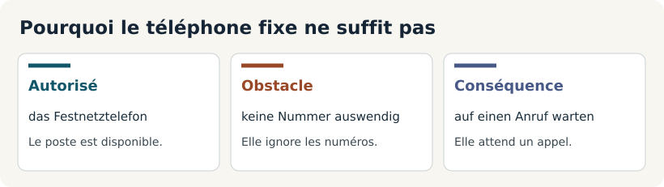

# ENS MP-PC — Allemand (langue étrangère B) 2011 · Corrigé guidé

*Corrigé rédigé par IA, non officiel. Signalez toute erreur.*

**Rédaction** · GPT-6.2 Astra Ultra · vitesse non renseignée

Deux heures. Version 15 points, question 5 points. Dictionnaire et calculatrice interdits pour l’allemand.

Meike Fries, ZEIT.de, 7 janvier 2011, texte abrégé, « Digitale Askese: Einsam ohne Handy und Internet ». [Cahier](https://banques-ecoles.fr/cms/wp-content/data/filiere-pc/annales-de-la-banque-pc/session-2011/2011%20Langue%20E-B.pdf#page=2)

## I. Version — 15 points

**Ascèse numérique. Seul sans portable ni Internet**

À première vue, l’expérience n’a rien de particulièrement audacieux. Pendant à peine vingt-quatre heures, des étudiants doivent renoncer aux médias qu’ils ont l’habitude d’utiliser. Ni téléphone portable, ni accès à Internet, ni radio, ni télévision, pas même de journaux. Le baladeur MP3 leur est lui aussi interdit pendant vingt-quatre heures. Pour que l’épreuve ne soit tout de même pas trop rude, ils ont le droit de se servir du téléphone fixe.

Les chercheurs de l’université du Maryland et de la Salzburg Academy on Media and Global Change espèrent ainsi découvrir si la jeune génération est dépendante des médias et, dans l’affirmative, à quel point. Ils veulent aussi savoir comment les jeunes organisent leur journée lorsqu’ils doivent se passer de leurs moyens habituels d’information et de communication.

Des étudiants d’Europe, d’Asie, d’Afrique et d’Amérique du Nord et du Sud participent au projet. On peut déjà lire le récit de ce qu’ont enduré les étudiants britanniques au cours de ces vingt-quatre heures sans médias.

Les témoignages concordent. Beaucoup ont trouvé ces vingt-quatre heures « incroyablement difficiles », « ennuyeuses », « frustrantes », ou ont parlé de « solitude ». Un étudiant a même écrit : « La pire journée depuis que je suis à la fac. La solitude m’enveloppe. »

Les étudiants avaient certes le droit d’utiliser le téléphone fixe, mais pour certains, cela ne changeait rien. Une étudiante a expliqué qu’elle avait attendu désespérément que quelqu’un l’appelle. Elle-même n’avait pu appeler personne, car elle ne connaissait pas un seul numéro de téléphone par cœur.

Cette ascèse numérique a toutefois permis à certains participants de faire d’heureuses découvertes sur eux-mêmes. « Me passer des médias a fait de moi quelqu’un de meilleur. J’ai dû sortir, regarder le monde autour de moi et prendre vraiment part aux conversations », a raconté avec enthousiasme l’un des participants.

> [!INDICATION]
> Séparez le protocole de ce qu’on en apprend. *Sollen … verzichten* indique la consigne des chercheurs et *dürfen* l’exception qu’ils autorisent. Internet, portable, baladeur, radio, télévision et presse sont suspendus. Le fixe reste disponible. L’étudiante qui attend qu’on l’appelle illustre ainsi une dépendance à la mémoire du portable et au carnet d’adresses numérique, même lorsque la communication vocale reste possible. *Ob, und wenn ja, wie abhängig* ouvre deux questions successives, celle de l’existence d’une dépendance puis celle de son degré.

> [!INDICATION]
> Les participants viennent de plusieurs continents, mais les témoignages déjà accessibles sont ceux des Britanniques. Une traduction de *bei einigen* par « pour tous » changerait ensuite l’échelle de l’observation. Dans le dernier paragraphe, *sich an Gesprächen beteiligen* signifie participer activement aux échanges. Ce retour à autrui donne un sens précis à l’amélioration qu’un étudiant dit avoir éprouvée.

## II. Question — 5 points

> [!INDICATION]
> La question personnelle comporte deux demandes. Montrez votre propre degré de dépendance par un signe observable, puis organisez une journée qui éprouverait votre diagnostic. La copie distingue l’outil d’orientation du divertissement. Elle emploie le présent pour l’habitude et *würde*, *könnte* ou *ließe sich* lorsqu’elle imagine la journée. Vérifiez en conclusion que l’activité choisie ne réintroduit aucun des médias suspendus et que le texte atteint le minimum de cent mots.

Wie abhängig ich von Medien bin, merke ich besonders dann, wenn mein Handy noch zu Hause liegt und ich schon im Bus sitze. Dass ich keine Musik hören kann, stört mich kaum. Viel unangenehmer ist es, wenn ich die Adresse eines Freundes nur im Chat gespeichert habe. Eine praktische Gewohnheit kann mich also stärker einschränken als die Lust auf Unterhaltung.

Für einen Tag ohne Medien würde ich am Vorabend mit meiner Schwester eine Wanderung verabreden. Wir würden Treffpunkt und Rückkehrzeit festlegen und uns eine Karte aus Papier besorgen. Am Nachmittag könnte ich beim Nachbarn vorbeigehen, statt ihm aus Bequemlichkeit eine Nachricht zu schicken. Am meisten würde mir unterwegs wohl fehlen, dass ich jede kleine Frage sofort nachschlagen kann. Einige Fragen könnte ich mir bis zum nächsten Tag merken. Andere ließen sich vermutlich lösen, indem ich jemanden frage, der neben mir steht.

*141 mots. Minimum demandé : 100.*
