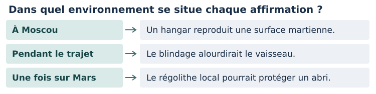
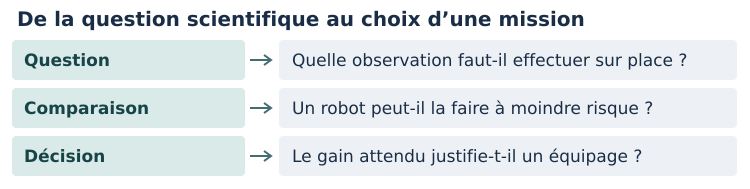

# ENS · MP-PC · Anglais (langue étrangère B) 2011 — Corrigé brut

*Corrigé rédigé par IA, non officiel. Signalez toute erreur.*

**Rédaction** · GPT-6.2 Astra Ultra · vitesse non renseignée

Épreuve UC commune aux ENS de Paris et de Cachan, deux heures, sans dictionnaire pour l’anglais et sans calculatrice. La page 3 comporte une version sur 15 points et une question en anglais sur 5 points. Elle ne fixe aucune longueur pour la réponse.

## I. Version — Pourquoi mieux vaut éviter de tomber enceinte en route pour Mars

Aujourd’hui a marqué un tournant pour l’Agence spatiale européenne et pour l’équipage de sa mission la plus insolite à ce jour. À dix heures, heure britannique, trois hommes en combinaison spatiale ont franchi tant bien que mal un sas et, pour la première fois, posé le pied sur une étendue de sable rouge jonchée de rochers. On se serait un peu cru sur Mars. Pourtant, ce sol d’un autre monde n’était qu’un bout de terrain de la taille d’un court de tennis, dans un hangar de Moscou.

La mission Mars500 en est à mi-parcours. Elle simule avec un grand luxe de détails un voyage aller-retour vers la planète rouge. Grâce à cette mission, […] les scientifiques espèrent savoir comment les voyageurs de l’espace, eh bien, se tireront du voyage quand on les enfermera à l’étroit pour les expédier vers Mars pour de bon. Ayez une pensée pour les membres de l’équipage. Les voilà enfermés pendant 520 jours dans une maquette de vaisseau spatial, avec pour seule compagnie celle de leurs camarades. […]

L’étude menée par Tore Straume, responsable des sciences de la vie au centre de recherche Ames de la NASA, en Californie, a porté sur les effets des rayonnements sur le cerveau, sur l’organisme et sur la grossesse. Pour résumer leurs conclusions à gros traits, si les rapports sexuels en route pour Mars ne sont pas en cause, y avoir des enfants semble peu recommandable.

Le problème qui a retenu l’attention de Straume et de ses collègues est celui du rayonnement cosmique. Privés de la protection du champ magnétique terrestre, les voyageurs de l’espace baigneraient dans un rayonnement intense pendant le trajet jusqu’à Mars, qui prendrait huit mois avec les techniques actuelles. Ces particules de haute énergie brisent l’ADN et feraient probablement augmenter la fréquence des cancers. D’après les chercheurs, le rayonnement pourrait aussi causer des dommages génétiques tels que les enfants naîtraient stériles. Seule lueur d’espoir, il y a sur la planète suffisamment de régolithe, autrement dit de terre martienne, pour construire des abris contre les rayonnements dès l’arrivée.

« Sur Mars, on devrait pouvoir protéger le fœtus en utilisant le régolithe disponible comme matériau de blindage. Pendant le trajet, en revanche, il serait difficile d’assurer le degré de protection nécessaire », écrivent les auteurs. L’une des difficultés tient à la densité et au poids des matériaux de blindage. Tout vaisseau conçu pour protéger son équipage des rayonnements aurait bien du mal à décoller.

*D’après Ian Sample, The Guardian, 14 février 2011.*

## II. En quoi des voyages vers d’autres planètes peuvent-ils servir l’humanité ?

A voyage to another planet can be useful to people who will never leave Earth. One good reason to go is to answer a question that cannot be settled here. A sample taken from a particular layer of Martian rock may tell us whether water once flowed there. A geologist on the spot could change the sampling plan after noticing something unexpected. That ability to change one's mind has scientific value.

Yet the example also gives us a test for deciding when to send people. If a rover can collect the same evidence, the case for exposing a crew to radiation becomes much weaker. Even a well protected crew would need food, medical care and a way of communicating with Earth. The cost matters to the other researchers whose experiments might lose funding.

I would support a human mission when its organisers can explain what people could discover that machines are unlikely to find, and how the crew's safety will be assessed. Meanwhile a simulation like the one in Moscow can already teach us how people work together in prolonged isolation. Some of the benefits of travelling to Mars can begin before anyone sets foot there.

Aucun rapport propre à cet écrit d’anglais B de 2011 n’a été identifié dans les sources consultées.

[Composition de langue étrangère B](https://banques-ecoles.fr/cms/wp-content/data/filiere-pc/annales-de-la-banque-pc/session-2011/2011%20Langue%20E-B.pdf#page=3)
