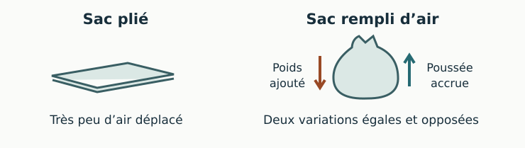

# ENS · MP-PC · Chinois (langue étrangère B) 2011 — Corrigé brut

*Corrigé rédigé par IA, non officiel. Signalez toute erreur.*

**Rédaction** · GPT-6.2 Astra Ultra · vitesse non renseignée

L’épreuve de langue étrangère B est commune aux ENS de Paris et de Cachan (UC). Elle dure deux heures. La version vaut 15 points et la rédaction 5 points. Pour le chinois, la garde autorise un ou plusieurs dictionnaires bilingues ou unilingues et interdit la calculatrice.

## 1. Version française

Prenons deux sacs en plastique identiques. L’un est plié, l’autre est rempli d’air. Lequel des deux pèse le plus lourd ? Si vous pensez que le sac plein d’air est le plus lourd, vous vous trompez.

Un sac en plastique rempli d’air devrait, semble-t-il, peser un peu plus lourd. Mais n’oublions pas qu’il déplace en même temps un volume d’air égal à celui qu’il contient. Le supplément de poids dû à l’air qu’on y a enfermé est exactement compensé par la poussée que lui imprime l’air déplacé. Les deux effets s’annulent, et il reste le poids d’un sac en plastique. Quant au sac plié, il ne contient pas d’air qui viendrait en augmenter le poids. Mais comme il ne déplace guère d’air, la poussée qu’il subit est elle aussi très faible. Là encore, il reste le poids d’un sac en plastique. Les deux sacs pèsent donc aussi lourd l’un que l’autre.

## 2. Rédaction en chinois

小时候，每逢暴雨，住在河边的外婆总要把米袋搬到楼上。有一次，广播提前通知大家河水会在夜里上涨。邻居们有时间去接老人，连平常行动最慢的王爷爷也赶在天黑以前到了学校的礼堂。那天我第一次明白，科学的用处，有时就是让人早几个小时作出决定。

后来我才知道，这几个小时来自许多人多年的工作。有人天天测量水位，有人比较雨量，还有人把可能出错的地方写进预报。可是一张准确的图如果只挂在办公室里，河边的人照样得不到帮助。村里的老师特意把预报画成人人看得懂的路线图，又带孩子走了一遍。从那以后，我们都知道该往哪里去，也知道为什么要走。

科学给我们观察和判断的办法。至于先去接谁，怎样让听不见广播的人也得到消息，还得由我们彼此商量。肯为别人多想一步，知识才能真正派上用场。

Le rapport de jury propre à cet écrit n’a pas été retrouvé. [Index des écrits de 2011](https://www.ens.psl.eu/rapports-et-sujets-2011-pc)

[Cahier de langue B, p. 5](https://banques-ecoles.fr/cms/wp-content/data/filiere-pc/annales-de-la-banque-pc/session-2011/2011%20Langue%20E-B.pdf#page=5)
