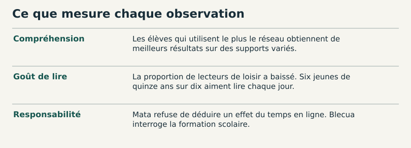

# ENS MP-PC — Espagnol (langue étrangère B) 2011 · Corrigé guidé

*Corrigé rédigé par IA, non officiel. Signalez toute erreur.*

**Rédaction** · GPT-6.2 Astra Ultra · vitesse non renseignée

Le cahier commun aux ENS de Paris et de Cachan (UC) fixe deux heures, sans dictionnaire pour l’espagnol. La version vaut 15 points et la réponse en espagnol, de 100 mots au minimum, 5 points. Aucun rapport propre à cette option n’a été identifié dans les archives consultées.

## 1. Version (15 points)

> [!INDICATION]
> Le titre généralise. Le premier paragraphe réduit ensuite la portée de l’observation. *Los que más usan* désigne les élèves qui se connectent le plus souvent ; *más favorecidas* qualifie les familles. Le mot *aunque* introduit deux précisions solidaires : variété des supports et influence possible du milieu.

**Les internautes lisent mieux**

Un rapport révèle que les élèves qui utilisent le plus Internet acquièrent une meilleure compréhension de l’écrit. Il faut toutefois préciser que l’épreuve évalue cette aptitude sur des textes très divers, depuis des extraits de romans ou de contes, des passages de textes journalistiques ou historiques, jusqu’à des graphiques, des tableaux ou des factures, et que les meilleurs résultats sont ceux des enfants issus des milieux les plus favorisés sur le plan socio-économique. Ce rapport ne permet toutefois pas d’affirmer que le passage à l’ère numérique nuise aux capacités de lecture des jeunes, prises au sens large.

Au cours de la dernière décennie, la proportion de filles et de garçons de quinze ans qui lisent pour le plaisir a diminué. Pour Juan Mata, professeur à la faculté des sciences de l’éducation de l’université de Grenade, « ce qui est étrange, c’est que personne ne songe à retourner la question et à se demander s’il n’est pas surprenant que 60 % des jeunes de quinze ans aiment lire tous les jours pour le plaisir ». Il ajoute que « rien ne semble prouver scientifiquement que le temps passé à naviguer sur Internet ou à discuter en ligne avec ses amis soit pris sur la lecture de loisir ».

Chez José Manuel Blecua, directeur de l’Académie royale espagnole, l’inquiétude ne semble pas non plus porter sur les textos ou les discussions en ligne. Ce qui le préoccupe, c’est « l’échec de l’enseignement primaire et secondaire », car « il n’existe pas de programmes adaptés de formation linguistique, et la priorité est d’apprendre aux élèves à lire, à écrire et à parler ».

*D’après elpais.com, 3 janvier 2011.*

> [!INDICATION]
> Mata fait entendre deux propositions compatibles. La pratique a reculé, et le chiffre restant peut surprendre par son ampleur. *A diario* précise la fréquence et *por placer* la motivation. Garder « semble » dans la deuxième citation évite de transformer l’absence de preuve d’un effet en preuve de son absence. *Tampoco* rapproche les deux spécialistes, mais c’est Blecua qui porte le jugement sur l’école.

## 2. Question (5 points) — L’école et le goût de lire

> [!INDICATION]
> La question porte sur la *afición*, le goût de lire. Une meilleure performance à un test ne garantit pas que l’élève aura envie d’ouvrir un livre le dimanche. On peut partir d’un geste scolaire qui décourage, proposer une modification concrète puis examiner un facteur extérieur à la classe.

Creo que la escuela tiene una parte de responsabilidad en la pérdida del gusto por la lectura. Cuando a cada novela le sigue un examen sobre nombres y fechas, el alumno aprende a buscar datos que pueda repetir. Es comprensible que, al volver a casa, prefiera una actividad en la que pueda equivocarse sin que nadie lo califique. Un profesor que reserve unos minutos para que dos lectores expliquen por qué un mismo final les ha gustado o decepcionado ya ofrece otra experiencia del libro.

Ahora bien, para seguir leyendo por cuenta propia también hacen falta tiempo y acceso a los libros. Dos compañeros de clase pueden tener oportunidades muy distintas de encontrar algo que les interese. Una biblioteca abierta después de las clases y la posibilidad de llevarse un libro elegido libremente permitirían a la escuela actuar incluso sobre esa desigualdad.

[Cahier, p. 6](https://banques-ecoles.fr/cms/wp-content/data/filiere-pc/annales-de-la-banque-pc/session-2011/2011%20Langue%20E-B.pdf#page=6)
