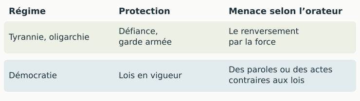

# ENS · MP-PC · Grec (langue étrangère B) 2011 — Corrigé brut

*Corrigé rédigé par IA, non officiel. Signalez toute erreur.*

**Rédaction** · GPT-6.2 Astra Ultra · vitesse non renseignée

L’épreuve de langue étrangère B est commune aux ENS de Paris et de Cachan (garde UC). Elle dure deux heures. Un ou plusieurs dictionnaires bilingues ou unilingues sont autorisés pour cette option. La calculatrice est interdite. La garde prévoit une éventuelle question en plus de la version. La page 11 demande uniquement la version française.

Eschine, Contre Timarque, extraits des paragraphes 4 et 5. La page 11 donne le nom de l’auteur et l’intitulé « Les trois formes de gouvernement ».

## Version française

Car on reconnaît partout qu’il existe chez tous les peuples trois formes de gouvernement, la tyrannie, l’oligarchie et la démocratie. Les tyrannies et les oligarchies sont gouvernées selon le caractère de ceux qui les dirigent, tandis que les cités démocratiques le sont selon les lois en vigueur.

Or vous le savez bien, Athéniens, ce sont les lois qui sauvegardent la personne de ceux qui vivent en démocratie ainsi que leur régime politique. Pour les tyrans et les oligarques, ce qui leur assure pareille sauvegarde, c’est la défiance et la protection d’une garde armée.

Aussi les oligarques et tous ceux qui gouvernent sous un régime fondé sur l’inégalité doivent-ils se garder de ceux qui renversent les régimes par la loi du plus fort. Quant à vous, qui avez un régime fondé sur l’égalité et régi par la loi, vous devez vous garder de ceux qui prennent la parole au mépris des lois ou qui ont mené leur vie en les enfreignant.

Le rapport propre à cet écrit n’a pas été retrouvé. [Index des écrits MPI de 2011](https://www.ens.psl.eu/rapports-et-sujets-2011-mpi)

[Cahier officiel, p. 11](https://banques-ecoles.fr/cms/wp-content/data/filiere-pc/annales-de-la-banque-pc/session-2011/2011%20Langue%20E-B.pdf#page=11) · [Édition du discours, §§ 4–5](https://resources.warburg.sas.ac.uk/pdf/hkh595b2478223.pdf)
