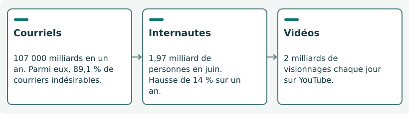

# ENS · MP-PC · Italien (langue étrangère B) 2011 — Corrigé brut

*Corrigé rédigé par IA, non officiel. Signalez toute erreur.*

**Rédaction** · GPT-6.2 Astra Ultra · vitesse non renseignée

Épreuve commune aux ENS de Paris et de Cachan. Durée de deux heures, sans dictionnaire. La version compte pour 15 points et la question pour 5 points.

## 1. Version. En 2010, 107 000 milliards de courriels envoyés, presque tous indésirables

Combien de courriels a-t-on envoyés en 2010 ? Combien d’utilisateurs sont inscrits sur Facebook ? Ou encore, combien de vidéos a-t-on regardées sur YouTube ? La société suédoise Royal Pingdom a tenté de répondre à ces questions. En étudiant l’évolution des principaux indicateurs du monde d’Internet au cours de l’année écoulée, ses analystes sont tombés sur des chiffres qui n’en finissent plus d’aligner les zéros. Un exemple ? En 2010, on a envoyé en tout 107 000 milliards de courriels, dont 89,1 % étaient des pourriels.

Tout le monde, ou presque, veut suivre Lady Gaga. Avec 7,7 millions d’abonnés, des *followers* dans le jargon, la chanteuse pop (@ladygaga) a été la personnalité la plus aimée de Twitter en 2010. Fin septembre, Twitter comptait 175 millions de membres, dont 100 millions s’étaient inscrits rien qu’en 2010. Au total, 25 milliards de messages ont été échangés. Des données qui donnent le vertige, en somme. Elles viennent d’être rassemblées et publiées dans le rapport 2010 de Pingdom, société de conseil qui compte parmi ses clients des acteurs majeurs du Web tels que Microsoft, Amazon ou encore Twitter. Enfin, les chiffres astronomiques du courrier électronique frappent les esprits. En l’espace de 365 jours, 107 000 milliards de courriels ont été envoyés dans le monde. Nous parlons d’un nombre à douze zéros après 107, soit 107 000 000 000 000. Ces estimations sont parmi les plus précises dont on dispose. Toujours est-il que la quasi-totalité de ces envois, soit 89,1 %, était du courrier indésirable.

Pour les amateurs de grands nombres, voici comment la Toile a grandi au cours des douze derniers mois. En juin, la population en ligne comptait 1,97 milliard de personnes, soit 14 % de plus que l’année précédente. Tous les internautes n’ont pas pour autant un compte de messagerie. Seuls 1,88 milliard d’utilisateurs sont joignables par courrier électronique. Il y a 255 millions de sites actifs sur le Web, dont 21,4 millions ont vu le jour en 2010. Quant aux blogs, on en compte 152 millions. Et sur la plateforme YouTube, deux milliards de vidéos ont été regardées chaque jour.

*Elmar Burchia, Corriere della Sera, 19 janvier 2011.*

## 2. Quelle place Internet occupe-t-il dans ta vie ?

Internet conta molto nella mia giornata soprattutto perché mi permette di mantenere rapporti che altrimenti diventerebbero fragili. Mio cugino vive lontano e la domenica ci colleghiamo per cucinare insieme. Lui mi mostra la consistenza dell’impasto e io gli faccio vedere come preparo il ripieno. Una ricetta trovata con un motore di ricerca non mi darebbe la stessa occasione di ascoltarlo.

Uso la rete anche per studiare. Se due spiegazioni di un fenomeno si contraddicono, provo a risalire alla fonte e ne parlo con un compagno. Mi accorgo però che a volte apro il telefono per cercare un orario e dieci minuti dopo sto ancora guardando video che non avevo scelto. Per questo, quando lavoro a un problema difficile, lascio il telefono in un’altra stanza. Il criterio che seguo è semplice. Alla fine della serata voglio ricordare con chi ho parlato o che cosa ho imparato, oltre al tempo che ho passato davanti allo schermo.

[Composition de langue étrangère B](https://banques-ecoles.fr/cms/wp-content/data/filiere-pc/annales-de-la-banque-pc/session-2011/2011%20Langue%20E-B.pdf#page=7)
