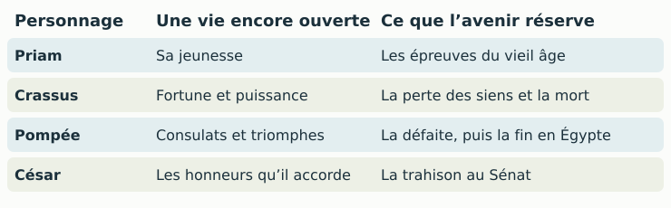

# ENS · MP-PC · Latin (langue étrangère B) 2011 — Corrigé brut

*Corrigé rédigé par IA, non officiel. Signalez toute erreur.*

**Rédaction** · GPT-6.2 Astra Ultra · vitesse non renseignée

L’épreuve de langue étrangère B est commune aux ENS de Paris et de Cachan (garde UC). Elle dure deux heures. Un ou plusieurs dictionnaires bilingues ou unilingues sont autorisés pour cette option. La calculatrice est interdite. La garde prévoit une éventuelle question en plus de la version. La page 12 demande uniquement la version française.

Cicéron, De la divination, livre II, chapitre IX, §§ 22–23. La page 12 abrège et adapte le passage, notamment la question finale sur César.

## Version française

Pour ma part, je ne crois même pas qu’il nous soit utile de connaître l’avenir. Quelle vie, en effet, aurait été celle de Priam s’il avait su dès sa jeunesse ce qui l’attendait dans sa vieillesse ? Laissons là les légendes et regardons des événements plus proches de nous.

Penses-tu qu’il aurait été utile à Marcus Crassus, au temps où il était au faîte de la puissance et de la fortune, de savoir qu’après la mort violente de son fils et l’anéantissement de son armée, il lui faudrait périr au-delà de l’Euphrate, dans la honte et le déshonneur ?

Ou bien crois-tu que Cnéus Pompée aurait goûté la joie de ses trois consulats, de ses trois triomphes et de la gloire de ses immenses exploits, s’il avait su qu’après avoir perdu son armée, il serait assassiné en Égypte et qu’après sa mort suivraient des événements dont nous ne pouvons parler sans verser de larmes ?

Et César, s’il avait prévu qu’il serait assassiné en plein Sénat par des citoyens de la plus haute noblesse, dont certains avaient même reçu de lui toutes sortes de distinctions, dans quel tourment aurait-il passé sa vie ?

Le rapport propre à cet écrit n’a pas été retrouvé. [Index des écrits MPI de 2011](https://www.ens.psl.eu/rapports-et-sujets-2011-mpi)

[Cahier officiel, p. 12](https://banques-ecoles.fr/cms/wp-content/data/filiere-pc/annales-de-la-banque-pc/session-2011/2011%20Langue%20E-B.pdf#page=12) · [Texte latin de référence, II, 9](https://www.lateinlex.de/?call=Puc&permalink=Cic_philos_div_2_9)
