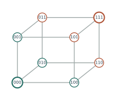
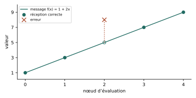
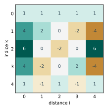

# ENS MP · Informatique-mathématiques 2011 · Corrigé guidé

*Corrigé rédigé par IA, non officiel. Signalez toute erreur.*

**Rédaction** · GPT-6.2 Astra Ultra · vitesse non renseignée · 25 novembre 2026

**Révision** · GPT-6.2 Astra Ultra · vitesse non renseignée

**Autour des codes correcteurs.** Le cahier ULC comporte trente questions. On suit la convention $\deg 0=-\infty$. Le rayon de correction est entier. Pour la dernière partie, le domaine des indices de trois identités de la question 4.1 est précisé et les extensions impossibles sont examinées.

La banque identifie cette composition par « Écrit Info-Math ULC ». Le calendrier de l’ENS la fixe au vendredi 13 mai 2011, de 8 h à 12 h, pour le concours INFO. Le corrigé s’appuie sur le sujet. Le sommaire des rapports de cette session identifie séparément l’épreuve de TIPE informatique. [Fac-similé du sujet](https://banques-ecoles.fr/cms/wp-content/data/filiere-mp/annales-de-la-banque-i/session-2011/2011%20Info_Maths.pdf) · [Sommaire](https://banques-ecoles.fr/cms/filiere-mp/les-annales-et-rapports-des-jurys/) · [Sommaire des rapports](https://banques-ecoles.fr/cms/filiere-mp/rapports-des-jurys-de-la-banque-i/session-2011) · [Calendrier ENS](https://www.ens.psl.eu/IMG/file/concours/INFO%20et%20MPI%202011.pdf)

## Repères

Les parties I et IV utilisent un alphabet fini, tandis que les deux décodeurs intermédiaires opèrent sur les réels ou les complexes. Dans la partie II, séparer les racines qui localisent les erreurs du polynôme qui porte le message. Dans la partie IV, une même quantité se calcule tantôt à partir des distances, tantôt à partir des coefficients d’un polynôme.

## I. Codes correcteurs

### Question 1.1 · Distance de Hamming

**Indication.** Écrire la distance comme somme de fonctions indicatrices. Quelle inégalité est vraie à chaque position ?

#### Solution

Pour $x,y\in A^n$, on a $\delta_H(x,y)=\sum_{j=1}^n\mathbf1_{x_j\ne y_j}$. Cette somme est positive ou nulle, symétrique et nulle exactement lorsque les $n$ coordonnées coïncident. Si $x_j\ne z_j$, l'une au moins des inégalités $x_j\ne y_j$, $y_j\ne z_j$ est vraie. En sommant les inégalités entre indicatrices, on obtient $\delta_H(x,z)\le\delta_H(x,y)+\delta_H(y,z)$.

### Question 1.2 · Existence du minimum

**Indication.** L'alphabet peut être infini. Examiner l'ensemble des valeurs du nombre de désaccords.

#### Solution

Le code contient au moins deux mots distincts. Leurs distances forment donc une partie non vide de l'ensemble fini $\{1,\ldots,n\}$. Son minimum existe et appartient à cet ensemble, même lorsque le code est infini.

### Question 1.3 · Unicité au décodage

**Indication.** Si deux mots expliquent la même réception, quelle longueur a le chemin qui les relie en passant par celle-ci ?

#### Solution

Si $x,x'$ sont tous deux à distance au plus $e$ de $y$, alors $\delta_H(x,x')\le2e$. Deux mots distincts du code sont à distance au moins $d_C\ge2e+1$. Ainsi $x=x'$, ce qui prouve l'unicité demandée. Certaines réceptions peuvent n'avoir aucun mot du code à portée.

### Question 1.4 · Volume d'une boule

**Indication.** Choisir d'abord les positions modifiées, puis une nouvelle lettre en chacune.

#### Solution

**a.** La distance prend des valeurs entières. Les sphères $S(x,0),\ldots,S(x,r)$ sont disjointes et leur réunion est $B(x,r)$. Le cardinal de la réunion est la somme de leurs cardinaux.

**b.** En posant $q=|A|$, pour une distance $i$ il y a $\binom ni$ choix des positions et $q-1$ choix indépendants en chacune. Ainsi

$$
V_q(n,r)=|B(x,r)|=\sum_{i=0}^r\binom ni(q-1)^i.
$$

Si $i>n$, la sphère est vide. Le volume est indépendant de $x$.

### Question 1.5 · Rayon de recouvrement

**Indication.** Pour chaque mot reçu, rechercher son code-mot le plus proche, puis prendre le pire cas.

#### Solution

Le rayon $n$ suffit puisque toute distance est au plus $n$. L'ensemble non vide des rayons entiers admissibles a donc un plus petit élément. Plus explicitement,

$$
\rho(C)=\max_{y\in A^n}\min_{x\in C}\delta_H(x,y).
$$

En effet, un rayon recouvre si et seulement s'il majore chacune des distances minimales. Un code contenant tous les mots a un rayon nul.

### Question 1.6 · Empilement et recouvrement

**Indication.** Comparer la somme des volumes à la taille de l'union dans chacune des deux situations.

#### Solution

**a.** Pour $e=\lfloor(d_C-1)/2\rfloor$, les boules fermées de rayon $e$ autour des mots du code sont disjointes par 1.3. Leur réunion est incluse dans $A^n$, donc $|C|V_q(n,e)\le q^n$.

**b.** Pour $r=\rho(C)$, la réunion est tout $A^n$. Son cardinal est au plus la somme des cardinaux. Ainsi $q^n\le |C|V_q(n,\rho(C))$. Dans le code binaire $\{000,111\}$, chaque boule de rayon un contient quatre mots. Les deux inégalités sont des égalités.

## II. Décodage de Reed–Solomon

### Question 2.1 · Poids et norme

**Indication.** Multiplier un mot non nul par le scalaire 2 et examiner son support.

#### Solution

Pour un mot $x\ne0$ du sous-espace $C$, les supports de $x$ et $2x$ sont identiques. On a $w_H(2x)=w_H(x)>0$, alors qu'une norme sur $\mathbb R$ ou $\mathbb C$ donnerait $2w_H(x)$. L'homogénéité échoue.

### Question 2.2 · Distance d'un code linéaire

**Indication.** Soustraire les deux mots. Quels vecteurs non nuls peuvent apparaître ?

#### Solution

L'égalité $\delta_H(x,y)=w_H(x-y)$ ramène tout couple distinct à un mot non nul de $C$. Réciproquement tout $z\in C\setminus\{0\}$ est la différence $z-0$ de deux mots de $C$. Les deux ensembles de valeurs et leurs minima coïncident.

### Question 2.3 · Borne dimensionnelle de Singleton

**Indication.** Projeter sur les premières coordonnées. Un mot du noyau pourrait-il avoir le poids minimal ?

#### Solution

La projection de $C$ sur ses $n-d+1$ premières coordonnées est injective. En effet, un élément du noyau a au plus $d-1$ coordonnées non nulles et doit donc être nul par 2.2. Comparer les dimensions donne $k\le n-d+1$, soit $k+d\le n+1$.

### Question 2.4 · Dimension d'un code d'évaluation

**Indication.** Caractériser le noyau de l'évaluation sur les polynômes de degré strictement inférieur à k.

#### Solution

$L_k$ a pour base $1,X,\ldots,X^{k-1}$. L'évaluation $\mathrm{ev}_\alpha$ est linéaire. Un polynôme de son noyau s'annule en $n\ge k$ points distincts et son degré est strictement inférieur à $k$, donc il est nul. L'image est bien un sous-espace de $K^n$ de dimension $k$.

### Question 2.5 · Distance de Reed–Solomon

**Indication.** Traduire une coordonnée nulle en racine et construire un polynôme ayant un nombre maximal de telles racines.

#### Solution

**a.** Pour $f\ne0$ de degré inférieur à $k$, le nombre de zéros de $\mathrm{ev}_\alpha(f)$ est au plus le degré de $f$, donc au plus $k-1$.

**b.** Le poids est au moins $n-k+1$. Le polynôme $\prod_{j=1}^{k-1}(X-\alpha_j)$ réalise l'égalité, y compris pour $k=1$ où le produit vaut $1$. Ainsi $d=n-k+1$. Ces codes atteignent la borne de Singleton.

### Question 2.6 · Localiser les erreurs

**Indication.** Faire disparaître les mauvaises positions en multipliant par un polynôme qui s'y annule.

#### Solution

Soit $J=\{i:f(\alpha_i)\ne y_i\}$, de cardinal $s\le e$. On peut prendre

$$
E=X^{e-s}\prod_{i\in J}(X-\alpha_i),\qquad F=Ef.
$$

$E$ est unitaire de degré exact $e$ et $\deg F<e+k$. Pour $i\in J$, les deux côtés de $F(\alpha_i)=y_iE(\alpha_i)$ sont nuls. Pour $i\notin J$, on utilise $f(\alpha_i)=y_i$. Le quotient vaut $f$ dans $K(X)$.

Pour les cinq nœuds $0,1,2,3,4$ de la figure, prenons $f=1+2X$ et la réception $(1,3,8,7,9)$. La distance au message vaut un. Avec $e=1$, choisir $E=X-2$ donne $F=2X^2-3X-2$. Au nœud 2, les deux membres de l’équation sont nuls malgré l’erreur. En tout autre nœud, $E$ est non nul et l’équation retrouve la valeur transmise.

### Question 2.7 · Unicité du quotient

**Indication.** Comparer deux fractions par produit croisé, sans les évaluer à leurs éventuels pôles.

#### Solution

Pour tout $i$, $F_1(\alpha_i)E_2(\alpha_i)=y_iE_1(\alpha_i)E_2(\alpha_i)=F_2(\alpha_i)E_1(\alpha_i)$. Le polynôme différence a degré strictement inférieur à $2e+k$. La condition entière $2e<n-k+1$ donne $2e+k\le n$. Ayant $n$ racines distinctes, la différence est nulle. Les dénominateurs sont non nuls, d'où $F_1/E_1=F_2/E_2$ dans $K(X)$.

### Question 2.8 · Correction du décodeur

**Indication.** Distinguer existence du message, indépendance de la paire choisie et vérification finale.

#### Solution

Si un message $f$ convient, 2.6 fournit une paire, puis 2.7 impose $F/E=f$ à toute paire trouvée. La division est exacte et le test de distance réussit. Si un polynôme est renvoyé, il a degré inférieur à $k$ par les bornes sur $F,E$ et sa distance à la réception est au plus $e$ par le dernier test. En l'absence d'un tel polynôme, seule la sortie « échec » est possible. Le message accepté est unique par 1.3 et 2.5.

### Question 2.9 · Système linéaire affine

**Indication.** Fixer le coefficient dominant du localisateur à un. Compter les coefficients restants avant d'écrire les lignes.

#### Solution

Écrivons $E=X^e+\sum_{j=0}^{e-1}a_jX^j$ et $F=\sum_{j=0}^{e+k-1}b_jX^j$. La ligne $i$ s'écrit

$$
\sum_{j=0}^{e+k-1}\alpha_i^j b_j-y_i\sum_{j=0}^{e-1}\alpha_i^j a_j=y_i\alpha_i^e.
$$

Les $n$ lignes portent sur $(e+k)+e=2e+k\le n$ inconnues. Toute solution du système fournit exactement une paire satisfaisant l'étape 1, et réciproquement.

### Question 2.10 · Division euclidienne et coût exact

**Indication.** Suivre la quantité A moins B fois le quotient déjà écrit. Le coefficient de tête du nouveau reste est connu.

#### Solution

**a.** Pour deux sorties, $B(Q-Q')=R'-R$. Si $Q\ne Q'$, le membre de gauche a degré au moins $m$, tandis que celui de droite a degré inférieur à $m$. Donc les quotients puis les restes sont égaux.

**b.** Si $n<m$, la sortie immédiate convient. Sinon, au début du rang $i$ descendant, $R=A-B\sum_{j>i}q_jX^j$ et $\deg R\le m+i$. Si ce degré vaut $m+i$, $q_i=\mathrm{cd}(R)/\mathrm{cd}(B)$ annule le terme dominant. Sinon $q_i=0$ convient. L'invariant se transmet avec $\deg R<m+i$. Après $i=0$, on obtient $A=BQ+R$, $\deg R<m$.

**c.** On inverse une fois le coefficient de tête de $B$. À un rang actif, un produit fournit $q_i$. Pour les $m$ coefficients inférieurs de la copie décalée de $B$, on compte un produit et une soustraction chacun. Le coefficient de tête est mis directement à zéro. Le total est au plus $1+(2m+1)(n-m+1)$ opérations du corps. Ce compte couvre $m=0$.

### Question 2.11 · Premier coût du décodage

**Indication.** Compter séparément la préparation des lignes, leur résolution, la division et l'évaluation.

#### Solution

Les puissances successives de chaque $\alpha_i$ sont calculées par récurrence. Les $n$ lignes de 2.9 coûtent $O(n^2)$ opérations à former. Leur résolution coûte $O(n^3)$ par l'hypothèse du sujet. La division de polynômes coûte $O(n^2)$ par 2.10 et les $n$ évaluations de $f$ par Horner coûtent $O(nk)$. La lecture des désaccords est linéaire. Le total est $O(n^3)$.

## III. Interpolation et algorithme d’Euclide étendu

### Question 3.1 · Matrices, Bézout et pgcd

**Indication.** Repérer les deux lignes de la matrice initiale, puis effectuer un seul pas de l'algorithme.

#### Solution

**a et b.** $U_0$ est l'identité. Au rang $i-1$, ses deux lignes sont $(S_{i-1},T_{i-1})$ et $(S_i,T_i)$. La multiplication à gauche par $W_i$ fait passer la seconde ligne en première position et forme en seconde l'ancienne première diminuée de $Q_i$ fois l'ancienne seconde. Ce sont précisément les mises à jour des coefficients. Appliquée à la colonne $(A,B)^{\mathsf T}$, la même opération donne $(R_i,R_{i-1}-Q_iR_i)^{\mathsf T}=(R_i,R_{i+1})^{\mathsf T}$. La récurrence établit les deux formules jusqu'à la dernière ligne, où $S_{\ell+1}A+T_{\ell+1}B=0$.

**c.** $\det W_i=-1$ et $\det U_0=1$. Ainsi $S_iT_{i+1}-S_{i+1}T_i=(-1)^i$.

**d.** Les couples $(R_{i-1},R_i)$ et $(R_i,R_{i+1})$ ont les mêmes diviseurs communs car $R_{i-1}=Q_iR_i+R_{i+1}$. Les degrés des restes non nuls décroissent strictement après $R_1$, ce qui assure l'arrêt. Le dernier couple est $(R_\ell,0)$ avec $R_\ell\ne0$, donc le pgcd unitaire de tous ces couples est $R_\ell/\mathrm{cd}(R_\ell)$.

### Question 3.2 · Degrés des coefficients de Bézout

**Indication.** Le premier quotient peut être constant. Initialiser les deux suites séparément avant d'exclure les annulations de tête.

#### Solution

Posons $r_i=\deg R_i$ pour les restes non nuls et $d_i=\deg Q_i=r_{i-1}-r_i$. On a $d_1\ge0$ et $d_i>0$ pour $i\ge2$. Or $S_2=1$, $T_1=1$, $T_2=-Q_1$. On en déduit

$$
\deg S_i=\sum_{j=2}^{i-1}d_j=r_1-r_{i-1}\quad(2\le i\le\ell+1),\qquad
\deg T_i=\sum_{j=1}^{i-1}d_j=r_0-r_{i-1}\quad(1\le i\le\ell+1).
$$

En effet, pour le passage au rang $i+1$, le terme $Q_iS_i$ domine strictement $S_{i-1}$ dès $i=2$ (où $S_1=0$). De même $Q_iT_i$ domine $T_{i-1}$ dès $i=2$, même si $d_1=0$, car $d_i>0$. L'addition des degrés à chaque pas donne les sommes annoncées et leur télescopage.

### Question 3.3 · Coût de l'algorithme étendu

**Indication.** Isoler le premier quotient si les degrés initiaux sont très différents. Sommer les degrés des quotients suivants.

#### Solution

Supposons $n\ge m$. Il y a au plus $m+1$ divisions. La première coûte $O((m+1)(n-m+1))$ par 2.10. Les nouvelles lignes y sont $S_2=1$, $T_2=-Q_1$, de coût au plus $O(n+1)$. Pour les rangs suivants, les $d_i=r_{i-1}-r_i$ vérifient $\sum_{i=2}^{\ell}d_i\le m$. La division au rang $i$ coûte $O((m+1)(d_i+1))$. Les produits de $Q_i$ par les coefficients de Bézout coûtent $O((n+1)(d_i+1))$ chacun, d'après 3.2 et le produit élémentaire, et les soustractions coûtent $O(n+1)$. La somme est $O((n+1)(m+1))$. Si $n<m$, une première division de quotient nul échange les rôles, avec un coût constant. La borne est symétrique et donne $O(nm)$ lorsque $\min(n,m)$ tend vers l'infini, au sens du préambule.

### Question 3.4 · Reconstruction avec deux bornes de degré

**Indication.** Arrêter Euclide au premier reste de degré strictement inférieur au seuil demandé. Penser aussi au reste nul.

#### Solution

Si $P=0$, prendre $(R,T)=(0,1)$. Sinon appliquer l'algorithme étendu à $(M,P)$. Choisir le premier $i\ge1$ avec $\deg R_i<k$, en autorisant $R_{\ell+1}=0$ de degré $-\infty$. Un tel rang existe même pour $k=0$. Alors $\deg R_{i-1}\ge k$, y compris pour $i=1$ où $\deg R_0=n$. Par 3.1 et 3.2,

$$
R_i=S_iM+T_iP,\qquad \deg T_i=n-\deg R_{i-1}\le n-k.
$$

Le degré de $T_i$ est fini, donc $T_i\ne0$. Le couple $(R_i,T_i)$ convient. Si $k=n$, on obtient immédiatement $(P,1)$.

### Question 3.5 · Interpolation de Lagrange

**Indication.** Construire, pour chaque nœud, un polynôme valant un à ce nœud et zéro aux autres.

#### Solution

**a.** La différence de deux interpolants de degré au plus $n-1$ s'annule en $n$ points distincts. Elle est donc nulle.

**b.** L'algorithme forme $M=\prod_{i=0}^{n-1}(X-u_i)$ puis $M_i=M/(X-u_i)$. Comme $M_i(u_i)=\prod_{j\ne i}(u_i-u_j)\ne0$, le polynôme $M_i/M_i(u_i)$ vaut $1$ en $u_i$ et $0$ aux autres nœuds. Leur combinaison $P=\sum_i v_i M_i/M_i(u_i)$ a les valeurs imposées et degré au plus $n-1$, même pour $n=1$.

**c.** La multiplication successive par des facteurs linéaires coûte $O(1+\cdots+n)=O(n^2)$. Chacun des $n$ termes nécessite une division par un facteur linéaire en $O(n)$ (2.10), une évaluation en $O(n)$, une mise à l'échelle et une addition en $O(n)$. Le total reste quadratique.

### Question 3.6 · Des évaluations à la congruence

**Indication.** Un polynôme nul aux nœuds est divisible par le produit de leurs facteurs linéaires.

#### Solution

**a.** Prendre $M=\prod_i(X-u_i)$ et l'interpolant $P$ de 3.5. La première condition de (2) signifie que $R-TP$ est nul en tous les $u_i$. Les facteurs $X-u_i$ sont deux à deux premiers entre eux, donc cette condition équivaut à $M\mid(R-TP)$. Les bornes de degrés et $T\ne0$ sont les mêmes dans (1) et (2).

**b.** Construire $M,P$, puis appliquer le choix de 3.4. L'identité de Bézout donne les $n$ égalités cherchées simultanément.

### Question 3.7 · Décodage en temps quadratique

**Indication.** Utiliser le seuil e+k. Si le dénominateur obtenu n'a pas le degré e, réduire la fraction et déterminer les facteurs encore imposés.

#### Solution

Posons $h=e+k$. Appliquons 3.6 aux couples $(\alpha_i,y_i)$ avec le seuil $h$. On obtient $R,T$ vérifiant $R(\alpha_i)=y_iT(\alpha_i)$, $\deg R<h$, $T\ne0$, $\deg T\le n-h$. Pour toute solution $(E,F)$ de l'étape 1, $FT-RE$ s'annule aux $n$ nœuds. Ses deux termes ont degré inférieur à $n$ puisque $\deg F<h$, $\deg T\le n-h$ et $h+e\le n$. Donc $F/E=R/T$.

Pour exécuter exactement l'étape 1, réduisons $R/T=A/B$ avec $B$ unitaire et $A,B$ premiers entre eux (si $R=0$, prendre $A=0,B=1$). Toute paire possible a la forme $F=AU$, $E=BU$. Calculons

$$
J=\{i:A(\alpha_i)\ne y_iB(\alpha_i)\},\qquad V=\prod_{i\in J}(X-\alpha_i).
$$

Les conditions aux nœuds équivalent à $V\mid U$. Écrivons $b=\deg B$, $s=|J|$. Il existe une paire si et seulement si $e-b\ge s$ et $\deg A+e-b<h$, avec $\deg 0=-\infty$. En effet, tout $U$ admissible a degré $e-b$ et doit être multiple de $V$. Réciproquement $U=VX^{e-b-s}$ donne $E$ unitaire et $F$ du degré requis. On effectue alors la division exacte éventuelle et le test de distance de l'algorithme 2.

Les interpolations, Euclide étendu et le pgcd de réduction coûtent chacun $O(n^2)$. Les divisions, les évaluations des deux polynômes aux $n$ nœuds et les produits de facteurs linéaires coûtent aussi $O(n^2)$. Les degrés intermédiaires restent $O(n)$. Le total est donc $O(n^2)$, y compris lorsque l'algorithme conclut à un échec.

Retrouvons le même exemple par l’algorithme quadratique. Posons $M=X(X-1)(X-2)(X-3)(X-4)$. Une seule position est erronée et le message a degré inférieur à $k=2$. En ajoutant au message trois fois le polynôme de Lagrange du nœud 2, on obtient l’interpolant de la réception,
$$P=1+2X+\frac34 X(X-1)(X-3)(X-4).$$
La relation $(X-2)P=F+3M/4$ fournit une paire de reconstruction de seuil $e+k=3$. La division de $F$ par $X-2$ retrouve $1+2X$ et le test final relève un seul désaccord.

## IV. Borne de programmation linéaire

### Question 4.1 · Polynômes de Krawtchouk

**Indication.** Former la série génératrice. Pour l'orthogonalité, sommer le produit de deux telles séries avec le poids binomial. Vérifier les indices au-delà de n.

#### Solution

Dans cette partie $q=|A|\ge2$. Posons $v_i=\binom ni(q-1)^i$. Les assertions **f**, **g** et la formule des coefficients de **h** nécessitent des restrictions d'indices qui manquent dans l'original.

**a.** Multiplions les deux séries binomiales $\sum_j\binom{x}{j}(-z)^j$ et $\sum_t\binom{n-x}{t}((q-1)z)^t$. Elles convergent absolument pour $|z|<1/(q-1)$ et le produit de Cauchy donne

$$
G_x(z)=\sum_{k\ge0}K_k(x)z^k=(1+(q-1)z)^{n-x}(1-z)^x.
$$

Pour $x\in\{0,\ldots,n\}$, c'est un polynôme de degré au plus $n$.

**b.** Réécrivons $G_x(z)=(1-z)^n(1+qz/(1-z))^{n-x}$. Dans un voisinage de zéro, le terme de rang $t$ de la seconde expansion donne $\binom{n-x}{t}(qz)^t(1-z)^{n-t}$. Son coefficient de degré $k$ est nul pour $t>k$. En posant $j=k-t$, on obtient

$$
K_k(x)=\sum_{j=0}^k(-1)^jq^{k-j}\binom{n-k+j}{j}\binom{n-x}{k-j}.
$$

**c.** Dans cette dernière somme, seul $j=0$ contribue au degré $k$. Le coefficient dominant est donc $(-q)^k/k!$, non nul. Comme $G_0(z)=(1+(q-1)z)^n$, le terme constant du polynôme en $x$ est $K_k(0)=v_k$.

**d.** Pour $0\le i\le n$, les deux séries génératrices sont finies. Par le binôme ordinaire,

$$
\begin{aligned}
\sum_{i=0}^n v_i G_i(y)G_i(z)
 &=\big[(1+(q-1)y)(1+(q-1)z)+(q-1)(1-y)(1-z)\big]^n\\
 &=q^n(1+(q-1)yz)^n.
\end{aligned}
$$

Comparer le coefficient de $y^kz^\ell$ donne $\sum_i v_iK_k(i)K_\ell(i)=\delta_{k\ell}q^nv_k$. Cela reste vrai pour des indices supérieurs à $n$, les coefficients correspondants s'annulant.

**e.** Pour $0\le i,k\le n$, la définition de $v_iK_k(i)$ donne, au rang $j$, le facteur $(-1)^j(q-1)^{i+k-j}$ multiplié par

$$
\binom ni\binom ij\binom{n-i}{k-j}
=\frac{n!}{j!(i-j)!(k-j)!(n-i-k+j)!}.
$$

La formule vaut pour les choix possibles, les autres termes étant nuls. Elle est symétrique en $i,k$, d'où $v_iK_k(i)=v_kK_i(k)$. Si un indice dépasse $n$, les deux côtés sont nuls par **a** et $v_i=0$ pour $i>n$.

**f.** Pour $0\le k,\ell\le n$, remplacer $K_i(k)$ par $v_i K_k(i)/v_k$ dans la somme et appliquer **d**. On obtient $\sum_{i=0}^n K_\ell(i)K_i(k)=q^n\delta_{k\ell}$. L'assertion imprimée pour tous les entiers échoue pour $k=\ell=n+1$ puisque $K_{n+1}(i)=0$ aux $n+1$ nœuds.

**g.** Lorsque $0\le m\le n$, prendre le coefficient de $t^m$ dans

$$
(1+t)^nG_x\!\left(\frac{t}{1+t}\right)=(1+qt)^{n-x}.
$$

Le terme de rang $k\le m$ du membre de gauche donne $K_k(x)\binom{n-k}{m-k}=K_k(x)\binom{n-k}{n-m}$. On obtient l'identité demandée. Pour $m=n+1$, la convention de l'énoncé annule tous les coefficients de gauche puisque leur indice inférieur vaut $-1$. À $x=n+1$, le membre de droite vaut pourtant $q^{n+1}(-1)^{n+1}\ne0$.

**h.** Les polynômes $K_0,\ldots,K_r$ forment une base de l'espace des polynômes de degré au plus $r$ par **c**, quel que soit $r$. Si $r\le n$, écrivons $f=\sum_{j=0}^r f_jK_j$, évaluons aux nœuds et utilisons **f**. Pour $0\le k\le r$,

$$
q^{-n}\sum_{i=0}^n f(i)K_i(k)=\sum_{j=0}^r f_j\delta_{jk}=f_k .
$$

Pour $r>n$, les valeurs en $0,\ldots,n$ ne déterminent plus $f$. Le contre-exemple $f(x)=\prod_{i=0}^n(x-i)$ donne zéro pour chaque somme, alors que son coefficient de $K_{n+1}$ est non nul.

### Question 4.2 · Caractères par poids

**Indication.** Former un produit avec une variable marquant les coordonnées non nulles. La racine de l'unité peut avoir un ordre composé.

#### Solution

Le coefficient de $z^k$ dans le produit suivant est la somme cherchée :

$$
\sum_{v\in(\mathbb Z/q\mathbb Z)^n}\zeta^{u\cdot v}z^{w_H(v)}
=\prod_{j=1}^n\left(1+z\sum_{a=1}^{q-1}\zeta^{u_ja}\right).
$$

Si $u_j=0$, la somme interne est $q-1$. Si $u_j\ne0$, $\zeta^{u_j}\ne1$ et sa puissance $q$ vaut $1$. La somme géométrique à partir de $a=0$ est alors nulle, donc celle à partir de $1$ vaut $-1$. Le produit est $(1+(q-1)z)^{n-i}(1-z)^i=G_i(z)$. Le coefficient demandé est $K_k(i)$.

### Question 4.3 · Positivité de la distribution transformée

**Indication.** Écrire la distance entre deux mots comme le poids de leur différence. Apparier les termes complexes conjugués.

#### Solution

Avec $M=|C|$, la définition de $A_i$ et 4.2 donnent

$$
\begin{aligned}
\sum_i A_iK_k(i)
&=\frac1M\sum_{x,y\in C}\sum_{w_H(v)=k}\zeta^{(x-y)\cdot v}\\
&=\frac1M\sum_{w_H(v)=k}\left|\sum_{x\in C}\zeta^{x\cdot v}\right|^2\ge0.
\end{aligned}
$$

On utilise $\overline{\zeta^{y\cdot v}}=\zeta^{-y\cdot v}$. Aucune hypothèse de linéarité sur le code n'est nécessaire.

### Question 4.4 · Programme linéaire primal

**Indication.** Montrer qu'un code fournit un point admissible. Vérifier aussi que le maximum de l'ensemble de réels existe.

#### Solution

Tout code de distance $d$ a $A_0=1$, $A_i=0$ pour $1\le i<d$, $A_i\ge0$ et $\sum_i A_i=M$ car les $M^2$ couples ordonnés sont comptés. Les dernières contraintes sont celles de 4.3. Maximiser sur tous les vecteurs réels admissibles majore donc $A_q(n,d)$.

Pour justifier l'existence du maximum, posons $B_k=\sum_i A_iK_k(i)\ge0$. En évaluant les polynômes $G_i$ à $1$, on trouve $G_0(1)=q^n$ et $G_i(1)=0$ pour $1\le i\le n$. Donc $\sum_{k=0}^n B_k=q^n A_0=q^n$. Comme $K_0=1$, $\sum_i A_i=B_0\le q^n$. Les $A_i$ étant positifs ou nuls, l'ensemble admissible est borné. Il est fermé et non vide (par exemple, prendre un code à deux mots distants de $d$). La somme y atteint son maximum.

### Question 4.5 · Certificat polynomial

**Indication.** Estimer la même somme par les coefficients de Krawtchouk, puis par les valeurs de f.

#### Solution

Écrivons $f=1+\sum_{k=1}^n f_kK_k$. La positivité des $f_k$ et 4.3 donnent

$$
\sum_i A_i f(i)=M+\sum_{k=1}^n f_k\sum_i A_iK_k(i)\ge M.
$$

Par ailleurs $A_0=1$, les $A_i$ de $1$ à $d-1$ sont nuls et $A_if(i)\le0$ pour les autres $i\ge d$. La même somme est donc au plus $f(0)$. On obtient $M\le f(0)$ pour tout code considéré et finalement $A_q(n,d)\le f(0)$.

### Question 4.6 · Retrouver Singleton

**Indication.** Choisir un polynôme s'annulant aux distances de d à n et normaliser le coefficient devant K₀.

#### Solution

Prenons $m=n-d+1$ et

$$
f(x)=\frac{q^m}{\binom nm}\binom{n-x}{m}
=\sum_{k=0}^m\frac{\binom{n-k}{m-k}}{\binom nm}K_k(x)
$$

par 4.1g. Le coefficient de $K_0$ est $1$ et les autres sont positifs ou nuls. Pour chaque entier $d\le i\le n$, on a $0\le n-i<m$, donc $f(i)=0$. Enfin $f(0)=q^m$. La borne de 4.5 donne $A_q(n,d)\le q^{n-d+1}$. Aux extrêmes, elle redonne $q^n$ pour $d=1$ et $q$ pour $d=n$.

En dimension $n=4$ sur l’alphabet binaire, la figure de 4.1 permet de contrôler le certificat pour $d=3$. Ici $m=2$ et $f=1+\tfrac12K_1+\tfrac16K_2$. On lit $f(0)=4$, $f(3)=f(4)=0$. La borne obtenue est donc $|C|\le4$ pour ces paramètres.
