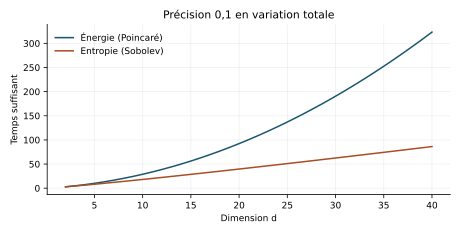

# ENS MP — Mathématiques C 2011 · Corrigé guidé

*Corrigé rédigé par IA, non officiel. Signalez toute erreur.*

**Rédaction** · GPT-6.2 Astra Ultra · vitesse non renseignée

**Révision** · GPT-6.2 Astra Ultra · vitesse non renseignée · 26 novembre 2026

**Diffusion sur des ensembles finis.** Le produit scalaire et la norme de variation totale comprennent le facteur $1/N$. Le vecteur constant $\pi$ vaut 1 en chaque état, et les densités étudiées ont moyenne 1.

## 1. Énergie et trou spectral

### Question 1.1.a

> [!INDICATION]
> Calculer chaque coordonnée de l’image du vecteur constant.

#### Solution

Pour tout $i$, $(P\pi)_i=\sum_jp_{ij}=1$. Ainsi $P\pi=\pi$, et $\pi\ne0$ est vecteur propre de valeur propre 1.

### Question 1.1.b

> [!INDICATION]
> En un indice de maximum, la moyenne des coordonnées atteint le maximum. Qu’imposent les poids strictement positifs ?

#### Solution

Soit $Pu=u$. Choisissons $i$ tel que $u_i=M=\max_j u_j$. Alors $0=M-u_i=\sum_jp_{ij}(M-u_j)$. Tous les termes sont positifs ou nuls et tous les poids sont strictement positifs. Donc chaque $u_j=M$. L’espace propre vaut $\mathbb R\pi$. Comme $P$ est réelle symétrique, elle est diagonalisable et la multiplicité algébrique de 1 est bien un.

### Question 1.1.c

> [!INDICATION]
> Propager l’égalité le long d’un chemin d’arêtes de poids non nul.

#### Solution

Dans la somme précédente, $u_j=M$ pour chaque voisin $j$ de $i$ avec $p_{ij}>0$. On peut alors reprendre l’argument en chacun de ces voisins. Par irréductibilité et symétrie, tout sommet est relié à $i$ par un tel chemin. Toutes les coordonnées valent $M$. Le théorème spectral conclut à la simplicité comme en 1.1.b.

### Question 1.2.a

> [!INDICATION]
> Développer le carré, puis sommer séparément selon les lignes et les colonnes.

#### Solution

Les termes $u_i^2$ donnent $\sum_i u_i^2$ par les sommes des lignes, et les termes $u_j^2$ donnent autant par les sommes des colonnes. Le terme croisé est $-2\sum_i u_i(Pu)_i$. En divisant le tout par $2N$, on obtient $\mathcal E(u,u)=\langle u,(I-P)u\rangle=\langle(I-P)u,u\rangle$.

### Question 1.2.b

> [!INDICATION]
> Normaliser le vecteur dans l’hyperplan orthogonal aux constantes, puis utiliser le théorème spectral.

#### Solution

On suppose $N\ge2$ pour que l’ensemble du quotient soit non vide. Par homogénéité, il suffit de minimiser $\mathcal E(v,v)$ sur la sphère unité de $\pi^\perp$. Celle-ci est compacte en dimension finie. La forme quadratique est continue, donc son minimum est atteint. Si ce minimum était nul, les carrés de la forme de Dirichlet imposeraient l’égalité de deux coordonnées voisines, donc de toutes par irréductibilité. Or un vecteur constant orthogonal à $\pi$ est nul et n’appartient pas à cette sphère. Ainsi $\mu>0$.

Dans une base orthonormée propre de $I-P$, la première direction est $\pi$, seule direction de valeur propre 0. Sur les autres directions, le quotient de Rayleigh est une moyenne des valeurs propres pondérée par les carrés des coordonnées. Son minimum est la plus petite valeur propre strictement positive de $I-P$, atteinte sur son espace propre.

### Question 1.3.a

> [!INDICATION]
> Exhiber la solution globale et vérifier l’unicité par multiplication avec l’exponentielle inverse.

#### Solution

Avec $A=P-I$, la fonction $u(t)=e^{tA}u_0$ est définie et dérivable pour tout réel $t$, vérifie $u'=Au$ et $u(0)=u_0$. Pour toute solution, $(e^{-tA}u(t))'=0$, car $A$ commute avec son exponentielle. Ainsi toute solution coïncide avec la formule, et sa solution maximale a pour intervalle $\mathbb R$.

### Question 1.3.b

> [!INDICATION]
> Différencier la moyenne et transférer l’opérateur sur le vecteur constant.

#### Solution

Par symétrie, $\frac d{dt}\langle\pi,u(t)\rangle=\langle (P-I)\pi,u(t)\rangle=0$. La valeur initiale étant 1, cette moyenne vaut 1 pour tout $t\in\mathbb R$.

### Question 1.3.c

> [!INDICATION]
> L’évolution du vecteur centré obéit à la même équation. Appliquer la définition de la constante dans le bon sous-espace.

#### Solution

Posons $w=u-\pi\in\pi^\perp$. On a $w'=(P-I)w$. Pour $e=\|w\|_2^2$,
$$e'=2\langle w,(P-I)w\rangle=-2\mathcal E(w,w)\le-2\mu e.$$
L’inégalité reste vraie si $w=0$. Ainsi $t\mapsto e^{2\mu t}e(t)$ décroît. Pour tout $t\ge0$, $\|u(t)-\pi\|_2^2\le\|u_0-\pi\|_2^2e^{-2\mu t}$. Comme $\mu>0$, la convergence est exponentielle.

## 2. Entropie et inégalité de Sobolev

### Question 2.1

> [!INDICATION]
> Appliquer Jensen avec les poids uniformes et s’assurer de la normalisation de la moyenne.

#### Solution

La fonction $h(s)=s\ln s$, prolongée par $h(0)=0$, est strictement convexe sur $[0,+\infty[$, puisque $h'$ est strictement croissante sur $]0,+\infty[$. La moyenne des $u_i$ vaut 1. Jensen donne $H(u)\ge h(1)=0$. Tous les poids $1/N$ sont strictement positifs, donc l’égalité exige et suffit que tous les $u_i$ soient égaux, c’est-à-dire $u=\pi$.

### Question 2.2.a

> [!INDICATION]
> Séparer le logarithme du dénominateur de ceux des numérateurs. Le terme d’ordre un a une moyenne nulle.

#### Solution

Notons $\overline z=N^{-1}\sum_i z_i$ et $s=\|v\|_2^2$. Comme $\bar v=0$, $M=\|\pi+\varepsilon v\|_2^2=1+\varepsilon^2s$. Pour $y=\varepsilon v_i$ voisin de 0,
$$(1+y)^2\ln((1+y)^2)=(1+2y+y^2)(2y-y^2+O(y^3))=2y+3y^2+O(y^3).$$
Le nombre d’indices est fini et $v$ fixé. Ainsi $\overline{f_i^2\ln f_i^2}=3\varepsilon^2s+O(\varepsilon^3)$. Par ailleurs $M\ln M=\varepsilon^2s+O(\varepsilon^4)$. Leur différence donne $L(f)=2\varepsilon^2s+O(\varepsilon^3)$.

### Question 2.2.b

> [!INDICATION]
> Les constantes disparaissent dans les différences de la forme de Dirichlet.

#### Solution

Pour $v\perp\pi$ non nul, $\mathcal E(\pi+\varepsilon v,\pi+\varepsilon v)=\varepsilon^2\mathcal E(v,v)$. D’après 2.2.a le dénominateur est strictement positif pour $\varepsilon$ assez petit et non nul. Le quotient tend vers $\mathcal E(v,v)/(2\|v\|_2^2)$ et majore $\alpha$ avant passage à la limite. En prenant l’infimum sur de tels $v$, on obtient $\alpha\le\mu/2$.

### Question 2.3.a

> [!INDICATION]
> Développer les quatre termes du produit puis échanger les indices des deux termes croisés.

#### Solution

Les sommes des lignes et des colonnes ramènent les deux termes diagonaux à $2\sum_i u_i v_i$. La symétrie $p_{ij}=p_{ji}$ rend les deux termes croisés égaux à $-\sum_i u_i(Pv)_i$ chacun. On divise par $2N$ pour trouver $\mathcal E(u,v)=\langle u,(I-P)v\rangle=\langle(I-P)u,v\rangle$.

### Question 2.3.b

> [!INDICATION]
> Écrire la différence des racines comme l’intégrale de leur dérivée, puis utiliser Cauchy–Schwarz.

#### Solution

Échangeons $a,b$ si nécessaire pour avoir $0<a<b$. Alors
$$ (\sqrt b-\sqrt a)^2=\frac14\left(\int_a^b s^{-1/2}\,ds\right)^2
\le\frac14(b-a)\int_a^b\frac{ds}{s}
=\frac14(b-a)(\ln b-\ln a).$$
Diviser par $(b-a)^2$ donne l’inégalité voulue, symétrique en $a,b$.

### Question 2.3.c

> [!INDICATION]
> Traiter séparément les paires de coordonnées égales avant de sommer avec les poids.

#### Solution

Appliquée à $a=u_i,b=u_j$, l’inégalité précédente donne $(u_i-u_j)(\ln u_i-\ln u_j)\ge4(\sqrt{u_i}-\sqrt{u_j})^2$ pour des coordonnées différentes. Lorsqu’elles sont égales, les deux côtés sont nuls. Multiplier par $p_{ij}/(2N)\ge0$ puis sommer donne $\mathcal E(u,\ln u)\ge4\mathcal E(\sqrt u,\sqrt u)$.

### Question 2.4.a

> [!INDICATION]
> Séparer le multiple de l’identité dans l’exponentielle. Conserver au moins le terme diagonal de rang zéro.

#### Solution

Les matrices $P$ et $I$ commutent. Pour $t\ge0$,
$$e^{t(P-I)}=e^{-t}\sum_{k=0}^\infty \frac{t^k}{k!}P^k.$$
Chaque matrice de la somme a des coefficients non négatifs. La diagonale vaut au moins $e^{-t}$. Dès lors $u_i(t)\ge e^{-t}(u_0)_i>0$. Pour $t>0$, si l’on veut la stricte positivité de **toutes** les entrées de l’exponentielle, un chemin de longueur $k$ de $j$ à $i$ donne $(P^k)_{ij}>0$. À $t=0$, l’exponentielle est l’identité.

### Question 2.4.b

> [!INDICATION]
> La stricte positivité des coordonnées permet de dériver le logarithme.

#### Solution

La dérivée de $s\ln s$ vaut $1+\ln s$ pour $s>0$. En dérivant la somme finie, $\frac d{dt}H(u(t))=N^{-1}\sum_i u'_i(t)(1+\ln u_i(t))=\langle u'(t),\ln u(t)+\pi\rangle$.

### Question 2.4.c

> [!INDICATION]
> Identifier la fonctionnelle de Sobolev de la racine de la densité.

#### Solution

La moyenne de $u'$ est nulle. Donc $H'=-\mathcal E(u,\ln u)\le-4\mathcal E(\sqrt u,\sqrt u)$. Or $\|\sqrt u\|_2^2=1$, si bien que $L(\sqrt u)=H(u)$. Lorsque $H(u)>0$, la définition de $\alpha$ donne $\mathcal E(\sqrt u,\sqrt u)\ge\alpha H(u)$. Lorsque $H(u)=0$, $u=\pi$ et les deux quantités s’annulent. Par conséquent $(e^{4\alpha t}H(u(t)))'\le0$, d’où $H(u(t))\le H(u_0)e^{-4\alpha t}$ pour $t\ge0$.

### Question 2.4.d

> [!INDICATION]
> Ajouter une petite quantité du vecteur constant, puis passer à la limite à temps fixé.

#### Solution

Pour $0<\varepsilon<1$, $u_0^\varepsilon=(1-\varepsilon)u_0+\varepsilon\pi$ est strictement positif de moyenne 1. Par linéarité et stationnarité de $\pi$, $u^\varepsilon(t)=(1-\varepsilon)u(t)+\varepsilon\pi$. La solution $u(t)$ est non négative par l’exponentielle de 2.4.a. À chaque $t\ge0$ fixé, la continuité de $s\ln s$ sur $[0,+\infty[$ avec le prolongement en zéro donne $H(u^\varepsilon(t))\to H(u(t))$ et la même convergence à $t=0$. L’inégalité de 2.4.c passe à la limite.

### Question 2.5.a

> [!INDICATION]
> Appliquer Cauchy–Schwarz directement avec le produit scalaire normalisé.

#### Solution

Pour $w=u-v$, $\|w\|_{\rm VT}=\langle |w|,\pi\rangle\le\|w\|_2\|\pi\|_2=\|w\|_2$. Ainsi $C_N=1$ convient pour tout $N$. La constante est optimale, puisque l’égalité a lieu pour un vecteur $w$ de module constant non nul.

### Question 2.5.b

> [!INDICATION]
> Introduire sous la valeur absolue deux facteurs contenant des puissances opposées de 4 + 2u.

#### Solution

L’inégalité scalaire admise se prolonge en $a=0$ par continuité. En la sommant pour $a=u_i$ avec les poids $1/N$, les termes $-u_i+1$ ont une moyenne nulle. Ainsi
$$3\,\overline{(u_i-1)^2/(4+2u_i)}\le H(u).$$
Cauchy–Schwarz, en écrivant $|u_i-1|=\sqrt{4+2u_i}\,|u_i-1|/\sqrt{4+2u_i}$, donne
$$\|u-\pi\|_{\rm VT}^2\le \overline{4+2u_i}\,\overline{(u_i-1)^2/(4+2u_i)}\le6H(u)/3=2H(u).$$

## 3. Diffusion sur l’hypercube

### Question 3.1.a

> [!INDICATION]
> Une coordonnée non nulle permet d’apparier deux termes de signes contraires.

#### Solution

Si $z\ne0$, choisissons $j$ tel que $z_j=1$. La translation $\xi\mapsto\xi+e_j$ est une involution sans point fixe et multiplie $(-1)^{\xi\cdot z}$ par $-1$. La somme sur chaque paire est nulle. Pour $z=0$, la somme vaudrait $N=2^d$.

### Question 3.1.b

> [!INDICATION]
> Développer la transformée, échanger les sommes finies et identifier leur noyau.

#### Solution

Le membre de droite est $N^{-1}\sum_x u(x)\sum_\xi(-1)^{\xi\cdot(y-x)}$. Si $x\ne y$, la somme intérieure est nulle par 3.1.a. Si $x=y$, chaque terme vaut 1 et la somme vaut $N$. Il reste donc exactement $u(y)$.

### Question 3.1.c

> [!INDICATION]
> Insérer l’inversion de l’un des deux vecteurs dans le produit scalaire normalisé.

#### Solution

Par 3.1.b,
$$\langle u,v\rangle=\frac1{N^2}\sum_\xi\widehat u(\xi)\sum_x (-1)^{\xi\cdot x}v(x)=\frac1{N^2}\sum_\xi\widehat u(\xi)\widehat v(\xi)=\frac1N\langle\widehat u,\widehat v\rangle.$$
Le signe dans la définition de la transformée est indifférent pour les puissances entières de $-1$.

### Question 3.2

> [!INDICATION]
> Compter les voisins de chaque sommet et construire un chemin entre deux sommets.

#### Solution

Un pas change exactement un bit. Chaque sommet possède $d$ voisins de poids $1/d$, donc les sommes des lignes valent 1. Le changement d’un bit est sa propre opération inverse, ce qui donne la symétrie, puis les sommes des colonnes. Les coefficients sont non négatifs. Enfin on passe de $x$ à $y$ en changeant successivement leurs bits différents. Le graphe est connexe, d’où l’irréductibilité.

### Question 3.3.a

> [!INDICATION]
> Exprimer la somme des signes au moyen du nombre de bits égaux à un.

#### Solution

Notons $k=|\xi|$ le nombre de coordonnées de $\xi$ égales à 1. Alors $\sum_i(-1)^{\xi_i}=d-2k$, donc $c(\xi)=2k/d$. Dès que $\xi\ne0$, $k\ge1$ et $c(\xi)\ge2/d$, avec égalité pour $k=1$. La condition supplémentaire $\langle\pi,\xi\rangle=0$ imprimée mélange un vecteur de fonctions sur $E$ et un indice de Fourier. La borne vient d’être établie pour tout indice non nul. L’orthogonalité du vecteur $v$ aux constantes interviendra en 3.3.c.

### Question 3.3.b

> [!INDICATION]
> Faire le changement de variable correspondant au retournement d’un bit dans la transformée.

#### Solution

On a $(Pv)(x)=d^{-1}\sum_i v(x+e_i)$. Dans la transformée du $i$-ième terme, poser $y=x+e_i$ donne $(-1)^{-\xi\cdot x}=(-1)^{\xi_i}(-1)^{-\xi\cdot y}$. Ainsi $\widehat{Pv}(\xi)=d^{-1}\sum_i(-1)^{\xi_i}\widehat v(\xi)$ et $\widehat w(\xi)=c(\xi)\widehat v(\xi)$.

### Question 3.3.c

> [!INDICATION]
> Exclure la fréquence constante pour minorer le quotient, puis choisir une seule fréquence pour atteindre la borne.

#### Solution

Si $v\perp\pi$, la fréquence nulle $\widehat v(0)=\sum_xv(x)$ disparaît. Par 3.1.c et 3.3.b,
$$\frac{\mathcal E(v,v)}{\|v\|_2^2}=\frac{\sum_{\xi\ne0}c(\xi)|\widehat v(\xi)|^2}{\sum_{\xi\ne0}|\widehat v(\xi)|^2}\ge\frac2d.$$
Le caractère de poids un réalise cette borne. En effet $v(x)=(-1)^{x_1}$ a moyenne nulle, et le pas suivant conserve son signe dans $d-1$ cas sur $d$ et le renverse dans le dernier. Donc $(I-P)v=(2/d)v$, et **$\mu=2/d$**.

### Question 3.4.a

> [!INDICATION]
> Calculer la norme initiale avec le facteur de normalisation 1/N avant d’utiliser la décroissance.

#### Solution

Pour $u_0=N\delta_x$, $\|u_0-\pi\|_2^2=((N-1)^2+N-1)/N=N-1$. Les questions 2.5.a et 1.3.c donnent
$$\|u(t)-\pi\|_{\rm VT}\le\sqrt{N-1}\,e^{-2t/d}.$$
Il suffit donc de prendre $T_P=\max\{0,(d/4)\ln((N-1)/\varepsilon^2)\}$.

### Question 3.4.b

> [!INDICATION]
> L’entropie de la masse ponctuelle est un logarithme. Appliquer l’inégalité en variation totale puis prendre la racine.

#### Solution

La convention en zéro donne $H(N\delta_x)=\ln N$. Par 2.4.d, 2.5.b et $\alpha=1/d$,
$$\|u(t)-\pi\|_{\rm VT}\le\sqrt{2\ln N}\,e^{-2t/d}.$$
Il suffit de prendre $T_S=\max\{0,(d/4)\ln(2\ln N/\varepsilon^2)\}$. Pour $d\ge2$, donc $N\ge4$, $2\ln N<N-1$ (vrai en 4 et la différence croît ensuite). Le terme exponentiel de décroissance est le même. L’entropie réduit le facteur initial et le temps suffisant. À précision fixée, quand $d\to\infty$, $T_P\sim (\ln2)d^2/4$ et $T_S\sim(d\ln d)/4$. Ce sont des estimations suffisantes du temps demandé.

Pour $d=1$, avec la donnée initiale $(2,0)$, le mode non constant est $(1,-1)$ de valeur propre 2 pour $I-P$. Ainsi $u(t)=(1+e^{-2t},1-e^{-2t})$ et $\|u(t)-\pi\|_{\rm VT}=e^{-2t}$. Dans ce cas particulier la borne par l’énergie est exacte, tandis que celle par l’entropie porte le facteur $\sqrt{2\ln2}>1$.

