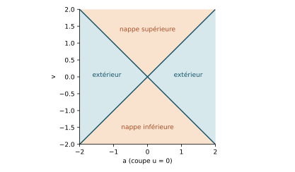
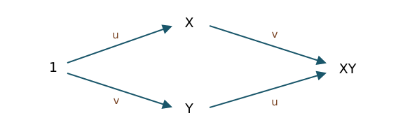
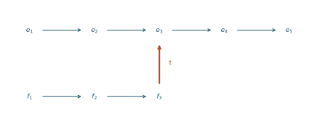

# ENS Ulm MP — Mathématiques D 2011 · Corrigé brut

*Corrigé rédigé par IA, non officiel. Signalez toute erreur.*

**Rédaction** · GPT-6.2 Astra Ultra · vitesse non renseignée

**Révision (tour 1)** · GPT-6.2 Astra Ultra · vitesse non renseignée · 26 novembre 2026

**Le cône nilpotent et les classes de similitude.** La première partie concerne les matrices réelles de taille deux. La seconde passe sur les complexes et relie les orbites nilpotentes à l’ordre de dominance sur les partitions. Les blocs de Jordan du sujet ont leur diagonale de 1 sous la diagonale principale.

## Question préliminaire

### Question Préliminaire

Par nilpotence $u^s=0$ pour un entier $s\ge1$. Le polynôme minimal divise $X^s$, donc vaut $X^r$ avec $r\ge1$ puisque $V\ne0$. Le théorème de Cayley–Hamilton le fait diviser le polynôme caractéristique, de degré $n$, donc $r\le n$. Pour tout scalaire $\alpha$, $(\alpha u)^r=\alpha^ru^r=0$. Ces arguments valent sur les deux corps de base.

## I. Géométrie du cône nilpotent réel en dimension deux

### Question I.1

Le préliminaire donne $u^2=0$. Choisissons $x$ tel que $u(x)\ne0$ et posons $e_1=u(x)$, $e_2=x$. Si $a e_1+b e_2=0$, l’application de $u$ donne $b e_1=0$, puis $b=a=0$. Les deux vecteurs forment donc une base, et $u(e_1)=0$, $u(e_2)=e_1$.

### Question I.2

Appliquons I.1 à l’endomorphisme de matrice $A$. Dans la base $(e_1,e_2)$, les colonnes sont $(0,0)^t$ puis $(1,0)^t$. Par changement de base, $A$ est semblable à $E_{12}=\left(\begin{smallmatrix}0&1\\0&0\end{smallmatrix}\right)$.

### Question I.3

Si $A$ est nilpotente, elle est nulle ou semblable à $E_{12}$, d’où $\mathrm{tr}(A)=\det A=0$. Réciproquement ces deux égalités donnent $\chi_A(X)=X^2-\mathrm{tr}(A)X+\det A=X^2$. Cayley–Hamilton donne $A^2=0$.

### Question I.4

D’après I.3, le sous-espace engendré est inclus dans $S$. Les matrices $E_{12},E_{21}$ et $K=\left(\begin{smallmatrix}1&1\\-1&-1\end{smallmatrix}\right)$ ont trace et déterminant nuls. Elles sont indépendantes, la coordonnée diagonale du troisième vecteur étant non nulle. Comme $S$ est le noyau de la trace non nulle sur un espace de dimension 4, $\dim S=3$. Le sous-espace engendré est donc **$S$**.

### Question I.5

La linéarité donne $\Phi(S)=\mathrm{Vect}(\Phi(\mathcal N))\subset\mathrm{Vect}(\mathcal N)=S$. La restriction de $\Phi$ à $S$ est injective, donc son image a la même dimension 3. Il y a égalité.

### Question I.6

La matrice de trace nulle s’écrit de manière unique $\iota(a,b,c)=\left(\begin{smallmatrix}a&b\\c&-a\end{smallmatrix}\right)$. La correspondance linéaire est donc bijective. Son déterminant vaut $-a^2-bc$. Par I.3, $\mathcal N=\iota(C)$ avec $C=\{(a,b,c):a^2+bc=0\}$.

### Question I.7

Posons $F(a,b,c)=a^2+bc$. Son gradient $(2a,c,b)$ ne s’annule qu’à l’origine. En $P=(a,b,c)\in C\setminus\{0\}$, le plan tangent est donc l’ensemble des $Q=(x,y,z)$ tels que $2a(x-a)+c(y-b)+b(z-c)=0$. Comme $2a^2+2bc=0$, il a pour équation $2ax+cy+bz=0$. Or $\mathrm{tr}(\iota(P)\iota(Q))=2ax+bz+cy$. Ceci donne aussi une description indépendante de la base.

### Question I.8

Dans une base propre réelle, $\iota(Q)=\operatorname{diag}(t,-t)$ avec $t\ne0$. Un point de tangence de matrice $A=\left(\begin{smallmatrix}a&b\\c&-a\end{smallmatrix}\right)\ne0$ doit vérifier $\mathrm{tr}(A\iota(Q))=2ta=0$, et sa nilpotence impose $bc=0$. Ainsi $A$ se trouve sur l’une des deux droites engendrées par $E_{12}$ et $E_{21}$. Elles fournissent exactement deux plans tangents distincts, d’équations respectives $z=0$ et $y=0$ dans les coordonnées de I.7.

L’intersection du premier plan avec le cône est la droite $\mathbb R E_{12}$, celle du second est $\mathbb R E_{21}$. Ces matrices tuent respectivement le premier et le second vecteur propre. Inversement une nilpotente qui tue le premier vecteur a sa première colonne nulle, puis sa trace nulle impose que seul le coefficient $(1,2)$ puisse subsister. Le second cas est symétrique et la matrice nulle convient aux deux. La conjugaison préserve nilpotence et trace des produits et transporte les noyaux et les droites propres. La description s’applique donc dans la base initiale.

### Question I.9

Posons $u=(b+c)/2$, $v=(b-c)/2$ et $r=\sqrt{a^2+u^2}$. Alors $F=r^2-v^2$. Les trois ouverts sont $v>r$, $v<-r$, et $r>|v|$. Les deux premiers sont convexes par l’inégalité triangulaire et donc connexes par arcs. Dans le troisième, on peut amener $v$ à 0 sur un segment vertical. On rejoint alors toute autre telle projection dans le plan $(a,u)$ privé de l’origine, qui est connexe par arcs. Ces trois ouverts disjoints couvrent le complément et aucune courbe dans ce complément ne peut passer de l’un à l’autre par continuité. Le polynôme caractéristique vaut $X^2-F$. Une matrice de trace nulle non nulle est diagonalisable sur $\mathbb R$ exactement pour $F>0$, qui est la troisième région.

## II.A. Réduction et commutant des endomorphismes nilpotents

### Question A.1

Si $u$ est nilpotent, chaque valeur propre $t$ satisfait $t^r=0$, donc vaut 0. Sur $\mathbb C$, le polynôme caractéristique est scindé et unitaire de degré $n$, d’où $\chi_u=X^n$. Réciproquement, $\chi_u=X^n$ entraîne $u^n=0$ par Cayley–Hamilton.

### Question A.2

Soit $e_i=u^{i-1}x$. Dans une relation non triviale, prenons le plus petit $i$ de coefficient $a_i\ne0$. Appliquer $u^{r-i}$ annule les termes suivants et donne $a_i e_r=0$, impossible. La famille est libre. Comme $ue_i=e_{i+1}$ pour $i<r$ et $ue_r=0$, son espace $W$ est stable. La matrice dans l’ordre donné a des 1 sur la première sous-diagonale et des 0 ailleurs, soit $J_r$.

### Question A.3

On a $\varepsilon_i(e_j)=\ell(u^{i+j-2}x)$. Cette valeur est nulle si $i+j>r+1$ et vaut $\ell(e_r)\ne0$ si $i+j=r+1$. En renversant les colonnes, la matrice est triangulaire à diagonale non nulle. Les formes restreintes à $W$ sont indépendantes, donc également sur $V$. L’application $T:y\mapsto(\varepsilon_i(y))_{i=1}^r$ induit un isomorphisme de $W$ sur $\mathbb C^r$. Ainsi $V=W\oplus\ker T=W\oplus W'$. Pour $y\in W'$, $\varepsilon_i(uy)=\varepsilon_{i+1}(y)=0$ pour $i<r$, et $\varepsilon_r(uy)=\ell(u^ry)=0$. Donc $W'$ est stable. Le polynôme minimal de la restriction divise $X^r$, donc vaut $X^s$ avec $1\le s\le r$ si $W'\ne0$ (et 1 sur l’espace nul).

### Question A.4

En dimension 1, l’unique nilpotent a matrice $J_1$. Dans $V$, choisir une chaîne maximale de longueur $r$ comme en A.2. Par A.3, le supplémentaire stable $W'$ a dimension $n-r<n$. S’il est nul, il reste le seul bloc $J_r$. Sinon l’hypothèse de récurrence sur $W'$ fournit des blocs $J_s$ de tailles décroissantes, toutes au plus $r$ car $(u|_{W'})^r=0$. En juxtaposant les bases, on obtient la forme voulue, en ordre décroissant.

### Question A.5

Sur un bloc $J_h$, $\dim\ker J_h^i=\min(i,h)$, car seuls les $\min(i,h)$ derniers vecteurs sont envoyés sur zéro. Par somme directe,
$$d_i=\dim\ker u^i-\dim\ker u^{i-1}=\#\{j:\lambda_j\ge i\}.$$
En particulier $d_1=\alpha$, et le nombre de blocs de taille exactement $i$ vaut $d_i-d_{i+1}$. Ces quantités sont invariantes et reconstruisent la liste ordonnée des tailles.

### Question A.6

Le commutant est le noyau de l’application linéaire $v\mapsto uv-vu$. Pour une chaîne de longueur $h$ engendrée par $x$, un $v$ commutant doit satisfaire $v(u^kx)=u^kv(x)$. La seule condition sur $v(x)$ est $u^hv(x)=0$. Inversement toute famille de tels choix, indépendante d’une chaîne à l’autre, définit un unique $v$ sur la base et assure la commutation, y compris au dernier vecteur. La dimension est donc
$$\sum_i\dim\ker u^{\lambda_i}=\sum_{i,j}\min(\lambda_i,\lambda_j)=\sum_{k=1}^{\alpha}(2k-1)\lambda_k.$$
La dernière égalité regroupe les couples de maximum d’indices $k$, au nombre de $k^2-(k-1)^2$, pour lesquels la plus petite taille vaut $\lambda_k$.

## II.B. Outils topologiques

### Question B.1

L’application $A\mapsto(f(A),g(A))$ est continue coordonnée par coordonnée. L’addition et la multiplication sur $\mathbb C^2$ vers $\mathbb C$ sont continues, donc les composées $f+g$ et $fg$ aussi. Pour $B$ fixée, les deux multiplications $A\mapsto AB$ et $A\mapsto BA$ sont linéaires entre espaces vectoriels de dimension finie et sont donc continues.

### Question B.2

Dans $\det(XI-A)=\sum_{\sigma}\mathrm{sgn}(\sigma)\prod_i(X\delta_{i,\sigma(i)}-a_{i,\sigma(i)})$, chaque coefficient en $X$ est polynomial en les coordonnées de $A$. Par B.1 ces coefficients sont continus, d’où la continuité vers l’espace des polynômes. Le terme constant vaut $(-1)^n\det A$, donc le déterminant est continu.

### Question B.3

Par A.1, $\mathcal N=\{A:\chi_A=X^n\}$. Le singleton $\{X^n\}$ est fermé dans l’espace normé des polynômes. Sa préimage par l’application continue de B.2 est fermée.

### Question B.4

Si $r>\min(a,b)$, l’ensemble est vide, donc ouvert. Sinon chaque mineur d’ordre $r$ est une fonction polynomiale continue. L’ensemble où il est non nul est ouvert. L’union de ces ouverts sur tous les choix de lignes et de colonnes est exactement l’ensemble des matrices de rang au moins $r$.

### Question B.5

Pour $r=\mathrm{rg}(A)>0$, B.4 fournit un voisinage de $A$ où le rang est au moins $r$. La suite y est finalement contenue, donc $\dim\ker A_i=n-\mathrm{rg}(A_i)\le n-r=\dim\ker A$. Si $r=0$, le majorant $n$ est immédiat.

## II.C. Endomorphismes qui commutent

### Question C.1

Les polynômes qui annulent $x$ sont stables par addition, soustraction et multiplication par tout $Q$, car $(QP)(v)x=Q(v)P(v)x$. L’idéal contient le polynôme minimal de $v$, donc est non nul. Son unique générateur unitaire $\mu_x$ divise ce dernier et a degré au plus $n$. Les $n$ vecteurs sont libres exactement lorsqu’aucun polynôme non nul de degré $<n$ n’annule $x$, autrement dit $\deg\mu_x=n$.

Si $v$ est nilpotent et si $x$ satisfait ces conditions, $v^nx=0$ et la base cyclique donne $J_n$. Réciproquement un bloc $J_n$ admet son premier vecteur comme vecteur cyclique. Cette dernière affirmation donne l’existence d’un tel $x$ ; pour un vecteur $x$ déjà fixé dans un bloc, la condition est $v^{n-1}x\ne0$ (par exemple le vecteur nul ne convient jamais).

### Question C.2

Choisissons $x$ cyclique pour $v$. Si $T$ commute avec $v$, on écrit $Tx=P(v)x$ pour un polynôme $P$ de degré $<n$ grâce à la base cyclique. Alors $T(v^jx)=v^jTx=P(v)(v^jx)$ pour tout $j$. Les deux endomorphismes coïncident sur une base. Réciproquement tout polynôme en $v$ commute avec $v$, donc $C(v)=\mathbb C[v]$.

### Question C.3

Pour $0\le k<n$, $(v+\varepsilon w)^kx$ est polynomial de degré au plus $k$ en $\varepsilon$, de coefficient de degré $k$ égal à $w^kx$. Cela suit par récurrence en multipliant à gauche par $v+\varepsilon w$. Le déterminant de ces $n$ colonnes dans la base $(x,wx,\ldots,w^{n-1}x)$ a pour coefficient de degré $0+1+\cdots+(n-1)$ le déterminant de la base elle-même, égal à 1. Ce polynôme non nul a un nombre fini de zéros. Pour toutes les autres valeurs, $x$ est cyclique pour $v+\varepsilon w$.

### Question C.4

Soit $x$ la somme des premiers vecteurs des blocs et $T=v+w$. Dans le bloc $j$, $T-c_jI$ est $J_{\lambda_j}$, dont le premier vecteur est cyclique. L’annulateur minimal de cette composante pour $T$ est $(X-c_j)^{\lambda_j}$. Pour annuler $x$, il faut et il suffit d’annuler chacune de ces composantes, puisque la décomposition est directe. L’annulateur minimal de $x$ est le ppcm de ces polynômes, égal à leur produit car les $c_j$ sont distincts. Son degré vaut $\sum_j\lambda_j=n$. Par C.1, $T$ est régulier.

### Question C.5

Dans la base de A.4, choisissons un scalaire distinct pour chaque bloc, et appelons $D$ la matrice scalaire ainsi obtenue sur chaque bloc. Elle commute avec $u$. Par C.4, $w=u+D$ est régulier, et $wu=uw$.

### Question C.6

Si $v$ est régulier, $u\in\mathbb C[v]$ par C.2. Tous les monômes sont donc dans $\mathbb C[v]$, de dimension au plus $n$ par Cayley–Hamilton. Pour $v$ quelconque, choisissons par C.5 un $w$ régulier commutant avec $u$. Alors $v_t=v+tw$ commute avec $u$ et est régulier pour tous les $t$ sauf un ensemble fini, par C.3.

Si $\dim A>n$, prenons $n+1$ monômes indépendants $u^{i_k}v^{j_k}$. Rangeons les coordonnées des $u^{i_k}v_t^{j_k}$ dans les colonnes d’une matrice. Elles dépendent polynomialement de $t$. Un mineur d’ordre $n+1$ est non nul en 0, donc reste non nul pour $t$ assez proche de 0. Pour un tel $t$ rendant $v_t$ régulier, on obtient $n+1$ monômes indépendants, en contradiction avec le premier cas. Donc $\dim A\le n$.

### Question C.7

Pour $(i,j)\ne(0,0)$, la commutation donne $(u^iv^j)^n=u^{in}v^{jn}=0$, puisque au moins un exposant est positif et $u^n=v^n=0$. Ces monômes ont trace nulle. Donc $B\subset\ker(\mathrm{tr}|_A)$. Or $I\in A$ et $\mathrm{tr}(I)=n\ne0$. Le noyau a dimension $\dim A-1\le n-1$ par C.6.

### Question C.8

Prenons $V=\mathbb C[X,Y]/(X^2,Y^2)$ avec la base $(1,X,Y,XY)$ et $u,v$ les multiplications par $X,Y$. Ces opérations commutent, vérifient $u^2=v^2=0$, et $uv(1)=XY\ne0$. Les seules multiplications monomiales non nulles de degré positif sont $u,v,uv$. Elles sont indépendantes par évaluation sur 1, donc $\dim B=3$. Tout $T=au+bv+cuv$ satisfait $T^2=2ab\,uv$ puis $T^3=0$. En dimension 4 son polynôme minimal a degré au plus 3, donc aucun $T\in B$ n’est régulier, par C.1.

Dans l’ordre $(XY,Y,X,1)$, en notant $E_{ij}$ la matrice élémentaire, les multiplications ont pour matrices $U=E_{12}+E_{34}$ et $V=E_{13}+E_{24}$. Ainsi $UV=VU=E_{14}$. Les trois supports de $U,V,UV$ sont disjoints, ce qui vérifie aussi leur indépendance directement sur les matrices.

## II.D. Partitions et dominance

### Question D.1

Les ensembles $\{j:\lambda_j\ge i\}$ décroissent avec $i$ et sont vides dès $i>\lambda_1$. Leurs cardinaux $\mu_i$ forment donc une partition. En échangeant deux sommes finies, $\sum_i\mu_i=\sum_j\#\{i:1\le i\le\lambda_j\}=\sum_j\lambda_j$.

### Question D.2

Pour $i,j\ge1$, $j\le\lambda'_i$ équivaut à $i\le\lambda_j$, car les parts de $\lambda$ sont décroissantes. La transformation $(i,j)\mapsto(j,i)$ échange donc les diagrammes. C’est la réflexion dans la droite $y=x$. Son carré est l’identité et le diagramme détermine les longueurs de toutes les lignes, donc $(\lambda')'=\lambda$.

### Question D.3

Les inégalités des sommes partielles et l’égalité des poids sont réflexives et transitives. Si elles valent dans les deux sens, les sommes partielles sont égales à chaque rang. En prenant leurs différences, toutes les parts sont égales, d’où l’antisymétrie. Les partitions $(4,1,1)$ et $(3,3)$ de 6 sont incomparables, puisque $4>3$ au premier rang mais $4+1<3+3$ au deuxième.

### Question D.4

Écrivons $D_k=\sum_{h\le k}(\lambda_h-\mu_h)\ge0$. Soit $i$ le premier rang où les parts diffèrent. Alors $\lambda_i>\mu_i$ et $D_i\ge1$. Soit $j>i$ le premier rang où $D_j=0$, qui existe puisque les poids sont égaux. On a $D_k\ge1$ pour $i\le k<j$ et $\mu_j>\lambda_j$. En outre $\mu_j>\mu_{j+1}$, car sinon $D_{j+1}=\lambda_{j+1}-\mu_{j+1}\le\lambda_j-\mu_j<0$.

Posons $\nu_i=\mu_i+1$, $\nu_j=\mu_j-1$ et gardons les autres parts. Si $i>1$, $\mu_{i-1}=\lambda_{i-1}\ge\lambda_i\ge\nu_i$. La chute stricte au rang $j$ garantit $\nu_j\ge\mu_{j+1}\ge0$. On a donc une partition. Ses sommes partielles sont celles de $\mu$ augmentées de 1 sur $i\le k<j$ et inchangées ailleurs. On a bien $\mu<\nu\le\lambda$.

### Question D.5

Pour une partition $\tau$ de poids $n$, écrivons $S_r(\tau)=\sum_{j\le r}\tau_j$, avec $S_0=0$. Pour $k\ge1$,
$$\sum_{h\le k}\tau'_h=\sum_j\min(k,\tau_j)
=n-\sum_j(\tau_j-k)_+
=n-\max_{r\ge0}(S_r(\tau)-rk).$$
L’expression est maximale après les parts supérieures à $k$, puisque ses accroissements sont les $\tau_j-k$ décroissants. Si $\mu\le\lambda$, le maximum pour $\mu$ est au plus celui pour $\lambda$, donc les sommes partielles de $\lambda'$ sont au plus celles de $\mu'$, à poids égal. Cela prouve $\lambda'\le\mu'$. Appliquée aux partitions conjuguées puis à D.2, la même implication donne la réciproque.

## II.E. Adhérences des classes de similitude

### Question E.1

A.4 donne l’union et A.5 rend les classes deux à deux disjointes. Le cône nilpotent étant fermé par B.3, $\overline{\mathcal N_\lambda}\subset\mathcal N$. Pour toute matrice inversible $S$, $A\mapsto SAS^{-1}$ est un homéomorphisme par B.1 et son inverse. Il préserve $\mathcal N_\lambda$, donc son adhérence. Dès que celle-ci contient une matrice d’une autre classe nilpotente, elle contient donc toute la classe. Elle est leur réunion.

### Question E.2

Si $D=\operatorname{diag}(d_1,\ldots,d_n)$ est inversible, chaque 1 de $J_\lambda$ en $(i+1,i)$ devient $d_{i+1}/d_i$, et les autres coefficients restent nuls. En choisissant $d_i=t^{i-1}$ pour $t\ne0$, on obtient $tJ_\lambda\to0$.

Partons maintenant de $J_n$. Sur sa sous-diagonale, gardons un poids 1 à l’intérieur des blocs de $J_\lambda$ et mettons $t$ aux endroits de coupure. Pour $t\ne0$, ces poids sont obtenus avec $d_1=1$ et $d_{i+1}$ égal au poids suivant fois $d_i$. La matrice est donc semblable à $J_n$, et tend vers $J_\lambda$. Par E.1 toutes les classes sont dans l’adhérence de $\mathcal N_{\rm reg}$, qui est ainsi $\mathcal N$. Enfin une nilpotente de dimension $n$ est régulière exactement quand $A^{n-1}\ne0$, par A.4. Cette condition est ouverte, puisque $A\mapsto A^{n-1}$ est continue, donc $\mathcal N_{\rm reg}$ est ouverte relativement à $\mathcal N$ (aussi pour $n=1$).

### Question E.3

Prenons $A_m\in\mathcal N_\lambda$ tendant vers $J_\mu$. Pour chaque $k\ge1$, $A_m^k\to J_\mu^k$. Les dimensions des noyaux des $A_m^k$ valent la constante $\dim\ker J_\lambda^k$. B.5 et A.5 donnent alors
$$\sum_{i\le k}\lambda'_i=\dim\ker J_\lambda^k\le\dim\ker J_\mu^k=\sum_{i\le k}\mu'_i.$$
Donc $\lambda'\le\mu'$, ce qui équivaut à $\mu\le\lambda$ par D.5.

### Question E.4

Sur la base de deux chaînes $(e_1,\ldots,e_m)$ et $(f_1,\ldots,f_m)$, posons $T_t e_i=e_{i+1}$, $T_t f_i=f_{i+1}$ pour $i<m$, $T_t e_m=0$ et $T_t f_m=t e_m$. Alors $T_0=J_m\oplus J_m$. Pour $t\ne0$, la chaîne issue de $f_1$ a longueur $m+1$ et $T_t^{m+1}=0$. Si $m\ge2$, l’image est engendrée librement par $e_2,\ldots,e_m,f_2,\ldots,f_m$, donc le noyau a dimension 2. Il y a deux blocs dont l’un a taille $m+1$, et l’autre nécessairement $m-1$. Si $m=1$, la chaîne $(f_1,t e_1)$ a longueur 2 et occupe tout l’espace. Ainsi $T_t\in\mathcal N_\lambda$ pour $t\ne0$, et sa limite appartient à $\mathcal N_\mu$. L’invariance par conjugaison de E.1 conclut.

Pour $m\ge2$, on peut exposer le second bloc au lieu de seulement en déduire la taille par le rang. Pour $t\ne0$, le vecteur $g=e_1-t^{-1}f_2$ vérifie $T_t^{m-1}g=0$ et $T_t^{m-2}g=e_{m-1}-t^{-1}f_m\ne0$. Ses $m-1$ itérés sont indépendants de la chaîne longue issue de $f_1$ : leurs composantes en $e_1,\ldots,e_{m-1}$ sont les vecteurs de cette liste, alors que la chaîne longue ne contient que des $f_j$ et $te_m$. Les deux chaînes donnent donc une base de $2m$ vecteurs.

### Question E.5

L’inclusion nécessaire est E.3. Pour la réciproque, traitons le transfert de D.4 : les deux parts initiales sont $a\ge b\ge1$ et deviennent $a+1,b-1$. Dans l’espace des deux blocs **initiaux**, prenons des chaînes $e_1,\ldots,e_a$ et $f_1,\ldots,f_b$. Gardons les flèches habituelles, sauf $T_t f_b=t e_b$ (et toujours $T_t e_a=0$). Pour $t\ne0$, la chaîne de $f_1$ a longueur $b+(a-b+1)=a+1$, et aucune n’est plus longue puisque $T_t^{a+1}=0$ sur les deux chaînes. Si $b\ge2$, l’image supplémentaire $t e_b$ est déjà dans la portée des $e_2,\ldots,e_a$. Le rang est donc $(a-1)+(b-1)$, ce qui donne exactement deux blocs, de tailles $a+1,b-1$. Si $b=1$, l’unique chaîne a longueur $a+1$ et engendre tout. En $t=0$, on retrouve les tailles $a,b$. Les autres blocs se gardent par somme directe. Ainsi, à chaque transfert $\mu<\nu$, on a $\mathcal N_\mu\subset\overline{\mathcal N_\nu}$.

D.4 permet de continuer en restant sous $\lambda$ jusqu’à l’atteindre, car l’ordre croît strictement dans l’ensemble fini des partitions du poids $n$. Les inclusions d’adhérences se composent. Finalement
$$\overline{\mathcal N_\lambda}=\bigcup_{\mu\le\lambda}\mathcal N_\mu.$$
La flèche supplémentaire part de la dernière case de la petite chaîne. Son point d’arrivée explique pourquoi le cas des tailles inégales fonctionne aussi.

