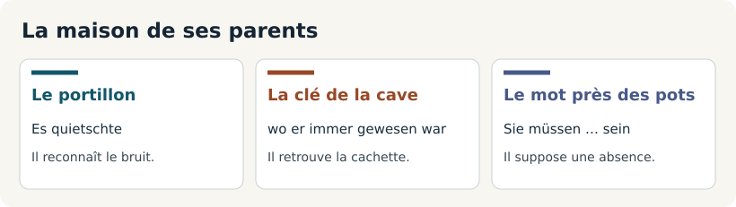

# X-ENS MP-PC — Allemand 2011 · Corrigé guidé

*Corrigé rédigé par IA, non officiel. Signalez toute erreur.*

**Rédaction** · GPT-6.2 Astra Ultra · vitesse non renseignée

Version et expression écrite durent chacune une heure trente. Les deux gardes interdisent le dictionnaire.

Peter Stamm, An einem Tag wie diesem (2006), passage intitulé « Heimkehr ». Robert Darnton, Apologie du livre (2011), « L’avenir des bibliothèques ». [Version](https://banques-ecoles.fr/cms/wp-content/data/filiere-pc/annales-de-la-banque-pc/session-2011/2011%20Version_LVA2.pdf#page=2) · [Expression écrite](https://banques-ecoles.fr/cms/wp-content/data/filiere-pc/annales-de-la-banque-pc/session-2011/2011%20MP-PC%20SUJET%20EXPRESSION%20ECRITE_LVA1.pdf)

## I. Version

**Retour au pays**

Ils traversèrent le village. Andreas montra à Delphine les lieux de son enfance, l’école, l’église où il avait fait sa confirmation et le restaurant où il retrouvait ses amis. Il n’arrivait pas à se représenter l’impression que le village pouvait faire à quelqu’un qui ne l’avait encore jamais vu, qui n’en connaissait ni l’histoire, ni les histoires, ni les habitants.

La grille du cimetière était fermée. Ils poursuivirent leur chemin, traversèrent le passage à niveau et arrivèrent à la piscine couverte, puis à la maison des parents d’Andreas, où son frère habitait à présent. Aucune lumière aux fenêtres. Ils se tenaient devant le portillon du jardin.

« Peut-être sont-ils en vacances, dit Delphine.
— Autrefois, on cachait quelque part une clé de la cave », dit Andreas. Sans réfléchir, il ouvrit le portillon. Il grinça, et Andreas se rappela ce bruit qui n’avait pas changé depuis son enfance. Il traversa le jardin et passa derrière la maison. Il descendit les marches de la cave. Delphine resta en haut. La clé était là où elle avait toujours été, une clé d’un autre âge, toute rouillée.

« Viens », murmura Andreas.

Il faisait sombre dans la cave. Seul un peu de lumière pénétrait par les fenêtres. Andreas avait aussitôt reconnu l’odeur, un mélange de terre, de moisissure et de fioul. Il prit Delphine par la main et la guida avec précaution jusqu’en haut de l’escalier intérieur. La porte qui donnait dans le logement n’était pas fermée à clé. Andreas l’ouvrit et resta un instant immobile, l’oreille tendue.

Sur la table de la cuisine se trouvaient une douzaine de pots de fleurs et un petit arrosoir en plastique rouge. À côté, un mot indiquait quelles plantes n’avaient besoin d’être arrosées qu’une fois par semaine et lesquelles devaient l’être plus souvent.

« Ils doivent être en vacances, dit-il. Il vaut mieux qu’on n’allume pas. Si les voisins voient de la lumière, ils vont appeler la police.
— Allons-nous-en », dit Delphine.

Andreas entra dans le salon. Il compta les journaux posés sur la table et dit que la famille rentrerait probablement dans les jours qui venaient. Il passa dans le couloir et prit l’escalier qui menait à l’étage. Delphine resta en bas. Elle dit qu’elle n’avait aucune envie de se faire arrêter. Elle finit tout de même par le suivre.

> [!INDICATION]
> Distinguer les deux clôtures rend le trajet lisible. *Friedhofstor* désigne l’entrée du cimetière, devant laquelle les promeneurs poursuivent leur chemin. *Gartentor* est le portillon de la maison familiale qu’Andreas pousse sans réfléchir. Reliez ensuite chaque indication de direction à son point de départ. Delphine attend en haut des marches extérieures. À la fin seulement, elle reste en bas de l’escalier qui monte à l’étage. On comprend alors son hésitation à suivre Andreas dans une maison qui lui est étrangère.

> [!INDICATION]
> Rétablir le fil de la mémoire donne son ton au passage. *Seine Geschichte, seine Geschichten* juxtapose l’histoire du village et les histoires qu’on s’y raconte. La phrase du narrateur préserve cette reprise du mot. Le grincement et l’odeur sont reconnus immédiatement. La date du retour, elle, reste conjecturale. *Vermutlich käme* et *sie habe keine Lust* font entendre des propos rapportés, distincts des répliques antérieures. Le conditionnel « rentrerait » et les mots « elle dit que » conservent le passage de la parole directe au récit.

## II.1. Le rôle de la bibliothèque selon Darnton

> [!INDICATION]
> Chez Darnton, quatre petites armoires signifient qu’une commission prétend avoir décidé ce qui mérite de rester lisible. Le moteur de recherche, lui, sélectionne les résultats d’une requête dans un ensemble qu’il continue de rendre consultable. Cette différence permet de citer Mercier et Google sans leur prêter la même politique. Une phrase telle que *Mercier möchte die Bücher vernichten* attribuerait la décision de la commission fictive à l’écrivain des Lumières. *Darnton deutet die Szene als …* restitue les deux voix.

Für Robert Darnton hat eine Forschungsbibliothek eine Aufgabe, die weit über die Interessen von Fachleuten hinausgeht. Jeder Mensch sucht Informationen und braucht Hilfe, um aus der Fülle des Verfügbaren brauchbares Wissen zu gewinnen. Genau dieses Problem macht Merciers Zukunftserzählung sichtbar. Dort hat eine Kommission fast alle Bücher vernichtet, um wenige vermeintlich unverzichtbare Wahrheiten zu bewahren. Darnton deutet das als Ausdruck einer alten Angst vor der Überfülle, nicht als Plädoyer Merciers für Bücherverbrennungen. Eine digitale Bibliothek könnte dieselbe Schwierigkeit auf andere Weise lösen: Sie würde die Bestände erhalten und zugleich den gezielten Zugriff auf sie erleichtern. Google digitalisiert bereits Millionen Bücher aus Forschungsbibliotheken. Für Darnton entscheidet sich die Bedeutung einer Bibliothek deshalb weniger an der Zahl ihrer Regale als an der Verbindung von umfassendem Bestand und der Möglichkeit, darin etwas Relevantes zu finden.

*132 mots. Indication du sujet : 120 à 150 mots.*

## II.2. Les bibliothèques à l’ère numérique

> [!INDICATION]
> Testez la portée de l’exemple des dix résultats identiques. Il montre qu’une abondance de liens peut donner une fausse impression de confirmation. Il permet aussi de proposer une tâche concrète à une bibliothécaire. Pour construire une limite crédible à la thèse défendue, indiquez une recherche qu’un catalogue en ligne suffit à résoudre. *Weil* place le verbe à la fin de la proposition, tandis que *deshalb* en tête d’une phrase fait immédiatement venir le verbe conjugué.

Gerade weil ich zu Hause mit wenigen Klicks so viele Texte öffnen kann, brauche ich gelegentlich eine Bibliothek. Für ein Referat über die Geschichte meiner Stadt fand ich im Netz mehrfach dieselbe Anekdote. Zehn Treffer sahen zunächst nach zehn Bestätigungen aus. Eine Bibliothekarin hätte mir zeigen können, wie ich die älteste Fundstelle suche und in der Lokalzeitung nach einem zeitgenössischen Bericht frage. Solche Hilfe verändert die Frage, mit der man an den Bildschirm zurückkehrt.

Auch der Ort selbst hat einen Wert. Wer sich mit Geschwistern ein Zimmer teilt, kann einen kostenlosen Arbeitsplatz besser gebrauchen als ein weiteres digitales Angebot. Davon profitieren nicht nur Schüler. In einem Lesesaal können Menschen mit unterschiedlichen Vorkenntnissen dieselben Quellen benutzen, ohne ein Abonnement zu bezahlen.

Natürlich braucht niemand eine lange Busfahrt auf sich zu nehmen, nur um das Erscheinungsjahr eines Buches zu prüfen. Öffentliche Bibliotheken sollten deshalb ihre Kataloge und möglichst viele Bestände auch von zu Hause aus zugänglich machen. Das Geld für Personal und Arbeitsplätze würde ich trotzdem nicht vollständig in die Digitalisierung stecken. Ein zugänglicher Text, eine kundige Ansprechpartnerin und ein ruhiger Tisch lösen drei verschiedene Probleme. Eine gute Bibliothek hält alle drei Angebote zusammen.

*192 mots. Indication du sujet : 180 à 200 mots.*
