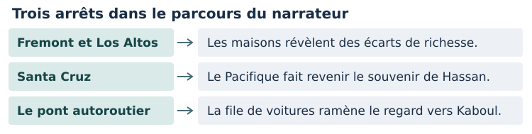

# X-ENS · MP-PC · Anglais 2011 — Corrigé guidé

*Corrigé rédigé par IA, non officiel. Signalez toute erreur.*

**Rédaction** · GPT-6.2 Astra Ultra · vitesse non renseignée

La version (p. 3 du cahier de langues) et l’expression écrite forment deux épreuves XEULC d’une heure trente chacune, sans dictionnaire. L’expression porte sur un texte français de Robert Darnton, distinct de l’extrait de Khaled Hosseini. Les longueurs indicatives sont de 120 à 150 mots puis de 180 à 200 mots.

Dans la version, noter à quel moment le narrateur passe du trajet familier au souvenir d’enfance, puis au souhait. Pour l’expression, isoler dans le brouillon les voix de Mercier, de son bibliothécaire imaginaire et de Darnton. La deuxième réponse peut alors défendre un point de vue personnel.

## I. Version — Accueillir l’Amérique à bras ouverts

**Le temps du trajet.** Dans *I’d get up* et *I would park*, le samedi qui revient appelle l’imparfait. *I’d read* équivaut à *I had read* et renvoie à une lecture antérieure à la séance de cinéma. Le conditionnel convient en revanche à la promesse faite à Hassan. Le garçon imagine ce qu’ils feraient un jour tous les deux. La première vision du Pacifique est un événement unique et appelle un changement de temps.

**Du détail au souvenir.** *One-story* désigne le rez-de-chaussée seul. *Bald tires* donne « pneus lisses » et le *blacktop* de l’allée est son revêtement. Distinguer le grillage des jardins, les portails de fer forgé des propriétés et le grillage où s’appuie le narrateur sur le pont. *Homes* détaché, puis les marques de voitures isolées, font entendre le rythme des découvertes successives. Les rendre en phrases courtes maintient ce mouvement.

**La chronologie morale.** Les trois *long before* situent les fantômes avant la guerre. En faire une conséquence de l’invasion inverserait leur rôle. La lèvre fendue donne au souvenir une particularité physique que le texte laisse résonner. *Wade* suppose qu’on entre dans l’eau en gardant pied. Le narrateur se donne la possibilité de rejoindre le courant. La reprise du titre dans la dernière phrase répond à cette décision intime.

Parfois, je prenais le volant de ma Ford, je baissais les vitres et je roulais des heures entières, de l’East Bay à la South Bay, puis je remontais la péninsule et faisais le chemin inverse. Je sillonnais le quadrillage de rues bordées de peupliers de notre quartier de Fremont. Là, des gens qui n’avaient jamais serré la main à des rois vivaient dans des maisons basses et défraîchies, de plain-pied, aux fenêtres munies de barreaux. De vieilles voitures comme la mienne perdaient leur huile sur l’asphalte des allées. Dans notre quartier, des clôtures de grillage gris comme la mine d’un crayon fermaient les jardins de derrière. Sur les pelouses mal entretenues, devant les maisons, traînaient des jouets, des pneus lisses et des bouteilles de bière dont l’étiquette se décollait. Je longeais des parcs ombragés qui sentaient l’écorce, des rangées de magasins assez vastes pour que s’y tiennent de front cinq tournois de bouzkachi. Au volant de la Torino, je gravissais les collines de Los Altos. Je passais au ralenti devant des propriétés aux larges baies vitrées, aux portails de fer forgé gardés par des lions d’argent. Des fontaines ornées d’angelots bordaient les allées impeccables de ces demeures. Aucune Ford Torino dans leurs entrées. À côté de pareilles maisons, celle de Baba, à Wazir Akbar Khan, faisait figure de cabane de domestique.

Certains samedis, je me levais de bonne heure et je prenais vers le sud la route 17. Je poussais la Ford dans les lacets de la route qui franchissait les montagnes jusqu’à Santa Cruz. Je me garais près du vieux phare et j’attendais le lever du soleil. Assis dans la voiture, je regardais le brouillard arriver de la mer. En Afghanistan, je n’avais vu l’océan qu’au cinéma. Dans le noir, à côté de Hassan, je m’étais toujours demandé s’il était vrai, comme je l’avais lu, que l’air marin sentait le sel. Je disais à Hassan qu’un jour nous marcherions sur une bande de plage jonchée d’algues, que nous enfoncerions les pieds dans le sable et regarderions l’eau se retirer de nos orteils. La première fois que j’ai vu le Pacifique, j’ai failli pleurer. Il était aussi vaste, aussi bleu que les océans sur les écrans de cinéma de mon enfance.

Parfois, en début de soirée, je me garais et je montais à pied sur un pont qui enjambait l’autoroute. Le visage collé au grillage, j’essayais de compter ces feux arrière rouges qui clignotaient et avançaient à grand-peine, à perte de vue. Des BMW. Des Saab. Des Porsche. Des voitures que je n’avais jamais vues à Kaboul, où la plupart des gens roulaient dans des Volga russes, de vieilles Opel ou des Paikan iraniennes.

Voilà bientôt deux ans que nous étions arrivés aux États-Unis et je m’émerveillais encore des dimensions du pays, de son immensité. Au-delà de chaque autoroute il y avait une autre autoroute, au-delà de chaque ville une autre ville, des collines par-delà les montagnes et des montagnes par-delà les collines, et plus loin encore, d’autres villes et d’autres gens.

Bien avant l’entrée de l’armée russe en Afghanistan, bien avant qu’on ne brûle les villages et qu’on ne détruise les écoles, bien avant qu’on ne plante des mines comme des graines de mort et qu’on n’enterre les enfants dans des tombes recouvertes de pierres amoncelées, Kaboul était devenue pour moi une ville de fantômes. De fantômes à la lèvre fendue.

L’Amérique était différente. L’Amérique était un fleuve qui dévalait en grondant, indifférent au passé. Je pouvais m’avancer à pied dans ce fleuve, laisser mes péchés sombrer jusqu’au fond, laisser l’eau m’emporter au loin. Quelque part où il n’y aurait ni fantômes, ni souvenirs, ni péchés.

Ne serait-ce que pour cela, j’ai accueilli l’Amérique à bras ouverts.

*Khaled Hosseini, The Kite Runner, 2003.*

## II.1. Comment Darnton conçoit-il la fonction d’une bibliothèque ?

**Attribuer les idées.** La commission de lettrés appartient à une fiction de Mercier, que Darnton interprète. Elle ne décide pas au nom de Darnton. Partir du besoin commun à tous les lecteurs permet de réunir les dates et les dispositifs autour d’une réponse à la question. On peut ensuite opposer les quatre armoires de l’utopie à la faculté d’interroger des millions de livres. Le rapport insiste sur la possibilité d’une coexistence entre imprimé et numérique. *Could* respecte la prudence de l’auteur.

For Darnton, a research library answers a need that extends well beyond the university. People need help finding relevant information and turning it into knowledge. Mercier's imaginary librarian solves the problem of abundance by destroying almost everything after a learned committee has extracted what it considers true. Darnton reads the story as evidence that readers already felt overwhelmed in the eighteenth century. Mercier himself believed that printed books could advance society. A modern search engine offers another way of dealing with abundance. It can make millions of digitised volumes accessible while allowing each reader to pursue a different question. Google Book Search is already building something like this library. Print and digital collections could thus coexist. Both could help readers find their way through the material.

*126 mots.*

## II.2. Quel rôle pour les bibliothèques à l’ère numérique ?

**Faire travailler l’exemple.** La réponse proposée adopte un « je » de copie et met en scène une recherche locale. La recherche rapide règle une partie du problème. L’existence d’éditions successives et la possibilité d’interpréter une annotation règlent l’autre. Un exemple réel du candidat peut remplir la même fonction. Le rapport demande de partir des attentes des lecteurs, qui varient selon les établissements. Une bibliothèque de quartier peut accueillir des débutants, tandis qu’un service d’archives aide à vérifier la date et la provenance d’une pièce. Pour élargir la réponse, distinguer l’accès à distance, la conservation dans le temps et les conditions matérielles d’une visite. L’expression *street directory* convient à un annuaire des rues. *To date a correction* signifie en déterminer la date.

I first understood what a library can do when I tried to find out when a street in my town had changed its name. A search engine gave me the present name almost instantly. The local library had kept successive street directories. A librarian showed me how to compare them and how to date a handwritten correction in one of the volumes. A question that had produced hundreds of search results finally had an answer I could check.

Digitisation can extend that kind of service. A reader living far away could search an index at home, identify the relevant page and ask for an image of it. Sharing a catalogue also lets small libraries draw on collections they could never afford to keep themselves. Yet somebody must preserve the volumes, describe them accurately and answer when an entry is ambiguous. There is also a public value in a room where someone can read or use a computer without paying for each visit.

I would judge a library by what people are able to find out with its help. On that measure, a reliable network and a knowledgeable member of staff belong in the same institution.

*195 mots.*

Le rapport de Kathryn English et Athéna Lavabre porte sur l’expression écrite. Le rapport distinct de version n’a pas été identifié dans les sources consultées.

[Version en anglais](https://banques-ecoles.fr/cms/wp-content/data/filiere-pc/annales-de-la-banque-pc/session-2011/2011%20Version_LVA2.pdf#page=3) · [Expression écrite commune, réponses en anglais](https://banques-ecoles.fr/cms/wp-content/data/filiere-pc/annales-de-la-banque-pc/session-2011/2011%20MP-PC%20SUJET%20EXPRESSION%20ECRITE_LVA1.pdf) · [Rapport d’expression écrite](https://upls.fr/wp-content/uploads/2014/03/X-ENS_2011_rapport_anglais_expression.pdf)
