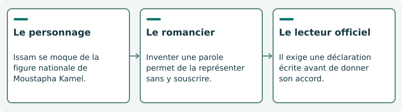

# X-ENS · MP-PC · Arabe 2011 — Corrigé brut

*Corrigé rédigé par IA, non officiel. Signalez toute erreur.*

**Rédaction** · GPT-6.2 Astra Ultra · vitesse non renseignée

La version et l’expression écrite durent chacune une heure et demie. Les deux réponses en arabe portent sur le texte de Robert Darnton. Les longueurs indicatives sont de 120 à 150 mots, puis de 180 à 200 mots.

## Version. Chez un employé du comité de lecture

De toute ma vie, je n’oublierai ce pénible moment. J’étais assis devant un employé du comité de lecture de l’Organisme du livre. Il feuilletait le manuscrit de mon roman, posé devant lui sur le bureau. Soudain, le visage renfrogné, il me lança d’un ton hostile :

— Impossible que je publie ce roman.  
— Pourquoi ?  
— Vous en ignorez vraiment la raison ?  
— Dites-la-moi, s’il vous plaît.  
— Parce que vous insultez l’Égypte.  
— Je n’ai pas insulté l’Égypte.  
— Vous tournez en ridicule notre dirigeant national, Moustapha Kamel.  
— Je ne me suis pas moqué de lui. J’aime et je respecte Moustapha Kamel. Celui qui s’est moqué de lui, c’est le héros du roman, Issam Abdel-Ati.  
— Vous voulez me faire croire que vous n’êtes pas d’accord avec ces propos, alors que c’est vous qui les avez écrits ?

J’entrepris d’expliquer à ce monsieur du comité de lecture la différence entre un article et un récit. Un article reflète l’opinion de son auteur, tandis qu’un récit est une œuvre d’imagination où interviennent des personnages divers, dont les opinions ne représentent pas nécessairement son point de vue. L’employé gardait le silence. Je m’échauffai en plaidant ma cause :

— Si nous suivons le raisonnement qui motive ce refus de publier le roman, un auteur qui met en scène un voleur deviendra lui-même un voleur, et s’il dépeint un espion, vous le tiendrez pour un traître à son pays… Un tel raisonnement sape les fondements mêmes de la littérature.

L’employé eut l’air un peu décontenancé. Puis un sourire rusé se dessina sur son visage, et il me dit :

— Vous ne partagez donc pas l’opinion du héros de votre roman ?  
— Absolument pas.  
— Vous en êtes sûr ?  
— Bien sûr que j’en suis sûr.  
— Pourriez-vous rédiger un désaveu ?  
— Un désaveu ?  
— Oui. J’autoriserai la publication si vous écrivez de votre main un désaveu où vous condamnez toutes les opinions du héros sur l’Égypte et les Égyptiens.  
— Entendu.

Je pris le papier et le stylo que me tendait l’employé et, sous le titre « Désaveu », j’écrivis : « Je soussigné, auteur de ce roman, déclare ne partager en aucune façon les opinions exprimées par son héros, Issam Abdel-Ati… Elles sont à l’opposé de ce que je pense de l’Égypte et des Égyptiens. » Et j’ajoutai de mon cru : « Je tiens à souligner que le héros de ce roman est un imbécile, psychologiquement instable, et qu’il a reçu à la fin ce qu’il méritait… J’ai rédigé ce désaveu à la demande du comité de lecture de l’Organisme du livre. »

L’employé lut attentivement le désaveu et poussa un soupir de soulagement. Puis il inscrivit son visa d’approbation sur le roman et me promit de le publier sous peu.

*Alaa El Aswany, Tirs amis, Dar al-Chourouk, Le Caire, 2009, p. 18–20.*

## Expression écrite 1. Comment Darnton conçoit-il le rôle de la bibliothèque ?

يرى روبرت دارنتون أن وظيفة المكتبة تبدأ من حاجة القارئ إلى معلومة يستطيع أن يصنع منها معرفة. لذلك يقيس قيمة مجموعاتها بما تتيحه من إمكان البحث والاختيار، ويستعين بالماضي لفهم حيرة الباحث أمام وفرة المطبوعات. ففي الحكاية التي يستعيدها يكتفي أهل المستقبل بخزائن قليلة بعد أن أحرقوا كتبا كثيرة واستخلصوا منها ما عدوه حقائق ثابتة. وتكشف هذه المبالغة عن قلق قديم من ضياع النافع وسط سيل المنشورات. أما مشروع رقمنة الكتب فيتصور حلا آخر للمشكلة نفسها، إذ يجمع عددا هائلا من المؤلفات ويتيح الوصول إليها عن طريق محرك بحث. تتغير إذن صورة المكتبة وأدواتها، لكن السؤال الذي يطرحه الكاتب يظل واحدا، وهو كيف يجد القارئ ما يلائم بحثه وسط هذا الكم من المواد وكيف ينتقل من مجرد العثور على النص إلى الإفادة منه.

## Expression écrite 2. Les bibliothèques ont-elles encore un rôle à jouer ?

أعتقد أن انتشار الإنترنت يزيد حاجتنا إلى بعض خدمات المكتبة. فعندما يبحث تلميذ عن تاريخ الحي الذي يسكنه يجد في هاتفه صورا كثيرة، لكنه قد يعجز عن معرفة تاريخ صورة واحدة أو اسم من التقطها. يستطيع أمين المكتبة أن يريه كيف يقارن الصورة بخريطة قديمة وبعدد من صحيفة محلية، وأن يشرح له لماذا اختلف تاريخ النشر عن تاريخ التصوير. وبعد هذه التجربة يصبح التلميذ أقدر على فحص ما يجده في البيت أيضا.

وللمكتبة وظيفة أخرى تتصل بالمساواة. فقد يملك شاب هاتفا يقرأ عليه الرسائل ولا يجد مكانا هادئا يكتب فيه بحثا طويلا. وحين توفر له المكتبة مقعدا وحاسوبا وأمينة مكتبة تساعده في استعمال الفهرس، تمنحه فرصة عملية لا يوفرها مجرد الاتصال بالشبكة. كذلك يمكنها أن تحفظ رسائل أهل الحي وتسجيلاتهم التي لم تفكر مؤسسة تجارية في نشرها، ثم تتيح نسخا رقمية منها لمن انتقلوا إلى مدينة بعيدة.

ولا أرى فائدة في إبقاء كل خدمة على صورتها القديمة. من الأفضل أن يتمكن القارئ من حجز الكتاب من بيته، وأن تستعمل المكتبة الوقت الذي توفره هذه العملية لاستقبال الزوار وتعليمهم. فنجاح المكتبة يقاس أيضا بما يتمكن الناس من فعله بعد مغادرتها، وبالأسئلة الجديدة التي يعودون بها إليها في المرة التالية.

[Version en arabe](https://banques-ecoles.fr/cms/wp-content/data/filiere-pc/annales-de-la-banque-pc/session-2011/2011%20Version_LVA2.pdf#page=4) · [Expression écrite commune, réponses en arabe](https://banques-ecoles.fr/cms/wp-content/data/filiere-pc/annales-de-la-banque-pc/session-2011/2011%20MP-PC%20SUJET%20EXPRESSION%20ECRITE_LVA1.pdf)
