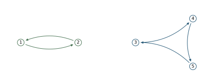

# X-ENS MP-PC · Informatique B 2011 · Corrigé brut

*Corrigé rédigé par IA, non officiel. Signalez toute erreur.*

**Rédaction** · GPT-6.2 Astra Ultra · vitesse non renseignée · 25 novembre 2026

Langage choisi : Python. Les valeurs d’une permutation et les arguments désignant des éléments sont numérotés de 1 à n. Une liste Python contient les n images, sans case fictive.

## I · Ordre d’une permutation

### Question 1 · Reconnaître une permutation

Les tableaux Python contiennent directement les valeurs de 1 à $n$. L'image de $i$ est donc `t[i-1]`. Un tableau de marques mémorise chaque valeur déjà lue. Une valeur hors de $[1,n]$ ou une répétition entraîne le rejet. Si les $n$ valeurs sont distinctes dans un ensemble de taille $n$, elles sont exactement les éléments de cet ensemble. Le coût est $O(n)$, pour $O(n)$ marques.

```python
def estPermutation(t):
    n = len(t)
    vu = [False] * n
    for v in t:
        if v < 1 or v > n or vu[v - 1]:
            return False
        vu[v - 1] = True
    return True
```

### Question 2 · Composition dans le bon ordre

La case d'indice $i$ doit contenir $t(u(i))$. Le parcours des valeurs `v` de `u` visite successivement les $u(i)$ et leur associe `t[v-1]`. Le nouveau tableau contient donc $t\circ u$. Aucune des deux entrées n'est modifiée.

```python
def composer(t, u):
    return [t[v - 1] for v in u]
```

### Question 3 · Permutation inverse

Chaque image $v=t(i)$ doit vérifier $t^{-1}(v)=i$. La bijectivité assure que chaque case de l'inverse est écrite une fois, sans recherche préalable. Le temps est $O(n)$ et l'inverse composé avec l'original redonne l'identité dans les deux sens.

```python
def inverser(t):
    inverse = [0] * len(t)
    for i, v in enumerate(t, start=1):
        inverse[v - 1] = i
    return inverse
```

### Question 4 · Exemples d’ordres 1 et n

L'identité $(1,2,\ldots,n)$ sous forme de tableau a pour ordre 1. Le tableau $(2,3,\ldots,n,1)$ décale chaque indice d'un cran, de sorte que $t^k(1)$ revient à 1 pour la première fois à $k=n$. Après $n$ pas chaque indice revient à son origine : l'ordre vaut $n$. Les deux exemples coïncident pour $n=1$.

### Question 5 · Calcul direct de l’ordre

Après initialisation, `puissance` vaut $t^k$ avec $k=1$. Une composition de plus et l'incrémentation de $k$ conservent cet invariant. La boucle rencontre nécessairement l'identité car les permutations d'un ensemble fini forment un groupe fini. Le premier exposant rencontré est l'ordre. Si cet ordre est $o$, la méthode coûte $O(no)$ et utilise des tableaux de taille $n$.

```python
def ordre(t):
    identite = list(range(1, len(t) + 1))
    puissance = t.copy()
    k = 1
    while puissance != identite:
        puissance = composer(t, puissance)
        k += 1
    return k
```

## II · Orbites, transpositions et cycles

### Question 6 · Période d’un indice

Une permutation décompose son ensemble en orbites cycliques. Partir de $t(i)$ avec un compteur à 1, puis avancer jusqu'à $i$, compte la longueur $p_i$ du cycle. Un point fixe renvoie ainsi 1. Le temps est $\Theta(p_i)$, sans tableau de marques.

```python
def periode(t, i):
    courant = t[i - 1]
    longueur = 1
    while courant != i:
        courant = t[courant - 1]
        longueur += 1
    return longueur
```

### Question 7 · Appartenance à l’orbite

Si $i=j$, l'itérée nulle donne immédiatement vrai. Sinon, tant que $j$ n'est pas atteint on avance d'une case. Revenir à $i$ après un tour entier prouve que $j$ n'appartient pas à ce cycle. La procédure termine en au plus $p_i$ transitions, même lorsque $j$ se trouve dans une autre orbite.

```python
def estDansOrbite(t, i, j):
    courant = i
    while courant != j:
        courant = t[courant - 1]
        if courant == i:
            return False
    return True
```

### Question 8 · Détecter une transposition

Une transposition déplace exactement deux indices. Réciproquement, si tous les autres sont fixes, ces deux-là ne peuvent avoir d'images parmi les indices fixes, déjà occupés, ni être leurs propres images. Ils s'échangent donc mutuellement. Il suffit de compter les différences $t(i)\ne i$. L'identité, même sur deux éléments, renvoie faux.

```python
def estTransposition(t):
    deplaces = sum(v != i for i, v in enumerate(t, start=1))
    return deplaces == 2
```

### Question 9 · Détecter un unique cycle non trivial

Si tous les éléments sont fixes, il n'y a aucun cycle de taille supérieure à un. Sinon, un élément déplacé $i$ appartient à un cycle non trivial dont tous les éléments sont déplacés. Sa longueur égale le cardinal de l'ensemble des éléments déplacés si et seulement si elle les contient tous. Les points fixes éventuellement présents ne font pas échouer le test.

```python
def estCycle(t):
    deplaces = [i for i, v in enumerate(t, start=1) if i != v]
    return bool(deplaces) and periode(t, deplaces[0]) == len(deplaces)
```

## III · Calculs efficaces

### Question 10 · Calculer toutes les périodes à coût linéaire

La valeur zéro sert de marque « non visité » puisque toute période est positive. Depuis un indice non marqué, on fait un premier tour pour mesurer la longueur, puis un second pour inscrire cette même valeur sur toute l'orbite. Les autres indices de l'orbite seront désormais ignorés. Les cycles sont disjoints et la somme de leurs longueurs vaut $n$. Le coût est donc $O(n)$ et le tableau résultat occupe $n$ cases.

```python
def periodes(t):
    p = [0] * len(t)
    for i in range(1, len(t) + 1):
        if p[i - 1] == 0:
            longueur = periode(t, i)
            j = i
            for _ in range(longueur):
                p[j - 1] = longueur
                j = t[j - 1]
    return p
```

### Question 11 · Calcul de la puissance par rotation des cycles

Pour une orbite $(u_0,\ldots,u_{d-1})$ ordonnée par $u_{s+1}=t(u_s)$, on a $t^k(u_s)=u_{(s+k\bmod d)\bmod d}$. Le tableau des périodes donne $d$, et le tableau du résultat sert de marque une fois toute l'orbite remplie. Chaque sommet n'est parcouru qu'un nombre borné de fois. Le coût est $O(n)$ opérations sur indices en comptant un reste par cycle comme une primitive. Pour $k=0$ ou un multiple de la longueur, chaque indice de ce cycle est renvoyé sur lui-même.

```python
def itererEfficace(t, k):
    p = periodes(t)
    resultat = [0] * len(t)
    for i in range(1, len(t) + 1):
        if resultat[i - 1] != 0:
            continue
        cycle = []
        j = i
        for _ in range(p[i - 1]):
            cycle.append(j)
            j = t[j - 1]
        taille = len(cycle)
        decalage = k % taille
        for indice, sommet in enumerate(cycle):
            resultat[sommet - 1] = cycle[(indice + decalage) % taille]
    return resultat
```


### Question 12 · Un ordre strictement supérieur à la taille

Sur $E_5$, prenons le tableau $(2,1,4,5,3)$, c'est-à-dire les cycles disjoints $(1\,2)$ et $(3\,4\,5)$. Une puissance est l'identité si et seulement si son exposant est multiple à la fois de 2 et de 3. Le premier exposant positif commun est 6, strictement supérieur à 5.



### Question 13 · Algorithme d’Euclide

Les diviseurs communs de $a,b$ sont exactement ceux de $b,a\bmod b$. Le second élément décroît strictement dès que l'on effectue un tour ; quand il vaut 0 le premier élément est le pgcd recherché. Le nombre de divisions est logarithmique au pire en le plus petit des deux arguments, à une première étape près si les arguments sont dans l'ordre inverse.

```python
def pgcd(a, b):
    while b != 0:
        a, b = b, a % b
    return a
```

### Question 14 · Plus petit commun multiple

Pour $d=\operatorname{pgcd}(a,b)$, écrire $a=d a'$, $b=d b'$ avec $a'$ et $b'$ premiers entre eux. Leur plus petit multiple commun est $da'b'= (a/d)b$. Le quotient de la fonction est donc exact. Diviser d'abord limite la taille du produit intermédiaire.

```python
def ppcm(a, b):
    return (a // pgcd(a, b)) * b
```

### Question 15 · Ordre à partir des longueurs de cycles

Une puissance est l'identité exactement lorsque son exposant est divisible par la longueur de chaque orbite. L'ordre est donc le ppcm de ces longueurs. On calcule les périodes en temps linéaire, supprime leurs répétitions, puis visite les valeurs distinctes en ordre décroissant. Le premier terme initialise le cumul sans appel à `ppcm`. Les longueurs divisant déjà le cumul n'entraînent qu'un test de reste. Les autres agrandissent le cumul au ppcm des longueurs examinées, ce qui prouve le résultat. L'ordre décroissant évite notamment tout appel pour une petite longueur qui divise une grande déjà traitée. Avec le tableau de la Q12 on combine ainsi uniquement 3 et 2 et on obtient 6.

```python
def ordreEfficace(t):
    longueurs = sorted(set(periodes(t)), reverse=True)
    if not longueurs:
        return 1
    resultat = longueurs[0]
    for longueur in longueurs[1:]:
        if resultat % longueur != 0:
            resultat = ppcm(resultat, longueur)
    return resultat
```
