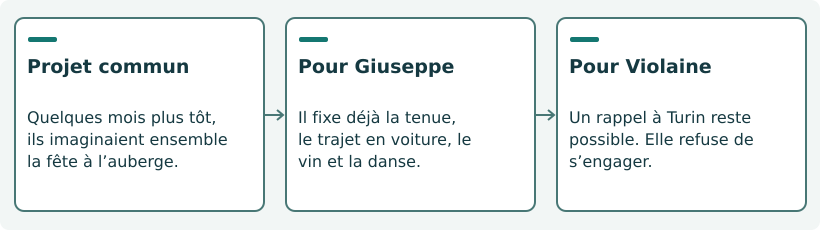

# X-ENS · MP-PC · Italien 2011 — Corrigé brut

*Corrigé rédigé par IA, non officiel. Signalez toute erreur.*

**Rédaction** · GPT-6.2 Astra Ultra · vitesse non renseignée

La version et l’expression écrite durent chacune une heure et demie. Les deux réponses sur le texte de Robert Darnton sont à rédiger en italien, en environ 120 à 150 mots pour la première et 180 à 200 mots pour la seconde.

## Version. Réveillon à la montagne

Vers trois heures de l’après-midi, il neigeait partout dans le Piémont au-dessus de huit cents mètres. Dans le val de Suse, il était tombé en peu de temps trente centimètres de poudreuse qui rendaient la circulation difficile. Violaine montait au pas, malgré ses pneus neige. Elle serait chez elle vers cinq heures.

Son portable sonna. C’était Giuseppe. « Tu as vu comme il neige ? Demain, tu vas pouvoir t’offrir ta plus belle journée de ski de l’année. »  
« Je suis déjà en route. Aujourd’hui, Avogadro nous a renvoyés chez nous de bonne heure. »  
« C’est Noël, championne, détends-toi. Deux jours de vacances n’ont jamais fait de mal à personne. Alors, qu’est-ce que tu as décidé pour le 31 ? Tu viens ? »

Mon Dieu. Le réveillon que Giuseppe organisait à l’auberge Gorlier ! Elle l’avait oublié. Quelques mois plus tôt, ça ne lui serait pas arrivé. « Je travaille. Je ne pense pas pouvoir venir. Je suis désolée. »  
« Allons, n’en fais pas toute une histoire. C’est le dernier jour de l’année, Violaine. Ça arrive une fois tous les trois cent soixante-cinq jours. »  
« Je ne peux vraiment pas. On m’a confié une enquête. » Elle eut de la peine à entendre la déception dans la voix de Giuseppe. « C’est une affaire difficile. J’ai le commissaire adjoint sur le dos. Excuse-moi, j’aurais dû te le dire plus tôt. C’est que… j’ai eu tant de choses à faire et… »  
Il l’interrompit. « Je te connais. Tu le regretteras. Ici, en haut, il vient de se remettre à neiger. L’après-midi du 31, tu n’auras qu’à te mettre sur ton trente et un. Je passerai te prendre. Avec une bouteille de mousseux. Il y aura aussi de la musique. On dansera toute la nuit si tu veux. Tu ne peux tout de même pas manquer ça, toi ! »

La voiture dérapa légèrement. Violaine serra plus fort le volant.

Détends-toi. Ne touche pas au frein. Reste calme.

Giuseppe avait raison. Cette fête du Nouvel An à l’auberge Gorlier, ils en avaient eu l’idée ensemble, des mois plus tôt, quand tout allait bien entre eux.

« Je sais, Giuseppe. Je suis désolée, mais cette enquête passe absolument avant tout. Je ne sais même pas ce qui va se passer dans trois heures, alors tu imagines, dans une semaine ! Je ne peux rien promettre. Si on me rappelle, il faut que je retourne à Turin, tu comprends ? »

Silence. Il avait raccroché.

Ils étaient restés ensemble trois ans. L’hiver, Giuseppe Mallen passait la saison de ski à patrouiller sur les pistes, à l’affût des skieurs en difficulté et des imprudents qui s’aventuraient sur les sommets au risque de déclencher des avalanches dans les couloirs. L’été, Violaine et lui se levaient à l’aube et marchaient des heures en silence, en prenant garde de ne pas effrayer les animaux.

*Benedetta Cibrario, Sous des cieux indifférents, 2010.*

## Expression écrite 1. Quelle fonction Darnton assigne-t-il à la bibliothèque ?

Per Darnton una biblioteca di ricerca risponde a un bisogno che accomuna gli studiosi e i cittadini. Ognuno cerca informazioni, ma ha anche bisogno di orientarsi per ricavarne una conoscenza pertinente. Lo mostra la visita immaginata da Mercier. Invece di trovare scaffali interminabili, il viaggiatore scopre quattro piccoli armadi: una commissione ha letto e bruciato i libri per conservarne poche verità. Il racconto dà forma al timore che quanto cerchiamo si perda nella massa degli scritti. La biblioteca digitale affronta la stessa difficoltà con un procedimento diverso. Accumula milioni di opere e affida a un motore di ricerca il compito di ritrovare quelle desiderate. Cambiano dunque le dimensioni della raccolta e gli strumenti di accesso, mentre resta aperta la questione di come mettere i documenti al servizio di chi li consulta.

## Expression écrite 2. Quel rôle pour les bibliothèques à l’ère numérique ?

Secondo me la biblioteca conserva un ruolo decisivo proprio perché uno schermo può mostrare moltissimi documenti senza suggerire come leggerli. Quando una classe studia la storia di una fabbrica chiusa, per esempio, una ricerca in rete può restituire per prima la pagina di una società immobiliare interessata al terreno. In biblioteca i ragazzi possono confrontare quella versione con la stampa locale, una pianta del quartiere e il racconto registrato di chi lavorava in fabbrica. Un bibliotecario che conosca il fondo li aiuta a formulare domande che il motore di ricerca non poteva anticipare.

C’è poi una questione di accesso. Il ragazzo che condivide una stanza con due fratelli può avere Internet sul telefono e tuttavia non avere un tavolo dove preparare un esame. Offrirgli un posto tranquillo è un servizio concreto, come prestare un libro a chi non può comprarlo.

Questo non significa che ogni lettore debba spostarsi per ogni consultazione. Chi abita lontano guadagna molto se può leggere da casa un giornale raro. Per me la biblioteca migliore è quella in cui la visita e il servizio a distanza si sostengono a vicenda: un documento consultato sul telefono può dare inizio a una ricerca che continua fra gli scaffali.

[Version en italien](https://banques-ecoles.fr/cms/wp-content/data/filiere-pc/annales-de-la-banque-pc/session-2011/2011%20Version_LVA2.pdf#page=6) · [Expression écrite commune, réponses en italien](https://banques-ecoles.fr/cms/wp-content/data/filiere-pc/annales-de-la-banque-pc/session-2011/2011%20MP-PC%20SUJET%20EXPRESSION%20ECRITE_LVA1.pdf)
