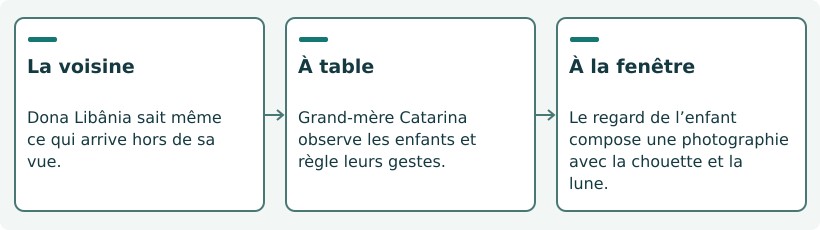

# X-ENS · MP-PC · Portugais 2011 — Corrigé guidé

*Corrigé rédigé par IA, non officiel. Signalez toute erreur.*

**Rédaction** · GPT-6.2 Astra Ultra · vitesse non renseignée

La version et l’expression écrite durent chacune une heure et demie. Les deux réponses sur le texte de Robert Darnton sont à rédiger en portugais, en environ 120 à 150 mots pour la première et 180 à 200 mots pour la seconde.

## Version. Chez grand-mère

Distribuer les noms avant de traduire le dialogue. Agnette souffre de la jambe. Catarina lui dit *mana*, « ma sœur », puis se tient près des enfants tandis qu’ils mangent. La voisine Libânia reste un personnage distinct. Dans ce récit familial, ce que les enfants voient et ce que la voisine sait n’ont pas les mêmes limites.

Les répétitions transmettent une voix. Le narrateur dit deux fois qu’Agnette rentre et trois regards se répondent autour du verbe *espreitar*. « Faire pipi » préserve le niveau de langue des enfants. Conserver le singulier dans l’image finale. La lune sert de support, la chouette est l’image en noir et blanc. La traduire par un simple clair de lune supprimerait la comparaison.

### Proposition rédigée

Grand-mère a raccompagné le camarade Botardov jusqu’au portail. Nous sommes allés jeter un coup d’œil. Ils restaient toujours un peu là à bavarder, au portail.

Dans la maison d’à côté, Dona Libânia venait toujours jeter un coup d’œil, elle aussi. Quoi qu’il arrive chez Grand-mère, elle était toujours au courant. Si on voulait savoir qui était passé ou à quelle heure, il suffisait de demander à Dona Libânia. Même ce qui se passait dans d’autres maisons qu’elle ne pouvait pas voir, elle le savait aussi.

Puis grand-mère Agnette est rentrée. Elle avait du mal à marcher. Elle est rentrée et s’est rassise en se frottant la jambe.

— Ça me fait comme une brûlure.  
— Ou bien tu téléphones à ta fille, ou bien tu appelles le médecin cubain.  
— J’appellerai demain. À cette heure-ci, il est déjà tard. Les enfants, commencez à vous préparer pour aller dormir.  
— Ceux qui ont faim peuvent prendre une assiette de soupe. Madalena va la réchauffer, a dit grand-mère Catarina. Reste où tu es, ma sœur. Repose-toi là, la jambe allongée.

La pluie s’était bel et bien arrêtée. Un joli bruit, tout doucement, une sorte de sifflement étouffé, a commencé à se faire entendre du côté de la cour où se trouvait le figuier.

Au dîner, on a mangé juste un petit peu. Personne n’aimait beaucoup la soupe, mais grand-mère Catarina restait là, tout près, à nous regarder tranquillement.

— Ce n’est pas la bouche qui va à la nourriture, nous apprenait-elle, c’est la nourriture qui vient à la bouche.

On s’exerçait à ce truc compliqué, manger presque sans baisser la tête, tout en écoutant les autres règles qu’on connaissait déjà par cœur.

— Les coudes, on ne les met pas sur la table. Le ventre ne touche pas la table. On n’a peut-être pas grand-chose à manger, mais on sait comment manger. Et on ne parle pas la bouche pleine, vous le savez.

On est montés se brosser les dents et faire pipi. En guise de pyjama, on portait de vieilles chemises et une culotte. Il faisait chaud, mais il fallait quand même se couvrir, ne serait-ce que du drap, à cause des moustiques.

— Je ne sais pas pourquoi les moustiques ont cette manie de boire du sang.  
— C’est sûrement qu’ils ont soif.  
— Ne dis pas n’importe quoi.

J’ai encore jeté un coup d’œil par la fenêtre de la salle de bains. Une chouette s’était posée tout en haut du figuier. On aurait dit que la lune était une petite boîte où mettre des photos et que la chouette était la photo elle-même, en noir et blanc.

*Ondjaki, Grand-mère Dix-Neuf et le secret du Soviétique, 2008.*

## Expression écrite 1. Quelle fonction Darnton assigne-t-il à la bibliothèque ?

Rattacher « ajuda » à une opération précise, passer de l’information au savoir. Pour Mercier, il faut rendre compte d’une sélection radicale faite à la place de tous les lecteurs. Pour la numérisation, reprendre la question du choix, qui se pose encore quand le livre demeure accessible. Cette formulation rend compte de Darnton sans présenter le projet de Google comme une solution définitive.

### Proposition rédigée

Para Robert Darnton, a biblioteca de pesquisa atende a uma necessidade que vai além do meio universitário. Todos nós procuramos informações e precisamos de ajuda para transformar o que encontramos em conhecimento pertinente. A história de Mercier permite ao autor mostrar que a impressão de afogamento diante de tantos textos já existia no século dezoito. Na biblioteca imaginada pelo escritor, uma comissão decide o que merece sobreviver e reduz um acervo imenso ao conteúdo de quatro pequenos armários. A digitalização propõe outra saída para o mesmo problema: milhões de livros podem ficar ao alcance do leitor, que procura entre eles o material de que necessita. O que está em jogo, portanto, é tanto a conservação dos documentos quanto a possibilidade de encontrar um caminho inteligível através deles.

## Expression écrite 2. Quel rôle pour les bibliothèques à l’ère numérique ?

Un détail local, le changement de nom d’une rue, permet de montrer quelle connaissance manque à un moteur de recherche. L’exemple des lettres introduit un enjeu distinct, la confiance qui permet à une collection d’exister. Dans la phrase sur la donatrice, le conditionnel *seria* apprécie les conséquences d’une mise en ligne hypothétique. Le texte peut ainsi défendre l’accès à distance tout en expliquant qu’il dépend aussi de décisions prises sur place.

### Proposition rédigée

Vejo um papel importante para as bibliotecas sempre que a facilidade de encontrar uma resposta esconde a dificuldade de fazer uma boa pergunta. Um rapaz que queira conhecer a história da sua rua pode achar num minuto dezenas de fotografias antigas. Mas talvez descubra, com a ajuda de uma bibliotecária, que a mesma rua já teve outro nome. A partir daí, uma busca nos jornais locais devolve notícias que nunca apareciam quando ele usava o nome atual. Essa pequena descoberta muda o alcance de toda a pesquisa.

Há ainda documentos que chegam à biblioteca porque alguém conhece o bairro e ganha a confiança das famílias. Uma moradora pode entregar cartas que guardou durante quarenta anos, com a condição de que só sejam consultadas de determinada maneira. Conservar essas cartas exige tempo, espaço e respeito pela palavra dada. Colocá-las imediatamente na rede seria desrespeitar a doadora.

Por isso, eu não mediria o valor de uma biblioteca pelo número de computadores instalados ou de volumes nas estantes. Perguntaria antes se um leitor distante consegue consultar o catálogo e se, ao chegar, encontra alguém disposto a ajudá-lo a interpretar o que descobriu.

[Version en portugais](https://banques-ecoles.fr/cms/wp-content/data/filiere-pc/annales-de-la-banque-pc/session-2011/2011%20Version_LVA2.pdf#page=7) · [Expression écrite commune, réponses en portugais](https://banques-ecoles.fr/cms/wp-content/data/filiere-pc/annales-de-la-banque-pc/session-2011/2011%20MP-PC%20SUJET%20EXPRESSION%20ECRITE_LVA1.pdf)
