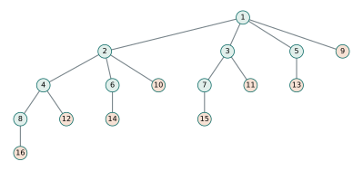
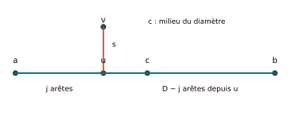
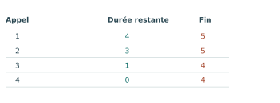
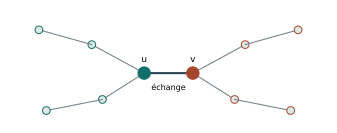

# X-ENS · MP · Informatique A 2011 — corrigé brut

*Corrigé rédigé par IA, non officiel. Signalez toute erreur.*

**Rédaction** · GPT-6.2 Astra Ultra · vitesse non renseignée · 25 novembre 2026

**Transmission dans les arbres.** Le sujet XULC de quatre heures utilise le modèle du téléphone, avec un seul voisin par sommet et par étape. Tous les programmes utilisent OCaml. Le temps écoulé et le nombre total d’appels sont comptés séparément.

## I. Arbres binomiaux

### Question 1 · Un arbre binomial d’ordre quatre

Choisissons les sommets $1,\ldots,16$. Les listes de fils sont $1:(2,3,5,9)$, $2:(4,6,10)$, $3:(7,11)$, $4:(8,12)$, $5:(13)$, $6:(14)$, $7:(15)$ et $8:(16)$. Les autres sommets sont externes. Les quatre branches de la racine ont respectivement les ordres 3, 2, 1 et 0. La figure fait apparaître ces quatre tailles.



### Question 2 · Effectifs et feuilles

Pour $k\ge1$, le nombre de nœuds vérifie $n_k=1+\sum_{i=0}^{k-1}n_i$, avec $n_0=1$. Il en résulte $n_k=2n_{k-1}=2^k$. Pour les feuilles, $e_0=1$ et $e_k=\sum_{i=0}^{k-1}e_i$. Ainsi **$e_k=2^{k-1}$ pour $k\ge1$**, et $e_0=1$.

### Question 3 · Construction par doublement

Dans $B_k$, le premier fils est la racine d’un $B_{k-1}$. En supprimant l’arête vers ce fils, la racine initiale garde comme branches $B_{k-2},\ldots,B_0$ et forme un second $B_{k-1}$. Réciproquement, joindre les racines de deux copies disjointes de $B_{k-1}$ en faisant de la seconde le premier fils de la première donne $B_k$. Pour $k=1$, ce sont deux singletons.

### Question 4 · Copie avec décalage des étiquettes

Le langage choisi pour toutes les fonctions est **OCaml**. On garde le constructeur du sujet. Chaque étiquette est augmentée de $n$ et l’ordre des fils est conservé. Le temps et la taille produite sont linéaires en nombre de nœuds.

```ocaml
type arbre = Noeud of int * arbre list

let rec copie n (Noeud (r, fils)) =
  Noeud (r + n, List.map (copie n) fils)
```

### Question 5 · Construction linéaire de $B_k$

À l’étape où l’arbre contient $m$ sommets numérotés de 1 à $m$, la copie décalée utilise $m+1,\ldots,2m$. L’ajout en tête des fils réalise Q3. Les coûts successifs $1,2,\ldots,2^{k-1}$ totalisent $2^k-1$. Le temps vaut donc $O(2^k)$, proportionnel à la taille de la sortie.

```ocaml
let bin k =
  if k < 0 then invalid_arg "bin";
  let rec construire rang =
    if rang = 0 then (Noeud (1, []), 1)
    else
      let ((Noeud (r, fils) as t), taille) = construire (rang - 1) in
      (Noeud (r, copie taille t :: fils), 2 * taille)
  in
  fst (construire k)
```

### Question 6 · Profondeur et diamètre

La profondeur est $k$ car la plus grande branche a profondeur $k-1$. Pour $k\ge1$, dans les deux copies de Q3 un chemin traversant leur arête de jonction a longueur au plus $(k-1)+1+(k-1)=2k-1$. Ce maximum est atteint en prenant une feuille de profondeur $k-1$ dans chaque copie mesurée depuis sa propre racine. Un chemin restant dans une seule copie est au plus aussi long. Le diamètre vaut donc **$2k-1$**, et vaut 0 pour $k=0$.

### Question 7 · Profil par profondeurs

Si $b(k,\ell)$ compte les nœuds de profondeur $\ell$, Q3 donne $b(k,\ell)=b(k-1,\ell)+b(k-1,\ell-1)$. Avec $b(0,0)=1$ et la valeur zéro hors de $0\le\ell\le k$, le triangle de Pascal donne **$b(k,\ell)=\binom{k}{\ell}$**.

### Question 8 · L’arbre $C_{16}$

Pour $2^j<i\le2^{j+1}$, le père de $i$ vaut $i-2^j$. Il est toujours compris entre 1 et $i-1$. Chaque sommet autre que 1 possède donc un père unique et l’itération décroît jusqu’à 1. Le graphe est connexe et sans cycle. Pour $C_{16}$, les pères de $2$, de $3,4$, de $5,\ldots,8$ puis de $9,\ldots,16$ sont respectivement $1$, $1,2$, $1,2,3,4$ et $1,2,\ldots,8$. C’est exactement l’arbre dessiné à Q1. **$C_{2^k}$ est isomorphe à $B_k$**. On peut aussi le voir à chaque doublement, qui attache un nouveau fils à chacun des anciens sommets.

### Question 9 · Construction de $C_n$ en temps linéaire

Le tableau enregistre les numéros de fils. Le second parcours transforme cette représentation en arbres imbriqués. Chaque numéro est créé et lu un nombre borné de fois. Le test après un bloc évite de doubler une puissance au-delà du dernier bloc nécessaire.

```ocaml
let cn n =
  if n < 1 then invalid_arg "cn";
  let fils = Array.make (n + 1) [] in
  let rec bloc debut =
    if debut < n then begin
      let nombre = min debut (n - debut) in
      for pere = 1 to nombre do
        fils.(pere) <- (debut + pere) :: fils.(pere)
      done;
      if debut <= n / 2 then bloc (2 * debut)
    end
  in
  bloc 1;
  let rec arbre i = Noeud (i, List.map arbre (List.rev fils.(i))) in
  arbre 1
```

## II. Chemins, profondeur et diamètre

### Question 10 · Profondeur d’un arbre

Le maximum des profondeurs des fils augmentées de 1 donne celle du nœud. La valeur initiale 0 traite la feuille. Chaque liste de fils est parcourue une fois, soit $O(n)$ pour $n$ nœuds.

```ocaml
let rec profondeur (Noeud (_, fils)) =
  List.fold_left (fun h t -> max h (1 + profondeur t)) 0 fils
```

### Question 11 · Étiquette d’une feuille la plus profonde

Le parcours transmet vers le bas la distance à la racine. Aux embranchements, on ne compare que les couples déjà produits par les fils. Chaque sommet est visité une fois.

```ocaml
let noeud_externe_max arbre =
  let rec chercher niveau (Noeud (r, fils)) =
    match fils with
    | [] -> (niveau, r)
    | premier :: autres ->
        List.fold_left
          (fun ((d, _) as meilleur) t ->
             let ((h, _) as candidat) = chercher (niveau + 1) t in
             if h > d then candidat else meilleur)
          (chercher (niveau + 1) premier) autres
  in
  snd (chercher 0 arbre)
```

### Question 12 · Chemin de la racine au sommet donné

Une recherche infructueuse renvoie None. Le chemin fructueux est construit par ajouts en tête, en remontant. Si $s$ est la racine, le résultat est le singleton correspondant. Le coût total est $O(n)$.

```ocaml
let chemin arbre s =
  let rec cherche (Noeud (r, fils)) =
    if r = s then Some [r]
    else
      let rec essaie = function
        | [] -> None
        | t :: reste ->
            match cherche t with
            | None -> essaie reste
            | Some liste -> Some (r :: liste)
      in
      essaie fils
  in
  match cherche arbre with
  | Some liste -> liste
  | None -> invalid_arg "sommet absent"
```

### Question 13 · Changement de racine par inversion du chemin

On obtient le chemin de Q12, puis on le descend. À chaque pas, on détache le fils suivant. Le reste de l’arbre, déjà réorienté côté ancien parent, devient une nouvelle branche à rattacher plus bas. Les sous-arbres hors chemin sont réutilisés. Les listes de fils examinées appartiennent à des sommets distincts du chemin. Le temps, y compris Q12, est $O(n)$.

```ocaml
let pivot arbre s =
  let rec enlever cible prefixe = function
    | [] -> invalid_arg "chemin incoherent"
    | (Noeud (r, _) as t) :: reste ->
        if r = cible then (t, List.rev_append prefixe reste)
        else enlever cible (t :: prefixe) reste
  in
  let ajoute parent fils =
    match parent with None -> fils | Some p -> p :: fils
  in
  let rec descend parent (Noeud (r, fils)) = function
    | [] -> Noeud (r, ajoute parent fils)
    | prochain :: suite ->
        let enfant, autres = enlever prochain [] fils in
        let ancien = Noeud (r, ajoute parent autres) in
        descend (Some ancien) enfant suite
  in
  match chemin arbre s with
  | _ :: suite -> descend None arbre suite
  | [] -> invalid_arg "arbre vide"
```

### Question 14 · Justification du double parcours

Enracinons en $r$ et prenons deux extrémités $a,b$ d’un diamètre $D$. Notons $w$ leur dernier ancêtre commun et $x=r_1$ une feuille de profondeur maximale. Si $x$ descend de $w$, choisir parmi $a,b$ une extrémité, disons $b$, dont le chemin vers $x$ passe par $w$, avec l’autre extrémité nommée $a$. Cela est toujours possible, y compris si $w$ est lui-même une extrémité en choisissant alors l’autre branche de façon appropriée ou en prenant $b=w$. On a $d(x,b)=h(x)+h(b)-2h(w)\ge h(a)+h(b)-2h(w)=D$. Si $x$ ne descend pas de $w$, le dernier ancêtre commun de $x$ et $b$ est au-dessus de $w$, d’où la même inégalité. Dans les deux cas, $D$ est déjà la plus grande distance entre deux sommets. Donc $d(x,b)=D$. La profondeur de l’arbre réenraciné en $x$ vaut exactement $D$, même si plusieurs feuilles étaient ex æquo.

### Question 15 · Calcul du diamètre

Chercher une feuille éloignée, en faire la racine et mesurer la nouvelle profondeur. La valeur renvoyée est correcte par Q14 et le coût est $O(n)$.

```ocaml
let diametre t =
  profondeur (pivot t (noeud_externe_max t))
```

### Question 16 · Rayon et diamètre

La plus grande profondeur est $D$, atteinte en choisissant une extrémité d’un diamètre. Pour toute racine $r$ et tout diamètre $ab$, $d(r,a)+d(r,b)\ge D$ donne une profondeur au moins $\lceil D/2\rceil$. Réciproquement, prendre le sommet $c$ à distance $\lfloor D/2\rfloor$ de $a$ sur $ab$. Pour un sommet $v$, notons $u$ son point de raccordement sur le chemin $ab$, $j=d(a,u)$ et $s=d(u,v)$. Des bornes $d(a,v),d(b,v)\le D$, on tire $s\le\min(j,D-j)$. Ainsi $d(c,v)=s+|j-\lfloor D/2\rfloor|\le\lceil D/2\rceil$, selon que $u$ est avant ou après $c$. Le minimum des profondeurs est donc **$\lceil D/2\rceil$**.



## III. Diffusion depuis la racine

### Question 17 · Diffusion en numérotation naturelle

Les fils dans l’ordre des appels portent $B_0,B_1,\ldots,B_{k-1}$. La branche $B_i$ commence à l’étape $i+1$. Sa durée interne augmente avec $i$, d’où $T_k=k+T_{k-1}$ et $T_0=0$. On obtient **$T_k=k(k+1)/2$**. Cette valeur est atteinte par la chaîne qui prend à chaque niveau la branche de plus grand ordre.

### Question 18 · Numérotation renversée

La branche $B_i$ commence à l’étape $k-i$. Si la diffusion renversée dans $B_i$ dure $i$ étapes, elle finit à $k-i+i=k$. Le singleton termine immédiatement. Par induction sur $k$, la durée est **$k$**.

### Question 19 · Optimalité dans un arbre binomial

À chaque étape, un sommet informé peut prévenir au plus un nouveau sommet. Le nombre informé peut donc au plus doubler. Partant de 1, informer $2^k$ sommets exige au moins $k$ étapes. Q18 atteint cette borne.

### Question 20 · Meilleur ordre des fils

Après calcul récursif des durées optimales $d_i$ des branches, un ordre $\sigma$ donne la durée $\max_j(j+d_{\sigma(j)})$ avec les rangs $j=1,\ldots,m$. Si $x\le y$ sont placés aux rangs $j,j+1$, leur contribution maximale vaut $j+1+y$. Après échange, $\max(j+y,j+1+x)$ est au plus cette valeur. Éliminer les inversions conduit à l’ordre **décroissant des durées**. Les branches travaillent indépendamment une fois appelées, d’où l’optimalité par induction. Le coût des tris locaux est borné par $\sum_v O(d_v\log(d_v+1))=O(n\log n)$ où $d_v$ est le nombre de fils. Mémoriser l’ordre obtenu en chaque sommet fournit la diffusion elle-même.



### Question 21 · Durée optimale par programmation récursive

La valeur initiale 0 traite la feuille. L’accumulateur contient le rang du prochain appel et le maximum des dates de fin déjà calculées.

```ocaml
let rec diffusion_optimale (Noeud (_, fils)) =
  let durees = List.map diffusion_optimale fils in
  let ordre = List.sort (fun a b -> compare b a) durees in
  let _, fin =
    List.fold_left
      (fun (rang, fin) d -> (rang + 1, max fin (rang + d)))
      (1, 0) ordre
  in
  fin
```

### Question 22 · Borne supérieure en taille

Informer un seul voisin nouveau par étape suffit en parcourant l’arbre depuis la racine. Il faut au plus $n-1$ étapes. La chaîne $P_n$ enracinée à une extrémité exige $n-1$ étapes car l’information doit franchir $n-1$ arêtes successives. La borne est donc exacte pour tout $n\ge1$.

### Question 23 · Borne inférieure en taille

Le doublement de Q19 donne $T\ge\lceil\log_2 n\rceil$. Dans $C_n$, au début de l’étape $j+1$ les sommets $1,\ldots,\min(2^j,n)$ sont informés. Chaque $i\le\min(2^j,n-2^j)$ appelle son fils $i+2^j$. Ces arêtes sont disjointes et les numéros informés s’étendent jusqu’à $\min(2^{j+1},n)$. Après $\lceil\log_2n\rceil$ étapes tous sont informés. Cela couvre aussi $n=1$ sans appel.

## IV. Échange total dans les arbres

### Question 24 · Échange total dans deux copies

Les deux $B_{k-1}$ de Q3 travaillent en parallèle. Inverser dans chacune le calendrier de la diffusion renversée collecte tous ses messages à sa racine en $k-1$ étapes. Les deux racines échangent une fois et connaissent alors tous les messages. Les deux diffusions de Q18, à nouveau parallèles, les propagent en $k-1$ étapes. La durée est **$2k-1$**. Pour $k=1$, un seul échange suffit.

### Question 25 · Borne inférieure pour l’échange binomial

Le diamètre de $B_k$ vaut $2k-1$. Un message avancera d’au plus une arête par étape, car un sommet communique avec un seul voisin et ne relaie que des messages reçus auparavant. Pour que les extrémités du diamètre connaissent leurs messages respectifs, il faut donc au moins $2k-1$ étapes. Avec Q24, la durée est optimale.

### Question 26 · Borne universelle de durée

Soit $h$ le numéro de la première étape à la fin de laquelle au moins un sommet connaît tout. À l’étape $t$, un sommet connaît au plus $2^t$ messages, en prenant l’union des deux ensembles antérieurs lors d’un appel. Ainsi $h\ge\lceil\log_2n\rceil$. Choisir un échange $uv$ qui forme pour la première fois un ensemble complet. Les deux participants connaissent alors tous les messages, alors qu’aucun participant ne connaissait tout au début de cette étape. Les détenteurs d’un message donné forment toujours un sous-arbre connexe, car une transmission ne peut ajouter qu’un voisin à l’ensemble de ses détenteurs.
Avant l’appel central, chaque extrémité est encore incomplètement informée. Choisir un message connu de $u$ et inconnu de $v$, et inversement. Par connexité des ensembles de détenteurs, le premier n’a encore atteint aucun sommet de la composante de $v$, et le second aucun de celle de $u$. Après l’appel il faut donc, dans chacune des deux composantes, acheminer un message depuis sa seule racine. Une composante a au moins $\lceil n/2\rceil$ sommets. En $T-h$ étapes, au plus $2^{T-h}$ de ses sommets peuvent recevoir le message, les éventuels appels ultérieurs sur l’arête centrale ne créant aucun nouveau point d’entrée. Ainsi $T-h\ge\lceil\log_2\lceil n/2\rceil\rceil=\lceil\log_2n\rceil-1$. On dispose aussi de $T\ge\operatorname{diam}(T_{\rm arbre})$. La borne en taille est atteinte pour les puissances de deux par Q24.



### Question 27 · Trafic de l’effeuillage

Les suppressions font passer de $n$ à 2 sommets, donc elles ont lieu $n-2$ fois. Chaque feuille transmet son information et celle des sous-arbres déjà absorbés. L’échange des deux derniers sommets rassemble tout. Les $n-2$ appels inversés font ensuite redescendre la connaissance complète. Le trafic est **$(n-2)+1+(n-2)=2n-3$**, y compris pour $n=2$.

### Question 28 · Liste linéaire des feuilles retirées

Construire un ordre postfixe des sommets puis garder ses $n-2$ premiers. Au moment de sa suppression, chaque sommet de ce préfixe n’a plus de fils, et son père appartient encore à l’arbre. Le dernier sommet du postfixe est la racine. La variante ci-dessous prépare le résultat par ajouts en tête et ne concatène jamais de longues listes. Chaque cellule est visitée un nombre borné de fois.

```ocaml
let echange_total arbre =
  let rec postfixe (Noeud (r, fils)) suite =
    List.fold_right postfixe fils (r :: suite)
  in
  let ordre = postfixe arbre [] in
  let rec sans_deux_derniers = function
    | [] | [_] | [_; _] -> []
    | x :: suite -> x :: sans_deux_derniers suite
  in
  sans_deux_derniers ordre
```

### Question 29 · Minimalité du trafic

Toutes les $n-1$ arêtes doivent être utilisées au moins une fois, car leur suppression sépare l’arbre en deux composantes dont les messages doivent se croiser. Deux arêtes distinctes $e,f$ ne peuvent être chacune utilisées une seule fois. En effet, choisir un sommet $x$ dans la composante au-delà de $e$ à l’opposé de $f$, et $y$ au-delà de $f$ à l’opposé de $e$. Leur chemin traverse $e$ puis $f$. Le message de $x$ vers $y$ impose l’appel unique sur $e$ **strictement avant** celui sur $f$. Le message de $y$ vers $x$ impose l’inverse. Une seule arête au plus peut donc être appelée une seule fois. Le trafic est au moins **$1+2(n-2)=2n-3$**. Q27 atteint la borne.
