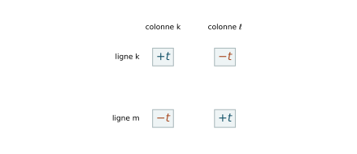

# X-ENS MP — Mathématiques A 2011 · Corrigé brut

*Corrigé rédigé par IA, non officiel. Signalez toute erreur.*

**Rédaction** · GPT-6.2 Astra Ultra · vitesse non renseignée

**Valeurs singulières et inégalités de traces.** On utilise le produit hermitien linéaire à droite du sujet. Les deux listes de valeurs propres de la dernière question sont algébriques, rangées par ordre décroissant, et peuvent comporter des valeurs négatives.

## I. Matrices normales

### Question 1

Avec $(x\mid y)=x^*y$, la règle $(BC)^*=C^*B^*$ donne $(A^*x\mid y)=(A^*x)^*y=x^*Ay=(x\mid Ay)$.

### Question 2.a

Pour tous $x,y$, $(Ax\mid Ay)=x^*A^*Ay$. La conservation du produit hermitien équivaut à $x^*(A^*A-I)y=0$ pour tout couple. En prenant des vecteurs canoniques, cela équivaut à $A^*A=I$. Une matrice carrée inversible à gauche est inversible et $A^{-1}=A^*$, donc $AA^*=I$ également. Ces identités suffisent bien à conserver le produit.

### Question 2.b

$(A^*A)_{ij}=(Ae_i\mid Ae_j)$. Par 2.a, $A$ est unitaire exactement lorsque les colonnes forment une famille orthonormale. Cette famille de $n$ vecteurs est libre et donc une base de $\mathbb C^n$. Réciproquement une base orthonormale donne $A^*A=I$.

### Question 3.a

Pour $A$ normale, $\|Ax\|^2=x^*A^*Ax=x^*AA^*x=\|A^*x\|^2$. Ainsi $\ker A=\ker A^*$. Si $y\in(\ker A)^\perp$ et $z\in\ker A$, on a $(z\mid Ay)=(A^*z\mid y)=0$, donc $Ay\in(\ker A)^\perp$. La matrice $A-\lambda I$ est normale car elle commute avec $A^*-\overline\lambda I$ en développant. Son noyau est $E_\lambda$. La stabilité de $E_\lambda^\perp$ par $A-\lambda I$ entraîne sa stabilité par $A$.

### Question 3.b

Toute normale complexe admet une valeur propre $\lambda$. Les sous-espaces orthogonaux $E_\lambda$ et $E_\lambda^\perp$ sont stables par $A$ d’après 3.a. Dans une base orthonormée adaptée, $A$ est donc bloc diagonale, avec un premier bloc $\lambda I$ ; la relation $AA^*=A^*A$ rend le second bloc normal. Par récurrence forte sur la dimension (le bloc vide et la dimension 1 sont immédiats), ce second bloc admet une base orthonormale propre. En réunissant les bases on obtient $A=UDU^*$ avec $U$ unitaire et $D$ diagonale. Inversement $D$ commute avec $D^*$ et la conjugaison unitaire préserve cette relation, donc $UDU^*$ est normale.

### Question 4

Les coefficients diagonaux de $AA^*$ sont $\sum_j|A_{ij}|^2$, donc $\operatorname{Tr}(AA^*)=\sum_{i,j}|A_{ij}|^2$. Si $A=UDU^*$ comme en 3.b, $AA^*=UDD^*U^*$ et la même trace vaut $\operatorname{Tr}(DD^*)=\sum_i|\lambda_i|^2$, multiplicités comprises.

### Question 5.a

Pour une matrice normale, $\|Ax\|^2=x^*A^*Ax=x^*AA^*x=\|A^*x\|^2$. L’une des deux images s’annule exactement quand l’autre s’annule, d’où $\ker A=\ker A^*$.

### Question 5.b

Si $A$ est normale, la matrice normale $A-\lambda I$ a même noyau que $A^*-\overline\lambda I$ par 5.a. Un vecteur propre pour $\lambda$ est donc propre pour $A^*$.

Réciproquement, choisissons un vecteur propre unitaire $x$ de $A$. Il est propre de $A^*$ par hypothèse. Alors $\mathbb Cx$ est stable par les deux matrices et son orthogonal aussi, par l’identité d’adjonction. Dans une base orthonormée adaptée, le second bloc de $A^*$ est l’adjoint $B^*$ du second bloc $B$ de $A$. Tout vecteur propre de $B$, vu dans l’espace initial, est propre de $A$, donc de $A^*$ et finalement de $B^*$. Par récurrence sur la dimension, $B$ est normal, le cas de dimension 1 étant immédiat. Le premier bloc scalaire l’est aussi, d’où la normalité de $A$.

### Question 6.a

Soit $S$ l’ensemble des valeurs propres distinctes de $A$. Le polynôme
$$P(X)=\sum_{\lambda\in S}\overline\lambda\prod_{\mu\in S\setminus\{\lambda\}}\frac{X-\mu}{\lambda-\mu}$$
vaut $\overline\lambda$ en chaque $\lambda\in S$. Dans la base orthonormée propre de 3.b, $P(A)$ et $A^*$ ont donc la même diagonale et sont égales.

### Question 6.b

Par 6.a, $A^*=P(A)$ et $B^*=Q(B)$. Si $AB=BA$, les quatre matrices $A,B,A^*,B^*$ commutent deux à deux par les identités polynomiales. En particulier $AB$ commute avec son adjoint $B^*A^*$. Donc $AB$ est normale.

### Question 7

Dans une base orthonormée propre de la normale $A$, prenons pour $U$ la diagonale de coordonnées $u_j=\overline\lambda_j/\lambda_j$ lorsque $\lambda_j\ne0$, et $u_j=1$ sinon. Ces coefficients ont module 1. La matrice unitaire ainsi définie commute avec $A$ et $AU$ a les valeurs diagonales $\overline\lambda_j$ de $A^*$. Inversement, si $A^*=AU$ et $AU=UA$, alors $AA^*=A^2U=AUA=A^*A$. Cela prouve la normalité.

## II. Valeurs singulières

### Question 8

Si $A=A^*$, elle est normale. Par 3.b elle est diagonalisable dans une base orthonormale. Dans cette base la diagonale est égale à sa conjuguée, donc réelle. Réciproquement une diagonale réelle conjuguée par une unitaire est hermitienne. Pour $x$ de coordonnées $c_j$ dans cette base, $(x\mid Ax)=\sum_j\lambda_j|c_j|^2$. La positivité pour tout $x$ équivaut à $\lambda_j\ge0$ pour tout $j$ en testant les vecteurs propres. On obtient les deux caractérisations.

### Question 9

En diagonalisant $A$ par 8, remplaçons chaque valeur propre $\lambda\ge0$ par $\sqrt\lambda$. La matrice obtenue $S$ est hermitienne positive et $S^2=A$. Si $T\ge0$ est une autre racine hermitienne, elle commute avec $A=T^2$, donc préserve chacun des espaces $E_\lambda(A)$. Sa restriction y est hermitienne positive et son carré y vaut $\lambda I$. Par 8 toutes ses valeurs propres y sont positives ou nulles et ont carré $\lambda$, donc cette restriction est $\sqrt\lambda I$, y compris si $\lambda=0$. Ainsi $T=S$.

### Question 10

Écrivons $A=QS$ avec $Q$ unitaire et $S\ge0$ hermitienne. Par 8, $S=VDV^*$ avec $V$ unitaire et $D$ diagonale à termes non négatifs. Alors $A=(QV)DV^*$ est une décomposition en valeurs singulières, car les produits et les adjoints d’unitaires sont unitaires.

### Question 11

Une matrice de permutation permet d’ordonner la diagonale : si $D'=P^*DP$, alors $UDW=(UP)D'(P^*W)$. De plus, dans toute telle décomposition, $A^*A=W^* D^2 W$. Les termes de $D^2$ constituent donc le multiensemble des valeurs propres de $A^*A$, avec multiplicité. Les racines carrées non négatives de ces valeurs, rangées dans l’ordre décroissant, forment une liste unique.

## III. Inégalités de traces et distance de Frobenius

### Question 12.a

Les identités $P=P^*=P^2$ donnent $P_{ii}=(e_i\mid Pe_i)=\|Pe_i\|^2$. Comme $e_i=Pe_i+(I-P)e_i$ est une décomposition orthogonale, $0\le P_{ii}\le1$. Les valeurs propres du projecteur sont 0 ou 1, et la multiplicité de 1 est la dimension de son image, $k$. Donc $\sum_iP_{ii}=\operatorname{Tr}P=k$.

### Question 12.b

Posons $p_i=P_{ii}$. Pour $k\ge1$, $\sum_{i\le k}(1-p_i)=\sum_{i>k}p_i$. Comme $\lambda_i\ge\lambda_k$ sur la première zone et $\lambda_i\le\lambda_k$ sur la seconde,
$$\sum_{i\le k}\lambda_i-\operatorname{Tr}(PD)=\sum_{i\le k}\lambda_i(1-p_i)-\sum_{i>k}\lambda_i p_i\ge0.$$
L’égalité est atteinte par le projecteur diagonal sur les $k$ premiers axes. Si $k=0$, le projecteur est nul et les deux membres valent zéro.

### Question 12.c

Pour $P_1,P_2$ de rang $k$, leurs images et leurs noyaux ont respectivement dimensions $k$ et $n-k$, et les deux sous-espaces sont orthogonaux pour chaque projecteur. Une unitaire $U$ envoyant une base orthonormale adaptée à $P_1$ sur une autre adaptée à $P_2$ vérifie $UP_1U^*=P_2$. Réciproquement, toute conjugaison unitaire de $P$ est encore un tel projecteur. On parcourt ainsi exactement tous les projecteurs de rang $k$, donc par 12.b $\max_U\operatorname{Tr}(UPU^*D)=\sum_{i\le k}\lambda_i$.

### Question 13

Chaque $|U_{ij}|^2$ est réel non négatif. La somme d’une colonne vaut 1 par la diagonale de $U^*U=I$. La somme d’une ligne vaut 1 par la diagonale de $UU^*=I$. C’est donc une matrice doublement stochastique.

### Question 14.a

Pour $j<k$, $A_{jj}=1$ impose, par positivité et sommes unitaires, que tous les autres coefficients de la ligne et de la colonne $j$ soient nuls. Comme $A_{kk}<1$, la colonne $k$ a donc un $A_{mk}>0$ avec $m>k$, et la ligne $k$ un $A_{k\ell}>0$ avec $\ell>k$. Nécessairement $A_{m\ell}<1$ puisque la ligne $m$ contient déjà le terme positif $A_{mk}$.

### Question 14.b

Prenons $t=\min(A_{mk},A_{k\ell})>0$. Ajouter $t$ aux cases $(k,k),(m,\ell)$ et retrancher $t$ aux cases $(m,k),(k,\ell)$, sans toucher aux autres. Les sommes ne changent pas, aucun coefficient ne devient négatif et l’une des deux cases diminuées devient nulle. La variation de la somme pondérée vaut
$$t(\alpha_k-\alpha_m)(\beta_k-\beta_\ell)\ge0.$$
Tant que $A_{kk}<1$, recommencer avec le même $k$. Le nombre de cases positives hors diagonale dans l’union de la ligne et de la colonne $k$ baisse strictement à chaque transfert : les seules cases augmentées sont $(k,k)$ et une case extérieure à cette union. En un nombre fini d’étapes $A_{kk}=1$. On passe alors au prochain indice, et les lignes et colonnes déjà traitées restent fixes. On arrive à l’identité sans avoir diminué la somme. Le maximum vaut donc $\sum_i\alpha_i\beta_i$, et l’identité l’atteint.

### Question 15.a

Soient $A=P D Q$ et $B=R T S$, avec $P,Q,R,S$ unitaires et les valeurs singulières ordonnées. Par cyclicité, $\operatorname{Tr}(AB)=\operatorname{Tr}((SP)D(QR)T)$. Les matrices $U=SP$ et $V=QR$ sont unitaires et conviennent.

### Question 15.b

Dans $UDVT$ le terme diagonal d’indice $i$ vaut $\sum_j U_{ij}\alpha_jV_{ji}\beta_i$, donc la trace est la somme double demandée. Les valeurs singulières sont non négatives. Par inégalité triangulaire et $|U_{ij}V_{ji}|\le(|U_{ij}|^2+|V_{ji}|^2)/2$,
$$|\operatorname{Tr}(AB)|\le\sum_{i,j}\beta_i\alpha_j W_{ij},\qquad W_{ij}=\tfrac12(|U_{ij}|^2+|V_{ji}|^2).$$
Par 13, $W$ est doublement stochastique (transposition et moyenne conservent les conditions). La question 14.b appliquée aux listes décroissantes $\beta,\alpha$ donne la borne $\sum_i\alpha_i\beta_i$.

### Question 15.c

Pour une matrice hermitienne positive, ses valeurs singulières sont ses valeurs propres car les carrés ont pour racines positives ces mêmes nombres. Leurs sommes valent donc les traces. Par 15.b et la non-négativité de chaque terme, $|\operatorname{Tr}(AB)|\le\sum_i\alpha_i\beta_i\le(\sum_i\alpha_i)(\sum_j\beta_j)=\operatorname{Tr}(A)\operatorname{Tr}(B)$.

### Question 16

Écrivons $A=P\operatorname{diag}(\alpha)P^*$ et $B=Q\operatorname{diag}(\beta)Q^*$ dans l’ordre décroissant. Pour $W=Q^*UP$, la trace croisée est réelle et vaut $\operatorname{Tr}(AU^*BU)=\sum_{i,j}\alpha_i\beta_j|W_{ji}|^2$. La question 14.b s’applique même lorsque les valeurs propres sont négatives, et donne le maximum $\sum_i\alpha_i\beta_i$. Il est atteint avec $W=I$, donc $U=QP^*$. En développant la norme de Frobenius et en utilisant la cyclicité de la trace,
$$\|A-U^*BU\|^2=\operatorname{Tr}(A^2)+\operatorname{Tr}(B^2)-2\operatorname{Tr}(AU^*BU).$$
Le minimum du carré vaut ainsi $\sum_i(\alpha_i-\beta_i)^2$. La racine carrée croissante donne la distance demandée.
