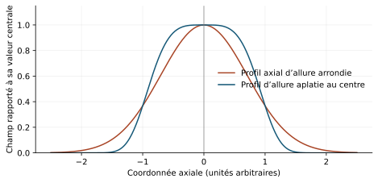
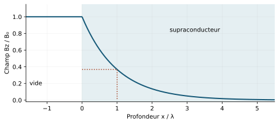
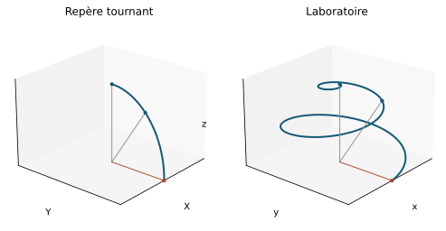
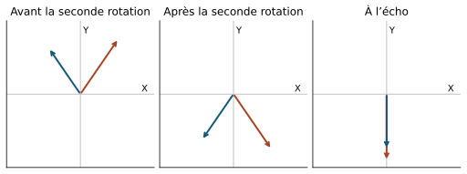
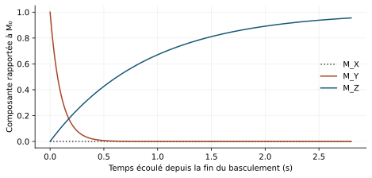

# X-ENS MP 2011 — Physique · Corrigé guidé

*Corrigé rédigé par IA, non officiel. Signalez toute erreur.*

**Lecture du rapport du jury** · GPT-6.2 Astra Ultra · vitesse non renseignée

**Rédaction** · GPT-6.2 Astra Ultra · vitesse non renseignée

## Imagerie par résonance magnétique

## I — Symétrie et homogénéité du champ

### Question I.1 — Antisymétrie de la distribution de courant

**Indication.** Examiner d’abord un point appartenant au plan, puis composer deux réflexions pour comparer des points d’azimuts différents.

Considérons un plan méridien passant par le point étudié. Sur ce plan, la réflexion conserve les composantes selon $\vec e_r,\vec e_z$ et inverse celle selon $\vec e_\theta$. Pour un courant **antisymétrique**, le vecteur au point image est l’opposé du vecteur réfléchi. Au point fixe, cela impose donc $j_r=j_z=0$. Deux réflexions méridiennes composées donnent une rotation arbitraire autour de l’axe. La distribution est ainsi axisymétrique et $\vec j=j_\theta(r,z)\vec e_\theta$, avec un coefficient indépendant de $\theta$. Ces conditions suffisent également à assurer l’antisymétrie.

### Question I.2 — Composantes autorisées du champ

**Indication.** Utiliser la transformation d’un vecteur axial sous réflexion. L’invariance par translation suivant $z$ n’a pas encore été supposée.

Le champ magnétique est un vecteur axial. Pour un plan d’antisymétrie des courants, il est contenu dans ce plan aux points de celui-ci. À tout point hors axe, $B_\theta=0$. L’invariance de rotation donne $\vec B=B_r(r,z)\vec e_r+B_z(r,z)\vec e_z$. Sur l’axe même il reste uniquement une composante axiale par régularité et symétrie. À distance de l’axe, un solénoïde de longueur finie peut également produire une composante radiale.

### Question I.3 — Champ d’un solénoïde long

**Indication.** Sur le contour d’Ampère, distinguer l’aire traversée par le courant et la cavité vide au centre.

Loin des bouts, on assimile le système à une distribution invariante par translation en $z$. L’équation $\nabla\cdot\vec B=0$ et la régularité sur l’axe conduisent alors à $B_r=0$. Le théorème d’Ampère sur un rectangle méridien de longueur axiale $h$, avec un côté dans l’alésage et l’autre à l’extérieur, donne $(B_{\rm int}-B_{\rm ext})h=\mu_0j_\theta(R_2-R_1)h$. Le champ extérieur constant est nul dans le modèle sans champ imposé. Ainsi
$$
\vec B_0=\mu_0 j_\theta(R_2-R_1)\,\vec e_z.
$$
Ce champ est uniforme dans la cavité centrale. Dans l’enroulement, $\partial_r B_z=-\mu_0j_\theta$ raccorde les deux valeurs.

### Question I.4 — Puissance Joule totale

**Indication.** Commencer par la puissance volumique, puis l’intégrer sur la couronne conductrice.

La loi locale $\vec E=\vec j/\sigma$ donne une puissance par unité de volume $\vec j\cdot\vec E=j_\theta^2/\sigma$. Le conducteur du modèle a le volume $\pi L(R_2^2-R_1^2)$. La puissance thermique totale est donc
$$
P_J=\frac{\pi L}{\sigma}(R_2^2-R_1^2)j_\theta^2
=\frac{\pi L B_0^2}{\sigma\mu_0^2}\frac{R_2+R_1}{R_2-R_1}.
$$
La seconde écriture permet de comparer différentes géométries à champ central fixé.

### Question I.5 — Borne géométrique à champ fixé

**Indication.** Exprimer le rapport géométrique comme un plus une fraction positive.

Le facteur géométrique de la puissance vaut $1+2R_1/(R_2-R_1)$. Pour $0\leq R_1<R_2$ il augmente avec $R_1$ à $R_2$ fixé. La borne inférieure correspond donc à $R_1=0$ ou à la limite $R_1\to0^+$ si le cylindre doit rester creux. Un appareil laissant une cavité utile a une puissance strictement supérieure dans ce modèle ohmique.

### Question I.6 — Ordre de grandeur de la dissipation

**Indication.** Calculer en premier le rapport champ sur perméabilité et conserver le facteur $\pi$.

La borne précédente donne $P_{\min}=\pi L B_0^2/(\sigma\mu_0^2)$. Avec les données de l’énoncé, $B_0/\mu_0=10^6\,\mathrm{A\,m^{-1}}$, puis $P_{\min}=\pi\,10^{12}/(6{,}0\times10^7)\simeq5\times10^4\,\mathrm W$. Cela représente la puissance de quelques dizaines de radiateurs domestiques, dont une puissance typique est de l’ordre du kilowatt.

### Question I.7 — Rayon externe et température

**Indication.** Distinguer la puissance électrique, la température transitoire et le bilan d’échange thermique en régime établi.

À $B_0,L,R_1$ fixés dans l’approximation précédente, un $R_2$ plus grand diminue $P_J$ vers la borne de I.6. La puissance volumique $B_0^2/[\sigma\mu_0^2(R_2-R_1)^2]$ diminue également. À courte durée et échange thermique négligeable, l’échauffement par unité de temps est cette puissance volumique divisée par la capacité thermique volumique. En régime établi, une plus grande surface extérieure favorise aussi l’évacuation de chaleur pour un même coefficient d’échange. Le modèle privilégie donc un rayon externe plus grand, dans les limites de l’approximation de solénoïde long. Une température chiffrée demanderait des données thermiques.

### Question I.8 — Pourquoi l’enroulement réel rompt la symétrie

**Indication.** Décomposer conceptuellement la tangente à l’hélice en composantes azimutale et axiale, puis considérer une moyenne sur plusieurs spires.

La tangente à une hélice de pas fini possède une composante axiale. De plus, un fil discret et ses connexions ne sont pas invariants sous toute rotation. L’approximation azimutale correspond, géométriquement, à des spires très proches les unes des autres dont l’inclinaison par rapport au plan transverse est faible. Dans la représentation moyennée de couches de pas opposés, les composantes axiales peuvent se compenser alors que les composantes azimutales s’ajoutent. C’est ce courant moyen qui est représenté par $j_\theta$ en I.3.

### Question I.9 — Effets de bord et homogénéité axiale

**Indication.** Un champ pair a déjà une tangente horizontale au centre. Le premier coefficient qu’il reste à corriger est celui du terme quadratique.

Avec un enroulement symétrique et de longueur finie, $B_z(0,z)$ est pair. Sa dérivée s’annule au centre, où le profil usuel a un maximum arrondi. Le champ diminue vers les extrémités puis tend vers zéro au loin. Pour l’aplatir au voisinage de zéro, il faut compenser sa courbure centrale négative. Une contribution symétrique donnant davantage de poids relatif aux zones proches des extrémités de l’enroulement peut fournir la courbure opposée. La somme conserve $B'_z(0)=0$ et peut aussi annuler $B''_z(0)$. Le premier écart au plateau devient alors d’ordre quatre en $z$.

### Question I.10 — Du profil axial au voisinage de l’axe

**Indication.** Introduire séparément la composante axiale paire en distance signée à l’axe et la composante transverse impaire. Employer les deux équations locales.

Dans la cavité vide, $\nabla\cdot\vec B=0$ et $\nabla\times\vec B=0$. Par régularité et axisymétrie, on écrit $B_z=b(z)+d(z)r^2+O(r^4)$ et $B_r=c(z)r+O(r^3)$ avec $b(z)=B_z(0,z)$. La divergence donne $2c+b'=0$ et le rotationnel donne $\partial_z B_r=\partial_r B_z$, soit $c'=2d$. Ainsi
$$
B_r=-\frac r2 b'(z)+O(r^3),\qquad B_z=b(z)-\frac{r^2}{4}b''(z)+O(r^4).
$$
Un plateau axial régulier, dont les dérivées sont petites sur l’intervalle étudié, rend le champ quasi axial et uniforme près de l’axe. Si $b$ est exactement constant sur un intervalle, les mêmes équations, appliquées aux ordres suivants, annulent successivement les corrections locales d’un champ harmonique régulier.

## II — Supraconductivité et effet Meissner

### Question II.1 — Accélération d’un électron dans le modèle

**Indication.** Appliquer la deuxième loi de Newton en respectant le signe de la charge mobile.

L’électron porte la charge $-e$. Dans le modèle de réponse sans frottement, son équation est $m_e\,d\vec v/dt=-e\vec E$. Pour un champ uniforme et constant et un départ au repos en $t=0$, $\vec v(t)=-(e/m_e)t\vec E$. La vitesse est de sens opposé au champ électrique.

### Question II.2 — Évolution de la densité de courant

**Indication.** Les deux signes négatifs viennent de l’accélération de l’électron et de la définition du courant.

Pour $n$ électrons par unité de volume, $\vec j=-ne\vec v$. À $n$ constant, la dérivation et le résultat de II.1 donnent $\partial_t\vec j=(ne^2/m_e)\vec E$. Un champ constant fait croître le courant dans ce modèle sans dissipation. Le coefficient reliant la dérivée de $\vec j$ à $\vec E$ est positif.

### Question II.3 — Longueur introduite par les équations de Maxwell

**Indication.** Le modèle microscopique fournit la dérivée temporelle de $\vec j$. L’utiliser avant de remplacer le rotationnel de $\vec E$.

Dans le régime quasi stationnaire, $\nabla\times\vec B=\mu_0\vec j$. Prenons le rotationnel puis dérivons en temps. En utilisant II.2 et Faraday, on obtient
$$
\partial_t(\nabla\times\nabla\times\vec B)
=\frac{\mu_0ne^2}{m_e}\nabla\times\vec E
=-\frac{\mu_0ne^2}{m_e}\partial_t\vec B.
$$
L’expression dont la dérivée temporelle est nulle est donc $\nabla\times\nabla\times\vec B+\vec B/\lambda^2$, avec $\lambda=\sqrt{m_e/(\mu_0ne^2)}$. Les deux termes ont les dimensions d’un champ divisé par une longueur au carré. Leur somme pourrait a priori être une fonction de la position indépendante du temps.

### Question II.4 — Ordre de grandeur de la longueur de London

**Indication.** Élever aussi la puissance de dix de la charge au carré avant de prendre la racine.

La substitution donne $\lambda^2=9{,}1\times10^{-31}/[1{,}3\times10^{-6}\times10^{28}\times(1{,}6\times10^{-19})^2]\simeq2{,}7\times10^{-15}\,\mathrm{m^2}$. D’où $\lambda\simeq5\times10^{-8}\,\mathrm m$, soit environ $50\,\mathrm{nm}$. Cette échelle est très petite devant la taille macroscopique d’un échantillon.

### Question II.5 — Écrantage dans le demi-espace

**Indication.** L’équation postulée fixe à zéro la constante d’intégration de II.3. Choisir ensuite la solution physiquement bornée.

L’équation renforcée et $\nabla\cdot\vec B=0$ donnent $\Delta\vec B=\vec B/\lambda^2$. Pour une dépendance en $x$, les solutions sont des combinaisons des exponentielles $e^{x/\lambda}$ et $e^{-x/\lambda}$. La première diverge en profondeur. Le courant d’écran est ici réparti sur une épaisseur finie, sans nappe singulière à l’interface, donc le champ tangentiel est continu. Les conditions à $x=0$ et $+\infty$ donnent
$$
\vec B(x)=B_0 e^{-x/\lambda}\vec e_z\qquad (x>0).
$$
Le champ pénètre d’une épaisseur de l’ordre de $\lambda$ et devient négligeable dans le volume à plusieurs longueurs de London de la surface. On retrouve l’expulsion macroscopique du champ, effet Meissner.

### Question II.6 — Courant d’écran

**Indication.** Le coefficient du rotationnel suivant $y$ contient $-\partial_x B_z$.

Pour $\vec B=B_z(x)\vec e_z$, $\nabla\times\vec B=-(dB_z/dx)\vec e_y$. La loi d’Ampère locale donne
$$
\vec j(x)=\frac{B_0}{\mu_0\lambda}e^{-x/\lambda}\vec e_y .
$$
Ce courant est transverse au champ et concentré près de la surface. Son intégrale sur la profondeur vaut $(B_0/\mu_0)\vec e_y$, cohérente avec le saut apparent de champ d’un modèle à nappe infiniment mince.

## III — Moments magnétiques et aimantation

### Question III.1 — Énergie d’un moment magnétique

**Indication.** Rechercher les deux valeurs extrêmes du produit scalaire de vecteurs de normes fixées.

L’énergie du dipôle est $U=-\vec\mu\cdot\vec B_0$. Le minimum $U_{\min}=-\mu B_0$ correspond aux vecteurs parallèles, le maximum $U_{\max}=+\mu B_0$ aux vecteurs antiparallèles. Avec $\mu=1{,}4\times10^{-26}\,\mathrm{J\,T^{-1}}$ et $B_0=1{,}5\,\mathrm T$, les deux énergies sont respectivement $-2\times10^{-26}\,\mathrm J$ et $+2\times10^{-26}\,\mathrm J$.

### Question III.2 — Distribution d’équilibre

**Indication.** Comparer les probabilités de petits cônes de même angle solide. Le poids de Boltzmann favorise l’énergie la plus basse.

Il s’agit du facteur de Boltzmann de l’ensemble canonique, pour un système en équilibre avec un thermostat à $T$. On retrouve ce facteur dans les populations de niveaux d’énergie ou dans l’équilibre d’un gaz soumis à la pesanteur. À angle solide élémentaire fixé, la densité de probabilité est la plus grande pour $U$ minimal, c’est-à-dire pour $\vec\mu$ dans la direction et le sens de $\vec B_0$. La répartition des angles polaires après intégration sur l’azimut comporte en outre un facteur géométrique.

### Question III.3 — Variables d’orientation

**Indication.** Prendre la colatitude depuis la direction du champ et se placer sur la sphère unité.

Notons $\vartheta$ l’angle entre $\vec\mu$ et $\vec e_z$, et $\varphi$ son azimut. Alors $U=-\mu B_0\cos\vartheta$ et $d^2\Omega=\sin\vartheta\,d\vartheta\,d\varphi$, avec $0\leq\vartheta\leq\pi$ et $0\leq\varphi<2\pi$. L’angle solide est l’aire élémentaire de la sphère unité, d’intégrale totale $4\pi$.

### Question III.4 — Comparaison avec l’agitation thermique

**Indication.** Comparer à $k_BT$ l’énergie de plus grande valeur absolue, ce qui contrôle aussi toutes les autres directions.

La plus grande valeur de $|U|/(k_BT)$ est $b=\mu B_0/(k_BT)$. À $T\simeq300\,\mathrm K$, $k_BT\simeq4{,}2\times10^{-21}\,\mathrm J$ et $b\simeq5\times10^{-6}\ll1$. Le développement de la distribution à l’ordre un est donc justifié uniformément sur toutes les orientations.

### Question III.5 — Somme macroscopique de moments

**Indication.** Appliquer la loi des grands nombres aux trois composantes du vecteur moment.

Dans le modèle où les orientations sont indépendantes ou faiblement corrélées, la moyenne des $N$ vecteurs observés s’approche de la moyenne statistique quand $N$ est grand. Ainsi $\vec M=\sum_i\vec\mu_i\simeq N\langle\vec\mu\rangle$. Pour des moments indépendants, la fluctuation typique de la somme est d’ordre $\mu\sqrt N$, tandis que la composante moyenne alignée croît comme $N$. Si l’alignement moyen est très faible, sa supériorité sur les fluctuations demande plus précisément $\sqrt N|\langle\vec\mu\rangle|/\mu\gg1$.

### Question III.6 — Loi de Curie dans le modèle classique

**Indication.** Développer également la normalisation. La moyenne isotrope de $\cos^2\vartheta$ fournit le facteur géométrique $1/3$.

Posons $b=\mu B_0/(k_BT)$. On a $e^{-U/(k_BT)}=1+b\cos\vartheta+O(b^2)$. Le terme linéaire a une intégrale nulle sur la sphère, donc $Z=4\pi+O(b^2)$ et $dp\simeq(1+b\cos\vartheta)d^2\Omega/(4\pi)$. Les composantes transverses sont nulles par symétrie. Pour la composante axiale,
$$
\langle\mu_z\rangle=
\frac{\mu b}{4\pi}\int\cos^2\vartheta\,d^2\Omega
=\frac{\mu b}{2}\int_{-1}^1 u^2\,du=\frac{\mu b}{3}
$$
à l’ordre considéré. Il vient $\vec M=[N\mu^2/(3k_BT)]\vec B_0$. La constante demandée est **$C=N\mu^2/(3k_B)$**. $\vec M$ désigne ici le moment total, suivant la définition de l’épreuve.

### Question III.7 — Couple magnétique

**Indication.** La variation d’énergie associée à une petite rotation $\delta\vec\alpha$ est $-\vec{\mathcal C}\cdot\delta\vec\alpha$.

Le couple subi par le moment magnétique est $\vec{\mathcal C}=\vec\mu\times\vec B_0$. Perpendiculaire à $\vec\mu$ et à $\vec B_0$, il s’annule pour les deux orientations axiales. L’ordre du produit vectoriel fixe le sens de la précession.

### Question III.8 — Précession de Larmor signée

**Indication.** Comparer l’équation du mouvement à celle d’un vecteur animé d’une rotation, en mettant le vecteur rotation en premier dans le produit.

Le théorème du moment cinétique fournit $d\vec S/dt=\vec\mu\times\vec B_0$. Avec $\vec\mu=\gamma\vec S$ et $\gamma=2\mu/\hbar>0$, on obtient
$$
\frac{d\vec\mu}{dt}=(-\gamma\vec B_0)\times\vec\mu=\vec\omega_0\times\vec\mu .
$$
La norme et la projection axiale sont conservées. L’extrémité du vecteur décrit un cercle autour de l’axe du champ. La pulsation algébrique est $\omega_0=-\gamma B_0=-2\mu B_0/\hbar\simeq-4\times10^8\,\mathrm{rad\,s^{-1}}$, le vecteur rotation étant orienté vers $-z$.

### Question III.9 — Rotation cyclotron du proton

**Indication.** Écrire la loi de Lorentz pour une charge $+e$ et comparer les rapports gyromagnétiques avant d’arrondir.

La translation d’un proton de charge positive vérifie $m_p\dot{\vec v}=e\vec v\times\vec B_0$. Pour $\vec v\perp\vec B_0$, la trajectoire est circulaire avec $\vec\omega_c=-(e/m_p)\vec B_0$. Sa pulsation algébrique vaut environ $-1\times10^8\,\mathrm{rad\,s^{-1}}$. Les deux rotations ont le même sens. Le rapport des normes vaut $\gamma m_p/e\simeq2{,}7$ avec les données non arrondies du sujet, soit environ trois. Le mouvement cyclotron concerne la trajectoire de la charge tandis que la précession de Larmor concerne le moment intrinsèque.

## IV — Résonance, écho et relaxation

### Question IV.1 — Équation du moment total

**Indication.** Utiliser la linéarité du couple par rapport au moment individuel et la définition de la somme macroscopique.

Pour chaque proton, $d\vec\mu_i/dt=\gamma\vec\mu_i\times(\vec B_0+\vec B_1)$. Les champs sont supposés communs aux protons du modèle. En sommant et en inversant l’ordre du produit vectoriel, on obtient
$$
\frac{d\vec M}{dt}=(\vec\omega_0+\vec\omega_1)\times\vec M,\qquad
\vec\omega_0=-\gamma\vec B_0,\quad \vec\omega_1(t)=-\gamma\vec B_1(t).
$$
La norme de $\vec M$ se conserve dans cette dynamique cohérente puisque sa dérivée est orthogonale à $\vec M$.

### Question IV.2 — Écriture dans le repère tournant

**Indication.** Soustraire du vecteur rotation de l’aimantation celui qui entraîne les axes d’observation.

La formule de dérivation est $(d\vec M/dt)_R=(d\vec M/dt)_{R'}+\omega\vec u_Z\times\vec M$. Posons $\omega_R=\gamma B_1>0$. La dynamique dans le repère du champ auxiliaire devient
$$
\left(\frac{d\vec M}{dt}\right)_{R'}=\vec\Omega_{\rm eff}\times\vec M,\qquad
\vec\Omega_{\rm eff}=-\omega_R\vec u_X+(\omega_0-\omega)\vec u_Z.
$$
L’axe effectif est constant dans $R'$. La vitesse $\omega$ de ce repère est algébrique et doit être négative pour suivre la précession de Larmor du proton à résonance.

### Question IV.3 — Faible basculement hors résonance

**Indication.** Représenter le cône que décrit un vecteur initialement vertical autour d’un axe faiblement incliné.

L’aimantation initiale est $M_0\vec u_Z$. Elle précesse autour de l’axe effectif en conservant l’angle avec lui. Si $|\omega-\omega_0|\gg\omega_R$, la droite de cet axe fait avec la verticale un petit angle $\beta$ tel que $\tan\beta=\omega_R/|\omega-\omega_0|$. Même au bout d’un demi-tour, l’écart du moment à sa direction initiale ne dépasse pas $2\beta$. Une composante transverse comparable à $M_0$ devient possible dans la bande $|\omega-\omega_0|\lesssim\omega_R$, étroite puisque $B_1\ll B_0$.

### Question IV.4 — Mouvement à résonance

**Indication.** Enlever la rotation d’entraînement pour lire le basculement, puis la rétablir pour dessiner le mouvement vu du laboratoire.

À $\omega=\omega_0$, la rotation dans $R'$ se fait autour de $-\vec u_X$ avec la vitesse angulaire de norme $\omega_R$. Partant de $+Z$, l’aimantation bascule vers $+Y$. Elle a pour expression
$$
\vec M(t)=M_0\big[\sin(\omega_R t)\vec u_Y(t)+\cos(\omega_R t)\vec u_Z\big].
$$
Dans $R'$, l’extrémité décrit le cercle du plan $YZ$. Dans le laboratoire, $\vec u_Y(t)=-\sin(\omega_0t)\vec e_x+\cos(\omega_0t)\vec e_y$. Le plan du basculement tourne autour de $Oz$ à $\omega_0$ pendant que le moment parcourt son cercle dans ce plan. La trajectoire se situe sur la sphère de rayon $M_0$.

### Question IV.5 — Fréquence du champ tournant

**Indication.** Passer des radians par seconde aux cycles par seconde avant de situer la fréquence dans le spectre.

La fréquence est positive, $f=|\omega_0|/(2\pi)$. À partir de la valeur non arrondie de III.8 on trouve environ $6\times10^7\,\mathrm{Hz}$, soit $60\,\mathrm{MHz}$. Le champ auxiliaire appartient donc au domaine des radiofréquences, dans la bande VHF.

### Question IV.6 — Vecteur de Poynting

**Indication.** Vérifier si c’est la norme du champ ou seulement une de ses composantes qui oscille.

Pour une onde plane progressive du vide, $\vec E\perp\vec B$, $E=cB$ et $\vec\Pi=\vec E\times\vec B/\mu_0$. Le champ circulaire imposé a un module constant $B_1$, donc
$$
\|\vec\Pi\|=\frac{cB_1^2}{\mu_0}
=\frac{3{,}0\times10^8(3\times10^{-5})^2}{1{,}3\times10^{-6}}
\simeq2\times10^5\,\mathrm{W\,m^{-2}} .
$$
Ce résultat porte sur l’onde plane idéale proposée par la question. Sa norme constante a la même valeur instantanée et moyenne.

### Question IV.7 — Durée du premier basculement

**Indication.** Partir du cercle déterminé en IV.4 afin de fixer à la fois la durée et le signe de la composante finale.

Dans le repère tournant à résonance, l’angle balayé pendant la présence du champ vaut $\omega_R\tau$. Le premier quart de tour correspond à
$$
\tau=\frac{\pi}{2\omega_R}=\frac{\pi}{2\gamma B_1}\simeq2\times10^{-4}\,\mathrm s .
$$
À cet instant $\vec M=M_0\vec u_Y$ avec le sens fixé en IV.4. Une fois $\vec B_1$ annulé, le vecteur rotation effectif devient nul à résonance. Le moment conserve donc cette direction transverse et ses composantes sont constantes dans $R'$ dans le modèle sans relaxation.

### Question IV.8 — Déphasage des contributions locales

**Indication.** Additionner des vecteurs de phases distinctes. L’allongement du temps d’observation amplifie l’effet d’un petit décalage de pulsation.

Pour un groupe de protons situé en un point donné, la composante axiale du vecteur rotation après le basculement est $\omega_0-\omega=-\delta\omega$. Les différentes régions ont donc des vitesses angulaires relatives différentes dans $R'$. Comme $|\delta\omega|\ll\omega_R$, le basculement initial est presque commun à toutes. Après la durée $\tau$, chaque contribution transverse garde approximativement sa norme mais acquiert une phase locale $-\delta\omega(t-\tau)$. La somme transverse diminue par dispersion des phases lorsque le temps écoulé devient comparable à l’inverse de la dispersion des pulsations.

### Question IV.9 — Refocalisation et orientation de l’écho

**Indication.** Une rotation de $\pi$ autour de $X$ inverse la phase déjà acquise dans le plan $XY$. Comparer ensuite les deux intervalles de précession libre.

À résonance exacte, le premier quart de tour donne $+M_0\vec u_Y$. Le deuxième basculement dure $2\tau$, soit une rotation de $\pi$ autour de $-\vec u_X$. Il envoie cette direction vers **$-\vec u_Y$**, où l’aimantation demeure jusqu’à $2T_E$.

Pour un décalage statique $\delta\omega$, travaillons à la précision $|\delta\omega|\ll\omega_R$ et $\tau\ll T_E$. Notons $\phi$ l’angle transverse depuis $+X$. Juste avant la seconde rotation, $\phi\simeq\pi/2-\delta\omega T_E$. La rotation de $\pi$ conserve $X$ et inverse $Y$, donc $\phi\mapsto-\phi$. La précession libre suivante ajoute de nouveau $-\delta\omega T_E$. Ainsi à $2T_E$ on trouve $\phi\simeq-\pi/2$ indépendamment du décalage. Les contributions se refocalisent suivant $-Y$ et forment un écho. Les durées finies et le désaccord pendant les rotations produisent des corrections d’ordre $|\delta\omega|\tau$, négligées ici. Une phase perdue par relaxation irréversible ne se récupère pas ainsi.

### Question IV.10 — Relaxations transverse et longitudinale

**Indication.** Pour l’équation longitudinale, intégrer l’écart $M_Z-M_0$ puis imposer la condition initiale du quart de tour.

Le rapport de $\tau$ au plus petit temps de relaxation vaut environ $2\times10^{-3}$. La relaxation pendant le basculement initial est donc négligeable. À $t=\tau$, on a $(M_X,M_Y,M_Z)=(0,M_0,0)$. Posons $s=t-\tau>0$. Les équations découplées se résolvent alors en
$$
M_X=0,\qquad M_Y=M_0 e^{-s/T_2},\qquad M_Z=M_0(1-e^{-s/T_1}).
$$
La composante transverse perd sa cohérence sur $T_2=0{,}1\,\mathrm s$ et la composante longitudinale regagne sa valeur d’équilibre sur $T_1=0{,}9\,\mathrm s$. Les deux phénomènes ont des constantes de temps distinctes.

### Question IV.11 — Temps caractéristique de l’écho

**Indication.** Dans la convention de l’épreuve, la refocalisation survient à $2T_E$. C’est cette durée totale qu’il faut comparer à $T_2$.

L’amplitude transverse au temps d’écho $2T_E$ varie comme $A(2T_E)=A_0\exp(-2T_E/T_2)$ lorsque les durées de basculement sont négligeables. Si $2T_E\ll T_2$, le signal dépend peu de $T_2$. Si $2T_E\gg T_2$, il devient très faible. Un écho mesuré vers **$2T_E\simeq T_2$**, donc $T_E\simeq0{,}05\,\mathrm s$ pour la valeur fournie, réalise un compromis. À bruit absolu fixé et $A_0$ connu, la sensibilité $|\partial A/\partial T_2|$ est effectivement maximale pour $2T_E/T_2=1$. Pour déterminer à la fois $A_0$ et $T_2$, on compare les amplitudes de plusieurs échos à des temps différents.
