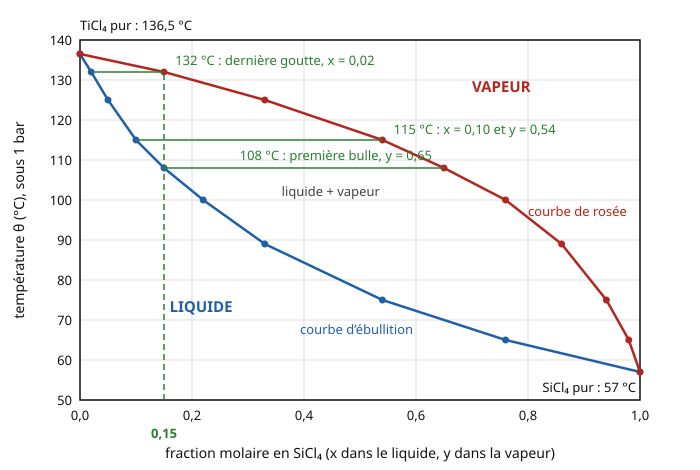
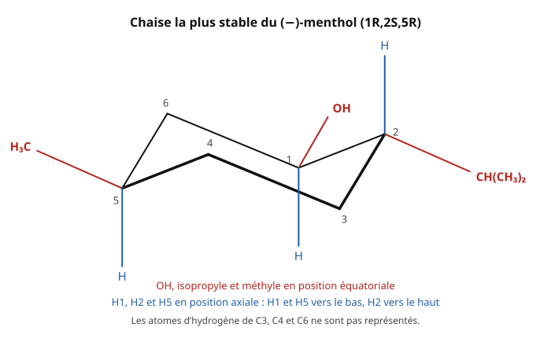
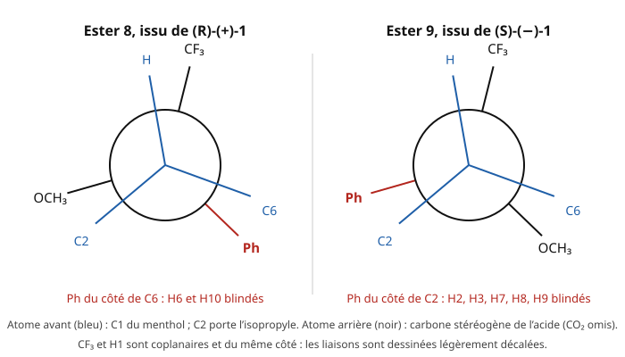
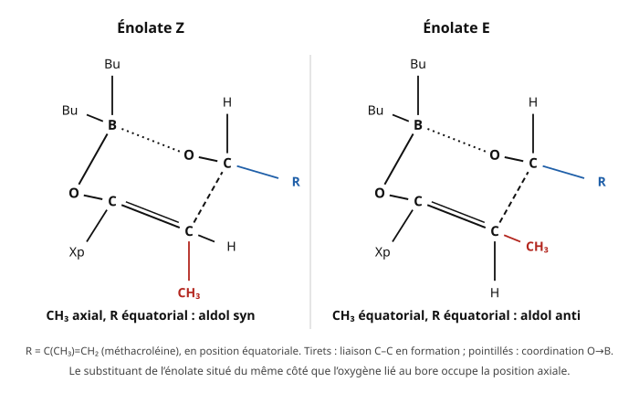

# X-ENS PC — Chimie 2011 · Corrigé brut

*Corrigé rédigé par IA, non officiel. Signalez toute erreur.*

**Rédaction** · modèle exact non renseigné (famille Claude) · effort non renseigné · vitesse non renseignée

**Révision (tour 2)** · modèle exact non renseigné (famille Claude) · effort non renseigné · vitesse non renseignée · 28 novembre 2026

Les repères de question reprennent la numérotation du sujet, précédée de P1 pour le premier problème et de P2 pour le second : P1.2.3 désigne la question 2.3 du premier problème. Les calculatrices étant interdites, les applications numériques sont conduites à la main avec deux chiffres significatifs.

## Premier problème · 1. Obtention de TiO₂ pur

### Question P1.1.1 — Allure du diagramme binaire

Le mélange étant idéal dans les deux phases, le diagramme isobare $\theta = f(x_\mathrm{Si}, y_\mathrm{Si})$ est un **fuseau simple**, sans azéotrope. Les deux courbes se rejoignent aux températures d'ébullition des corps purs sous $P^\circ$ : $57\ ^\circ\mathrm{C}$ pour $\mathrm{SiCl_4}$ ($x_\mathrm{Si}=1$) et $136{,}5\ ^\circ\mathrm{C}$ pour $\mathrm{TiCl_4}$ ($x_\mathrm{Si}=0$).

La courbe inférieure, lieu des points $(x_\mathrm{Si},\theta)$, est la courbe d'ébullition ; la courbe supérieure, lieu des points $(y_\mathrm{Si},\theta)$, est la courbe de rosée. Sous la première, le système est liquide ; au-dessus de la seconde, il est gazeux ; entre les deux, liquide et vapeur coexistent. À une température donnée, $y_\mathrm{Si} > x_\mathrm{Si}$ : la vapeur est plus riche en $\mathrm{SiCl_4}$ que le liquide.



### Question P1.1.2 — Composé le plus volatil

Sous $1\ \mathrm{bar}$, $\mathrm{SiCl_4}$ bout à $57\ ^\circ\mathrm{C}$ et $\mathrm{TiCl_4}$ à $136{,}5\ ^\circ\mathrm{C}$. Le composé le plus volatil est celui dont la température d'ébullition est la plus basse, soit **$\mathrm{SiCl_4}$**. C'est cohérent avec $y_\mathrm{Si} > x_\mathrm{Si}$ dans tout le tableau.

### Question P1.1.3 — Constantes des équilibres de vaporisation

Chaque constituant est en équilibre entre les deux phases :

$$\mathrm{TiCl_4(\ell) = TiCl_4(g)} \qquad \mathrm{SiCl_4(\ell) = SiCl_4(g)}$$

Dans le liquide idéal, l'activité d'un constituant est sa fraction molaire $x_i$. Dans la vapeur, mélange idéal de gaz parfaits, elle vaut $p_i/P^\circ = y_i P/P^\circ$. À l'équilibre :

$$\boxed{K_\mathrm{Ti}(T) = \dfrac{y_\mathrm{Ti}\,P}{x_\mathrm{Ti}\,P^\circ} \qquad K_\mathrm{Si}(T) = \dfrac{y_\mathrm{Si}\,P}{x_\mathrm{Si}\,P^\circ}}$$

### Question P1.1.4 — Variation des constantes avec la température

La relation de Van't Hoff s'écrit, pour chaque équilibre :

$$\dfrac{\mathrm{d}\ln K_i}{\mathrm{d}T} = \dfrac{\Delta_\mathrm{vap}H^\circ_i}{RT^2}$$

Pour le corps pur $i$ en équilibre liquide-vapeur sous $P^\circ$, à sa température d'ébullition $T_{\mathrm{eb},i}$, on a $x_i = y_i = 1$ et $P = P^\circ$, donc $K_i(T_{\mathrm{eb},i}) = 1$. L'enthalpie standard de vaporisation étant indépendante de $T$, l'intégration entre $T_{\mathrm{eb},i}$ et $T$ donne :

$$\boxed{\ln K_i(T) = \dfrac{\Delta_\mathrm{vap}H^\circ_i}{R}\left(\dfrac{1}{T_{\mathrm{eb},i}} - \dfrac{1}{T}\right)}$$

avec $i = \mathrm{Ti}$ ou $\mathrm{Si}$, $T_\mathrm{eb,Ti} = 409{,}7\ \mathrm{K}$ et $T_\mathrm{eb,Si} = 330\ \mathrm{K}$. Comme $\Delta_\mathrm{vap}H^\circ_i > 0$, chaque constante croît avec $T$.

### Question P1.1.5 — Expressions de ln(y/x)

D'après la question P1.1.3, $y_i/x_i = K_i\,P^\circ/P$. Donc :

$$\boxed{\ln\dfrac{y_\mathrm{Ti}}{x_\mathrm{Ti}} = \dfrac{\Delta_\mathrm{vap}H^\circ_\mathrm{TiCl_4}}{R}\left(\dfrac{1}{T_\mathrm{eb,Ti}} - \dfrac{1}{T}\right) - \ln\dfrac{P}{P^\circ}}$$

$$\boxed{\ln\dfrac{y_\mathrm{Si}}{x_\mathrm{Si}} = \dfrac{\Delta_\mathrm{vap}H^\circ_\mathrm{SiCl_4}}{R}\left(\dfrac{1}{T_\mathrm{eb,Si}} - \dfrac{1}{T}\right) - \ln\dfrac{P}{P^\circ}}$$

Sous $P = P^\circ$ et pour $T_\mathrm{eb,Si} < T < T_\mathrm{eb,Ti}$, on retrouve $y_\mathrm{Si} > x_\mathrm{Si}$ et $y_\mathrm{Ti} < x_\mathrm{Ti}$.

### Question P1.1.6 — Courbes d'ébullition et de rosée

On a $x_\mathrm{Si} = 1 - x_\mathrm{Ti}$ et $y_\mathrm{Ti} + y_\mathrm{Si} = 1$, avec $y_i = K_i\,x_i\,P^\circ/P$ :

$$K_\mathrm{Ti}\,x_\mathrm{Ti} + K_\mathrm{Si}\,(1 - x_\mathrm{Ti}) = \dfrac{P}{P^\circ}$$

D'où :

$$\boxed{x_\mathrm{Ti} = \dfrac{P/P^\circ - K_\mathrm{Si}}{K_\mathrm{Ti} - K_\mathrm{Si}} \qquad y_\mathrm{Ti} = \dfrac{P^\circ}{P}\,K_\mathrm{Ti}\,\dfrac{P/P^\circ - K_\mathrm{Si}}{K_\mathrm{Ti} - K_\mathrm{Si}}}$$

où

$$K_i = \exp\left[\dfrac{\Delta_\mathrm{vap}H^\circ_i}{R}\left(\dfrac{1}{T_{\mathrm{eb},i}} - \dfrac{1}{T}\right)\right]$$

Ces deux relations sont les équations paramétriques, en $T$, de la courbe d'ébullition et de la courbe de rosée. Vérification sous $P = P^\circ$ : à $T = T_\mathrm{eb,Ti}$, $K_\mathrm{Ti} = 1$ et $x_\mathrm{Ti} = y_\mathrm{Ti} = 1$ ; à $T = T_\mathrm{eb,Si}$, $K_\mathrm{Si} = 1$ et $x_\mathrm{Ti} = y_\mathrm{Ti} = 0$.

### Question P1.1.7.1 — État physique initial

La composition globale est $x_\mathrm{Si} = 15/100 = 0{,}15$. À $20\ ^\circ\mathrm{C}$, le point représentatif est très en dessous de la courbe d'ébullition (la plus basse température du diagramme est $57\ ^\circ\mathrm{C}$) : le mélange est **entièrement liquide**, en une seule phase puisque le mélange liquide est idéal.

### Question P1.1.7.2 — Début d'ébullition et première bulle

La verticale $x_\mathrm{Si} = 0{,}15$ coupe la courbe d'ébullition au point du tableau $x_\mathrm{Si} = 0{,}15$ : l'ébullition commence à **$108\ ^\circ\mathrm{C}$**. La première bulle de vapeur a la composition lue sur la courbe de rosée à cette température : **$y_\mathrm{Si} = 0{,}65$** et $y_\mathrm{Ti} = 0{,}35$. Elle est bien plus riche en $\mathrm{SiCl_4}$ que le liquide.

### Question P1.1.7.3 — Composition et quantités à 115 °C

À $115\ ^\circ\mathrm{C}$, le tableau donne le liquide $x_\mathrm{Si} = 0{,}10$ et la vapeur $y_\mathrm{Si} = 0{,}54$. La composition globale $0{,}15$ est comprise entre les deux : le système est diphasé.

Bilan en $\mathrm{SiCl_4}$, avec $n = n^\ell + n^v = 100\ \mathrm{mol}$ :

$$n^v = n\,\dfrac{0{,}15 - x_\mathrm{Si}}{y_\mathrm{Si} - x_\mathrm{Si}} = 100 \times \dfrac{0{,}05}{0{,}44} \approx 11\ \mathrm{mol}$$

$$n^\ell = n - n^v \approx 89\ \mathrm{mol}$$

| Phase | Quantité totale | $\mathrm{SiCl_4}$ | $\mathrm{TiCl_4}$ |
|---|---|---|---|
| Vapeur ($y_\mathrm{Si} = 0{,}54$) | $11{,}4\ \mathrm{mol}$ | $6{,}1\ \mathrm{mol}$ | $5{,}2\ \mathrm{mol}$ |
| Liquide ($x_\mathrm{Si} = 0{,}10$) | $88{,}6\ \mathrm{mol}$ | $8{,}9\ \mathrm{mol}$ | $79{,}8\ \mathrm{mol}$ |

On vérifie $6{,}1 + 8{,}9 = 15\ \mathrm{mol}$ de $\mathrm{SiCl_4}$ et $5{,}2 + 79{,}8 = 85\ \mathrm{mol}$ de $\mathrm{TiCl_4}$.

### Question P1.1.7.4 — Fin de la vaporisation

La vaporisation s'achève lorsque la verticale $0{,}15$ atteint la courbe de rosée, c'est-à-dire pour $y_\mathrm{Si} = 0{,}15$ : le tableau donne **$132\ ^\circ\mathrm{C}$**. La dernière goutte de liquide a alors la composition $x_\mathrm{Si} = 0{,}02$, soit du $\mathrm{TiCl_4}$ presque pur.

### Question P1.1.8 — Plateau 2

Le composé le plus volatil est $\mathrm{A = SiCl_4}$, et $\mathrm{B = TiCl_4}$. La vapeur issue du plateau 2 est condensée en totalité : le liquide obtenu, dont une partie forme le distillat, a la même composition qu'elle. Donc :

$$\boxed{y_\mathrm{A2} = x_\mathrm{AD} = 0{,}98}$$

L'équilibre liquide-vapeur est réalisé sur le plateau 2. Dans le tableau 1, la vapeur $y_\mathrm{Si} = 0{,}98$ est en équilibre avec le liquide $x_\mathrm{Si} = 0{,}76$ à $65\ ^\circ\mathrm{C}$ :

$$\boxed{x_\mathrm{A2} = 0{,}76 \qquad T_2 = 65\ ^\circ\mathrm{C} = 338\ \mathrm{K}}$$

### Question P1.1.9 — Conservation de la matière totale

Pendant $\mathrm{d}t$, la quantité $\mathrm{d}n_v$ de vapeur arrive au condenseur ; elle en ressort sous forme liquide, partagée entre le distillat et le reflux. Les quantités présentes sur les plateaux étant constantes, les débits de vapeur et de liquide sont les mêmes à tous les niveaux de la colonne, et :

$$\boxed{\mathrm{d}n_v = \mathrm{d}n_l + \mathrm{d}n_\mathrm{D}}$$

### Question P1.1.10 — Conservation de A sur le plateau 2

La quantité de A présente sur le plateau 2 est constante. Pendant $\mathrm{d}t$ :

- entrent la vapeur venue du plateau 1, soit $y_\mathrm{A1}\,\mathrm{d}n_v$, et le reflux venu du condenseur, de composition $x_\mathrm{AD}$, soit $x_\mathrm{AD}\,\mathrm{d}n_l$ ;
- sortent la vapeur montant vers le condenseur, soit $y_\mathrm{A2}\,\mathrm{d}n_v$, et le liquide descendant vers le plateau 1, soit $x_\mathrm{A2}\,\mathrm{d}n_l$.

$$y_\mathrm{A1}\,\mathrm{d}n_v + x_\mathrm{AD}\,\mathrm{d}n_l = y_\mathrm{A2}\,\mathrm{d}n_v + x_\mathrm{A2}\,\mathrm{d}n_l$$

Avec $y_\mathrm{A2} = x_\mathrm{AD}$ et $\mathrm{d}n_v = \mathrm{d}n_l + \mathrm{d}n_\mathrm{D}$, il reste :

$$\boxed{y_\mathrm{A1}\,(\mathrm{d}n_l + \mathrm{d}n_\mathrm{D}) = x_\mathrm{A2}\,\mathrm{d}n_l + x_\mathrm{AD}\,\mathrm{d}n_\mathrm{D}}$$

Cette relation est aussi le bilan en A de l'ensemble formé par le plateau 2 et le condenseur : ce qui y entre par la vapeur du plateau 1 en ressort par le liquide du plateau 2 et par le distillat.

### Question P1.1.11 — Vapeur du plateau 1 en fonction du reflux

En posant $r = \mathrm{d}n_l/\mathrm{d}n_\mathrm{D}$ (taux de reflux) :

$$\boxed{y_\mathrm{A1} = \dfrac{r\,x_\mathrm{A2} + x_\mathrm{AD}}{r + 1}}$$

La fraction $y_\mathrm{A1}$ est le barycentre de $x_\mathrm{A2}$ et de $x_\mathrm{AD}$, affectés des poids $r$ et 1 : elle est comprise entre les deux.

### Question P1.1.12 — Reflux total

Quand $r \to \infty$ :

$$\boxed{y_\mathrm{A1} \to x_\mathrm{A2}}$$

À reflux total, la vapeur qui monte d'un plateau a la composition du liquide qui descend du plateau supérieur. L'enrichissement par plateau est alors maximal, mais on ne recueille aucun distillat ($\mathrm{d}n_\mathrm{D} = 0$) : la séparation est la meilleure possible et la production est nulle.

### Question P1.1.13 — Plateau 1 pour un taux de reflux égal à 1

Pour $r = 1$ :

$$y_\mathrm{A1} = \dfrac{x_\mathrm{A2} + x_\mathrm{AD}}{2} = \dfrac{0{,}76 + 0{,}98}{2} = 0{,}87$$

$$\boxed{y_\mathrm{A1} \approx 0{,}87}$$

L'équilibre est réalisé sur le plateau 1. La ligne du tableau la plus proche est $y_\mathrm{Si} = 0{,}86$, en équilibre avec $x_\mathrm{Si} = 0{,}33$ à $89\ ^\circ\mathrm{C}$ :

$$\boxed{x_\mathrm{A1} \approx 0{,}33 \qquad T_1 \approx 89\ ^\circ\mathrm{C}}$$

### Question P1.1.14 — Bouilleur

Le bilan en A sur l'ensemble formé par le plateau 1, le plateau 2 et le condenseur donne, en notant $y_\mathrm{A0}$ la fraction de A dans la vapeur issue du bouilleur :

$$y_\mathrm{A0} = \dfrac{r\,x_\mathrm{A1} + x_\mathrm{AD}}{r + 1}$$

Pour $r = 1$ :

$$y_\mathrm{A0} = \dfrac{0{,}33 + 0{,}98}{2} \approx 0{,}65$$

$$\boxed{y_\mathrm{A0} \approx 0{,}65}$$

Le bouilleur est le siège d'un équilibre liquide-vapeur : dans le tableau, $y_\mathrm{Si} = 0{,}65$ correspond à

$$\boxed{x_\mathrm{A0} = 0{,}15 \qquad T_0 = 108\ ^\circ\mathrm{C}}$$

On retrouve la composition du mélange à 15 % de $\mathrm{SiCl_4}$ étudié à la question P1.1.7.

### Question P1.1.15 — Bilan de la purification

Avec seulement deux plateaux et un taux de reflux de 1, un mélange à 15 % de $\mathrm{SiCl_4}$ fournit en tête de colonne un distillat à 98 % de $\mathrm{SiCl_4}$ : la colonne **extrait très efficacement l'impureté**, alors qu'une distillation simple ne donnerait qu'une vapeur à 65 %.

Le distillat n'est cependant pas le produit recherché. $\mathrm{TiCl_4}$, moins volatil, reste dans le bouilleur, qui en contient encore 85 % à l'instant étudié : il n'est donc pas encore pur. Il le devient à mesure que la distillation se poursuit : le bouilleur s'appauvrit en $\mathrm{SiCl_4}$, sa température s'élève vers $136{,}5\ ^\circ\mathrm{C}$, et le résidu tend vers $\mathrm{TiCl_4}$ pur. Le dispositif permet donc de purifier $\mathrm{TiCl_4}$, **recueilli comme résidu en fin d'opération** et non en tête de colonne.

## Premier problème · 2. Détermination de la surface spécifique du matériau

### Question P1.2.1 — Isotherme d'adsorption

Les activités sont $P/P^\circ$ pour le diazote gazeux, $1 - \Theta$ pour les sites libres et $\Theta$ pour les sites occupés. À l'équilibre :

$$K = \dfrac{\Theta}{(1 - \Theta)\,P/P^\circ}$$

$$\boxed{\Theta = \dfrac{K\,P/P^\circ}{1 + K\,P/P^\circ}}$$

C'est l'isotherme de Langmuir : $\Theta \approx KP/P^\circ$ à basse pression, $\Theta \to 1$ à haute pression (monocouche complète).

### Question P1.2.2 — Linéarisation de l'isotherme

Une molécule par site : $N_\mathrm{ads} = \Theta\,N_\mathrm{tot}$. En inversant l'isotherme :

$$\dfrac{1}{N_\mathrm{ads}} = \dfrac{1}{N_\mathrm{tot}}\left(1 + \dfrac{P^\circ}{K\,P}\right)$$

$$\boxed{\dfrac{1}{N_\mathrm{ads}} = \dfrac{1}{N_\mathrm{tot}} + \dfrac{P^\circ}{K\,N_\mathrm{tot}} \times \dfrac{1}{P}}$$

L'ordonnée à l'origine vaut $1/N_\mathrm{tot}$ et la pente $P^\circ/(K\,N_\mathrm{tot})$. Le rapport de l'ordonnée à l'origine à la pente donne $K/P^\circ$.

### Question P1.2.3 — Surface spécifique de la poudre

$$N_\mathrm{tot} = \dfrac{1}{2000\ \mathrm{mol^{-1}}} = 5{,}0 \times 10^{-4}\ \mathrm{mol}$$

La surface totale des sites est celle de la monocouche complète, soit $N_\mathrm{tot}\,\mathcal{N}_A\,\sigma$. Rapportée à la masse $m$ :

$$\Sigma = \dfrac{N_\mathrm{tot}\,\mathcal{N}_A\,\sigma}{m}$$

$$\Sigma = \dfrac{5{,}0 \times 10^{-4} \times 6{,}02 \times 10^{23} \times 1{,}6 \times 10^{-19}}{4{,}0}$$

$$\boxed{\Sigma \approx 12\ \mathrm{m^2 \cdot g^{-1}}}$$

Le numérateur vaut $48\ \mathrm{m^2}$ : les $4{,}0\ \mathrm{g}$ de poudre offrent une surface de l'ordre de celle d'une pièce d'habitation.

### Question P1.2.4 — Comparaison avec un gel de silice

Le gel de silice présente une surface spécifique environ 50 fois plus grande que celle de la poudre de $\mathrm{TiO_2}$ étudiée. C'est un solide très poreux, dont la surface est surtout celle des parois internes des pores, d'où son emploi comme adsorbant (desséchant, phase stationnaire de chromatographie). La poudre de $\mathrm{TiO_2}$ est au contraire constituée de grains compacts et relativement gros.

Deux conséquences. La photocatalyse étant une catalyse hétérogène, on a intérêt à augmenter la surface spécifique de $\mathrm{TiO_2}$ (grains plus fins). Par ailleurs, des traces de silice très divisée fausseraient la mesure, en apportant une surface importante mais inactive : c'est une raison supplémentaire d'éliminer la silice lors de la préparation.

### Question P1.2.5 — Enthalpie isostérique par la droite ln P = f(1/T)

À $\Theta$ fixé, l'isotherme impose :

$$K\,\dfrac{P}{P^\circ} = \dfrac{\Theta}{1 - \Theta} = \mathrm{cste}$$

$$\ln\dfrac{P}{P^\circ} = \ln\dfrac{\Theta}{1 - \Theta} - \ln K(T)$$

La relation de Van't Hoff appliquée à l'équilibre d'adsorption donne $\mathrm{d}\ln K/\mathrm{d}T = \Delta_\mathrm{ads}H^\perp/(RT^2)$, soit, puisque $\mathrm{d}(1/T) = -\mathrm{d}T/T^2$ :

$$\left(\dfrac{\partial \ln P}{\partial (1/T)}\right)_\Theta = -\dfrac{\mathrm{d}\ln K}{\mathrm{d}(1/T)} = \dfrac{\Delta_\mathrm{ads}H^\perp}{R}$$

Si $\Delta_\mathrm{ads}H^\perp$ ne dépend pas de $T$ sur le domaine étudié, $\ln P$ est une fonction affine de $1/T$ :

$$\boxed{\ln P = \dfrac{\Delta_\mathrm{ads}H^\perp}{R} \times \dfrac{1}{T} + \mathrm{cste}}$$

La pente de la droite, multipliée par $R$, donne $\Delta_\mathrm{ads}H^\perp$.

### Question P1.2.6 — Valeur de l'enthalpie isostérique

$$\Delta_\mathrm{ads}H^\perp = R \times \mathrm{pente} = 8{,}31 \times (-1{,}7 \times 10^{3})$$

$$\boxed{\Delta_\mathrm{ads}H^\perp \approx -14\ \mathrm{kJ \cdot mol^{-1}}}$$

L'adsorption est **exothermique**, ce qui est attendu : une liaison se crée entre la molécule et la surface. Elle est donc défavorisée par une élévation de température ; à recouvrement fixé, il faut une pression d'autant plus grande que $T$ est élevée (pente négative).

La valeur absolue est faible, de l'ordre de grandeur des interactions de Van der Waals et très inférieure à une énergie de liaison covalente (plusieurs centaines de $\mathrm{kJ \cdot mol^{-1}}$) : il s'agit d'une **physisorption**, sans rupture de la liaison $\mathrm{N{\equiv}N}$, ce qui est cohérent avec le modèle d'adsorption moléculaire réversible.

### Question P1.2.7 — Entropie isostérique

Avec $-RT\ln K = \Delta_\mathrm{ads}H^\perp - T\,\Delta_\mathrm{ads}S^\perp$, la relation de la question P1.2.5 devient :

$$\ln\dfrac{P}{P^\circ} = \dfrac{\Delta_\mathrm{ads}H^\perp}{R} \times \dfrac{1}{T} + \ln\dfrac{\Theta}{1 - \Theta} - \dfrac{\Delta_\mathrm{ads}S^\perp}{R}$$

On trace donc $\ln(P/P^\circ)$ en fonction de $1/T$ à $\Theta$ fixé. L'**ordonnée à l'origine** $b$ de la droite donne :

$$\boxed{\Delta_\mathrm{ads}S^\perp = R\left(\ln\dfrac{\Theta}{1 - \Theta} - b\right)}$$

On attend une valeur négative : la molécule adsorbée perd ses degrés de liberté de translation. De façon équivalente, on calcule $K$ à une température à partir de $P$ et $\Theta$, puis $\Delta_\mathrm{ads}S^\perp = (\Delta_\mathrm{ads}H^\perp + RT\ln K)/T$.

### Question P1.2.8 — Adsorption dissociative : schéma

La molécule se dissocie en deux atomes qui occupent chacun un site :

$$\mathrm{N_2} + 2\ \mathrm{S{-}} \ \overset{K'}{\rightleftharpoons}\ 2\ \mathrm{S{-}N}$$

où $\mathrm{S{-}}$ est un site libre et $\mathrm{S{-}N}$ un atome d'azote adsorbé.

### Question P1.2.9 — Adsorption dissociative : isotherme

$$K' = \dfrac{\Theta^2}{(1 - \Theta)^2\,P/P^\circ}$$

$$\dfrac{\Theta}{1 - \Theta} = \sqrt{K'\,P/P^\circ}$$

$$\boxed{\Theta = \dfrac{\sqrt{K'\,P/P^\circ}}{1 + \sqrt{K'\,P/P^\circ}}}$$

### Question P1.2.10 — Comparaison des deux lois

La loi a la même forme qu'en P1.2.1, avec $\sqrt{K'P/P^\circ}$ à la place de $KP/P^\circ$ :

- à basse pression, $\Theta \approx \sqrt{K'P/P^\circ}$ : le recouvrement croît comme $\sqrt{P}$ et non plus comme $P$ ;
- à haute pression, $\Theta \to 1$ dans les deux cas, mais la saturation est atteinte plus lentement dans le cas dissociatif, puisque $1 - \Theta \approx (K'P/P^\circ)^{-1/2}$ au lieu de $(KP/P^\circ)^{-1}$.

Les deux mécanismes se distinguent donc expérimentalement : $1/N_\mathrm{ads}$ est une fonction affine de $1/P$ pour l'adsorption moléculaire, et de $1/\sqrt{P}$ pour l'adsorption dissociative. La linéarité observée en fonction de $1/P$ valide le modèle moléculaire pour le diazote sur $\mathrm{TiO_2}$, en accord avec la faible enthalpie d'adsorption trouvée en P1.2.6.

## Premier problème · 3. Principe simplifié de la photocatalyse

### Question P1.3.1 — Diagramme d'orbitales moléculaires de H₂

Les deux orbitales atomiques $1s$, de même énergie et de recouvrement non nul, se combinent en deux orbitales moléculaires de symétrie $\sigma$ :

```text
        H                 H2                 H
                      σ* (antiliante)
                     ------------
                    /            \
  1s  ----(↑)------                ------(↑)----  1s
                    \            /
                     -----(↑↓)---
                      σ (liante)
```

L'orbitale liante $\sigma_{1s}$ (combinaison en phase) est stabilisée par rapport à $1s$ ; l'orbitale antiliante $\sigma^*_{1s}$ (combinaison en opposition de phase, un plan nodal entre les noyaux) est déstabilisée, un peu plus que la liante n'est stabilisée. Les deux électrons occupent l'orbitale liante avec des spins appariés : configuration $(\sigma_{1s})^2$, indice de liaison $(2 - 0)/2 = 1$, molécule diamagnétique.

### Question P1.3.2 — Bornes des énergies

Pour $1 \leqslant p \leqslant n$, l'angle $p\pi/(n+1)$ est strictement compris entre 0 et $\pi$, donc $-1 < \cos\bigl(p\pi/(n+1)\bigr) < 1$. L'intégrale de résonance $\beta$ étant négative :

$$\boxed{\alpha + 2\beta < E_p < \alpha - 2\beta}$$

La borne inférieure $\alpha + 2\beta$ est approchée pour $p = 1$ (orbitale la plus liante), la borne supérieure $\alpha - 2\beta$ pour $p = n$ (orbitale la plus antiliante). La largeur de l'intervalle, $4|\beta|$, ne dépend pas de $n$.

### Question P1.3.3 — Formation d'une bande

Les $n$ niveaux, tous distincts puisque le cosinus est strictement décroissant sur $]0, \pi[$, sont contenus dans un intervalle de largeur fixe $4|\beta|$. L'écart entre deux niveaux consécutifs vaut :

$$E_{p+1} - E_p = 2\beta\left[\cos\dfrac{(p+1)\pi}{n+1} - \cos\dfrac{p\pi}{n+1}\right] = -4\beta\,\sin\dfrac{(2p+1)\pi}{2(n+1)}\,\sin\dfrac{\pi}{2(n+1)}$$

$$0 < E_{p+1} - E_p \leqslant 4|\beta|\,\sin\dfrac{\pi}{2(n+1)} \leqslant \dfrac{2\pi|\beta|}{n+1}$$

Cet écart tend vers 0 quand $n \to \infty$. Pour un échantillon macroscopique ($n \sim 10^{23}$), il est très inférieur à l'énergie d'agitation thermique : les niveaux, infiniment proches, forment un **quasi-continuum** de largeur $4|\beta|$, appelé bande d'énergie.

### Question P1.3.4 — Remplissage de la bande à 0 K

Les $n$ atomes apportent $n$ électrons. La bande compte $n$ niveaux, donc $2n$ places (principe de Pauli). À $0\ \mathrm{K}$, les électrons occupent par paires les $n/2$ niveaux de plus basse énergie : la **bande est à moitié remplie**. Sa moitié inférieure (niveaux liants, $E < \alpha$) est pleine, sa moitié supérieure (niveaux antiliants, $E > \alpha$) est vide. Le dernier niveau occupé ($p \approx n/2$) a une énergie voisine de $\alpha$.

Des niveaux vacants se trouvent ainsi immédiatement au-dessus des niveaux occupés, sans écart d'énergie : un tel enchaînement serait conducteur. La situation de $\mathrm{TiO_2}$ est différente, puisqu'une bande pleine y est séparée d'une bande vide par $3{,}2\ \mathrm{eV}$.

### Question P1.3.5 — Longueur d'onde maximale

Le photon doit avoir une énergie au moins égale à l'écart $E_g = 3{,}2\ \mathrm{eV}$ entre les deux bandes : $hc/\lambda \geqslant E_g$.

$$\lambda_\mathrm{max} = \dfrac{hc}{E_g} = \dfrac{6{,}62 \times 10^{-34} \times 3 \times 10^{8}}{3{,}2 \times 1{,}6 \times 10^{-19}}$$

$$\boxed{\lambda_\mathrm{max} \approx 3{,}9 \times 10^{-7}\ \mathrm{m} = 390\ \mathrm{nm}}$$

Seuls les rayonnements de longueur d'onde inférieure, c'est-à-dire l'ultraviolet (limite du visible), créent une paire électron-trou. C'est cohérent avec l'énoncé, et avec le fait que $\mathrm{TiO_2}$, qui n'absorbe pas le visible, est blanc.

### Question P1.3.6 — Devenir de l'état excité

Si l'électron n'est pas piégé, il retombe dans la bande de valence et comble le trou : c'est la **recombinaison de la paire électron-trou**. L'énergie est restituée sous forme d'un photon (luminescence) ou de chaleur (désexcitation non radiative). La paire est alors perdue pour la photocatalyse, qui exige que l'électron et le trou vivent assez longtemps pour atteindre la surface et y réagir.

## Premier problème · 4. Cinétique de dégradation

### Question P1.4.1 — Loi de Beer-Lambert

Pour un faisceau monochromatique de longueur d'onde $\lambda$ traversant une cuve d'épaisseur $\ell$, l'absorbance est :

$$\boxed{A = \log\dfrac{I_0}{I} = \sum_i \varepsilon_i(\lambda)\,\ell\,c_i}$$

où $I_0$ et $I$ sont les intensités incidente et transmise, $c_i$ la concentration de l'espèce absorbante $i$ et $\varepsilon_i$ son coefficient d'absorption molaire, qui dépend de $\lambda$, de la température et du solvant.

Conditions de validité : lumière monochromatique ; solution diluée (typiquement $c < 10^{-2}\ \mathrm{mol \cdot L^{-1}}$), pour que les espèces absorbent indépendamment ; solution homogène et limpide, sans particules qui diffusent la lumière ; espèces qui ne réagissent pas sous le faisceau et ne fluorescent pas ; absorbance restant dans le domaine de linéarité de l'appareil.

### Question P1.4.2 — Suivi cinétique par spectrophotométrie

On se place à une longueur d'onde du visible où AB80 absorbe. Les produits de dégradation, incolores, n'absorbent pas dans ce domaine, de même que le tampon. La loi de Beer-Lambert se réduit à $A = \varepsilon\,\ell\,C$, et, avec la même cuve :

$$\boxed{\dfrac{C}{C_0} = \dfrac{A}{A_0}}$$

La mesure de l'absorbance à intervalles réguliers donne donc directement $C/C_0$, sans connaître $\varepsilon$, de façon rapide, non destructive et sur de petits prélèvements. Dans l'échantillon contenant $\mathrm{TiO_2}$, la poudre en suspension diffuse la lumière : il faut la séparer (filtration ou centrifugation du prélèvement) avant la mesure.

### Question P1.4.3 — Longueur d'onde de travail

On lit sur la figure 4 du sujet deux groupes de bandes : dans l'ultraviolet, deux maximums intenses vers $230$ et $260\ \mathrm{nm}$ (absorption voisine de 1,8) ; dans le visible, un maximum vers **$625\ \mathrm{nm}$** (absorption voisine de 0,95), précédé d'un second vers $580\ \mathrm{nm}$.

On choisit **$\lambda \approx 625\ \mathrm{nm}$**, maximum d'absorption dans le visible : la sensibilité y est la meilleure dans ce domaine, et, la tangente étant horizontale, une petite erreur de réglage de la longueur d'onde est sans effet sur $A$. Les bandes de l'ultraviolet sont plus intenses, mais les produits de dégradation, incolores sans être transparents dans l'UV (ce sont encore des dérivés aromatiques), y absorbent aussi : la proportionnalité entre $A$ et $C$ y serait perdue.

### Question P1.4.4 — Analyse de la figure 5

Lectures sur la figure 5 du sujet :

| Expérience | $C/C_0$ en fin d'essai | Interprétation |
|---|---|---|
| $\mathrm{TiO_2}$, sans lumière | environ 0,96 à 100 min | légère baisse, due à l'adsorption du colorant sur la poudre |
| lumière, sans $\mathrm{TiO_2}$ | environ 0,91 à 100 min | photolyse directe très lente |
| lumière et $\mathrm{TiO_2}$ | environ 0,10 à 90 min | dégradation rapide, 90 % du colorant détruit |

Ni la lumière seule ni $\mathrm{TiO_2}$ seul ne dégradent notablement le colorant ; la dégradation n'est efficace que si les deux sont réunis. $\mathrm{TiO_2}$ est donc bien un **photocatalyseur** : il doit être activé par le rayonnement (création de paires électron-trou) pour accélérer l'oxydation. La décroissance, d'allure exponentielle, suggère une cinétique d'ordre 1.

### Question P1.4.5 — Vitesse d'oxydation

L'étape 1 est un pré-équilibre d'adsorption rapide. Par analogie avec P1.2.1, la fraction de sites occupés par AB80 est :

$$\Theta = \dfrac{K\,C/C^\circ}{1 + K\,C/C^\circ}$$

L'étape 2 est d'ordre 1 par rapport à chaque réactif. La quantité de colorant adsorbé étant proportionnelle à $\Theta$ (le facteur de proportionnalité, lié au nombre de sites, est inclus dans $k$) :

$$v = k\,[\mathrm{HO^\bullet}]\,\Theta$$

$$\boxed{v = k\,[\mathrm{HO^\bullet}]\,\dfrac{K\,C/C^\circ}{1 + K\,C/C^\circ}}$$

### Question P1.4.6 — Hypothèse et constante apparente

Sur la figure 6, $\ln(C_0/C)$ est proportionnel au temps : la réaction est d'**ordre apparent 1**, $v = -\mathrm{d}C/\mathrm{d}t = k_\mathrm{app}\,C$, qui s'intègre en $\ln(C_0/C) = k_\mathrm{app}\,t$.

La loi de la question P1.4.5 ne redonne cet ordre que si le dénominateur se réduit à 1, c'est-à-dire si le **recouvrement est faible** :

$$\boxed{K\,\dfrac{C}{C^\circ} \ll 1}$$

Alors, $[\mathrm{HO^\bullet}]$ étant constante :

$$v \approx \dfrac{k\,K\,[\mathrm{HO^\bullet}]}{C^\circ}\,C \qquad k_\mathrm{app} = \dfrac{k\,K\,[\mathrm{HO^\bullet}]}{C^\circ}$$

La droite tracée sur la figure 6 passe par l'origine et par un point voisin de $(60\ \mathrm{min}\ ;\ 2{,}4)$ :

$$k_\mathrm{app} \approx \dfrac{2{,}4}{60\ \mathrm{min}}$$

$$\boxed{k_\mathrm{app} \approx 4 \times 10^{-2}\ \mathrm{min^{-1}}}$$

Le temps de demi-réaction correspondant est $\ln 2/k_\mathrm{app} \approx 17\ \mathrm{min}$. Les points de la figure 5 conduisent à une valeur du même ordre mais un peu plus faible ($C/C_0 = 0{,}10$ à 90 min donne $\ln 10/90 \approx 2{,}6 \times 10^{-2}\ \mathrm{min^{-1}}$) ; la valeur demandée est celle de la droite de la figure 6.

### Question P1.4.7 — Validité de l'hypothèse

$$K\,\dfrac{C}{C^\circ} = 5 \times 10^{3} \times 10^{-5} = 5 \times 10^{-2}$$

Ce terme est négligeable devant 1, à 5 % près : **l'hypothèse est justifiée**. Le recouvrement de la surface par le colorant reste faible ($\Theta \approx 0{,}05$) et diminue encore au cours de la dégradation, de sorte que l'approximation s'améliore avec l'avancement.

## Deuxième problème · 1.1 Préparation de l'acide de Mosher énantiomériquement pur

### Question P2.1.1.1 — Intermédiaire 3

L'ion cyanure s'additionne sur le carbone du carbonyle, très électrophile ici en raison de l'effet inductif attracteur du groupe $\mathrm{CF_3}$. Le doublet du carbone de $\mathrm{{}^-C{\equiv}N}$ attaque le carbone trigonal, pendant que le doublet $\pi$ de $\mathrm{C{=}O}$ se rabat sur l'oxygène :

$$\mathrm{Ph{-}CO{-}CF_3 + {}^-CN \longrightarrow Ph{-}C(O^-)(CF_3){-}C{\equiv}N}$$

L'intermédiaire **3** est l'**alcoolate de sodium de la cyanhydrine** :

$$\boxed{\mathbf{3} : \ \mathrm{Ph{-}C(CF_3)(CN){-}O^-,\ Na^+}}$$

Le milieu ne contenant pas d'acide, l'alcoolate n'est pas protoné : c'est lui qui réagit dans l'étape suivante.

### Question P2.1.1.2 — Composé 4

L'alcoolate **3** est un bon nucléophile et l'iodométhane un excellent substrat de substitution nucléophile bimoléculaire (carbone non encombré, ion iodure bon nucléofuge). Il se forme un éther-oxyde (synthèse de Williamson, mécanisme $\mathrm{S_N2}$) :

$$\boxed{\mathbf{4} : \ \mathrm{Ph{-}C(CF_3)(OCH_3){-}C{\equiv}N}}$$

L'hydrolyse acide à chaud du nitrile **4** donne ensuite l'acide carboxylique **1**, $\mathrm{Ph{-}C(CF_3)(OCH_3){-}COOH}$.

### Question P2.1.1.3 — Activité optique de l'acide 1 préparé

L'acide **1** possède un atome de carbone stéréogène, lié à quatre substituants différents ($\mathrm{OCH_3}$, $\mathrm{CF_3}$, $\mathrm{COOH}$, $\mathrm{Ph}$) : la molécule est chirale. Mais ce centre est créé lors de l'addition de l'ion cyanure sur le carbonyle plan de la cétone **2**, achirale, par un réactif achiral dans un milieu achiral : les deux faces du carbonyle sont attaquées avec la même probabilité. Les étapes suivantes ne touchent pas ce carbone.

L'acide **1** est donc obtenu sous forme de **mélange racémique**, qui est **sans activité optique** : les pouvoirs rotatoires des deux énantiomères, opposés, se compensent.

### Question P2.1.1.4 — Ordres de grandeur des constantes d'acidité

Un acide carboxylique a un $\mathrm{p}K_A$ voisin de 4 à 5. Ici, le carbone en $\alpha$ porte deux groupes à effet inductif attracteur ($\mathrm{CF_3}$ et $\mathrm{OCH_3}$) qui stabilisent le carboxylate : l'acide **1** est nettement plus fort.

$$\boxed{\mathrm{p}K_A(\mathbf{1}/\text{carboxylate}) \approx 2 \text{ à } 3 \qquad K_A \sim 10^{-3} \text{ à } 10^{-2}}$$

Pour la 1-phényléthylamine, qui intervient ici comme base, le couple à considérer est ion ammonium/amine, comme pour toute amine primaire (son acidité propre, couple $\mathrm{RNH_2/RNH^-}$ de $\mathrm{p}K_A$ voisin de 35, ne joue aucun rôle dans la suite) :

$$\boxed{\mathrm{p}K_A(\mathrm{RNH_3^+/RNH_2}) \approx 9 \text{ à } 10 \qquad K_A \sim 10^{-10}}$$

La réaction entre l'acide et l'amine, de constante $10^{\Delta \mathrm{p}K_A} \approx 10^{7}$, est donc quantitative.

### Question P2.1.1.5 — Structures de 5 et 6

L'amine (R) déprotone quantitativement chacun des deux énantiomères de l'acide : on obtient deux **carboxylates d'ammonium** (sels). L'acide régénéré à partir du filtrat est lévogyre et de descripteur S ; celui régénéré à partir du solide **5** est son énantiomère, dextrogyre et donc de descripteur R. Le traitement acide ne touche pas le carbone stéréogène. Par conséquent :

- **5** est le (R)-3,3,3-trifluoro-2-méthoxy-2-phénylpropanoate de (R)-1-phényléthylammonium, $\mathrm{[(R)\text{-}PhCH(CH_3)NH_3^+]\,[(R)\text{-}PhC(CF_3)(OCH_3)COO^-]}$ ;
- **6** est le (S)-3,3,3-trifluoro-2-méthoxy-2-phénylpropanoate de (R)-1-phényléthylammonium, $\mathrm{[(R)\text{-}PhCH(CH_3)NH_3^+]\,[(S)\text{-}PhC(CF_3)(OCH_3)COO^-]}$.

Les deux sels ont le même cation et des anions énantiomères : leurs configurations sont (R,R) et (R,S). Ils diffèrent par la configuration d'un seul de leurs deux centres stéréogènes : ce sont des **diastéréoisomères**. Leurs propriétés physiques diffèrent, en particulier leur solubilité dans l'éthanol : **5**, le moins soluble, cristallise, tandis que **6** reste en solution.

### Question P2.1.1.6 — Nom de la séquence

Il s'agit du **dédoublement (ou résolution) du mélange racémique** par formation de sels diastéréoisomères avec une base chirale énantiomériquement pure, suivie de leur séparation par cristallisation fractionnée. L'acidification de chaque sel régénère ensuite chaque énantiomère de l'acide, l'amine restant en phase aqueuse sous forme d'ion ammonium.

### Question P2.1.1.7 — Représentation de Cram de l'isomère dextrogyre

L'isomère lévogyre étant de descripteur S, l'isomère dextrogyre est **(R)-(+)-1**.

Ordre de priorité (règles de Cahn, Ingold et Prelog) autour du carbone stéréogène. L'oxygène de $\mathrm{OCH_3}$ l'emporte sur les trois carbones. Ceux-ci se départagent au rang suivant : $\mathrm{CF_3}$ porte $(\mathrm{F, F, F})$, $\mathrm{COOH}$ porte $(\mathrm{O, O, O})$ (la double liaison compte pour deux oxygènes) et le phényle porte $(\mathrm{C, C, C})$. D'où :

$$\boxed{\mathrm{OCH_3} > \mathrm{CF_3} > \mathrm{COOH} > \mathrm{C_6H_5}}$$

Représentation de Cram de l'isomère (R) : on place dans le plan de la feuille la chaîne $\mathrm{F_3C{-}C{-}COOH}$, avec $\mathrm{CF_3}$ en haut à gauche et $\mathrm{COOH}$ en haut à droite du carbone stéréogène ; vers le bas, la liaison vers $\mathrm{OCH_3}$ est dessinée en trait gras (vers l'avant) et la liaison vers le phényle en traits hachurés (vers l'arrière).

```text
        F3C         COOH
           \       /
            \     /
               C
             /   \
   (avant) H3CO   C6H5 (arrière)
```

Vérification : le phényle, de plus basse priorité, pointe vers l'arrière ; l'observateur placé devant la feuille voit $\mathrm{OCH_3}$ (en bas), puis $\mathrm{CF_3}$ (en haut à gauche), puis $\mathrm{COOH}$ (en haut à droite) défiler dans le sens des aiguilles d'une montre : descripteur **R**.

## Deuxième problème · 1.2 Propriétés spectroscopiques des dérivés de l'acide de Mosher

### Question P2.1.2.1 — Descripteurs du (−)-menthol

Les trois atomes de carbone stéréogènes sont C1, C2 et C5 (numérotation du sujet).

- **C1** : $\mathrm{OH} > \mathrm{C2}\ (\mathrm{C, C, H}) > \mathrm{C6}\ (\mathrm{C, H, H}) > \mathrm{H}$. L'hydroxyle est vers l'avant, donc H vers l'arrière ; la séquence $\mathrm{OH \to C2 \to C6}$ tourne dans le sens des aiguilles d'une montre : **R**.
- **C2** : $\mathrm{C1}\ (\mathrm{O, C, H}) > \mathrm{C7}\ (\mathrm{C, C, H}) > \mathrm{C3}\ (\mathrm{C, H, H}) > \mathrm{H}$. L'isopropyle est vers l'arrière, donc H vers l'avant ; vue de l'avant, la séquence $\mathrm{C1 \to C7 \to C3}$ tourne dans le sens des aiguilles d'une montre, et il faut inverser puisque H pointe vers l'observateur : **S**.
- **C5** : C6 et C4 portent tous deux $(\mathrm{C, H, H})$. On poursuit l'exploration : la branche C6 conduit à C1, qui porte $(\mathrm{O, C, H})$, la branche C4 à C3, qui porte $(\mathrm{C, H, H})$. D'où $\mathrm{C6} > \mathrm{C4} > \mathrm{C10} > \mathrm{H}$. Le méthyle est vers l'avant, H vers l'arrière ; la séquence $\mathrm{C6 \to C4 \to C10}$ tourne dans le sens des aiguilles d'une montre : **R**.

$$\boxed{(-)\text{-menthol} : \ (1R, 2S, 5R)}$$

### Question P2.1.2.2 — Composé 7

Le chlorure de thionyle transforme l'acide carboxylique en **chlorure d'acyle**, avec dégagement de $\mathrm{SO_2}$ et de $\mathrm{HCl}$ gazeux, ce qui rend la réaction totale :

$$\mathrm{R{-}COOH + SOCl_2 \longrightarrow R{-}COCl + SO_2 + HCl}$$

$$\boxed{\mathbf{7} : \ \mathrm{Ph{-}C(CF_3)(OCH_3){-}COCl}}$$

Le carbone stéréogène n'est pas touché : sa géométrie est celle de l'acide (R)-(+)-**1**. Son descripteur devient toutefois S, car $\mathrm{COCl}$, qui porte $(\mathrm{Cl, O, O})$, passe devant $\mathrm{CF_3}$ ; ce changement de nom ne traduit aucune inversion.

### Question P2.1.2.3 — Composé 8 et rôle de la triéthylamine

L'alcool attaque le carbonyle très électrophile du chlorure d'acyle (addition nucléophile, puis élimination de l'ion chlorure) : il se forme un **ester**, dit ester de Mosher.

$$\boxed{\mathbf{8} : \ \mathrm{Ph{-}C(CF_3)(OCH_3){-}CO{-}O{-}CH(menthyle)}}$$

c'est-à-dire le (R)-3,3,3-trifluoro-2-méthoxy-2-phénylpropanoate de (1R,2S,5R)-2-isopropyl-5-méthylcyclohexyle. Aucune liaison n'est rompue sur un carbone stéréogène : dans l'alcool, c'est la liaison $\mathrm{O{-}H}$ qui est rompue, donc C1 garde sa configuration, comme C2 et C5. Le carbone stéréogène de la partie acide garde sa géométrie (son descripteur redevient R, l'ester $\mathrm{COOR}$ repassant derrière $\mathrm{CF_3}$).

La réaction libère un équivalent de $\mathrm{HCl}$. La **triéthylamine** est une base qui le capte sous forme de chlorure de triéthylammonium ; amine tertiaire, elle ne peut pas donner d'amide avec le chlorure d'acyle. Elle évite ainsi la protonation de l'alcool et les réactions parasites en milieu acide (substitution ou déshydratation du menthol), et rend l'estérification totale.

### Question P2.1.2.4 — Composé 9 et relation avec 8

**9** a la même formule semi-développée que **8**, $\mathrm{Ph{-}C(CF_3)(OCH_3){-}CO{-}O{-}CH(menthyle)}$, avec la configuration opposée pour le carbone stéréogène de la partie acide : c'est le (S)-3,3,3-trifluoro-2-méthoxy-2-phénylpropanoate de (1R,2S,5R)-2-isopropyl-5-méthylcyclohexyle.

**8** et **9** possèdent quatre centres stéréogènes et ne diffèrent que par la configuration d'un seul : ils ne sont pas images l'un de l'autre dans un miroir. Ce sont des **diastéréoisomères**, dont les spectres de RMN sont différents ; c'est ce qui fonde la méthode.

### Question P2.1.2.5.a — Conformère le plus stable du (−)-menthol

Le cycle adopte une conformation chaise. Sur le dessin du sujet, OH (sur C1) et l'isopropyle (sur C2) sont de part et d'autre du plan moyen : relation *trans* entre carbones voisins, donc tous deux équatoriaux ou tous deux axiaux. OH (sur C1) et le méthyle (sur C5) sont du même côté : relation *cis* en positions 1,3, donc tous deux équatoriaux ou tous deux axiaux.

Il existe donc une chaise où **les trois substituants sont équatoriaux**, l'autre chaise les plaçant tous trois en position axiale. La première est de loin la plus stable (aucune interaction 1,3-diaxiale, l'isopropyle étant le plus volumineux). Dans ce conformère, les atomes d'hydrogène portés par C1, C2 et C5 sont tous axiaux : H1 et H2 sont en relation *trans*-diaxiale, H1 et H5 sont du même côté du cycle.

```text
 Chaise la plus stable du (−)-menthol (1R,2S,5R)
   C1 : OH équatorial,          H1 axial (vers le bas)
   C2 : CH(CH3)2 équatorial,    H2 axial (vers le haut)
   C5 : CH3 équatorial,         H5 axial (vers le bas)
   C3, C4, C6 : un H axial et un H équatorial chacun
```



Sur ce dessin, les liaisons en trait épais sont en avant ; les atomes d'hydrogène de C3, C4 et C6 ne sont pas représentés.

### Question P2.1.2.5.b — Projections de Newman de 8 et 9

On regarde selon l'axe qui joint C1 (devant) au carbone stéréogène de l'acide (derrière), le plan contenant $\mathrm{CF_3}$ et H1 étant vertical. Sur l'atome avant, H1 pointe vers le haut ; C2 et C6 pointent vers le bas, de part et d'autre. Sur l'atome arrière, $\mathrm{CF_3}$ pointe vers le haut, du même côté que H1 ; $\mathrm{OCH_3}$ et le phényle pointent vers le bas, de part et d'autre.

Les positions se fixent avec les descripteurs.

- C1 est R, avec l'ordre $\mathrm{O} > \mathrm{C2} > \mathrm{C6} > \mathrm{H}$ ; dans la représentation simplifiée, la liaison vers l'arrière tient la place de l'oxygène. En regardant du côté opposé à H1, on doit voir (arrière) $\to$ C2 $\to$ C6 tourner dans le sens des aiguilles d'une montre : **C2 est à gauche et C6 à droite**.
- Dans **8**, le carbone de l'acide est R, avec l'ordre $\mathrm{OCH_3} > \mathrm{CF_3} > \mathrm{C1} > \mathrm{Ph}$ (C1 garde le rang de $\mathrm{CO_2}$) : **$\mathrm{OCH_3}$ est à gauche et le phényle à droite**, du côté de C6.
- Dans **9**, le carbone de l'acide est S : $\mathrm{OCH_3}$ et phényle sont échangés. **Le phényle est à gauche**, du côté de C2 et donc de l'isopropyle, et $\mathrm{OCH_3}$ à droite.



La représentation simplifiée n'est pas une vraie liaison : les deux atomes sont séparés par le groupe $\mathrm{CO_2}$, ce qui explique que $\mathrm{CF_3}$ et H1 puissent être du même côté sans gêne stérique.

### Question P2.1.2.6 — Valeurs presque nulles et valeurs multiples

**Valeurs presque nulles.** Pour H4 (0 et $-15\ \mathrm{Hz}$) et, dans une moindre mesure, H3 ($-10$ et $-15\ \mathrm{Hz}$), le déplacement chimique est presque le même dans **8** et **9**. Ces protons sont portés par les carbones les plus éloignés de C1, donc du phényle, dont l'effet d'anisotropie décroît très vite avec la distance. De plus, C4 est situé près du plan qui contient $\mathrm{CF_3}$, le carbone de l'acide, C1 et H1 : ses protons sont à peu près à la même distance du phényle, que celui-ci soit d'un côté ou de l'autre de ce plan.

**Valeurs multiples.** C3, C4 et C6 sont des groupes $\mathrm{CH_2}$ d'un cycle chiral dont la conformation est bloquée : leurs deux atomes d'hydrogène, l'un axial et l'autre équatorial, sont **diastéréotopes**. Ils ne sont pas équivalents, résonnent à des fréquences différentes et, n'étant pas à la même distance du phényle, subissent des blindages différents : d'où deux valeurs de $\delta^{SR}$ pour H3 ($-10$ et $-15\ \mathrm{Hz}$) et pour H6 ($+30$ et $+65\ \mathrm{Hz}$).

### Question P2.1.2.7 — Interprétation des signes

Le phényle est pratiquement perpendiculaire au plan $\mathrm{CF_3{-}C{-}C1{-}H1}$ : les protons du menthol situés du même côté de ce plan que lui se trouvent au-dessus du cycle aromatique, dans sa zone de blindage (+), et leur déplacement chimique diminue.

- Dans **9** (acide S), le phényle est du côté de C2 : il blinde H2, les protons de C3 et ceux de l'isopropyle (H7, H8, H9). Pour ces protons, $\delta^S < \delta^R$, donc $\delta^{SR} < 0$. C'est ce que montre le tableau 2 : $-20$ (H2), $-10$ et $-15$ (H3), $-155$ (H7), $-50$ (H8), $-60\ \mathrm{Hz}$ (H9).
- Dans **8** (acide R), le phényle est du côté de C6 : il blinde les protons de C6 et le méthyle C10 porté par C5. Pour ces protons, $\delta^R < \delta^S$, donc $\delta^{SR} > 0$ : $+30$ et $+65$ (H6), $+15\ \mathrm{Hz}$ (H10).
- H4, dans le plan de séparation et loin du phényle, n'est presque pas affecté.

Le plan $\mathrm{CF_3{-}C{-}C1{-}H1}$ partage donc la molécule d'alcool en deux moitiés : $\delta^{SR} < 0$ du côté de C2, $\delta^{SR} > 0$ du côté de C6. Les signes du tableau sont tous en accord avec les projections de la question P2.1.2.5.b.

### Question P2.1.2.8 — Plus grande différence et position de l'isopropyle

La plus grande différence, en valeur absolue, est celle de H7 : $-155\ \mathrm{Hz}$. À $500\ \mathrm{MHz}$ :

$$\delta^{SR}(\mathrm{H7}) = \dfrac{-155\ \mathrm{Hz}}{500\ \mathrm{MHz}} = \dfrac{-155}{500 \times 10^{6}} \times 10^{6}\ \mathrm{ppm}$$

$$\boxed{\delta^{SR}(\mathrm{H7}) = -0{,}31\ \mathrm{ppm}}$$

H7, proton du $\mathrm{CH}$ de l'isopropyle, est donc très fortement blindé dans **9** : il se trouve tout près du phényle, au cœur de son cône de blindage. L'isopropyle, porté par C2 voisin de C1 et en position équatoriale, est ainsi du même côté que le phényle dans **9**, et il est orienté de façon que sa liaison $\mathrm{C7{-}H7}$ pointe vers la fonction ester (donc vers le phényle), ses deux méthyles étant rejetés vers l'extérieur : H8 et H9 sont en effet trois fois moins affectés ($-50$ et $-60\ \mathrm{Hz}$) que H7.

### Question P2.1.2.9 — Pourquoi pas l'acide sans groupe méthoxy

Dans l'acide 3,3,3-trifluoro-2-phénylpropanoïque, le carbone stéréogène porte un **atome d'hydrogène en $\alpha$ du carbonyle**. Cet hydrogène est particulièrement acide : le carbanion (énolate) correspondant est stabilisé à la fois par le carbonyle, par le phényle et par l'effet inductif de $\mathrm{CF_3}$. Dans les conditions de la séquence (chlorure d'acyle, encore plus énolisable, chauffé puis opposé à la triéthylamine), ce carbone se déprotonerait de façon réversible en un énolate plan, ou conduirait à un cétène par élimination de $\mathrm{HCl}$ : il perdrait sa configuration (**racémisation**, c'est-à-dire épimérisation des esters).

On obtiendrait le même mélange de diastéréoisomères à partir des deux énantiomères de l'acide, et la comparaison des spectres n'aurait plus de sens. L'acide de Mosher, dont le carbone stéréogène est quaternaire (pas d'hydrogène en $\alpha$), est configurationnellement stable : c'est la raison de la présence du groupe méthoxy.

### Question P2.1.2.10 — Configuration absolue de C13 de l'amphidinolide T1

L'alcool secondaire est porté par C13, dont les voisins sont C12 (carbonyle de la cétone) et C14.

- $\delta^{SR} > 0$ pour H10 ($+36\ \mathrm{Hz}$) et les deux H11 ($+12$ et $+6\ \mathrm{Hz}$) : ces protons sont du côté de **C12**.
- $\delta^{SR} < 0$ pour H14 ($-30\ \mathrm{Hz}$) et les deux H15 ($-30$ et $-90\ \mathrm{Hz}$) : ces protons sont du côté de **C14**.

D'après le modèle validé sur le menthol (P2.1.2.7), le côté des différences négatives est celui qu'occupe C2 et le côté des différences positives celui qu'occupe C6. La disposition spatiale autour de C13 est donc celle de C1 du menthol, C14 tenant la place de C2 et C12 celle de C6 :

| Menthol, C1 (descripteur R) | Amphidinolide T1, C13 |
|---|---|
| O | O |
| C2 (côté $\delta^{SR} < 0$), rang 2 | C14 (côté $\delta^{SR} < 0$), rang 3 |
| C6 (côté $\delta^{SR} > 0$), rang 3 | C12 (côté $\delta^{SR} > 0$), rang 2 |
| H | H |

Classement autour de C13 : $\mathrm{OH} > \mathrm{C12}\ (\mathrm{O, O, C}) > \mathrm{C14}\ (\mathrm{C, C, H}) > \mathrm{H}$. Par rapport au menthol, la géométrie est la même mais les rangs 2 et 3 sont échangés : le sens de rotation est inversé.

$$\boxed{\text{C13 est de descripteur } S}$$

## Deuxième problème · 2.1 Préparation du synthon A

### Question P2.2.1.1 — Composé 13

L'alcool primaire de **12** est transformé en ester sulfonique (tosylate), ce qui fait du groupe hydroxyle un bon nucléofuge :

$$\boxed{\mathbf{13} : \ \mathrm{TsO{-}CH_2{-}CH(CH_3){-}COOCH_3} \qquad \mathrm{Ts} = p\text{-}\mathrm{CH_3{-}C_6H_4{-}SO_2}}$$

Mécanisme : l'oxygène de l'alcool attaque l'atome de soufre électrophile de $\mathrm{TsCl}$ et l'ion chlorure est expulsé (addition-élimination sur le soufre, analogue à l'acylation d'un alcool par un chlorure d'acyle). L'ion alkyloxonium obtenu est déprotoné par la triéthylamine, qui capte ainsi $\mathrm{HCl}$ sous forme de chlorure de triéthylammonium :

$$\mathrm{R{-}OH + TsCl \longrightarrow R{-}O^+(H){-}Ts + Cl^-}$$

$$\mathrm{R{-}O^+(H){-}Ts + Et_3N \longrightarrow R{-}OTs + Et_3NH^+}$$

La liaison $\mathrm{C{-}O}$ n'est pas rompue et le carbone stéréogène n'est pas concerné : sa configuration (S, comme dans **12**) est conservée.

### Question P2.2.1.2 — Composé 14

L'hydrure de diisobutylaluminium réduit l'ester ; les données montrent que la réduction s'arrête au stade de l'**aldéhyde** : bande intense à $1740\ \mathrm{cm^{-1}}$ (vibration de valence $\mathrm{C{=}O}$ d'un aldéhyde, d'après la table du sujet) et signal vers $10\ \mathrm{ppm}$ intégrant pour un proton (proton aldéhydique $\mathrm{{-}CHO}$, domaine 9 à 11 ppm de la table). Une réduction poussée jusqu'à l'alcool primaire ne donnerait ni cette bande $\mathrm{C{=}O}$ ni ce signal vers $10\ \mathrm{ppm}$ : elle est donc exclue.

$$\boxed{\mathbf{14} : \ \mathrm{TsO{-}CH_2{-}CH(CH_3){-}CHO}}$$

Le tosylate n'est pas touché. À basse température, l'intermédiaire tétraédrique (hémiacétal d'aluminium) formé par addition d'un seul hydrure est stable ; l'aldéhyde n'est libéré qu'à l'hydrolyse acide, quand il ne reste plus de réducteur. Le proton aldéhydique devrait être couplé au proton voisin, mais la constante de couplage est faible et le signal apparaît comme un singulet.

### Question P2.2.1.3 — Formation de 15

**Mécanisme.** La liaison $\mathrm{C{-}Mg}$ est polarisée $\mathrm{C^{\delta-}{-}Mg^{\delta+}}$ : le bromure d'allylmagnésium est un nucléophile carboné. Le magnésium, acide de Lewis, se coordine à l'oxygène du carbonyle, ce qui exalte l'électrophilie du carbone ; le groupe allyle s'additionne sur ce carbone et le doublet $\pi$ se rabat sur l'oxygène (addition nucléophile). On obtient un alcoolate de magnésium, que l'hydrolyse acide transforme en alcool secondaire :

$$\mathrm{R{-}CHO + CH_2{=}CH{-}CH_2{-}MgBr \longrightarrow R{-}CH(OMgBr){-}CH_2{-}CH{=}CH_2}$$

$$\mathrm{R{-}CH(OMgBr){-}CH_2{-}CH{=}CH_2 + H_3O^+ \longrightarrow R{-}CH(OH){-}CH_2{-}CH{=}CH_2 + Mg^{2+} + Br^- + H_2O}$$

$$\boxed{\mathbf{15} : \ \mathrm{TsO{-}CH_2{-}CH(CH_3){-}CH(OH){-}CH_2{-}CH{=}CH_2}}$$

**15** est le tosylate de (2S,3S)-3-hydroxy-2-méthylhex-5-ényle : le carbone qui porte le méthyle garde sa configuration, et le nouveau carbone stéréogène, celui qui porte OH, est S.

**Autre produit.** Le carbonyle est plan et l'organomagnésien peut attaquer ses deux faces. Celles-ci ne sont pas équivalentes, car le carbone voisin est stéréogène (faces diastéréotopiques) : on obtient aussi, en proportion différente, l'**épimère (2S,3R)**, de même formule semi-développée mais de configuration opposée sur le carbone qui porte OH. **15** et cet épimère sont diastéréoisomères ; ils se forment en quantités inégales et sont séparables (par chromatographie, par exemple).

### Question P2.2.1.4 — Composé 16

L'ion cyanure, bon nucléophile, substitue le groupe tosylate, excellent nucléofuge, porté par un carbone primaire : substitution nucléophile bimoléculaire ($\mathrm{S_N2}$), qui allonge la chaîne d'un carbone.

$$\boxed{\mathbf{16} : \ \mathrm{N{\equiv}C{-}CH_2{-}CH(CH_3){-}CH(OH){-}CH_2{-}CH{=}CH_2}}$$

soit le (3S,4S)-4-hydroxy-3-méthylhept-6-ènenitrile. Les deux carbones stéréogènes ne sont pas concernés par la substitution.

### Question P2.2.1.5 — Composé 17 et cyclisation

La réduction du nitrile donne l'aldéhyde $\mathrm{OHC{-}CH_2{-}CH(CH_3){-}CH(OH){-}CH_2{-}CH{=}CH_2}$. L'hydroxyle est en position $\gamma$ du carbonyle : son addition intramoléculaire ferme un cycle à cinq chaînons, très favorable.

**17** est un 2-hydroxytétrahydrofurane : cycle formé, dans l'ordre, de l'oxygène, du carbone $\mathrm{CH(OH)}$ issu de l'aldéhyde, d'un $\mathrm{CH_2}$, du carbone $\mathrm{CH(CH_3)}$ et du carbone $\mathrm{CH(CH_2{-}CH{=}CH_2)}$ lié à l'oxygène.

$$\boxed{\mathbf{17} : \ \text{5-allyl-4-méthyltétrahydrofuran-2-ol}}$$

Mécanisme en milieu acide :

1. protonation de l'oxygène du carbonyle, qui rend le carbone plus électrophile : $\mathrm{R{-}CH{=}O + H^+ \rightleftharpoons R{-}CH{=}OH^+}$ ;
2. addition nucléophile intramoléculaire de l'oxygène de l'alcool sur ce carbone, avec fermeture du cycle et formation d'un ion oxonium ;
3. déprotonation de l'oxonium, qui régénère le catalyseur $\mathrm{H^+}$.

Le groupe fonctionnel formé, un carbone lié à un groupe $\mathrm{OH}$ et à un groupe $\mathrm{OR}$, est un **hémiacétal** (cyclique : lactol). Les deux carbones stéréogènes déjà présents gardent leur configuration (méthyle et allyle en *cis* sur le cycle, comme dans **A**) ; le nouveau carbone stéréogène, celui de l'hémiacétal, est obtenu sous ses deux configurations. C'est ce groupe $\mathrm{OH}$ qui est ensuite remplacé par $\mathrm{SO_2Ph}$ pour donner **A**.

## Deuxième problème · 2.2 Préparation du synthon B

### Question P2.2.2.1.a — Acidité de Lewis de Bu₂BOTf

Dans $\mathrm{Bu_2B{-}OTf}$, le bore est trivalent : engagé dans trois liaisons, il n'est entouré que de six électrons de valence et possède une **orbitale 2p vacante** (lacune électronique). Il peut accepter un doublet : c'est un acide de Lewis. Ce caractère est renforcé par le groupe triflate, très attracteur, qui est de plus un excellent nucléofuge : une fois le bore coordiné à l'oxygène d'un carbonyle, l'ion triflate part facilement.

### Question P2.2.2.1.b — Les deux énolates

La triéthylamine arrache un atome d'hydrogène porté par le $\mathrm{CH_2}$ en $\alpha$ du carbonyle de la chaîne propanoyle, rendu acide par la complexation du carbonyle par le bore. On obtient un énolate de bore $\mathrm{X_p{-}C(OBBu_2){=}CH{-}CH_3}$, qui existe sous deux géométries :

- l'**énolate Z** : le groupe $\mathrm{OBBu_2}$ et le méthyle sont du même côté de la double liaison (H étant alors du côté de $\mathrm{X_p}$) ;
- l'**énolate E** : le groupe $\mathrm{OBBu_2}$ et le méthyle sont de part et d'autre de la double liaison (le méthyle étant alors du côté de $\mathrm{X_p}$).

```text
   énolate Z                      énolate E
   Bu2B-O        CH3              Bu2B-O        H
         \      /                       \      /
          C == C                         C == C
         /      \                       /      \
       Xp        H                    Xp        CH3
```

Sur le carbone qui porte l'oxygène, $\mathrm{OBBu_2}$ (lié par O) est prioritaire sur $\mathrm{X_p}$ (lié par N) ; sur l'autre carbone, $\mathrm{CH_3}$ est prioritaire sur H.

### Question P2.2.2.1.c — Relation entre les deux énolates

Les deux énolates ont la même formule semi-développée et ne diffèrent que par la disposition des substituants autour de la double liaison $\mathrm{C{=}C}$ ; ils ne sont pas images l'un de l'autre dans un miroir. Ce sont des **diastéréoisomères** (stéréoisomères de configuration Z/E).

### Question P2.2.2.2 — Mécanisme simplifié de formation de 19

1. **Complexation.** L'oxygène du carbonyle de la chaîne propanoyle de **18** donne un doublet à l'orbitale vacante du bore ; l'ion triflate est expulsé. Le carbonyle ainsi activé rend les hydrogènes en $\alpha$ beaucoup plus acides.

$$\mathrm{X_p{-}CO{-}CH_2CH_3 + Bu_2BOTf \longrightarrow X_p{-}C({=}O^+{-}BBu_2){-}CH_2CH_3 + TfO^-}$$

2. **Déprotonation.** La triéthylamine, base faible mais suffisante grâce à cette activation, arrache un hydrogène en $\alpha$ : il se forme l'énolate de bore et du triflate de triéthylammonium.

$$\mathrm{X_p{-}C({=}O^+{-}BBu_2){-}CH_2CH_3 + Et_3N \longrightarrow X_p{-}C(OBBu_2){=}CH{-}CH_3 + Et_3NH^+}$$

3. **Addition sur l'aldéhyde (aldolisation).** L'oxygène de la méthacroléine se coordine au bore de l'énolate, ce qui active l'aldéhyde. Le carbone nucléophile de l'énolate attaque alors le carbone électrophile de l'aldéhyde : création de la liaison $\mathrm{C{-}C}$, le doublet $\pi$ de l'aldéhyde devenant une liaison $\mathrm{O{-}B}$. On obtient un aldolate de bore.

$$\mathrm{X_p{-}C(OBBu_2){=}CH{-}CH_3 + R{-}CHO \longrightarrow X_p{-}CO{-}CH(CH_3){-}CH(OBBu_2){-}R}$$

4. **Hydrolyse.** Le traitement final rompt la liaison $\mathrm{O{-}B}$ et libère le $\beta$-hydroxycarbonylé **19**, $\mathrm{X_p{-}CO{-}CH(CH_3){-}CH(OH){-}C(CH_3){=}CH_2}$.

### Question P2.2.2.3.a — État de transition chaise et substituants de l'aldéhyde

Le cycle à six atomes de l'état de transition comprend, dans l'ordre : le bore, l'oxygène de l'énolate, le carbone de l'énolate lié à $\mathrm{X_p}$, le carbone nucléophile de l'énolate, le carbone de l'aldéhyde et l'oxygène de l'aldéhyde. Le bore porte ses deux groupes butyle, l'un axial et l'autre équatorial.

Le carbone de l'aldéhyde porte un atome d'hydrogène et le groupe $\mathrm{R = C(CH_3){=}CH_2}$. On place **R en position équatoriale et H en position axiale**. En position axiale, le groupe R, volumineux, subirait une interaction 1,3-diaxiale forte avec le groupe butyle axial du bore ; en position équatoriale, il pointe vers l'extérieur du cycle, sans gêne. L'état de transition correspondant est de plus basse énergie.

La chaise ainsi dessinée est celle des deux schémas de la figure 4, donnée à la question suivante.

### Question P2.2.2.3.b — États de transition des deux énolates et produits

Le carbone nucléophile de l'énolate porte H et $\mathrm{CH_3}$. La double liaison impose que ces deux substituants soient dans le plan de l'énolate : celui qui est du même côté que l'oxygène (atome du cycle) occupe la position axiale, celui qui est du côté de $\mathrm{X_p}$ (hors du cycle) la position équatoriale.

- **Énolate Z** ($\mathrm{CH_3}$ du côté de l'oxygène) : $\mathrm{CH_3}$ est **axial**, H équatorial ; R reste équatorial. $\mathrm{CH_3}$ et R, portés par deux carbones voisins, l'un axial et l'autre équatorial, sont en *cis* sur le cycle.
- **Énolate E** ($\mathrm{CH_3}$ du côté de $\mathrm{X_p}$) : $\mathrm{CH_3}$ est **équatorial**, H axial ; R équatorial. $\mathrm{CH_3}$ et R, tous deux équatoriaux sur deux carbones voisins, sont en *trans* sur le cycle.



**Produits.** Dans le produit, la chaîne principale est $\mathrm{X_pCO{-}CH(CH_3){-}CH(OH){-}R}$ : l'oxygène de l'aldéhyde devient le groupe $\mathrm{OH}$, alors que R appartient à la chaîne. Dans la chaise, le carbone lié à $\mathrm{X_p}$ et le groupe R équatorial sont antipériplanaires autour de la liaison formée : la chaîne est déjà en zigzag.

- Avec l'énolate Z, $\mathrm{CH_3}$ (axial) et l'oxygène de l'aldéhyde sont alors du même côté du plan de ce zigzag : on obtient l'**aldol *syn*** ($\mathrm{CH_3}$ et $\mathrm{OH}$ du même côté).
- Avec l'énolate E, $\mathrm{CH_3}$ (équatorial) et l'oxygène de l'aldéhyde sont de part et d'autre de ce plan : on obtient l'**aldol *anti***.

$$\boxed{\text{énolate } Z \longrightarrow \text{aldol } syn \qquad \text{énolate } E \longrightarrow \text{aldol } anti}$$

### Question P2.2.2.3.c — Géométrie de l'énolate formé

**19** présente $\mathrm{CH_3}$ et $\mathrm{OH}$ en position relative *syn*. D'après la question précédente, seul l'énolate Z conduit à ce produit par un état de transition chaise où R est équatorial. La déprotonation de **18** par la triéthylamine en présence de $\mathrm{Bu_2BOTf}$ fournit donc très majoritairement l'**énolate Z**, celui dans lequel le méthyle est éloigné du groupe $\mathrm{X_p}$ encombrant.

### Question P2.2.2.4 — Composé 20

L'ion hydrure, base très forte, déprotone l'alcool de **19** de façon totale et irréversible, avec dégagement de dihydrogène :

$$\mathrm{R'{-}OH + NaH \longrightarrow R'{-}O^-\,Na^+ + H_2}$$

L'alcoolate, nucléophile, substitue ensuite l'atome de chlore du chlorure de méthoxyméthyle (synthèse de Williamson) :

$$\mathrm{R'{-}O^- + Cl{-}CH_2{-}OCH_3 \longrightarrow R'{-}O{-}CH_2{-}OCH_3 + Cl^-}$$

La substitution est très facile : le carbone est primaire et peu encombré ($\mathrm{S_N2}$), et le départ de l'ion chlorure est assisté par le doublet de l'oxygène voisin (un mécanisme $\mathrm{S_N1}$ passant par l'ion oxonium $\mathrm{CH_2{=}O^+{-}CH_3}$, stabilisé par mésomérie, est également envisageable).

$$\boxed{\mathbf{20} : \ \mathrm{X_p{-}CO{-}CH(CH_3){-}CH(OCH_2OCH_3){-}C(CH_3){=}CH_2}}$$

L'alcool est ainsi protégé sous forme d'éther de méthoxyméthyle (MOM), qui est un acétal, stable en milieu basique, nucléophile ou réducteur. Les configurations sont conservées.

### Question P2.2.2.5 — Composé 21

**Étape 1.** Le produit de l'action de $\mathrm{LiBH_4}$ présente une bande large vers $3600\ \mathrm{cm^{-1}}$ : c'est un alcool. L'hydrure réduit le carbonyle de la chaîne acyle et détache la copule $\mathrm{X_p}$ (qui est récupérée) : on obtient l'alcool primaire $\mathrm{HO{-}CH_2{-}CH(CH_3){-}CH(OMOM){-}C(CH_3){=}CH_2}$.

**Étape 2.** Le chlorure de *tert*-butyldiméthylsilyle, en présence de triéthylamine qui capte $\mathrm{HCl}$, transforme cet alcool en éther silylé : $\mathrm{TBSO{-}CH_2{-}CH(CH_3){-}CH(OMOM){-}C(CH_3){=}CH_2}$.

**Étape 3.** L'ozonolyse suivie d'un traitement réducteur par le sulfure de diméthyle coupe la double liaison $\mathrm{C(CH_3){=}CH_2}$ en deux carbonyles : une cétone méthylée d'un côté, le méthanal de l'autre.

$$\boxed{\mathbf{21} : \ \mathrm{TBSO{-}CH_2{-}CH(CH_3){-}CH(OCH_2OCH_3){-}CO{-}CH_3}}$$

avec $\mathrm{TBS} = \mathrm{Si(CH_3)_2C(CH_3)_3}$.

### Question P2.2.2.6 — Passage de 21 à B

**B**, $\mathrm{TBSO{-}C({=}CH_2){-}CH(OMOM){-}CH(CH_3){-}CH_2{-}OTBS}$, est l'**éther d'énol silylé** de la cétone **21**, la double liaison étant du côté du méthyle. Il faut donc former l'énolate le moins substitué (énolate cinétique), puis le silyler sur l'oxygène :

1. **diisopropylamidure de lithium (LDA), dans le THF anhydre, à $-78\ ^\circ\mathrm{C}$**, sous atmosphère inerte : la base, forte et encombrée, arrache rapidement et irréversiblement un hydrogène du méthyle, le plus accessible, plutôt que l'hydrogène porté par le carbone qui porte le groupe OMOM ;
2. **addition de $\mathrm{TBSCl}$** à l'énolate de lithium : l'oxygène, site dur, attaque le silicium (la liaison $\mathrm{Si{-}O}$ est très forte) et l'ion chlorure est expulsé.

La basse température et l'absence d'excès de cétone évitent l'équilibration vers l'énolate le plus substitué. En variante, on peut employer le triflate $\mathrm{TBSOTf}$ en présence de triéthylamine, plus réactif que $\mathrm{TBSCl}$ vis-à-vis de l'oxygène de l'énolate.

## Deuxième problème · 2.3 Préparation du synthon C

### Question P2.2.3.1.a — Choix du LDA

Couples mis en jeu (ordres de grandeur) :

| Couple | $\mathrm{p}K_A$ |
|---|---|
| diisopropylamine / diisopropylamidure | environ 35 |
| **22** (H en $\alpha$ du carbonyle) / énolate | environ 20 à 25 |
| triéthylammonium / triéthylamine | environ 10 à 11 |

L'écart entre les deux premiers couples dépasse dix unités : la constante de la réaction entre le LDA et **22** est supérieure à $10^{10}$. La déprotonation est **quantitative et irréversible** ; tout le composé **22** est converti en énolate avant l'ajout de l'électrophile, ce qui évite la réaction de l'énolate sur le dérivé carbonylé restant. Une amine comme la triéthylamine, seule, en serait incapable (c'est pourquoi la partie précédente recourait à un acide de Lewis).

Le LDA est en outre une base **très encombrée, non nucléophile** : il ne s'additionne pas sur les deux carbonyles de **22**. La basse température ($-78\ ^\circ\mathrm{C}$) assure le contrôle cinétique et la stabilité de l'énolate.

### Question P2.2.3.1.b — Approche privilégiée du bromure d'allyle

Dans l'énolate, le cation lithium est lié à la fois à l'oxygène $\mathrm{O^1}$ de l'énolate et à l'oxygène $\mathrm{O^2}$ du carbonyle de la copule : il se forme un **chélate** à six chaînons ($\mathrm{Li, O^1, C, N, C, O^2}$). Ce chélate bloque la rotation autour de la liaison $\mathrm{C{-}N}$ et maintient le cycle de l'oxazolidinone dans le plan de l'énolate, dans une orientation unique.

Les deux faces de l'énolate ne sont alors plus équivalentes : le méthyle et le phényle portés par la copule sont tous deux du même côté de ce plan et encombrent une face, en particulier le méthyle, porté par le carbone voisin de l'azote et donc proche du carbone nucléophile. Le bromure d'allyle approche par la **face opposée**, la plus dégagée. L'alkylation ($\mathrm{S_N2}$ sur le carbone portant le brome) est ainsi diastéréosélective.

### Question P2.2.3.1.c — Composé 23

**23** résulte de l'allylation du carbone en $\alpha$ :

$$\boxed{\mathbf{23} : \ \mathrm{X'_p{-}CO{-}CH(CH_3){-}CH_2{-}CH{=}CH_2}}$$

Le carbone stéréogène créé se retrouve inchangé dans le synthon **C** (carbone portant le méthyle, en $\alpha$ du carbonyle de l'ester). Sur le dessin de **C**, ce carbone porte le méthyle vers l'arrière ; son classement est $\mathrm{COO} > \mathrm{CH_2{-}CH{=}CH_2} > \mathrm{CH_3} > \mathrm{H}$ et son descripteur est **S**. Dans **23**, le groupe $\mathrm{CO{-}N}$ garde le premier rang : le carbone est aussi **S**.

En représentation de Cram, avec la chaîne $\mathrm{X'_p{-}CO{-}C{-}CH_2{-}CH{=}CH_2}$ en zigzag dans le plan, le carbonyle à droite du carbone stéréogène et le groupe allyle à gauche, tous deux vers le bas, le méthyle pointe vers le haut et vers l'arrière (hachuré), l'hydrogène vers l'avant, comme sur le dessin de **C**.

### Question P2.2.3.1.d — Géométrie de l'énolate de lithium

On dessine le chélate dans le plan de la feuille, la copule étant orientée comme sur le dessin du sujet (méthyle et phényle vers l'arrière) : l'azote porte le carbone de l'énolate, $\mathrm{O^1}$ étant du même côté que $\mathrm{O^2}$ (chélation) et le carbone nucléophile du côté du carbone de la copule qui porte le méthyle. Le groupe allyle arrive par l'avant, face opposée aux substituants de la copule.

- **Énolate Z** ($\mathrm{CH_3}$ du côté de $\mathrm{O^1}$, H du côté de la copule). Autour du carbone créé, on trouve l'allyle vers l'avant, puis, dans le plan, le carbonyle, le méthyle (à l'opposé de la copule) et l'hydrogène (vers la copule). L'hydrogène n'étant pas vers l'arrière, on regarde depuis le côté opposé à H : la séquence $\mathrm{CO \to allyle \to CH_3}$ tourne dans le sens inverse des aiguilles d'une montre : descripteur **S**.
- **Énolate E** : méthyle et hydrogène sont échangés, le descripteur serait R.

Le produit **23** étant S, l'intermédiaire majoritairement formé est l'**énolate Z** (méthyle et $\mathrm{O^1{-}Li}$ du même côté de la double liaison). C'est aussi le plus stable : dans l'énolate E, le méthyle viendrait buter contre la copule, maintenue dans le plan par la chélation.

### Question P2.2.3.2 — Composé 24

L'hydroxyde de lithium en milieu aqueux hydrolyse la liaison entre le carbonyle et l'azote de la copule (addition de l'ion hydroxyde sur le carbonyle, puis élimination de la copule), ce qui libère, après acidification, un **acide carboxylique** et la copule $\mathrm{X'_p{-}H}$, récupérée.

- RMN : le pic élargi à $11{,}3\ \mathrm{ppm}$ intégrant pour un proton est celui du proton acide $\mathrm{COOH}$ (domaine 9,5 à 12 ppm de la table), élargi par les échanges.
- IR : $1708\ \mathrm{cm^{-1}}$ est la vibration de valence $\mathrm{C{=}O}$ d'un acide carboxylique (1680 à 1710 $\mathrm{cm^{-1}}$) ; $3081\ \mathrm{cm^{-1}}$ est la vibration de valence des liaisons $\mathrm{C{-}H}$ portées par les carbones trigonaux de la double liaison terminale (au-dessus de $3000\ \mathrm{cm^{-1}}$), qui confirme que l'alcène est intact. Elle se superpose à la bande large $\mathrm{O{-}H}$ de l'acide (2500 à 3200 $\mathrm{cm^{-1}}$).

$$\boxed{\mathbf{24} : \ \mathrm{CH_2{=}CH{-}CH_2{-}CH(CH_3){-}COOH}}$$

soit l'acide (S)-2-méthylpent-4-énoïque, la configuration du carbone stéréogène étant conservée.

### Question P2.2.3.3 — Composé 25

Le carbodiimide EDCI, $\mathrm{R{-}N{=}C{=}N{-}R'}$, se retrouve sous forme d'urée $\mathrm{R{-}NH{-}CO{-}NH{-}R'}$ : il a fixé une molécule d'eau. Cette eau provient de la condensation de l'acide **24** et de l'alcool secondaire du 3-hydroxyhexanoate de *tert*-butyle : la réaction est une **estérification**, rendue totale par l'agent déshydratant (agent de couplage). L'acide s'additionne d'abord sur le carbodiimide pour donner un intermédiaire acylé activé, dont le carbonyle est ensuite attaqué par l'alcool, avec départ de l'urée.

$$\boxed{\mathbf{25} : \ \mathrm{(CH_3)_3C{-}O{-}CO{-}CH_2{-}CH(CH_2CH_2CH_3){-}O{-}CO{-}CH(CH_3){-}CH_2{-}CH{=}CH_2}}$$

Les deux carbones stéréogènes gardent leur configuration (liaison $\mathrm{C{-}O}$ de l'alcool non rompue) : R pour le carbone qui porte le groupe propyle, S pour celui qui porte le méthyle. La suite s'en déduit : l'acide trifluoroacétique coupe sélectivement l'ester de *tert*-butyle en acide carboxylique, que le chlorure d'oxalyle transforme en chlorure d'acyle, ce qui donne **C**.

## Deuxième problème · 2.4 Fin de la synthèse

### Question P2.2.4.1 — Relation entre 27a et 27b

La métathèse cyclisante réunit les deux doubles liaisons terminales de **26** (celle du groupe allyle porté par le cycle tétrahydrofuranique et celle du groupe allyle de la partie ester) avec perte d'éthène : il se forme un macrocycle comportant une nouvelle double liaison $\mathrm{{-}CH_2{-}CH{=}CH{-}CH_2{-}}$ entre C4 et C5. Le cycle est assez grand pour que cette double liaison disubstituée existe sous les deux géométries.

**27a** et **27b** sont les **isomères E et Z** de cette double liaison : ce sont des **diastéréoisomères**.

Pour les différencier, la **RMN du proton** : la constante de couplage $^3J$ entre les deux protons éthyléniques vaut environ 14 à 18 Hz pour l'isomère E (protons en *trans*) et 6 à 12 Hz pour l'isomère Z (protons en *cis*). L'intégration des signaux donne en outre le rapport 6 : 1. La spectroscopie infrarouge peut confirmer (bande de déformation hors du plan vers $970\ \mathrm{cm^{-1}}$ pour une double liaison E disubstituée).

### Question P2.2.4.2 — Composé 28

L'hydrogénation catalytique sature la double liaison $\mathrm{C{=}C}$ du macrocycle : $\mathrm{{-}CH_2{-}CH{=}CH{-}CH_2{-}}$ devient $\mathrm{{-}CH_2{-}CH_2{-}CH_2{-}CH_2{-}}$ (C3 à C6). Dans ces conditions douces, la cétone, l'ester, l'éther silylé et l'acétal MOM ne sont pas touchés.

Le produit est le macrocycle saturé : lactone à 19 chaînons incluant le cycle tétrahydrofuranique, qui porte la cétone en C16, le groupe OTBS en C12, le groupe OMOM en C13, les méthyles en C2, C8 et C14 et le groupe propyle en C18.

**28** est donc le macrocycle **27** dont la liaison double C4=C5 est devenue une liaison simple $\mathrm{CH_2{-}CH_2}$.

Il n'est pas nécessaire de séparer **27a** et **27b** : ils ne diffèrent que par la géométrie de la double liaison, qui disparaît lors de l'hydrogénation. Aucun carbone stéréogène n'est créé (les deux carbones deviennent des $\mathrm{CH_2}$) : les deux isomères conduisent **au même produit 28**.

### Question P2.2.4.3 — Passage de 28 à 29

C'est une **réaction de Wittig** : l'ylure de phosphore $\mathrm{Ph_3P{=}CH_2}$ réagit avec la cétone (C16) pour remplacer la double liaison $\mathrm{C{=}O}$ par une double liaison $\mathrm{C{=}CH_2}$, avec formation d'oxyde de triphénylphosphine $\mathrm{Ph_3P{=}O}$, dont la liaison $\mathrm{P{=}O}$ très forte est le moteur de la réaction.

$$\mathrm{R_2C{=}O + Ph_3P{=}CH_2 \longrightarrow R_2C{=}CH_2 + Ph_3P{=}O}$$

**29** est le macrocycle **28** dans lequel le carbonyle C16 est devenu un groupe méthylidène :

**Dans 29, C16 porte le groupe $\mathrm{{=}CH_2}$, C12 porte OTBS et C13 porte OMOM.**

Le carbonyle de la lactone, beaucoup moins électrophile, ne réagit pas. On retrouve la double liaison exocyclique de l'amphidinolide T1.

### Question P2.2.4.4 — De 29 à l'amphidinolide T1

Dans la cible, C12 est un carbonyle de cétone et C13 porte un hydroxyle libre ; dans **29**, C12 porte OTBS et C13 porte OMOM. Les deux groupes protecteurs étant différents (protection orthogonale), on peut les retirer l'un après l'autre :

1. **Déprotection sélective de l'éther silylé** : ions fluorure, par exemple fluorure de tétrabutylammonium dans le THF, à température ambiante. La formation de la liaison $\mathrm{Si{-}F}$, très forte, libère l'alcool secondaire en C12 ; l'acétal MOM, la lactone et l'alcène ne sont pas touchés.
2. **Oxydation de l'alcool secondaire C12 en cétone** par un oxydant doux, en milieu anhydre et non acide, qui respecte la double liaison et l'acétal : par exemple le complexe trioxyde de chrome-pyridine dans le dichlorométhane (ou le chlorochromate de pyridinium).
3. **Déprotection de l'alcool C13** : hydrolyse de l'acétal MOM en milieu acide dilué (par exemple acide chlorhydrique dilué dans un mélange eau-THF ou dans le méthanol, à température modérée), qui libère l'hydroxyle en C13 avec du méthanal et du méthanol.

Cet ordre est imposé : si l'hydroxyle de C13 était libéré avant l'oxydation, les deux alcools secondaires seraient oxydés. Les conditions acides de la dernière étape doivent rester douces, pour ne pas épimériser C13, situé en $\alpha$ de la cétone, ni faire migrer la double liaison exocyclique.
