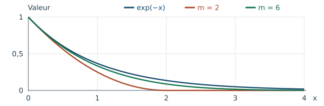
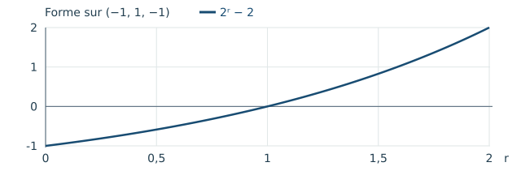

# X-ENS · PC · Mathématiques 2011 — corrigé brut

*Corrigé rédigé par IA, non officiel. Signalez toute erreur.*

**Rédaction** · GPT-6.2 Astra Ultra · vitesse non renseignée · 25 novembre 2026

Pour une matrice réelle symétrique, « positive » signifie que sa forme quadratique est positive ou nulle. On note $A*B$ le produit de Hadamard et $A^{*r}=(a_{ij}^r)$ une puissance entrée par entrée. Le sujet étudie les matrices pour lesquelles toutes ces puissances sont positives.

## Partie 1 · Fonction Gamma et produit d'Euler

### Question 1a · Convergence de l'intégrale

Sur $]0,1]$, $e^{-x}x^{s-1}\le x^{s-1}$, dont l'intégrale vaut $1/s$ pour $s>0$. À l'infini $x^{s-1}e^{-x/2}$ est bornée, d'où une majoration par $C_s e^{-x/2}$. Ces deux contrôles définissent $\Gamma(s)$.

### Question 1b · Valeurs entières

$\Gamma(1)=1$. L'intégration par parties sur un segment, suivie des passages aux bornes, donne $\Gamma(s+1)=s\Gamma(s)$ car $x^se^{-x}$ tend vers zéro aux deux extrémités. Ainsi $\Gamma(m)=(m-1)!$.

### Question 1c · Continuité

Sur tout segment $[a,b]\subset]0,\infty[$, l'intégrande est majoré sur $]0,1]$ par $x^{a-1}$ et sur $[1,\infty[$ par $x^{b-1}e^{-x}$. Ces deux fonctions sont intégrables, et pour chaque $x>0$ l'intégrande dépend continûment de $s$. La convergence dominée donne la continuité en tout $s>0$.

### Question 2a · Approximation de l'exponentielle

Pour $0\le x<m$, $m\log(1-x/m)\le-x$ ; à $x=m$ le membre à majorer vaut zéro. À $x$ fixé, $m\log(1-x/m)=-x+O(x^2/m)$ lorsque $m\to\infty$. Exponentier donne la limite $e^{-x}$.

### Question 2b · Intégrale à support borné

Par $x=mu$, l'intégrale vaut $m^s I_m(s)$, où $I_m(s)=\int_0^1u^{s-1}(1-u)^m\,du$. Pour $m\ge1$, une intégration par parties donne $I_m(s)=m I_{m-1}(s+1)/s$, les bords étant nuls. Comme $I_0(t)=1/t$,
\[
m^s I_m(s)=\frac{m!\,m^s}{s(s+1)\cdots(s+m)}.
\]

### Question 2c · Produit limite

Prolongeons par zéro la fonction $x^{s-1}(1-x/m)^m$ au-delà de $m$. Pour tout $x>0$, elle tend vers $x^{s-1}e^{-x}$ et reste comprise entre zéro et cette fonction intégrable. La convergence dominée sur $]0,\infty[$ identifie $\Gamma(s)$ à la limite du quotient de 2b.

## Partie 2 · Positivité et produit de Hadamard

### Question 3 · Critère en dimension deux

La forme $ax^2+2bxy+dy^2$ impose $a,d\ge0$. Si $a>0$ elle vaut $a(x+by/a)^2+(d-b^2/a)y^2$. Sa positivité équivaut alors à $ad-b^2\ge0$. Si $a=0$, la positivité force $b=0$ en faisant varier $x$ à $y=1$ ; réciproquement la condition de déterminant impose elle aussi $b=0$ et la forme devient $dy^2\ge0$.

### Question 4 · Positivité spectrale

Le théorème spectral donne une base orthonormée propre de $A$. Dans cette base $X^{\mathsf T}AX=\sum_i\lambda_i y_i^2$. Si $\lambda_i\ge0$ pour tout $i$, cette somme est positive ou nulle ; tester un vecteur propre unitaire isolant chaque $\lambda_i$ donne la réciproque.

### Question 5 · Pondérer les coordonnées

Avec $D=\mathrm{diag}(\lambda_i)$ on a $B=DAD$, donc $X^{\mathsf T}BX=(DX)^{\mathsf T}A(DX)\ge0$. La symétrie est conservée, y compris si certains poids sont nuls ou négatifs.

### Question 6 · Matrice de Gram

La symétrie vient du produit scalaire réel. La bilinéarité donne $\sum_{ij}x_ix_j\langle u_i,u_j\rangle=\|\sum_i x_i u_i\|^2\ge0$. L'indépendance des $u_i$ n'est pas nécessaire.

### Question 7 · Facteur diagonal

$A*B$ est diagonale de termes $a_{ii}b_{ii}$. Or $a_{ii}=e_i^{\mathsf T}Ae_i\ge0$ et $b_{ii}\ge0$ par hypothèse. Sa forme est donc une somme de carrés pondérés non négativement.

### Question 8a · Décomposition en rang un

Si $A=\sum_k \lambda_k q_k q_k^{\mathsf T}$ est la décomposition spectrale avec $q_k$ orthonormés, prendre $Y_k=\sqrt{\lambda_k}\,q_k$. Alors $A=\sum_k Y_kY_k^{\mathsf T}$, en omettant éventuellement les valeurs propres nulles.

### Question 8b · Théorème de Schur

Écrivons $B=\sum_kY_kY_k^{\mathsf T}$. Pour $D_k$ diagonale des coordonnées de $Y_k$, on a $A*(Y_kY_k^{\mathsf T})=D_kAD_k$. Chaque terme est positif par 5 et la somme de leurs formes est positive. Ainsi $A*B$ est positive.

## Partie 3 · Puissances réelles entrée par entrée

### Question 9a · Toute puissance en dimension deux

L'inégalité $ad\ge b^2$ se conserve sous la fonction croissante $t\mapsto t^r$ sur $\mathbb R_+$ pour $r>0$. Les termes diagonaux restent non négatifs et $a^rd^r-b^{2r}\ge0$. Appliquer 3 à $A^{*r}$.

### Question 9b · Un seuil en dimension trois

Avec $X=(x,y,z)$, la forme de $A^{*r}$ est
\[
(x+y)^2+(z+y)^2+(2^r-2)y^2.
\]
Elle est positive pour $r\ge1$, en particulier pour $A=A^{*1}$. Pour $0<r<1$, $X=(-1,1,-1)$ rend les deux premiers carrés nuls et le dernier terme strictement négatif. Le seuil exact est $1$.

### Question 10 · Changement d'échelle

Pour $r>0$, $B^{*r}=D_r A^{*r}D_r$ avec $D_r=\mathrm{diag}(\lambda_i^r)$. La question 5 et l'hypothèse sur $A$ s'appliquent pour tout $r$.

### Question 11 · Des racines aux puissances réelles

Pour un rationnel $p/m>0$, $A^{*p/m}$ est le produit de Hadamard de $p$ copies de la racine positive $A^{*1/m}$. Le théorème de Schur prouve sa positivité. Si $q_j\to r>0$ par ces rationnels, chaque entrée converge, y compris une entrée nulle qui reste nulle. Pour chaque vecteur $X$, la somme finie $X^{\mathsf T}A^{*q_j}X$ converge donc vers $X^{\mathsf T}A^{*r}X\ge0$.

### Question 12a · Noyau de Cauchy

Les fonctions $u_i(t)=e^{-\lambda_i t}$ sont continues et de carré intégrable. Leur produit scalaire vaut $\int_0^\infty e^{-(\lambda_i+\lambda_j)t}\,dt=(\lambda_i+\lambda_j)^{-1}$. La matrice $C$ est positive par 6.

### Question 12b · Transformée de Laplace

Le changement de variable $x=\alpha t$ dans $\Gamma(r)$ donne $\int_0^\infty e^{-\alpha t}t^{r-1}\,dt=\alpha^{-r}\Gamma(r)$ pour $\alpha,r>0$. Diviser par $\Gamma(r)>0$.

### Question 12c · Produit scalaire pondéré

Comme $2|uv|\le u^2+v^2$, l'intégrale pondérée du produit converge absolument. Elle est bilinéaire et symétrique. Si $\int_0^\infty u(t)^2t^{r-1}\,dt=0$, la continuité et la stricte positivité du poids sur $]0,\infty[$ imposent $u(t)=0$ pour tout $t>0$, puis $u(0)=0$ par continuité. C'est un produit scalaire.

### Question 12d · Divisibilité de la matrice de Cauchy

Dans l'espace de 12c, prendre $v_i(t)=e^{-\lambda_i t}/\sqrt{\Gamma(r)}$. Par 12b, leur matrice de Gram est $((\lambda_i+\lambda_j)^{-r})$. Les normes sont finies par la même formule avec $i=j$. Cela vaut pour chaque $r>0$.

### Question 13a · Rapport de trois fonctions Gamma

Appliquer 2c aux paramètres $1+\lambda_i+\lambda_j$, $1+\lambda_i$, $1+\lambda_j$. Dans le quotient, les factorielles donnent $1/m!$, les puissances de $m$ donnent $m^{-1}$, et les produits décalés sont indexés de $1$ à $m+1$. Les limites des dénominateurs sont non nulles. On obtient
\[
k_{ij}=\lim_{m\to\infty}\frac{1}{m\,m!}
\prod_{p=1}^{m+1}\frac{(\lambda_i+p)(\lambda_j+p)}{\lambda_i+\lambda_j+p}.
\]

### Question 13b · Produits et passage à la limite

Fixer $p\ge1$. Le dénominateur vaut $\mu_i+\mu_j$ avec $\mu_i=\lambda_i+p/2>0$. Par 12d son inverse fournit une matrice infiniment divisible. Multiplier par les poids $\lambda_i+p$ et $\lambda_j+p$ conserve cette propriété par 10. Pour $r>0$ fixé, élever les approximations de 13a à la puissance $r$ revient à multiplier entrée par entrée les matrices positives des facteurs à la puissance $r$ et le scalaire positif $(m\,m!)^{-r}$. Par 8b l'approximation est positive et sa limite $K^{*r}$ l'est pour chaque forme quadratique.

## Partie 4 · Positivité sur l'hyperplan de somme nulle

### Question 14 · Logarithme du noyau de Cauchy

Soit $\sum x_i=0$. Pour $f(r)=\sum_{ij}x_ix_j(\lambda_i+\lambda_j)^{-r}$, on a $f(r)\ge0$ si $r>0$ et $f(0)=(\sum x_i)^2=0$. Dériver la somme finie à droite en zéro donne $f'(0)=\sum_{ij}x_ix_j[-\log(\lambda_i+\lambda_j)]\ge0$. La matrice est symétrique et conditionnellement positive.

### Question 15 · Suppression du terme constant

Pour $\sum x_i=0$, $X^{\mathsf T}JX=(\sum x_i)^2=0$. L'hypothèse (ii) donne $X^{\mathsf T}BX\ge-\varepsilon\|X\|^2$ pour tout $\varepsilon>0$, quel que soit le choix admissible de $\lambda$. Faire tendre $\varepsilon$ vers zéro établit (i).

### Question 16a · Logarithme d'une matrice divisible

Pour $a_{ij}>0$ et $\sum x_i=0$, $g(r)=\sum x_ix_j a_{ij}^r$ est dérivable en zéro, y vaut zéro et est non négative à droite. Donc $g'(0)=\sum x_i x_j\log a_{ij}\ge0$. Le logarithme entrée par entrée est conditionnellement positif.

### Question 16b · Exponentielle entrée par entrée

Par l'équivalence admise en 15, choisir $C=B+\varepsilon I+\lambda J$ positive. Les puissances de Hadamard $C^{*k}$ sont positives pour les entiers $k\ge1$ même si certaines entrées de $C$ sont négatives. Le terme constant $J$ est positif. Ainsi les sommes partielles $J+\sum_{k=1}^N r^k C^{*k}/k!$ sont positives et leur limite est $(e^{rc_{ij}})$. Multiplier par $e^{-r\lambda}>0$ enlève la constante ajoutée partout. Il reste $(e^{r(b_{ij}+\varepsilon\delta_{ij})})$ ; à $\varepsilon\downarrow0$, les formes convergent vers celles de $(e^{rb_{ij}})$, donc elles restent non négatives.

### Question 17a · Noyau gaussien sur le plan

Écrire $z_i=u_i+\mathrm{i}v_i$. Pour des $x_i$ réels de somme nulle,
\[
-\sum_{ij}x_ix_j|z_i-z_j|^2=2\left|\sum_i x_i z_i\right|^2\ge0.
\]
En effet les termes dépendant d'un seul indice s'annulent et les termes croisés donnent le carré. Appliquer 16b à $b_{ij}=-|z_i-z_j|^2$ pour tout $r>0$.

### Question 17b · Résolvante et intégrale conditionnelle

Posons $a_{ij}=|z_i-z_j|^2$. Pour $t>0$,
\[
(t+a_{ij})^{-1}=\int_0^\infty e^{-ts}e^{-s a_{ij}}\,ds.
\]
Par 17a, tester cette identité sur un vecteur donne une intégrale non négative et donc une matrice positive. Sur $\sum x_i=0$, la matrice $(-a_{ij}/(t+a_{ij}))$ a la même forme que $(t/(t+a_{ij}))$, puisque leur différence est $-J$. Multiplier par $t^{-1/2}$ puis intégrer préserve cette positivité conditionnelle. Chaque entrée est intégrable : pour $a>0$ le module est au plus $t^{-1/2}$ près de zéro et $a t^{-3/2}$ à l'infini ; pour $a=0$ il est nul.

### Question 17c · Exponentielle de la distance

Si $a>0$, la substitution $t=ay^2$ donne
\[
\int_0^\infty t^{-1/2}\frac{a}{t+a}\,dt
=2\sqrt a\int_0^\infty\frac{dy}{1+y^2}=\pi\sqrt a.
\]
L'égalité se prolonge à $a=0$. Par 17b, $(-|z_i-z_j|)$ est conditionnellement positive après division par $\pi$. La question 16b donne la positivité de $(e^{-r|z_i-z_j|})$ pour tout $r>0$, soit la divisibilité demandée.
