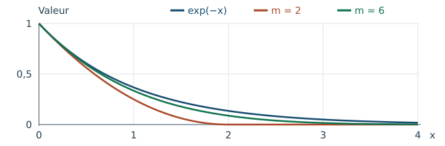
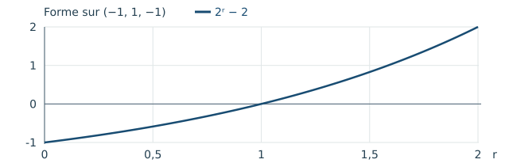

# X-ENS · PC · Mathématiques 2011 — corrigé guidé

*Corrigé rédigé par IA, non officiel. Signalez toute erreur.*

**Rédaction** · GPT-6.2 Astra Ultra · vitesse non renseignée · 25 novembre 2026

La fonction Gamma fournit une représentation intégrale de certaines matrices. On apprend d’abord à reconnaître une forme quadratique positive, puis à construire de nouveaux exemples par produits, intégrales et passage à la limite. Le dernier noyau fait intervenir la distance ordinaire entre des points du plan complexe.

## Partie 1 · Fonction Gamma et produit d'Euler

### Question 1a · Convergence de l'intégrale

Coupez en $1$. Au voisinage de zéro une puissance $x^\alpha$ est intégrable si $\alpha>-1$, ici $s-1>-1$. Au-delà de $1$, gardez la moitié de l'exponentielle pour absorber la puissance et l'autre moitié pour intégrer.

### Question 1b · Valeurs entières

Faites dériver $x^s$ et intégrez $e^{-x}$. Le terme de bord disparaît pour $s>0$. La récurrence commence à $\Gamma(1)=\int_0^\infty e^{-x}\,dx=1$, si bien que le dernier facteur à multiplier pour obtenir $\Gamma(m)$ est $m-1$.

### Question 1c · Continuité

Pour étudier $s$ près d'une valeur fixée, enfermez-le entre $a>0$ et $b$. À gauche de $1$, la plus grande puissance correspond au plus petit exposant ; à droite c'est l'inverse. Ces deux majorants locaux permettent de passer à la limite sous l'intégrale.

### Question 2a · Approximation de l'exponentielle

La tangente du logarithme en $1$ donne $\log(1-y)\le-y$ pour $0\le y<1$. Prenez $y=x/m$ et traitez la borne $x=m$ séparément. Pour la limite, gardez $x$ fixe et utilisez $\log(1-y)=-y+O(y^2)$ avant de multiplier par $m$.

### Question 2b · Intégrale à support borné

Ramenez le bord variable à $1$ en écrivant $x=mu$. Choisissez $u^{s-1}$ comme facteur à intégrer et $(1-u)^m$ comme facteur à dériver. À chaque étape le degré baisse de un, le paramètre $s$ augmente de un et le facteur sorti est le rapport de l'ancien degré à l'ancien paramètre. La toute dernière intégrale vaut $1/(s+m)$. Le changement d'échelle a fourni $m^s$.

### Question 2c · Produit limite

Les bornes d'intégration bougent avec $m$. Incorporez l'indicatrice de $]0,m]$ à la fonction, puis intégrez toujours sur la même demi-droite. La figure et 2a donnent le majorant après multiplication par $x^{s-1}$. L'intégrabilité vient de 1a et la formule des intégrales approchantes de 2b.

## Partie 2 · Positivité et produit de Hadamard

### Question 3 · Critère en dimension deux

Testez d'abord les deux vecteurs de base. Lorsque $a>0$, pour une valeur fixée de $y$ le minimum en $x$ est atteint en $-by/a$ et vaut $(ad-b^2)y^2/a$. Lorsque $a=0$, le terme $2bxy$ prend des valeurs arbitrairement négatives si $b\ne0$. Dans les deux cas, les trois inégalités de l'énoncé sont nécessaires et suffisantes.

### Question 4 · Positivité spectrale

La symétrie réelle autorise un changement de base orthogonal. Dans les nouvelles coordonnées on lit les valeurs propres comme coefficients des carrés. La forme conserve son signe dans toute direction exactement lorsque tous ces coefficients sont non négatifs.

### Question 5 · Pondérer les coordonnées

Remplacez $x_i$ par $\lambda_i x_i$ dans la forme quadratique de $A$. Vous obtenez exactement le coefficient $\lambda_i\lambda_j a_{ij}$ devant $x_ix_j$. Le vecteur ainsi pondéré est un vecteur réel auquel s'applique la positivité de $A$.

### Question 6 · Matrice de Gram

Regroupez la somme double en prenant un facteur $x_i$ dans le premier argument et $x_j$ dans le second. Il reste le produit scalaire du même vecteur $\sum_i x_i u_i$ avec lui-même : sa norme au carré.

### Question 7 · Facteur diagonal

Le produit entrée par entrée annule toutes les cases hors diagonale. Pour connaître le signe de $a_{ii}$, essayez la forme de $A$ sur le $i$-ème vecteur canonique. Vous pouvez alors appliquer directement le critère des matrices diagonales.

### Question 8a · Décomposition en rang un

Pour une diagonale positive, son $k$-ème terme est le produit extérieur de $\sqrt{\lambda_k}e_k$ avec lui-même. Transportez chaque colonne dans la base propre orthonormée de $A$. Vous obtenez une somme de matrices, chacune construite à partir d'une seule colonne.

### Question 8b · Théorème de Schur

Utilisez la décomposition sur un seul des deux facteurs. Si ce facteur est un produit extérieur, l'entrée $ij$ de $A$ se trouve multipliée par le produit de deux poids : c'est exactement la question 5. Additionnez ensuite les résultats par distributivité.

## Partie 3 · Puissances réelles entrée par entrée

### Question 9a · Toute puissance en dimension deux

Ne diagonalisez pas une puissance entrée par entrée. Ici le critère du déterminant se réduit à comparer deux nombres non négatifs. Leur ordre est préservé par toute puissance réelle strictement positive, même si certains sont nuls.

### Question 9b · Un seuil en dimension trois

En prenant les puissances, seule la case centrale change. Complétez séparément le carré en $x$ puis celui en $z$. Il reste $2^r-2$ fois le carré de $y$. Si ce coefficient devient négatif, le choix $x=z=-y$ permet de le voir seul. La figure suit la valeur obtenue pour $y=1$.

### Question 10 · Changement d'échelle

Élevez l'entrée $\lambda_i a_{ij}\lambda_j$ à la puissance $r$. Les deux poids deviennent $\lambda_i^r$ et $\lambda_j^r$. Vous retrouvez une pondération que la question 5 autorise pour la matrice positive $A^{*r}$.

### Question 11 · Des racines aux puissances réelles

Traitez d'abord une fraction : la racine fournit le dénominateur et des produits de Hadamard successifs, le numérateur. Pour atteindre un exposant irrationnel, fixez un vecteur test avant de passer à la limite. Sa forme quadratique est une somme finie de termes continus en l'exposant, donc une limite de nombres non négatifs.

### Question 12a · Noyau de Cauchy

Vérifiez d'abord que $u_i$ appartient à l'espace en intégrant $e^{-2\lambda_i t}$. Multiplier deux de ces fonctions ajoute leurs taux de décroissance. Leur intégrale donne alors exactement l'entrée cherchée d'une matrice de Gram.

### Question 12b · Transformée de Laplace

Une dilatation de rapport $\alpha$ enlève $\alpha$ de l'exponentielle. Le différentiel apporte $\alpha^{-1}$ et la puissance apporte $\alpha^{1-r}$ ; leur produit est $\alpha^{-r}$. L'intégrale restante définit $\Gamma(r)$.

### Question 12c · Produit scalaire pondéré

Une inégalité sur $2|uv|$ garantit l'existence de toutes les intégrales croisées. Pour la séparation, si $u$ ne s'annulait pas en un point strictement positif, sa continuité donnerait un intervalle où $u^2$ reste minorée par une constante positive. L'intégrale ne pourrait s'annuler. Il reste à prolonger cette conclusion jusqu'en zéro.

### Question 12d · Divisibilité de la matrice de Cauchy

Cherchez les vecteurs dont les produits scalaires pondérés donnent les puissances des entrées de $C$. Les exponentielles de 12a conviennent encore dès que chacune est divisée par $\sqrt{\Gamma(r)}$. Appliquez 12b à la somme des deux taux puis le critère de Gram.

### Question 13a · Rapport de trois fonctions Gamma

Écrivez toutes les approximations de Gamma avec le même indice $m$. Prendre Gamma au numérateur met son produit d'Euler au dénominateur du nouveau quotient. Pour éviter un facteur oublié, soustrayez les exposants de $m$ : $(1+\lambda_i+\lambda_j)-(1+\lambda_i)-(1+\lambda_j)=-1$. Il reste aussi une factorielle au dénominateur.

### Question 13b · Produits et passage à la limite

Répartissez le décalage $p$ en deux moitiés dans le dénominateur. Le noyau de Cauchy réapparaît, accompagné de deux poids, l'un par ligne, l'autre par colonne. À exposant fixé, chaque produit fini de la formule précédente est donc positif après la prise de puissance. La limite se transporte en testant sur chaque vecteur comme en 11.

## Partie 4 · Positivité sur l'hyperplan de somme nulle

### Question 14 · Logarithme du noyau de Cauchy

Pour un vecteur de somme nulle, toutes les entrées égales à un donnent une forme nulle. En faisant varier l'exposant à partir de zéro, la forme de 12d ne peut que partir vers des valeurs non négatives. Le signe de sa dérivée à droite fournit le signe voulu pour le logarithme.

### Question 15 · Suppression du terme constant

Testez l'inégalité de (ii) uniquement sur l'hyperplan demandé. Le coefficient $\lambda$ disparaît car $JX=0$ sur cet hyperplan. Seule reste une erreur $\varepsilon\|X\|^2$, que l'on peut rendre arbitrairement petite.

### Question 16a · Logarithme d'une matrice divisible

Reprenez le raisonnement de 14 avec la base $a_{ij}$. La stricte positivité de ces bases permet de dériver $e^{r\log a_{ij}}$ en zéro. Le terme constant s'annule sur les vecteurs de somme nulle et la première variation est celle de la matrice logarithmique.

### Question 16b · Exponentielle entrée par entrée

Développez l'exponentielle case par case. Le terme d'ordre zéro est la matrice de tous les $1$ et les termes suivants sont des produits de Schur d'une matrice positive. Leurs coefficients sont positifs, donc les formes restent positives à la limite. Pour revenir à $B$, retirez d'abord $\lambda$ en multipliant toute la matrice par le même scalaire $e^{-r\lambda}$. Seule la diagonale dépend encore de $\varepsilon$, qui peut alors tendre vers zéro.

### Question 17a · Noyau gaussien sur le plan

Développez le carré de la distance en utilisant le produit scalaire réel du plan complexe. Les termes $|z_i|^2$ et $|z_j|^2$ disparaissent après sommation sur l'autre indice. Reste deux fois le carré de la norme du barycentre pondéré $\sum x_i z_i$. Le logarithme du noyau gaussien est donc conditionnellement positif et 16b donne toutes les puissances.

### Question 17b · Résolvante et intégrale conditionnelle

Obtenez l'inverse $1/(t+a)$ en intégrant une exponentielle en une nouvelle variable $s$. Le facteur $e^{-ts}$ est un poids positif ; la matrice restante est le noyau traité en 17a. Pour la seconde assertion, écrivez $-a/(t+a)=-1+t/(t+a)$. La partie constante n'intervient plus sur l'hyperplan de somme nulle. Intégrez donc des formes non négatives avec le poids demandé. La convergence résulte des majorants $t^{-1/2}$ en zéro et $a t^{-3/2}$ à l'infini, et les entrées correspondant à des points confondus sont nulles.

### Question 17c · Exponentielle de la distance

Pour enlever le carré dans la distance, évaluez l'intégrale de 17b. Le changement $t=ay^2$ transforme son poids en $2\sqrt a\,dy/(1+y^2)$, d'intégrale $\pi\sqrt a$. Le signe moins de la question précédente fournit donc le logarithme du noyau final, à un facteur positif près. Appliquez le sens exponentiel du critère de 16.
