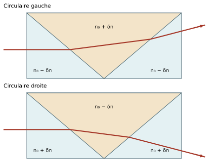
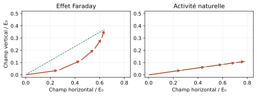

# X–ENS PC 2011 — Physique B (XELC) · Corrigé guidé

*Corrigé rédigé par IA, non officiel. Signalez toute erreur.*

**Lecture du rapport du jury** · GPT-6.2 Astra Ultra · vitesse non renseignée

**Rédaction** · GPT-6.2 Astra Ultra · vitesse non renseignée

## Activité optique

## I. Préparer et analyser la lumière

### Question I.1 — Source de lumière

**Indication.** Distinguer largeur de raie et direction de vibration.

Un laser émet dans une bande de fréquences étroite. On peut aussi sélectionner une raie d’une lampe spectrale avec un monochromateur. Un polariseur rectiligne placé après la source fixe la direction du champ transmis, même si la source émet une lumière non polarisée.

### Question I.2 — Mesurer la rotation

**Indication.** Rechercher une extinction avant et après l’insertion de la cuve.

Devant la source, placer un polariseur fixe puis un analyseur tournant. Avec la cuve de référence, repérer l’azimut $a_0$ qui éteint le faisceau. Introduire l’échantillon et tourner l’analyseur jusqu’à retrouver l’extinction, à l’azimut $a_1$. L’extinction complète atteste une polarisation rectiligne et $a_1-a_0$ donne sa rotation modulo $\pi$. Un simple changement de transmission modifierait la puissance maximale sans déplacer l’extinction.

## II. Deux modes circulaires

### Question II.1 — Suivre l’extrémité du champ

**Indication.** Prendre la partie réelle au point $z=0$ puis comparer les directions à $t=0$ et $T/4$.

Des amplitudes réelles donnent un champ parallèle au vecteur fixe $(E_{0x},E_{0y})$. Un déphasage quelconque décrit en général une ellipse, qui devient une droite pour un déphasage nul ou égal à $\pi$ et un cercle pour des amplitudes égales en quadrature. Avec $(E_0,iE_0)$ on obtient en $z=0$ le couple $E_0(\cos\omega t,\sin\omega t)$, tournant de $x$ vers $y$ et désigné gauche dans le sujet. Le signe $-i$ inverse la rotation et donne le mode droit.

### Question II.2 — Décomposition du champ incident

**Indication.** Additionner deux amplitudes circulaires dont les composantes en $y$ se compensent.

L’identité $(E_0,0)=\tfrac{E_0}{2}(1,i)+\tfrac{E_0}{2}(1,-i)$ fixe les amplitudes et la phase relative à l’entrée. La linéarité des équations permet ensuite de propager chaque terme avec son propre nombre d’onde.

### Question II.3 — Rotation après une épaisseur donnée

**Indication.** Factoriser la phase moyenne des deux exponentielles.

On a $n_g=n_0-\delta n$ et $n_d=n_0+\delta n$. Posons $k_0=\omega/c$ et $u=k_0\ell\delta n$. En sortie, après extraction de $E_0 e^{ik_0n_0\ell}$, les composantes sont $(e^{-iu}+e^{iu})/2=\cos u$ et $i(e^{-iu}-e^{iu})/2=\sin u$. En multipliant par la même oscillation temporelle on conserve cette direction, d’angle $\alpha=\omega(n_d-n_g)\ell/(2c)$ modulo $\pi$.

### Question II.4 — Réflexion en activité naturelle

**Indication.** Suivre les indices rencontrés par la même composante sur les deux trajets.

Un miroir à incidence normale impose la même phase de réflexion aux deux composantes transverses. La propagation s’inverse et leurs identités droite et gauche, définies par rapport au sens de propagation, s’échangent. Chaque composante accumule alors $k_0(n_d+n_g)\ell$ sur l’aller-retour. Le déphasage relatif final est nul et la figure 2.a s’applique.

## III. Un champ magnétique impose une rotation

### Question III.1.1 — Équations de l’électron lié

**Indication.** Écrire $\dot{\mathbf r}\times B_0\mathbf e_z$ avant de multiplier par la charge.

Avec $\Phi=\varphi-\omega t$, la relation de Newton donne $m(\ddot x+\omega_1^2x)=-eE_0\cos\Phi-eB_0\dot y$ et $m(\ddot y+\omega_1^2y)=eE_0\sin\Phi+eB_0\dot x$. La composante longitudinale obéit à $\ddot z+\omega_1^2z=0$. Elle disparaît dans la solution purement forcée.

### Question III.1.2 — Rayon algébrique du mouvement

**Indication.** La dérivée de $-a\sin(\varphi-\omega t)$ vaut $+a\omega\cos(\varphi-\omega t)$.

Le mouvement proposé donne $\ddot x=-\omega^2 x$, $\ddot y=-\omega^2 y$, $\dot y=a\omega\cos\Phi$, $\dot x=a\omega\sin\Phi$. Les deux équations se réduisent à $m(\omega_1^2-\omega^2)a=-eE_0-eB_0\omega a$. Posant $D=\omega_1^2-\omega^2$ et $\omega_c=eB_0/m$, on obtient $a=-eE_0/[m(D+\omega_c\omega)]$ hors résonance.

### Question III.1.3 — Courant de polarisation

**Indication.** Multiplier la vitesse de chaque porteur par sa densité volumique de charge.

Le noyau étant immobile, $\mathbf j=-Ne\dot{\mathbf r}=-Nea\omega(\sin\Phi\,\mathbf e_x+\cos\Phi\,\mathbf e_y)$. La densité $N$ a pour unité $\mathrm{m^{-3}}$ et $j$ s’exprime en $\mathrm{A\,m^{-2}}$.

### Question III.1.4 — Équation de propagation

**Indication.** Combiner les rotationnels de Maxwell–Faraday et de Maxwell–Ampère.

Prendre le rotationnel de $\nabla\times\mathbf E=-\partial_t\mathbf B$ et substituer $\nabla\times\mathbf B=\mu_0\mathbf j+c^{-2}\partial_t\mathbf E$. Pour ce champ transverse qui dépend seulement de $z$ et $t$, $\nabla\cdot\mathbf E=0$, donc le double rotationnel vaut $-\Delta\mathbf E$. Ainsi $\Delta\mathbf E-c^{-2}\partial_t^2\mathbf E=\mu_0\partial_t\mathbf j$.

### Question III.1.5 — Indice gauche

**Indication.** Identifier la polarisation $\mathbf P$ telle que $\partial_t\mathbf P=\mathbf j$.

Chaque électron porte un dipôle $-e\mathbf r$. Il vient $\mathbf P=-Ne(a/E_0)\mathbf E$, donc $\partial_t\mathbf j=-Ne(a/E_0)\partial_t^2\mathbf E$. Dans l’équation de propagation, remplacer $\Delta$ par $-k_g^2$ et $\partial_t^2$ par $-\omega^2$. On trouve $n_g^2=1-Nea/(\epsilon_0E_0)=1+\omega_p^2/(D+\omega_c\omega)$ avec $\omega_p^2=Ne^2/(m\epsilon_0)$ et $\omega_c=eB_0/m$.

### Question III.1.6 — Indice droit

**Indication.** Inverser la composante en $y$ du champ et du déplacement avant de reprendre l’équation en $x$.

Pour le mode droit $y=a_d\sin\Phi$, donc $\dot y=-a_d\omega\cos\Phi$. Le terme magnétique projeté en $x$ devient $+eB_0 a_d\omega\cos\Phi$. L’équation donne $a_d=-eE_0/[m(D-\omega_c\omega)]$. La polarisation et l’équation d’onde s’obtiennent comme pour le mode gauche, soit $n_d=\sqrt{1+\omega_p^2/(D-\omega_c\omega)}$ dans la bande transparente.

### Question III.2.1 — Constante de Verdet

**Indication.** Développer la racine à faible susceptibilité, puis les deux dénominateurs au premier ordre en $B_0$.

La différence vaut $n_d-n_g\simeq(\omega_p^2/2)[1/(D-\omega_c\omega)-1/(D+\omega_c\omega)]\simeq\omega_p^2\omega_c\omega/D^2$. À basse fréquence $D\simeq\omega_1^2$. Ainsi $V_e=\alpha/(B_0\ell)\simeq e\omega_p^2\omega^2/(2mc\omega_1^4)=e\omega_p^2\lambda_1^4/(8\pi^2mc^3\lambda^2)$. L’unité est le radian par tesla et par mètre.

### Question III.2.2 — Retour dans un milieu de Faraday

**Indication.** Les mouvements propres de l’électron sont fixés par le champ magnétique extérieur.

Dans les axes fixes $x,y$, les amplitudes $(1,\pm i)$ retrouvent au retour les mêmes équations mécaniques car $B_0$ garde son sens. Leurs phases de propagation s’accumulent une deuxième fois sur la longueur $\ell$. Le déphasage est doublé, l’angle mesuré au point de départ vaut $2\alpha$ modulo $\pi$ (figure 2.b).

### Question III.2.3 — Courant du solénoïde

**Indication.** Employer la même unité angulaire pour l’angle voulu et la constante tabulée.

Avec $B_0=\mu_0 nI$ pour le solénoïde long, $I=\alpha/(V_e\ell\mu_0 n)$. Les données conduisent à $B_0=10/(100\times0{,}30)\ \mathrm T\simeq0{,}33\ \mathrm T$, puis $I\simeq0{,}33/(4\pi\times10^{-7}\times10^5)\ \mathrm A\simeq2{,}7\ \mathrm A$, soit quelques ampères.

## IV. Une molécule hélicoïdale

### Question IV.1.1 — Énergie de rappel

**Indication.** Intégrer la composante du rappel le long de $Z$.

Le travail élémentaire du rappel vaut $-m\omega_1^2 Z\,dZ=-dU$. L’origine de l’énergie prise en $Z=0$ donne $U=m\omega_1^2 Z^2/2$.

### Question IV.1.2 — Champ d’induction

**Indication.** Choisir comme contour un cercle horizontal de rayon $r$, orienté selon $+\mathbf e_Z$.

Le flux magnétique vaut $\pi r^2B(t)$. La circulation du champ induit, uniforme sur le cercle par symétrie, est $2\pi r E_\theta=-\pi r^2\dot B$. Il en résulte $E_\theta=-r\dot B/2=(r\omega B_0/2)\sin\omega t$.

### Question IV.1.3 — Inertie de l’électron contraint

**Indication.** Relier les vitesses azimutale et axiale par $Z=P\theta$.

Comme $r=R$, $v^2=R^2\dot\theta^2+\dot Z^2$ et $K=\tfrac12m(1+R^2/P^2)\dot Z^2$. Le travail électrique élémentaire vaut $-eE_\theta R\,dZ/P$ et la contrainte idéale ne travaille pas. L’équation issue du bilan d’énergie est $m(1+R^2/P^2)\ddot Z+m\omega_1^2 Z=-eRE_\theta/P$. On obtient $\omega_0^2=\omega_1^2 P^2/(R^2+P^2)$ et $\ddot Z+\omega_0^2Z=-eB_0PR^2\omega\sin(\omega t)/[2m(R^2+P^2)]$.

### Question IV.1.4 — Dipôle d’une hélice

**Indication.** En régime forcé, remplacer $\ddot Z$ par $-\omega^2Z$ et identifier $p_Z=-eZ$.

Le second membre précédent vaut $ePR^2\dot B/[2m(R^2+P^2)]$. Donc $p_Z=\beta_1\dot B$ avec $\beta_1=e^2PR^2/[2m(R^2+P^2)(\omega^2-\omega_0^2)]$. Le dipôle entier possède aussi la composante $-eR\mathbf e_r$ et n’est généralement pas axial.

### Question IV.1.5 — Dipôle d’une double hélice

**Indication.** Additionner les deux vecteurs positions au même angle $\theta$.

Les vecteurs transverses des deux nuages sont opposés, les cotes sont égales. Ainsi $\mathbf p=-e(\mathbf r_1+\mathbf r_2)=-2eZ\mathbf e_Z=2\beta_1\dot{\mathbf B}$. Cette géométrie supprime la composante radiale du dipôle total.

### Question IV.1.6 — Moyenne d’orientation

**Indication.** Le poids d’un intervalle d’angle polaire est proportionnel à $\sin\eta$.

L’isotropie donne $\langle\cos^2\eta\rangle=\tfrac12\int_0^\pi\cos^2\eta\sin\eta\,d\eta=1/3$. Les contributions transverses s’annulent par invariance autour du champ. La réponse moyenne est $\langle\mathbf p\rangle=\beta_e\dot{\mathbf B}$, où $\beta_e=2\beta_1/3=e^2PR^2/[3m(R^2+P^2)(\omega^2-\omega_0^2)]$.

### Question IV.1.7 — Forçage électrique axial

**Indication.** Reprendre le bilan mécanique en remplaçant le travail du champ induit par $-eE\,dZ$.

L’inertie effective est toujours $m(1+R^2/P^2)$. Le bilan devient $m(1+R^2/P^2)\ddot Z+m\omega_1^2Z=-eE(t)$, d’où $\ddot Z+\omega_0^2Z=-eP^2E_0\cos(\omega t)/[m(R^2+P^2)]$.

### Question IV.1.8 — Moment magnétique

**Indication.** Dans chaque produit $\mathbf r\times\mathbf v$, isoler la composante axiale $R^2\dot\theta$.

Les composantes transverses des deux produits vectoriels se compensent par rotation de $\pi$ autour de $Z$. Il reste $\mathbf M=-eR^2\dot Z\mathbf e_Z/P$. La solution forcée est $Z=eP^2E/[m(R^2+P^2)(\omega^2-\omega_0^2)]$. En dérivant, $\mathbf M=-\beta_2\dot{\mathbf E}$ avec $\beta_2=e^2PR^2/[m(R^2+P^2)(\omega^2-\omega_0^2)]$.

### Question IV.2.1 — Champ transmis par une couche mince

**Indication.** Les deux champs rayonnés sont en phase et dirigés suivant $y$.

La superposition donne $\mathbf E=E_0\cos(k_0z-\omega t)[\mathbf e_x+C\mathbf e_y]$ avec $C=(\beta_e+\beta_m)k_0^2Nh/(2\epsilon_0)$. Le champ reste rectiligne. Comme $\tan\alpha=C$ et que la couche vérifie $|C|\ll1$, $\alpha\simeq(\beta_e+\beta_m)k_0^2Nh/(2\epsilon_0)$.

### Question IV.2.2 — Molécule miroir

**Indication.** Appliquer la symétrie $Y\mapsto-Y$ et examiner le pas algébrique.

Pour les deux courbes images on obtient $X=\pm R\cos\theta$, $Y=\mp R\sin\theta$, $Z=P\theta$. En posant $\theta'=-\theta$, elles retrouvent la forme initiale avec $P'=-P$. Les fréquences sont inchangées puisque $\omega_0^2$ dépend de $P^2$, tandis que $\beta_e$ et $\beta_m$, impairs en $P$, changent de signe. À épaisseur égale, l’angle devient $-\alpha$.

## V. Détecter une rotation faible

### Question V.1.1 — Écart à une interface de limonène

**Indication.** Dériver $n\sin r=n_{\rm air}\sin\phi$ à angle incident fixé.

Pour chaque mode $j$, $n_j\sin r_j=n_{\rm air}\sin30^\circ$. La rotation mesurée donne $n_d-n_g=(\alpha/\ell)\lambda_0/\pi\simeq2{,}63\times10^{-6}$ avec $\alpha/\ell=750\pi/180\ \mathrm{rad\,m^{-1}}$. À l’indice moyen $r_0\simeq19{,}8^\circ$ et $dr=-\tan r\,dn/n$. Donc $r_g-r_d\simeq\tan r_0(n_d-n_g)/n_0\simeq6{,}4\times10^{-7}\ \mathrm{rad}$. Sur un mètre de propagation, l’écart transversal est de l’ordre du micromètre.

### Question V.1.2 — Prismes d’activités opposées

**Indication.** Tracer la normale à chaque frontière du prisme central, dont la base est en haut.

Pour le mode gauche l’indice central est plus élevé. À la première interface le rayon se rapproche de la normale montante et à la seconde il s’éloigne de la normale descendante. Les deux écarts le dévient vers le haut. Pour le mode droit les deux changements d’indice s’inversent, ce qui dévie le rayon vers le bas. Une série de cellules orientées de même manière cumule la séparation angulaire au premier ordre.

### Question V.2.1 — Somme des trajets optiques

**Indication.** Compter les deux réflexions et la phase de chaque tour supplémentaire.

La première sortie a l’amplitude $Te^{i\delta\varphi}E_i$. Un aller-retour multiplie celle-ci par $Re^{2i\delta\varphi}$. Ainsi $E_p=Te^{i\delta\varphi}(Re^{2i\delta\varphi})^p E_i$. Comme $R<1$, la somme géométrique converge et $E_s=Te^{i\delta\varphi}E_i/(1-Re^{2i\delta\varphi})$.

### Question V.2.2 — Nombre effectif d’ondes

**Indication.** Diviser la queue de la série par sa somme complète avant de prendre la norme.

La queue au-delà de $p=f$ vaut $E_s(Re^{2i\delta\varphi})^{f+1}$. L’erreur relative vaut donc $R^{f+1}$. À un pour cent on veut $f+1\ge\ln(0{,}01)/\ln R$, d’où le plus petit indice $f=\lceil\ln(0{,}01)/\ln R\rceil-1$. Pour $R=0{,}999$ on trouve $f=4602$, soit environ $4{,}6\times10^3$ termes. L’approximation $-\ln R\simeq1-R$ donne directement cette échelle.

### Question V.2.3 — Angle amplifié à résonance

**Indication.** Représenter chaque polarisation par une flèche du plan $xy$, puis additionner les flèches pondérées.

En effet Faraday, le terme de rang $p$ est tourné de $(2p+1)\alpha$. La somme vectorielle, écrite sous la forme $S=E_x+iE_y$, vaut $S/E_0=(1-R)e^{i\alpha}/(1-Re^{2i\alpha})$. Après multiplication par le conjugué du dénominateur, $\tan(\arg S)=[(1+R)/(1-R)]\tan\alpha$. Pour $R=0{,}999$ et $|\alpha|\ll(1-R)/(1+R)$, la rotation en sortie est proche de $1999\alpha$. En activité naturelle chaque aller-retour compense sa propre rotation. Tous les termes sortent à $\alpha$, leur somme garde cette direction et le gain angulaire vaut un.

