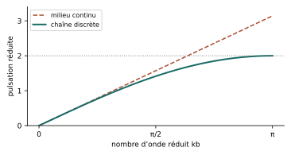
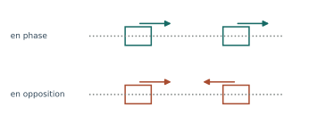
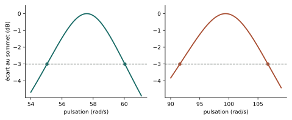
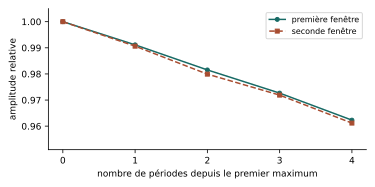
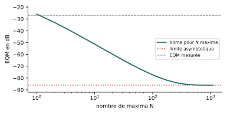

# X-ENS · PSI · Modélisation 2011 — corrigé brut

*Corrigé rédigé par IA, non officiel. Signalez toute erreur.*

**Rédaction** · GPT-6.2 Astra Ultra · vitesse non renseignée · 25 novembre 2026

**Amortissement dans les structures spatiales.** Le sujet CX1612 étudie un modèle vibratoire à deux masses, puis le dispositif civil de support de satellites SYLDA 5. Les 44 questions distinguent calcul modal, essais en flexion et estimation statistique. Les valeurs extraites des figures expérimentales sont arrondies à leur précision de lecture.

## I. Modéliser la vibration d’une structure

### Question 1 · Efforts sur les deux masses

L'allongement initial $b-\ell_0$ des ressorts donne des efforts qui s'équilibrent. Pour la masse de gauche, l'effort élastique additionnel vaut $-\kappa u_1+\kappa(u_2-u_1)$ et l'effort visqueux vaut $-\eta\dot u_1+\eta(\dot u_2-\dot u_1)$. Avec la convention positive de la figure 7, le principe fondamental donne

$$
\begin{aligned}
\mu\ddot u_1+\eta(2\dot u_1-\dot u_2)+\kappa(2u_1-u_2)&=f_1,\\
\mu\ddot u_2+\eta(2\dot u_2-\dot u_1)+\kappa(2u_2-u_1)&=0 .
\end{aligned}
$$

### Question 2 · Somme et différence

Pour $\sigma=u_1+u_2$ et $\delta=u_1-u_2$, on obtient

$$
\mu\ddot\sigma+\eta\dot\sigma+\kappa\sigma=f_1,\qquad
\mu\ddot\delta+3\eta\dot\delta+3\kappa\delta=f_1.
$$

Ces deux équations sont indépendantes. On reconstruit $u_1=(\sigma+\delta)/2$ et $u_2=(\sigma-\delta)/2$. Le mouvement en phase sollicite moins les ressorts que le mouvement en opposition.

### Question 3 · Chaîne discrète

Notons $D_2u_n=u_{n+1}-2u_n+u_{n-1}$. La force élastique est $\kappa D_2u_n$ et la force visqueuse $\eta D_2\dot u_n$. Si $f_n$ est l'effort extérieur appliqué au site $n$, alors

$$
\mu\ddot u_n=\kappa D_2u_n+\eta D_2\dot u_n+f_n.
$$

Pour une chaîne libre de toute excitation, $f_n=0$. Les termes de voisinage mesurent une variation de pente et s'annulent pour une translation uniforme.

### Question 4 · Passage au milieu continu

À $x=nb$ et $t$ fixé, $u_{n\pm1}=u\pm b u_x+\tfrac12 b^2 u_{xx}+o(b^2)$. Ainsi $u_{n+1}+u_{n-1}=2u+b^2u_{xx}+o(b^2)$. Dans l'approximation des grandes longueurs d'onde, en omettant les frottements et le chargement,

$$
u_{tt}=v^2u_{xx},\qquad v=b\sqrt{\kappa/\mu}.
$$

$\kappa/\mu$ est en $\mathrm{s}^{-2}$ et $v$ est une célérité en $\mathrm{m\,s^{-1}}$.

### Question 5 · Deux relations de dispersion

Dans l'équation continue de Q4, $u=Ue^{j(\omega t-k_ux)}$ donne $\omega^2=v^2k_u^2=(\kappa/\mu)b^2k_u^2$. Toute composante voyage à la célérité $v$.

Pour la chaîne discrète de Q3, la translation d'un rang multiplie $u_n$ par $e^{\mp jk_ub}$. La relation exacte est

$$
\omega^2=\frac{4\kappa}{\mu}\sin^2\!\left(\frac{k_ub}{2}\right).
$$

Elle relie la fréquence temporelle à la longueur d'onde spatiale. Pour $|k_u|b\ll1$, elle redonne Q4. La distinction importe pour interpréter Q6.

### Question 6 · Bande de propagation

Dans la chaîne discrète, une onde de nombre d'onde réel existe pour $|\omega|\le2\sqrt{\kappa/\mu}$. Au bord supérieur, $|k_u|b=\pi$ dans la première zone et la vitesse de groupe s'annule. Au-dessus du seuil le nombre d'onde acquiert une partie imaginaire et la réponse spatiale décroissante est évanescente. Dans l'équation continue expressément citée en Q5, $k_u=\pm\omega/v$ est réel pour toute pulsation réelle : cette approximation de basse fréquence ne possède pas de fréquence de coupure.

### Question 7 · Propagation avec viscosité

On a $D_2\dot u_n\simeq b^2u_{xxt}$. En posant $\gamma=\eta b^2/\mu$ et $v^2=\kappa b^2/\mu$, l'équation devient

$$
u_{tt}-\gamma u_{xxt}=v^2u_{xx}.
$$

Pour $u=Ue^{j(\omega t-k_ux)}$, elle donne $\omega^2=(v^2+j\gamma\omega)k_u^2$. L'unité de $\gamma$ est $\mathrm{m^2\,s^{-1}}$.

### Question 8 · Atténuation à basse fréquence

Avec $\varepsilon=\gamma\omega/v^2\ll1$,

$$
k_u=\pm\frac{\omega}{v}(1+j\varepsilon)^{-1/2}
=\pm\frac{\omega}{v}\left(1-\frac{j\varepsilon}{2}+O(\varepsilon^2)\right).
$$

Pour $\omega>0$ et une propagation vers $x>0$, en écrivant $k_u=k_r-jk_i$, on a $k_r\simeq\omega/v$, $k_i\simeq\gamma\omega^2/(2v^3)>0$. La partie réelle est $|U|e^{-k_i x}\cos(\omega t-k_rx+\arg U)$. L'autre racine renverse les deux signes et décrit l'autre sens de propagation. $k_i$ mesure l'atténuation par unité de distance. À cet ordre, les vitesses de phase et de groupe valent $v$ et le milieu est pratiquement non dispersif.

### Question 9 · Validité du modèle continu

La méthode choisit des masses et des liaisons élémentaires, écrit leurs équations de Newton, remplace les différences spatiales par des dérivées, puis recherche des ondes compatibles avec les conditions aux limites. Elle suppose ici un mouvement longitudinal linéaire, des coefficients uniformes, de faibles perturbations et des longueurs d'onde grandes devant $b$. Une géométrie tridimensionnelle, des assemblages hétérogènes et des conditions aux limites complexes conduisent à des équations difficiles à résoudre analytiquement. La résolution discrète puis modale évite d'imposer une solution d'onde plane à toute la structure.

### Question 10 · Matrices de l'exemple

Avec $x=(u_1,u_2)^{\mathsf T}$, introduisons la matrice $L$. Les équations $M\ddot x+C\dot x+Kx=F$ s'écrivent avec

$$
L=\begin{pmatrix}2&-1\\-1&2\end{pmatrix},\quad
M=\mu I_2,\quad C=\eta L,\quad K=\kappa L,\quad F=\begin{pmatrix}f_1\\0\end{pmatrix}.
$$

Les matrices sont symétriques et les deux modes de Q2 sont communs à $C$ et $K$.

## II. Résolution temporelle et modale

### Question 11 · Euler explicite à deux pas

À $t_q$, $Ma_q+Cv_q+Kx_q=F_q$, $v_q=(x_{q+1}-x_q)/h$ et $a_q=(x_{q+2}-2x_{q+1}+x_q)/h^2$. Donc

$$
M x_{q+2}=(2M-hC)x_{q+1}+(-M+hC-h^2K)x_q+h^2F_q .
$$

On résout par rapport à $x_{q+2}$ car $M$ est inversible. L'initialisation est $x_1=x_0+hv_0$. Si $M$ est constant, sa factorisation peut être réutilisée.

### Question 12 · Budget mémoire et durée

Avec $h=10^{-4}\,\mathrm s$ et $60\,\mathrm s$ de chargement, il faut $600\,000$ pas. À huit octets pour chacun des $10^5$ déplacements, l'enregistrement demande environ $4{,}8\times10^{11}$ octets, soit $447$ Go au sens du sujet, contre $16$ Go disponibles. L'instant initial supplémentaire change le total de $0{,}8$ Mo décimal seulement. Le temps de calcul annoncé est $600\,000\times0{,}4=240\,000\,\mathrm s$, soit $66$ h $40$ min par chargement, contre $12$ h autorisées. L'enregistrement intégral et le coût des chargements répétés excluent cette stratégie avec les moyens imposés. Le fait de ne garder que quelques instants en mémoire réduirait le stockage au prix de modifier la sortie requise.

### Question 13 · Problème généralisé aux valeurs propres

On obtient $(K-\omega^2 M)x_0=0$. Le problème généralisé est $K\phi_i=\lambda_iM\phi_i$ avec $\lambda_i=\omega_i^2$. Les pulsations propres satisfont $\det(K-\omega^2M)=0$. Puisque $M$ est inversible, on peut aussi chercher les valeurs propres de $M^{-1}K$.

### Question 14 · Orthogonalité modale

Par symétrie, $\phi_i^{\mathsf T}K\phi_j=\lambda_j\phi_i^{\mathsf T}M\phi_j=\lambda_i\phi_i^{\mathsf T}M\phi_j$. Pour $i\ne j$, la simplicité des valeurs propres impose $\phi_i^{\mathsf T}M\phi_j=0$. L'identité précédente impose alors aussi $\phi_i^{\mathsf T}K\phi_j=0$.

### Question 15 · Normalisation en masse

La normalisation donne $\phi_i^{\mathsf T}M\phi_i=1$, donc $\phi_i^{\mathsf T}K\phi_i=\omega_i^2$. Pour $\Phi$ dont les colonnes sont ces modes, $m=\Phi^{\mathsf T}M\Phi=I$ et $k=\Phi^{\mathsf T}K\Phi=\operatorname{diag}(\omega_1^2,\ldots,\omega_n^2)$.

### Question 16 · Équations indépendantes

Poser $x=\Phi q$ puis multiplier l'équation par $\Phi^{\mathsf T}$. On obtient, pour $1\le i\le n$,

$$
\ddot q_i+\omega_i^2q_i=\phi_i^{\mathsf T}F(t).
$$

Le membre de gauche ne fait intervenir que le mode $i$. Les conditions initiales se projettent dans la même base, $q(0)=\Phi^{\mathsf T}Mx(0)$ et de même pour la vitesse.

### Question 17 · Troncature modale

La base modale se calcule une fois. Pour des chargements et des sorties dominés par les basses fréquences, quelques dizaines de modes suffisent selon l'hypothèse donnée. À chaque fréquence, il reste autant d'équations scalaires indépendantes. Les chargements successifs se traitent par projection dans la même base, ce qui réduit fortement le stockage et les résolutions répétées. La précision dépend des modes omis et se contrôle dans la bande et aux points de mesure choisis.

### Question 18 · Modes des deux masses

$L(1,1)^{\mathsf T}=(1,1)^{\mathsf T}$, $L(1,-1)^{\mathsf T}=3(1,-1)^{\mathsf T}$. Les valeurs propres sont $\omega_1^2=\kappa/\mu$ et $\omega_2^2=3\kappa/\mu$. Avec $b_0=1/\sqrt{2\mu}$, on peut choisir $\phi_1=b_0(1,1)^{\mathsf T}$ et $\phi_2=b_0(1,-1)^{\mathsf T}$. Le premier mode conserve la longueur du ressort central. Dans le second, les masses s'écartent ou se rapprochent.

### Question 19 · Amortissement proportionnel

Si $C=\delta_1M+\delta_2K$, la matrice modale vaut $c=\delta_1 I+\delta_2\operatorname{diag}(\omega_i^2)$. L'équation du mode $i$ devient

$$
\ddot q_i+(\delta_1+\delta_2\omega_i^2)\dot q_i+\omega_i^2q_i=\phi_i^{\mathsf T}F .
$$

Elle reste indépendante des autres modes. Le découplage découle de la forme proportionnelle choisie pour $C$.

### Question 20 · Coefficients de Rayleigh

Ici $C=(\eta/\kappa)K$. Donc $\delta_1=0$ et $\delta_2=\eta/\kappa$. Sous l'hypothèse $\mu,\kappa>0$ de l'exemple, l'identification sur une composante hors diagonale puis une diagonale rend ces coefficients uniques.

### Question 21 · Pulsations, taux d'amortissement et gains

Notons $\lambda_1=1$, $\lambda_2=3$, $b_0=1/\sqrt{2\mu}$. Pour les coordonnées $q_i$ de Q16 et Q18,

$$
\omega_i^2=\lambda_i\kappa/\mu,\qquad
\xi_i=\frac{\lambda_i\eta}{2\mu\omega_i}
=\frac{\sqrt{\lambda_i}\eta}{2\sqrt{\mu\kappa}},\qquad
\ddot q_i+2\xi_i\omega_i\dot q_i+\omega_i^2q_i=b_0 f_1 .
$$

Dans la notation $A_i\omega_i^2 f_1$ de Q21, $A_i=b_0/\omega_i^2$. Pour la contribution au déplacement de la première masse, $z_i=b_0q_i$, le facteur devant $f_1$ devient $b_0^2$. Le gain physique vaut alors $A_i^{(u)}=b_0^2/\omega_i^2=1/(2\lambda_i\kappa)$. C'est cette seconde convention que la matrice imprimée avant Q23 emploie, car elle écrit $\sqrt{A_i^{(u)}}\,\omega_i=b_0$. Les gains de $q_i$ et de $z_i$ diffèrent bien du facteur de normalisation.

## III. Identification à partir de réponses en fréquence

### Question 22 · Réponse fréquentielle générale

Pour $Z(p)=Mp^2+Cp+K$, on a $\Phi^{\mathsf T}Z(p)\Phi=mp^2+cp+k$. Les trois matrices modales étant diagonales dans le modèle adopté,

$$
H(p)=Z(p)^{-1}=\Phi(mp^2+cp+k)^{-1}\Phi^{\mathsf T}.
$$

Notons $\phi_{ir}$ la composante au nœud $i$ du mode $r$. Pour une entrée au nœud $l$ et une sortie au nœud $i$,

$$
H_{il}(j\omega)=\sum_{r=1}^n
\frac{\phi_{ir}\phi_{lr}}{k_r-m_r\omega^2+jc_r\omega}.
$$

La formule s'applique aux fréquences où l'inverse existe. Elle montre aussi la réciprocité $H_{il}=H_{li}$.

### Question 23 · Séparer les deux réponses modales

Posons $D_i=\omega_i^2-\omega^2+2j\xi_i\omega_i\omega$ avec $\omega_i=\sqrt{k_i/m_i}$ et $\xi_i=c_i/(2\sqrt{k_im_i})$. Avec les modes de Q18, $m_i=1$, $k_i=\lambda_i\kappa/\mu$ et $c_i=\lambda_i\eta/\mu$. Définissons $H_i=b_0^2/D_i=A_i^{(u)}\omega_i^2/D_i$ avec les gains physiques de Q21. La matrice complète est

$$
H=\begin{pmatrix}H_1+H_2&H_1-H_2\\H_1-H_2&H_1+H_2\end{pmatrix}.
$$

Ainsi $H_1=(H_{11}+H_{21})/2$ et $H_2=(H_{11}-H_{21})/2$. On peut donc retrouver les deux courbes modales avec une force sur la première masse et des mesures sur les deux masses.

### Question 24 · Pulsations propres sur les courbes

Les maxima des deux réponses de la figure 9, précisés par la figure 10, sont vers $\omega_{r1}=57{,}6$ et $\omega_{r2}=99{,}5\,\mathrm{rad\,s^{-1}}$. En amortissement faible, $\omega_r=\omega_0\sqrt{1-2\xi^2}$ est très proche de $\omega_0$. Avec les taux de Q26 on obtient environ $\omega_1=57{,}7$ et $\omega_2=100\,\mathrm{rad\,s^{-1}}$. Leur rapport est proche de $\sqrt3$, comme l'impose Q18. Le gain seul ne rend pas la pulsation du sommet exactement égale à la pulsation propre.

### Question 25 · Largeur de bande à mi-puissance

Le carré du dénominateur réduit vaut $D(X)=(1-X)^2+4\xi^2X$, minimal en $X_r=1-2\xi^2$, avec $D(X_r)=4\xi^2(1-\xi^2)$. À mi-puissance, $D(X)=2D(X_r)$, soit

$$
X^2+(4\xi^2-2)X+1-8\xi^2(1-\xi^2)=0.
$$

Les solutions sont $X_{1,2}=1-2\xi^2\mp2\xi\sqrt{1-\xi^2}$. Pour $\xi\ll1$, leurs racines carrées valent $1\mp\xi+O(\xi^2)$. Donc $\Delta\omega/(2\omega_0)\simeq\xi$, et la même approximation vaut avec $\omega_r$ au dénominateur. Les deux points à mi-puissance existent dans le régime de faible amortissement considéré.

### Question 26 · Mesure des deux amortissements

Les deux zooms de la figure 10 donnent les lectures suivantes. Pour $H_1$, le sommet est vers $-49{,}2$ dB et la droite $-52{,}2$ dB coupe la courbe vers $55{,}1$ et $60{,}1\,\mathrm{rad\,s^{-1}}$. Pour $H_2$, le sommet est vers $-63{,}5$ dB et le niveau $-66{,}5$ dB donne environ $91{,}6$ et $106{,}6\,\mathrm{rad\,s^{-1}}$. Par Q25,

$$
\xi_1\simeq\frac{60{,}1-55{,}1}{2\times57{,}6}\simeq4{,}3\%,\qquad
\xi_2\simeq\frac{106{,}6-91{,}6}{2\times99{,}5}\simeq7{,}5\%.
$$

L'incertitude de lecture est de l'ordre du dixième de $\mathrm{rad\,s^{-1}}$. Le rapport des taux est compatible avec $\sqrt3$.

## IV. Prédiction de l’amortissement et qualité des mesures

### Question 27 · Pivots souples du banc de flexion

Les pivots souples autorisent les petites rotations imposées par la flexion en déformant élastiquement leurs lames. Ils évitent les glissements, les jeux et le frottement sec d'un pivot à contact. Leur faible dissipation limite la part attribuée à tort à l'éprouvette. Leur raideur et leurs pertes résiduelles se contrôlent avec l'essai sur matériau seul.

### Question 28 · Oscillation libre après le lâcher

Pour $0\le\xi<1$, posons $a=\xi\omega_0$ et $\omega_d=\omega_0\sqrt{1-\xi^2}$. Les racines caractéristiques sont $-a\pm j\omega_d$. Les conditions $y(0)=y_0$, $\dot y(0)=0$ donnent

$$
y(t)=y_0e^{-at}\left[\cos(\omega_dt)+\frac{a}{\omega_d}\sin(\omega_dt)\right].
$$

Les enveloppes sont proportionnelles à $e^{-at}$, et $T_p=2\pi/\omega_d$. Pour $y_0>0$, les maxima positifs correspondent à $t=nT_p$, d'où $Y_n=y_0e^{-anT_p}$.

### Question 29 · Décrément logarithmique

Le rapport $Y_n/Y_{n+1}=e^{\xi\omega_0T_p}$ donne $\delta=\ln(Y_n/Y_{n+1})=2\pi\xi/\sqrt{1-\xi^2}$. La relation exacte est $\xi=\delta/\sqrt{4\pi^2+\delta^2}$. Pour un faible taux, $\xi\simeq A\ln(Y_n/Y_{n+1})$ avec $A=1/(2\pi)$. Sur $s$ périodes on emploie $\delta=s^{-1}\ln(Y_n/Y_{n+s})$, ce qui réduit l'influence des incertitudes de lecture.

### Question 30 · Deux fenêtres de décroissance

Sur la figure 16, première fenêtre, les pics extrêmes sont environ $0{,}01353\%$ et $0{,}01302\%$. Le taux vaut

$$
\xi\simeq\frac{1}{8\pi}\ln\!\left(\frac{0{,}01353}{0{,}01302}\right)\simeq0{,}00153=0{,}153\%.
$$

Dans la seconde fenêtre, les lectures sont voisines de $7{,}47\times10^{-3}\%$ et $7{,}18\times10^{-3}\%$. Le même calcul donne $0{,}00158$, soit $0{,}158\%$. Le facteur $10^{-3}$ se simplifie dans le rapport. Les deux lectures s'accordent à la précision du graphique.

### Question 31 · Pertes du montage

Les mesures de $0{,}15$ à $0{,}16\%$ concordent avec le taux matériau d'environ $0{,}15\%$. Une dissipation parasite dominante du banc aurait relevé sensiblement le décrément. À la précision du test, la dissipation du montage est donc faible devant celle de l'éprouvette. Cet accord ne permet pas de lui assigner une perte exactement nulle.

### Question 32 · Effet d'une liaison boulonnée

À amplitude initiale comparable, l'éprouvette avec liaison perd bien davantage d'amplitude sur les premières oscillations. L'enveloppe décroît ensuite plus lentement et les cycles présentent des irrégularités visibles sur le zoom. La liaison ajoute une dissipation qui dépend du niveau de déformation. Une exponentielle unique et un taux constant ne décrivent donc pas toute la courbe aussi bien que pour le matériau seul.

### Question 33 · Amplitude moyenne sur un cycle

Pour $y_n(t)=Y_n\sin(\omega t)$ et $\omega=2\pi/T_p$, les quatre quarts de période ont la même aire en valeur absolue. Ainsi

$$
I_n=\int_{nT_p}^{(n+1)T_p}|y_n(t)|\,dt=\frac{4|Y_n|}{\omega},\qquad |Y_n|=\frac{\omega I_n}{4}.
$$

Si on travaille avec la moyenne $I_n/T_p$, l'amplitude est $\pi/2$ fois cette moyenne. L'intégration répartit la mesure sur tout le cycle, au lieu de la faire dépendre d'un seul maximum bruité.

### Question 34 · Amplitude et historique de cyclage

La figure 19 montre un taux croissant avec la déformation. À déformation donnée, la courbe du premier essai dépasse celle après 15 cycles, qui dépasse à son tour celle après 40 000 cycles. Par exemple, près de $0{,}02\%$ de déformation, les taux sont de l'ordre de $3\%$, $1{,}5\%$ et nettement moins de $1\%$. Des microglissements et frottements dans les surfaces de contact dissipent davantage lorsque leur étendue augmente avec l'amplitude. Le rodage et la mise en place des contacts peuvent modifier ces pertes après cyclage. Les courbes mesurent ce changement global sans identifier séparément chaque mécanisme.

### Question 35 · Identité issue de l'absence de biais

Sous les conditions de régularité et d'absence de biais utilisées dans l'équation (1), on dérive $\int (\widehat\xi(y)-\xi)p(y\mid\xi)\,dy=0$ au point $\xi^\circ$. Comme $\int p\,dy=1$,

$$
\int (\widehat\xi(y)-\xi^\circ)p(y\mid\xi^\circ)
\left.\frac{\partial\ln p(y\mid\xi)}{\partial\xi}\right|_{\xi^\circ}\,dy=1 .
$$

Ici $\widehat\xi=E$ dans la notation du sujet. On maintient l'observation $y$ fixe dans la dérivation, tandis que sa densité varie avec le paramètre. C'est l'absence de biais dans un voisinage, ou directement l'équation (1) admise, qui justifie cette dérivation.

### Question 36 · Inégalité de Cauchy–Schwarz

Posons $S(y)=\partial_\xi\ln p(y\mid\xi)|_{\xi^\circ}$. L'égalité de Q35 est $\mathbb E[(\widehat\xi-\xi^\circ)S]=1$. Cauchy–Schwarz donne

$$
1\le \mathbb E[(\widehat\xi-\xi^\circ)^2]\,\mathbb E[S^2]
=\left(\int(\widehat\xi-\xi^\circ)^2p\,dy\right)\left(\int S^2p\,dy\right).
$$

Toutes les espérances sont prises pour $\xi=\xi^\circ$.

### Question 37 · Borne de Cramér–Rao

Le second facteur est l'information de Fisher $\mathcal F(\xi^\circ)$. Pour $0<\mathcal F<\infty$, l'EQM de tout estimateur sans biais satisfaisant les hypothèses vérifie $C(\xi^\circ)\ge B_{\mathrm{CR}}=1/\mathcal F(\xi^\circ)$. L'égalité exige que l'erreur d'estimation soit proportionnelle au score presque sûrement.

### Question 38 · Signal aux dates d'observation

À $t=nT_p$, Q28 donne $Y_n=y_0\exp(-\xi^\circ\omega_0 nT_p)$. Avec $\alpha=\omega_0T_p$ supposé connu et fixe, la mesure est

$$
y_n=y_0e^{-\alpha n\xi^\circ}+w_n .
$$

L'amplitude initiale et les instants de mesure figurent ici parmi les données connues.

### Question 39 · Information d'un maximum bruité

Soit $m_n(\xi)=y_0e^{-\alpha n\xi}$ et $v_n=\sigma_n^2>0$. Alors $\ln p(y_n\mid\xi)=-\tfrac12\ln(2\pi v_n)-(y_n-m_n(\xi))^2/(2v_n)$. Au vrai paramètre,

$$
S_n=\frac{y_n-m_n(\xi^\circ)}{v_n}\,m'_n(\xi^\circ)
=-\frac{\alpha n y_0e^{-\alpha n\xi^\circ}}{v_n}(y_n-Y_n).
$$

Comme $\mathbb E[(y_n-Y_n)^2]=v_n$, on trouve $\mathcal F_n=(\alpha n y_0)^2 e^{-2\alpha n\xi^\circ}/v_n$ et $B_{\mathrm{CR},n}=v_ne^{2\alpha n\xi^\circ}/(\alpha n y_0)^2$ pour $n\ge1$, $y_0\ne0$. L'échantillon $n=0$ seul n'informe pas sur $\xi$.

### Question 40 · Une, trois et cinq observations

Pour une variance commune $v_n=0{,}1$, on obtient

$$
B_{\mathrm{CR},N}=\frac{0{,}1}{(6{,}3)^2\sum_{n=1}^N n^2e^{-0{,}0126n}} .
$$

Pour $N=1$, la borne vaut $2{,}5515\times10^{-3}$, soit $-25{,}93$ dB. Pour $N=3$, elle vaut $1{,}8589\times10^{-4}$, soit $-37{,}31$ dB. Pour $N=5$, elle vaut $4{,}8229\times10^{-5}$, soit $-43{,}17$ dB. Les décibels sont $10\log_{10}B$. Des données supplémentaires apportent de l'information et abaissent le minimum théorique de l'EQM.

### Question 41 · Borne asymptotique

Posons $r=e^{-2\alpha\xi^\circ}$, qui vérifie $0<r<1$ pour $\alpha,\xi^\circ>0$. À partir de $\sum_{n\ge0}r^n=(1-r)^{-1}$, deux applications de l'opérateur $r\,d/dr$ donnent $\sum_{n\ge1}n^2r^n=r(1+r)/(1-r)^3$. D'où, à variance commune $\sigma_n^2$,

$$
B_A=\frac{\sigma_n^2(1-r)^3}{\alpha^2y_0^2r(1+r)}.
$$

L'exponentielle de décroissance rend finie la quantité d'information apportée par les observations tardives.

### Question 42 · Performance du décrément

Avec les données de Q40, $r=e^{-0{,}0126}$ et $B_A=2{,}52\times10^{-9}$, soit $-85{,}99$ dB. L'EQM mesurée de $-27$ dB vaut environ $2{,}0\times10^{-3}$. Elle dépasse d'environ $59$ dB, soit un facteur $7{,}9\times10^5$, la borne asymptotique du modèle. Le décrément fournit une mesure simple de l'amortissement, mais n'atteint pas l'efficacité théorique dans cette comparaison. Une comparaison à nombre fini d'observations emploierait la borne correspondante de Q40.

### Question 43 · Amortissement global du premier mode

La lecture de la figure 24 à $\varepsilon=0{,}02\%=2\times10^{-4}$ sur la courbe du premier chargement donne $\xi_{\rm liaison}\simeq3{,}1\%$. Les 500 liaisons se répartissent le volume total de l'enveloppe mince $V\simeq\pi D h e=\pi\times4{,}7\times0{,}30\times0{,}01=4{,}43\times10^{-2}\,\mathrm{m^3}$. Chacune occupe en moyenne $V/500$. Ainsi la somme de leurs énergies de déformation vaut

$$
E_{\rm def,liaisons}=\tfrac12 E\varepsilon^2 V
\simeq\tfrac12(70\times10^9)(2\times10^{-4})^2(0{,}0443)
\simeq62\,\mathrm J .
$$

La dissipation du matériau vaut $4\pi\xi_{\rm mat}E_{\rm def,tot}$ et celle des liaisons $4\pi\xi_{\rm liaison}E_{\rm def,liaisons}$. Avec $E_{\rm def,tot}=1\,\mathrm{kJ}$,

$$
\xi_{\rm global}=0{,}0015+0{,}031\frac{62}{1000}\simeq0{,}00342\simeq0{,}34\%.
$$

Une lecture arrondie à $3\%$ donne également environ $0{,}34\%$. Multiplier encore le volume total par 500 compterait plusieurs fois la même zone.

### Question 44 · Comparaison sur les douze modes

L'essai de la structure complète intègre directement les interactions, les assemblages réels et les conditions de montage. Il exige un exemplaire disponible ainsi qu'un banc, des capteurs et l'identification des pics. La méthode prédictive combine un modèle modal et des essais élémentaires réutilisables. Elle permet de comparer des choix de conception avant assemblage. Sa précision dépend de la base de données, du niveau de déformation, de l'historique des contacts et de la représentativité du modèle de chaque liaison.

Sur la figure 25, le premier mode prédit est voisin de $0{,}34\%$ et tombe dans la plage expérimentale. Les faibles amortissements des modes 2 et 6 et les forts amortissements des modes 10 et 11 sont également retrouvés. Pour certains modes, notamment 4, 5 et 12, la prédiction est proche du bord supérieur de la plage mesurée. L'accord d'ensemble appuie l'emploi de la méthode prédictive sur la structure étudiée avec les incertitudes visibles sur chaque mode.
