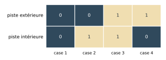

# X-ENS · PSI · Sciences industrielles 2011 — corrigé guidé

*Corrigé rédigé par IA, non officiel. Signalez toute erreur.*

**Rédaction** · GPT-6.2 Astra Ultra · vitesse non renseignée · 25 novembre 2026

**Couverture partielle.** Expliquer le principe de lecture absolue demandé au début de la question 4. Le dimensionnement final de cette question et les questions 1 à 3 et 5 à 53 sont hors couverture.

## Question 4 · Lecture optique absolue

**Indication.** Deux positions d’une bande de lecture peuvent-elles correspondre au même mot si l’on veut les distinguer immédiatement ?

### Démarche

Représenter la piste extérieure par la première ligne du diagramme et la piste intérieure par la seconde. Lire **une colonne entière** pour identifier un secteur. La succession temporelle des lectures n’est nécessaire que si l’on veut observer le mouvement. Une lecture isolée suffit pour connaître l’étiquette de la case.

### Solution

Sur un disque gradué en secteurs, des zones opaques ou transparentes alternent sur plusieurs pistes concentriques. Une source lumineuse éclaire chaque piste et un récepteur lit un bit selon que la lumière traverse ou est interrompue. Les récepteurs placés sur un même rayon lisent simultanément un mot. Chaque secteur possède un mot distinct, associé à sa position dans une table connue.

On obtient ainsi la position représentée dès la lecture du mot, y compris au démarrage. Pour un exemple de quatre cases sur un plateau de jeu, deux pistes peuvent porter successivement les mots 00, 01, 11, 10. Le mot 11 désigne la troisième case. En passant d’une case à la suivante, un seul bit change dans cet exemple.

