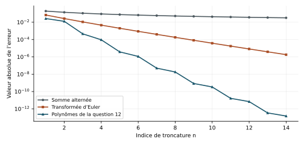

# École polytechnique MP — Mathématiques B 2011 · Corrigé brut

*Corrigé rédigé par IA, non officiel. Signalez toute erreur.*

**Rédaction** · GPT-6.2 Astra Ultra · vitesse non renseignée · 25 novembre 2026

**Révision** · GPT-6.2 Astra Ultra · vitesse non renseignée · 26 novembre 2026

**Transformation d’Euler et accélération de la convergence.** La transformée d’une série alternée convergente se démontre à l’aide de moyennes binomiales de ses restes. Pour le logarithme de deux, le sujet demande finalement les erreurs signées et leurs équivalents.

## I. Suites complètement monotones

### Question 1.a

Pour $p=1$, le théorème des accroissements finis sur $[n,n+1]$ donne la formule. Supposons-la vraie à l’ordre $p$ pour toute fonction lisse. Appliquons-la à $g(t)=f(t+1)-f(t)$ dont les valeurs entières sont $\Delta u$. Il existe $y\in(n,n+p)$ tel que $(\Delta^{p+1}u)_n=g^{(p)}(y)=f^{(p)}(y+1)-f^{(p)}(y)$. Les accroissements finis appliqués à $f^{(p)}$ donnent un $x\in(y,y+1)\subset(n,n+p+1)$ avec la valeur $f^{(p+1)}(x)$ voulue.

### Question 1.b

Pour $f(t)=1/(1+t)$, la dérivation par récurrence donne $f^{(p)}(t)=(-1)^p p!/(1+t)^{p+1}$. Le signe de $(-1)^p f^{(p)}$ est strictement positif pour $t\ge0$. Par 1.a, cela donne $(-1)^p(\Delta^pa)_n>0$ pour $p\ge1$. Pour $p=0$, $a_n>0$ directement.

### Question 2.a

Si $(Eu)_n=u_{n+1}$, on a $\Delta=E-I$. Les deux opérateurs commutent, donc le binôme de Newton donne $\Delta^p=\sum_{k=0}^p\binom pk(-1)^{p-k}E^k$. L’évaluation en $n$ fournit $(\Delta^pu)_n=\sum_{k=0}^p(-1)^{p-k}\binom pk u_{n+k}$.

### Question 2.b

Pour la suite $u_n=b^n$, $\Delta u=(b-1)u$. En itérant, $(\Delta^pu)_n=(b-1)^p b^n$ pour tous $p,n\ge0$. Ainsi $(-1)^p(\Delta^pu)_n=(1-b)^p b^n>0$ puisque $0<b<1$.

### Question 3.a

Pour $N\ge0$, la somme partielle est $\int_0^1\omega(t)(1-(-t)^{N+1})/(1+t)\,dt$ par linéarité de l’intégrale finie. Sa différence avec $\int_0^1\omega(t)/(1+t)\,dt$ a module au plus $\|\omega\|_\infty\int_0^1 t^{N+1}dt=\|\omega\|_\infty/(N+2)$. La série converge donc vers l’intégrale annoncée.

### Question 3.b

Par 2.a et le binôme, $(-1)^p(\Delta^p u)_n=\int_0^1t^n(1-t)^p\omega(t)\,dt$. L’intégrande est continu et positif ou nul, et strictement positif sur un sous-intervalle ouvert de $(0,1)$ puisque $\omega$ est continue, non négative et non identiquement nulle. L’intégrale est donc strictement positive pour tous $p,n$.

### Question 3.c

Écrivons $r(t)=(1-t)/2\in[0,1/2]$. Alors $1/(1+t)=\tfrac12\sum_{p\ge0}r(t)^p$. Après multiplication par $\omega$, la série converge normalement sur $[0,1]$ par le majorant $\|\omega\|_\infty 2^{-p}$. L’intégration terme à terme dans 3.a donne
$$S=\tfrac12\sum_{p\ge0}\int_0^1((1-t)/2)^p\omega(t)\,dt.$$

### Question 3.d

La formule de 3.b en $n=0$ donne $\int_0^1(1-t)^p\omega(t)\,dt=(-1)^p(\Delta^pu)_0$. En substituant dans 3.c, la série convergente devient $S=\sum_{p\ge0}(-1)^p(\Delta^p u)_0/2^{p+1}$.

### Question 4

Avec $\omega=1$, $u_n=1/(n+1)$. Par 3.a la somme alternée vaut $\int_0^1dt/(1+t)=\ln 2$. Par 3.b, $(-1)^p(\Delta^pu)_0=\int_0^1(1-t)^p dt=1/(p+1)$. D’où les deux séries convergentes
$$\ln2=\sum_{n\ge0}\frac{(-1)^n}{n+1}=\sum_{p\ge0}\frac1{(p+1)2^{p+1}}.$$

### Question 5.a

Dans la définition de $E_n$, l’intégrale d’indice $p$ multipliée par $1/2$ vaut $(-1)^p(\Delta^pu)_0/2^{p+1}$ par 3.b. La somme finie est donc $E_n=\sum_{p=0}^{n}(-1)^p(\Delta^pu)_0/2^{p+1}$.

### Question 5.b

Avec $r(t)=(1-t)/2$, le reste exact est
$$S-E_n=\int_0^1\frac{\omega(t)}{1+t}r(t)^{n+1}\,dt.$$
L’intégrande est positif ou nul et $r(t)^{n+1}\le2^{-n-1}$ uniformément. Par 3.a, $0\le S-E_n\le2^{-n-1}S$.

## II. Transformée d’Euler pour une série convergente quelconque

### Question 6.a

La convergence de $\sum(-1)^n u_n$ impose $u_n\to0$. Pour chaque $p$ fixé, 2.a exprime $(\Delta^p u)_n$ comme combinaison finie à coefficients fixes de $u_n,\ldots,u_{n+p}$. Tous tendent vers zéro avec $n$, donc la différence aussi.

### Question 6.b

Pour $\varepsilon>0$, choisissons $K$ tel que $|r_k|\le\varepsilon$ dès $k\ge K$. Les poids $2^{-p}\binom pk$ sont non négatifs et ont somme 1. La somme des termes $k\ge K$ a donc module au plus $\varepsilon$. Pour chacun des $k<K$, $2^{-p}\binom pk\le2^{-p}p^k/k!\to0$. La somme finie correspondante tend donc vers zéro. Cela donne la limite nulle.

### Question 7.a

Posons $B_p(n)=(-1)^p(\Delta^pu)_n/2^p$. La somme de $B_p(n)-B_{p+1}(n)$ de $p=0$ à $P$ vaut $u_n-B_{P+1}(n)$. Pour $n$ fixé, $B_p(n)=2^{-p}\sum_{j=0}^p\binom pj(-1)^j u_{n+j}\to0$ par 6.b appliquée à $r_j=(-1)^j u_{n+j}$. Ainsi la série télescopique converge vers $u_n$.

### Question 7.b

Avec les notations de 7.a, $B_{p+1}(n)=(B_p(n)-B_p(n+1))/2$. Par conséquent
$$\sum_{n=0}^N(-1)^n(B_p(n)-B_{p+1}(n))
=\tfrac12(B_p(0)+(-1)^N B_p(N+1)).$$
Pour $p$ fixé, le second terme tend vers zéro par 6.a. La série converge donc vers $B_p(0)/2=(-1)^p(\Delta^pu)_0/2^{p+1}$.

### Question 8.a

Soient $R_j=\sum_{k\ge j}(-1)^k u_k$ et $H_p=2^{-p}\sum_{j=0}^p\binom pj R_j$. Ces restes existent par l’hypothèse de convergence, et $H_0=S$. La formule de Pascal donne
$$H_p-H_{p+1}=2^{-p-1}\sum_{j=0}^p\binom pj(R_j-R_{j+1})
=2^{-p-1}\sum_{j=0}^p\binom pj(-1)^j u_j
=\frac{(-1)^p}{2^{p+1}}(\Delta^p u)_0.$$
En sommant de 0 à $n$, on trouve $E_n=H_0-H_{n+1}$ et donc
$$E_n-S=-\frac1{2^{n+1}}\sum_{j=0}^{n+1}\binom{n+1}{j}\sum_{k\ge j}(-1)^ku_k.$$
Aucune permutation de deux séries infinies n’est nécessaire.

### Question 8.b

$R_j\to0$. Par 6.b, $H_{n+1}\to0$. La formule de 8.a donne donc $E_n\to S$. La série transformée d’Euler converge et a la même somme que la série initiale, sans hypothèse supplémentaire sur les $u_n$.

## III. Accélération par le choix des polynômes

### Question 9.a

Par 3.a, $S=\int_0^1\omega(t)/(1+t)\,dt$. La définition de $T_n$ et le fait que $P_n(-1)\ne0$ donnent par soustraction
$$S-T_n=\int_0^1\frac{P_n(t)\,\omega(t)}{P_n(-1)(1+t)}\,dt.$$
Tous les intégrandes sont continus sur $[0,1]$.

### Question 9.b

L’intégrale de 9.a a module au plus $M_n/|P_n(-1)|$ fois $\int_0^1\omega(t)/(1+t)\,dt$, car $\omega\ge0$ et $M_n=\max_{[0,1]}|P_n|$. On obtient $|S-T_n|\le SM_n/|P_n(-1)|$.

### Question 10

Pour $P_n(t)=(1-t)^n$, le maximum en module sur $[0,1]$ est 1, atteint en 0, et $P_n(-1)=2^n$. Ainsi $|S-T_n|\le S/2^n$ par 9.b, également pour $n=0$.

### Question 11

Pour $P_n(t)=(1-2t)^n$, $|1-2t|\le1$ sur $[0,1]$ et l’égalité est atteinte aux extrémités. De plus $P_n(-1)=3^n$. Par 9.b on a $|S-T_n|\le S/3^n$.

### Question 12.a

Fixons $P_0=1$, $P_1(X)=1-2X$ puis $P_{n+1}=2(1-2X)P_n-P_{n-1}$ pour $n\ge1$. La formule $\cos(2(n+1)t)=2\cos(2t)\cos(2nt)-\cos(2(n-1)t)$ et $\cos(2t)=1-2\sin^2t$ donnent par récurrence $P_n(\sin^2t)=\cos(2nt)$. Le terme dominant du produit avec $1-2X$ ne peut être annulé par $P_{n-1}$, donc $\deg P_n=n$. Deux solutions en un rang donné coïncident sur toutes les valeurs de $\sin^2t$, soit sur tout $[0,1]$. Elles sont donc le même polynôme.

### Question 12.b

Posons $p_n=P_n(-1)$. On a $p_0=1$, $p_1=3$, puis $p_{n+1}=6p_n-p_{n-1}$. Les racines de l’équation caractéristique sont $\rho=3+2\sqrt2$ et $\rho^{-1}=3-2\sqrt2$. Les conditions initiales donnent $p_n=(\rho^n+\rho^{-n})/2$.

### Question 12.c

Par 12.a, $|P_n(t)|\le1$ pour $t\in[0,1]$ et $P_n(0)=1$. Donc $M_n=1$. Par 9.b et 12.b,
$$|S-T_n|\le\frac{2S}{\rho^n+\rho^{-n}}\le 2S\rho^{-n}.$$

## IV. Comparaison des trois méthodes pour le logarithme de deux

### Question 13

Par la somme géométrique finie, $S-S_n=(-1)^{n+1}\int_0^1 t^{n+1}/(1+t)\,dt$. Pour les deux premiers restes, il suffit d’un même calcul au bord. Pour $h\in C^1([0,1])$ et $m\ge0$, une intégration par parties donne
$$ (m+1)\int_0^1t^m h(t)\,dt=h(1)-\int_0^1t^{m+1}h'(t)\,dt. $$
La dernière intégrale a un module inférieur ou égal à $\|h'\|_\infty/(m+2)$. En prenant $h(t)=1/(1+t)$, on obtient
$$S-S_n\sim\frac{(-1)^{n+1}}{2n}.$$
De même 5.b donne $S-E_n=2^{-n-1}\int_0^1 (1-t)^{n+1}/(1+t)\,dt$. Après $v=1-t$, la fonction test $1/(2-v)$ vaut 1 en 1, d’où
$$S-E_n\sim\frac{1}{n2^{n+1}}.$$

Pour le troisième reste, posons $t=(1-\cos u)/2$, $0\le u\le\pi$. Alors $P_n(t)=\cos(nu)$ et
$$P_n(-1)(S-T_n)=I_n=\int_0^\pi H(u)\cos(nu)\,du,\qquad H(u)=\frac{\sin u}{3-\cos u}.$$
Par deux intégrations par parties pour $n\ge1$,
$$I_n=\frac{(-1)^nH'(\pi)-H'(0)}{n^2}-\frac1{n^2}\int_0^\pi H''(u)\cos(nu)\,du.$$
Comme $H$ est lisse, une intégration par parties supplémentaire majore la dernière intégrale en module par $\pi\|H'''\|_\infty/n$. Les valeurs $H'(0)=1/2$ et $H'(\pi)=-1/4$ donnent un coefficient principal de module au moins $1/4$ pour chaque parité. Puisque $P_n(-1)\sim\rho^n/2$,
$$S-T_n\sim-\frac{2+(-1)^n}{2n^2\rho^n},\qquad \rho=3+2\sqrt2.$$
Les trois équivalents montrent que $|S-T_n|/|S-E_n|\to0$ et $|S-E_n|/|S-S_n|\to0$. La parité change le coefficient principal du dernier reste.

