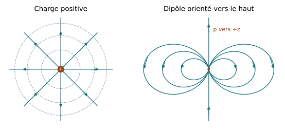
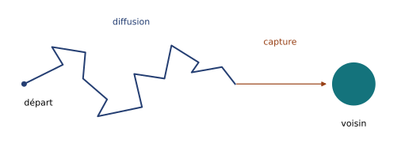
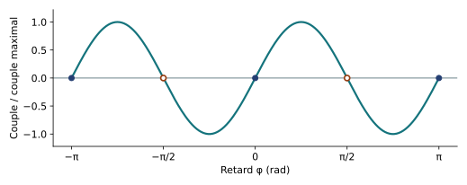
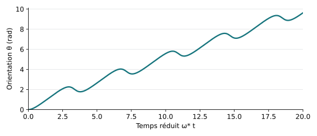

# École polytechnique et ESPCI PC 2011 — Physique A · Corrigé guidé

*Corrigé rédigé par IA, non officiel. Signalez toute erreur.*

**Lecture du rapport du jury** · GPT-6.2 Astra Ultra · vitesse non renseignée

**Rédaction** · GPT-6.2 Astra Ultra · vitesse non renseignée

## Interactions dipolaires entre particules colloïdales

## I. Interaction dipôle-dipôle

### Question I.1 — Champ et potentiel d’une charge

**Indication.** Choisir l’origine des potentiels à l’infini. Le sens de la flèche de champ dépend du signe de la charge.

Pour $M\ne O$, posons $r=OM$, $\mathbf e_r=\overrightarrow{OM}/r$ et $K=1/(4\pi\varepsilon_0)$. Dans le vide, $V(M)=Kq/r$ et $\mathbf E=-\nabla V=Kq\mathbf e_r/r^2$. Les équipotentielles sont des sphères de centre $O$. Leurs normales, les demi-droites issues de $O$, portent le champ, sortant pour $q>0$ et entrant pour $q<0$.

### Question I.2 — Premier terme non nul à grande distance

**Indication.** Écrire la somme des deux potentiels avant de développer. La dérivée angulaire dans le gradient comporte un facteur $1/r$.

La distance à la charge positive est $d=(r^2-2r\delta\cos\theta+\delta^2)^{1/2}$. Ainsi $V=Kq(1/d-1/r)$ et $1/d=r^{-1}+\delta\cos\theta/r^2+O(\delta^2/r^3)$. Avec $p=q\delta$ et $\theta$ compté depuis $+Oz$, on obtient

$$
V\simeq Kp\frac{\cos\theta}{r^2},\qquad
\mathbf E\simeq\frac{Kp}{r^3}(2\cos\theta\,\mathbf e_r+\sin\theta\,\mathbf e_\theta).
$$

La symétrie de révolution impose $E_\phi=0$. Les lignes vérifient $dr/(r\,d\theta)=E_r/E_\theta=2\cot\theta$, donc $r=C\sin^2\theta$. Sur la figure 1, elles sortent du côté positif du dipôle et rentrent du côté négatif. La séparation effective des charges disparaît à cette échelle.

### Question I.3 — Orientation et déplacement d’un dipôle

**Indication.** Une rotation peut diminuer l’énergie dans un champ uniforme. Pour obtenir aussi une translation, il faut que le champ varie dans l’espace.

À une constante près, l’énergie vaut $U=-\mathbf p\cdot\mathbf E$. Le couple aligne le dipôle sur le champ local. Une fois orienté, son énergie $-p|\mathbf E|$ décroît vers les régions de champ intense. Le champ du voisin varie avec la distance. Les dipôles peuvent ainsi s’aligner bout à bout, avec des pôles opposés adjacents et des moments parallèles sur la ligne des centres, puis se rapprocher.

### Question I.4 — Force exercée par le premier dipôle sur le second

**Indication.** Projeter $\mathbf e_z$ sur la base sphérique et compter l’énergie de la paire une seule fois. Dériver ensuite à orientations des moments fixées.

Puisque $\mathbf e_z=\cos\theta\,\mathbf e_r-\sin\theta\,\mathbf e_\theta$, le champ de I.2 donne $U=-p\mathbf e_z\cdot\mathbf E_1=Kp^2(1-3\cos^2\theta)/r^3$. Avec $F_r=-\partial_rU$ et $F_\theta=-r^{-1}\partial_\theta U$,

$$
F_r=\frac{3Kp^2}{r^4}(1-3\cos^2\theta),\qquad F_\theta=-\frac{6Kp^2}{r^4}\sin\theta\cos\theta,\qquad F_\phi=0.
$$

Sur l’axe $F_r<0$ correspond à l’attraction. Dans le plan équatorial $F_r>0$ donne une répulsion entre moments parallèles.

### Question I.5 — Sphère magnétisable

**Indication.** Le moment d’une boucle est un courant multiplié par une aire. Relier ensuite le moment total à la quantité de matière magnétisable.

$[m]=\mathrm{A\,m^2}$ et $[B/\mu_0]=\mathrm{A\,m^{-1}}$, donc $[\alpha_m]=\mathrm{m^3}$. À matériau, forme et champ fixés, l’aimantation (moment par unité de volume) est la même. Le nombre de moments microscopiques dont on somme les contributions varie comme $a^3$. La loi donnée conduit à $\mathbf m=4\pi a^3B_0\mathbf e_z/\mu_0$. Dans les formules magnétiques du sujet, posons $C=12\pi a^6 B_0^2/\mu_0$. Il vient $F_r=C(1-3\cos^2\theta)/r^4$, $F_\theta=-2C\cos\theta\sin\theta/r^4$ et $F_\phi=0$. Comme $B_0^2/\mu_0$ est une pression, $C/r^4$ est une force.

## II. Cinétique d’agrégation

### Question II.1 — Bilan sur une particule en suspension

**Indication.** Séparer la pression hydrostatique de l’action du fluide associée au mouvement de la particule.

Dans le référentiel du liquide au repos, supposé galiléen, une sphère de volume $V$ et de masse $M=\rho_p V$ subit son poids $M\mathbf g$, la poussée $-\rho_f V\mathbf g$, la force visqueuse $\mathbf f$ et celle du voisin $\mathbf F$. Le champ imposé est uniforme et ne produit pas seul de force de translation. Ici $\rho_p=\rho_f$, d’où $M\dot{\mathbf v}=\mathbf f+\mathbf F$. Cette première description est déterministe.

### Question II.2 — Frottement visqueux et domaine de Stokes

**Indication.** Multiplier une contrainte de cisaillement d’ordre $\eta v/a$ par une aire d’ordre $a^2$.

La traînée a pour échelle $\eta av$. Elle s’oppose à la vitesse relative au liquide et le coefficient donné fixe $\mathbf f=-6\pi\eta a\mathbf v$. La loi de Stokes s’applique pour $\mathrm{Re}=2\rho_fav/\eta\ll1$, en écoulement établi ou quasi stationnaire, pour une sphère à adhérence dans un liquide newtonien. On emploie ici la traînée de la sphère isolée.

### Question II.3 — Mouvement relatif et relaxation de vitesse

**Indication.** Additionner les équations des deux sphères. Que devient la vitesse moyenne après le transitoire ?

Sur $Oz$, $z_2>z_1$ et $r=z_2-z_1$. Posons $\zeta=6\pi\eta a$. La somme des équations donne $M\dot v_G=-\zeta v_G$, car les forces de la paire se compensent. Pour un départ au repos $v_G=0$ à tout instant, de sorte que $v_2=-v_1=\dot r/2$. Pour le centre supérieur, $M\dot v_2=-\zeta v_2-2C/r^4$. Le temps de relaxation vaut $t_v=M/\zeta=2\rho_pa^2/(9\eta)$. Lorsque l’échelle de variation des vitesses dépasse largement $t_v$, après le transitoire on a $\zeta\dot r/2=-2C/r^4$. L’inertie de la particule et l’inertie du fluide de II.2 font intervenir des comparaisons distinctes.

### Question II.4 — Loi d’approche et durée de rencontre

**Indication.** Pour passer de la vitesse d’une sphère à la vitesse de fermeture de l’intervalle, tenir compte du mouvement de sa voisine.

Après substitution de $C$, $r^4\dot r=-8a^5 B_0^2/(\mu_0\eta)$. Intégrons de $r_0$ à $r$ et de $0$ à $t$ pour obtenir

$$
1-\left(\frac r{r_0}\right)^5=\frac t{\tau_b},\qquad
\tau_b=\frac{\mu_0\eta}{40 B_0^2}\left(\frac{r_0}{a}\right)^5.
$$

$\mu_0\eta/B_0^2$ a la dimension d’un temps. Avec $B_0=10^{-2}\,\mathrm T$ et $r_0/a=10$, on obtient $\tau_b\simeq3,1\times10^{-2}\,\mathrm s$. Au contact $r=2a$, le modèle donne $t_c=\tau_b[1-(2a/r_0)^5]$. La grande séparation initiale justifie $t_c\simeq\tau_b$ même si les approximations de traînée indépendante et de dipôles deviennent moins précises près du contact.

### Question II.5 — Influence de la concentration

**Indication.** Attribuer à une particule une cellule de volume de l’ordre du cube de l’espacement moyen.

Il y a de l’ordre d’une particule dans $r_0^3$, donc $r_0\sim n^{-1/3}$. La loi précédente donne $\tau\sim[\mu_0\eta/(40 B_0^2a^5)]n^{-5/3}$ avec la convention $r_0\simeq n^{-1/3}$. Un doublement de l’espacement multiplie le temps par $2^5$.

### Question II.6 — Petites sphères et dilution

**Indication.** Identifier dans la loi de force le facteur qui traduit la taille des sphères et celui qui traduit leur espacement.

À champ fixé, $F\propto a^6/r^4$ pour une géométrie donnée. Chaque moment induit diminue comme $a^3$ et le produit des deux moments comme $a^6$. La dilution accroît aussi $r$ et réduit la force comme $r^{-4}$. L’énergie d’interaction typique diminue comme $B_0^2a^6/(\mu_0r^3)$ et peut ainsi devenir petite devant $kT$.

### Question II.7 — Diffusion brownienne

**Indication.** Faire un bilan sur un volume fixe. Une densité de courant sortante positive doit faire diminuer la population du volume.

Pour la densité de nombre $n(\mathbf r,t)$, la loi de Fick est $\mathbf j=-D\nabla n$. Dans tout volume fixe $\Omega$, la conservation impose $d\int_\Omega n\,dV/dt=-\oint_{\partial\Omega}\mathbf j\cdot d\mathbf S$. Le théorème de la divergence donne $\partial_t n+\nabla\cdot\mathbf j=0$, donc $\partial_t n=D\Delta n$ pour $D$ uniforme. Le coefficient a la dimension d’une surface divisée par un temps. Dans l’eau, $D=kT/(6\pi\eta a)=4,14\times10^{-21}/(6\pi\times10^{-9})\simeq2,2\times10^{-13}\,\mathrm{m^2\,s^{-1}}$, soit $0,22\,\mathrm{\mu m^2\,s^{-1}}$.

### Question II.8 — Durée d’une excursion diffusive

**Indication.** Évaluer l’ordre de grandeur du laplacien pour un profil de concentration qui varie sur la longueur $r_0$.

En comparant $n/\tau_d$ à $Dn/r_0^2$, on obtient $\tau_d\sim r_0^2/D\sim\eta a r_0^2/(kT)$ aux facteurs numériques près. En diffusion libre tridimensionnelle, $\langle|\Delta\mathbf r|^2\rangle=6Dt$ donne le facteur $1/6$ si l’on définit exactement la durée par le déplacement quadratique moyen.

### Question II.9 — Succession des deux phases

**Indication.** Comparer localement le temps de dérive sur une distance $r$ au temps de diffusion sur cette même distance.

Le rapport $\tau_b(r)/\tau_d(r)$ varie comme $r^3$. Loin d’un voisin, la diffusion fait explorer une trajectoire irrégulière. Lorsqu’une fluctuation amène les centres à une séparation $r_c$ où la dérive devient compétitive, l’attraction, en configuration favorable, accélère très vite le rapprochement. Le dernier tronçon est dirigé. Le terme « balistique » de l’énoncé décrit ici cette dérive malgré la faible inertie.

En suspension diluée, la première durée a pour échelle $r_0^2/D$ dans l’estimation du sujet. Pour une capture axiale démarrant à $r_c$, la seconde vaut approximativement $\mu_0\eta(r_c^5-(2a)^5)/(40 B_0^2a^5)$, soit de l’ordre du temps de diffusion sur $r_c$ au seuil de capture. Ainsi $r_c\ll r_0$ rend le dernier tronçon beaucoup plus rapide que l’exploration initiale. Le temps balistique hypothétique depuis $r_0$ serait au contraire grand devant $\tau_d(r_0)$.

### Question II.10 — Concentration de transition

**Indication.** À la transition, comparer les deux temps à la même séparation. La viscosité doit disparaître de la comparaison.

La condition $\tau_b(r^*)\sim\tau_d(r^*)$ donne, aux facteurs numériques sans dimension près,

$$
(r^*)^3\sim\frac{a^6B_0^2}{\mu_0 kT},\qquad
n^*\sim\frac{\mu_0 kT}{a^6 B_0^2}.
$$

On retrouve la même dépendance en écrivant que l’énergie de paire est de l’ordre de $kT$. Avec les données, $n^*\sim5\times10^{13}\,\mathrm{m^{-3}}$ et $r^*\sim3\times10^{-5}\,\mathrm m$, soit quelques dizaines de micromètres, plus de dix diamètres de $2\,\mathrm{\mu m}$. La valeur numérique du seuil dépend de la convention choisie pour les temps caractéristiques. Pour $n\gg n^*$, la dérive magnétique domine dès l’espacement moyen.

## III. Compression d’une lamelle de gel

### Question III.1 — Force normale

**Indication.** Mesurer la distance d’un centre à l’autre, y compris les deux demi-hauteurs des cylindres.

Sur l’axe, $\cos^2\theta=1$ et $F_\theta=0$. Le modèle impose à chaque cylindre le moment de la sphère de I.5. À la distance $d=h+\delta$, la force sur le cylindre supérieur pointe vers le bas et vaut en module $F=24\pi a^6B_0^2/[\mu_0(h+\delta)^4]$. L’autre cylindre subit la force opposée.

### Question III.2 — Module d’Young

**Indication.** Former la contrainte normale en divisant la force par la section de la lamelle.

$F_c/(\pi R^2)=Y\epsilon$, avec $\epsilon=(\delta_0-\delta)/\delta_0$. Le module est la pente de la contrainte de compression en fonction de la déformation relative dans le régime élastique linéaire. Il s’exprime en pascals, $\mathrm{N\,m^{-2}}$.

### Question III.3 — Estimation à partir d’une pente

**Indication.** Garder la variation $\delta_0-\delta$ au numérateur de la déformation, même quand on néglige $\delta/h$ dans la force magnétique.

À l’équilibre, $\pi a^2Y(\delta_0-\delta)/\delta_0=24\pi a^6 B_0^2/(\mu_0d^4)$. Écrivons $d_0=h+\delta_0$. Le tracé de $(d_0-d)d^4$ en fonction de $B_0^2$ a pour pente $24a^4\delta_0/(\mu_0Y)$. Plus simplement, puisque $\delta\le\delta_0\ll h=\beta a$, on peut remplacer $d^4$ par $h^4$ dans le facteur de force. On mesure alors la droite

$$
d\simeq d_0-\frac{24\delta_0}{\mu_0\beta^4Y}B_0^2.
$$

La valeur absolue de sa pente fournit $Y$ si $\beta$ et $\delta_0$ sont connus. L’ordonnée à l’origine permet de contrôler $d_0$.

### Question III.4 — Mesure sur le gel d’actine

**Indication.** La compression de 20 nm se rapporte à l’épaisseur initiale de 100 nm. Repérer le facteur géométrique que les données laissent libre.

$\epsilon=(100-80)/100=0,20$. Dans l’approximation de couche mince, $Y\simeq24 B_0^2/(\mu_0\beta^4\epsilon)\simeq9,5\times10^3\beta^{-4}\,\mathrm{Pa}$. Par exemple, $\beta=1$ donne environ $10\,\mathrm{kPa}$ et $\beta=2$ donne $0,60\,\mathrm{kPa}$. L’échelle de pression $B_0^2/(\mu_0\epsilon)$ vaut $4\times10^2\,\mathrm{Pa}$ si l’on omet les facteurs numériques comme le permet le sujet. L’absence de hauteur relative chiffrée limite la précision de l’estimation.

### Question III.5 — Pourquoi ajuster le contour entier ?

**Indication.** Distinguer l’incertitude sur chaque point de contour de celle sur le centre ajusté avec de nombreux points.

Chaque position de bord fluctue avec le bruit et la discrétisation de l’image. Un ajustement circulaire utilise des points situés de part et d’autre du centre, dans de nombreuses directions. Les erreurs aléatoires se compensent en partie, avec une incertitude typiquement proportionnelle à $1/\sqrt{N}$ pour $N$ points indépendants bien répartis. Une mesure sur les deux points les plus proches dépend entièrement de leurs erreurs locales. Un biais commun de calibration ou de forme peut subsister dans l’ajustement.

## IV. Dimère dans un champ tournant

### Question IV.1 — Énergie, couple et équilibres

**Indication.** Utiliser l’angle de retard orienté du dimère vers le champ. À champ fixe, cet angle diminue lorsque le dimère tourne dans le sens positif.

La distance des centres est $2a$. Notons $A=\mu_0m^2/[4\pi(2a)^3]=\pi a^3B_0^2/(2\mu_0)$. À une constante indépendante de l’orientation près, $E_B=A(1-3\cos^2\varphi)$. Si $\psi$ est l’angle du champ, $\varphi=\psi-\theta$. Le couple sur le dimère est $\Gamma_B=-\partial E_B/\partial\theta=+dE_B/d\varphi=3A\sin(2\varphi)$, le long de $\mathbf e_y$. Les positions $\varphi=k\pi$ sont des minima d’énergie stables et les positions $\pi/2+k\pi$ des maxima instables.

### Question IV.2 — Origine du couple visqueux

**Indication.** Appliquer la traînée de Stokes à chaque centre, puis prendre son moment par rapport au milieu du dimère.

Chaque centre se déplace à la vitesse $a|\dot\theta|$ et subit une traînée d’ordre $\eta a^2|\dot\theta|$. Les deux forces opposées ont des moments de même sens, avec un bras de levier $a$. Le couple résultant est de l’ordre de $-\eta a^3\dot\theta\,\mathbf e_y$. La rotation propre et l’influence mutuelle des écoulements affectent le coefficient. On suit l’énoncé qui le fixe à 1. Le couple dissipe de l’énergie à la puissance $-\eta a^3\dot\theta^2$.

### Question IV.3 — Équation dynamique

**Indication.** Écrire le théorème du moment cinétique en $G$, puis introduire $\varphi=\omega t-\theta$.

Dans le référentiel barycentrique à axes parallèles au laboratoire, le centre de masse $G$ reste au repos pour un départ au repos par symétrie des actions. Notons $J_G$ le moment d’inertie autour de l’axe $Gy$. Avec $\Gamma_0=3A$ et $\zeta_r=\eta a^3$, le bilan projeté sur cet axe donne

$$
J_G\ddot\theta+\zeta_r\dot\theta=\Gamma_0\sin[2(\omega t-\theta)].
$$

L’alignement initial impose $\theta(0)=0$. Un départ au repos donne en outre $\dot\theta(0)=0$. Lorsque le temps de relaxation $J_G/\zeta_r$ est court devant le temps de variation de la vitesse, le terme inertiel peut être négligé après transitoire.

### Question IV.4 — Retard synchrone et viscosimétrie

**Indication.** Un angle de retard constant autorise une rotation du dimère à vitesse non nulle.

En régime verrouillé $\dot\theta=\omega$ et $\ddot\theta=0$. Il vient $\sin(2\varphi_s)=\eta a^3\omega/\Gamma_0$. Pour $\omega>0$, la branche stable issue de zéro est $\varphi_s=\tfrac12\arcsin(\eta a^3\omega/\Gamma_0)$ modulo $\pi$ : un léger excès de retard y augmente le couple moteur. Filmer l’axe du dimère et le comparer à la direction instantanée du champ à pulsation connue donne $\eta=[3\pi B_0^2/(2\mu_0\omega)]\sin(2\varphi_s)$, dans la convention de frottement du sujet.

### Question IV.5 — Décrochage

**Indication.** Comparer le couple de traînée à la valeur maximale du couple magnétique. Au-delà, suivre le signe du couple quand le retard traverse plusieurs quadrants.

L’existence d’un retard constant impose $|\omega|\le\omega^*=\Gamma_0/\zeta_r=3\pi B_0^2/(2\mu_0\eta)$, en $\mathrm{rad\,s^{-1}}$. À l’égalité, les deux branches de retard se rejoignent à $\pi/4$ pour $\omega>0$. Pour $\omega>\omega^*$ et en régime suramorti, $\dot\varphi=\omega-\omega^*\sin(2\varphi)>0$. Le champ prend régulièrement un demi-tour d’avance supplémentaire. Le dimère avance puis recule lorsque $\dot\theta=\omega^*\sin(2\varphi)$ change de signe. La phase passe plus de temps en couple positif, d’où une avance moyenne sur plusieurs oscillations. Le tracé ci-dessous part de l’alignement et illustre la limite visqueuse. L’inertie peut lisser les inversions.

