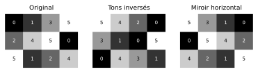
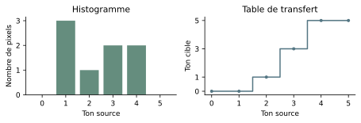
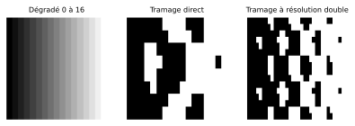

# École polytechnique · PSI et PT · Informatique 2011 · Corrigé guidé

*Corrigé rédigé par IA, non officiel. Signalez toute erreur.*

**Rédaction** · GPT-6.2 Astra Ultra · vitesse non renseignée · 25 novembre 2026

**Images en gris.** Le langage choisi est Python. La primitive `allouer(H, L, P)` fournit une image neuve. On écrit `M[ligne][colonne]` pour accéder à ses tons, compris entre 0 et P bornes incluses.

## Repères

Distinguer le déplacement d’un pixel, le transfert de son ton et le choix du seuil utilisé à une position donnée. La hauteur et la largeur sont des nombres de pixels. La profondeur est la valeur maximale d’un pixel.

## I · Opérations élémentaires

### Question 1 · Inverser les tons

**Indication.** Aux bornes, le noir de valeur zéro doit devenir le blanc de valeur P, et réciproquement.

#### Solution

```python
def inverser(i):
    r = allouer(i.H, i.L, i.P)
    for ligne in range(i.H):
        for c in range(i.L):
            r.M[ligne][c] = i.P - i.M[ligne][c]
    return r
```

Le résultat garde les dimensions et la profondeur de l’original. L’application répétée deux fois redonne chaque ton initial. Le coût est $\Theta(HL)$.

### Question 2 · Appliquer la symétrie horizontale

**Indication.** Une symétrie d’axe vertical conserve les lignes et échange les colonnes extrêmes.

#### Solution

```python
def flipH(i):
    r = allouer(i.H, i.L, i.P)
    for ligne in range(i.H):
        for c in range(i.L):
            r.M[ligne][c] = i.M[ligne][i.L - 1 - c]
    return r
```

La colonne 0 reçoit l’ancienne colonne $L-1$. Pour une largeur impaire, la colonne du milieu reste identique. Le temps est $\Theta(HL)$.



### Question 3 · Poser une image sur une autre

**Indication.** Les deux copies conservent leurs colonnes. Pour la deuxième, les numéros de ligne sont décalés de la hauteur de la première.

#### Solution

```python
def poserV(i1, i2):
    r = allouer(i1.H + i2.H, i1.L, i1.P)
    for ligne in range(r.H):
        for c in range(r.L):
            if ligne < i1.H:
                r.M[ligne][c] = i1.M[ligne][c]
            else:
                r.M[ligne][c] = i2.M[ligne - i1.H][c]
    return r
```

La première ligne de la seconde image est placée au numéro $H_1$. Les hauteurs peuvent différer. Le coût est $\Theta((H_1+H_2)L)$.

### Question 4 · Placer deux images côte à côte

**Indication.** Repérer la première colonne qui appartient à l’image de droite.

#### Solution

```python
def poserH(i1, i2):
    r = allouer(i1.H, i1.L + i2.L, i1.P)
    for ligne in range(r.H):
        for c in range(r.L):
            if c < i1.L:
                r.M[ligne][c] = i1.M[ligne][c]
            else:
                r.M[ligne][c] = i2.M[ligne][c - i1.L]
    return r
```

La colonne de sortie $L_1$ est la colonne 0 de $i_2$. Les hauteurs et les profondeurs sont égales par hypothèse. Le temps est $\Theta(H(L_1+L_2))$.

## II · Transferts

### Question 5 · Appliquer une table de transfert

**Indication.** Le ton source sert d’indice dans la table, alors que le ton lu dans cette table appartient à la profondeur cible.

#### Solution

```python
def transferer(i, profondeur_cible, t):
    r = allouer(i.H, i.L, profondeur_cible)
    for ligne in range(i.H):
        for c in range(i.L):
            r.M[ligne][c] = t[i.M[ligne][c]]
    return r
```

La table comporte $P+1$ entrées car le ton maximal $P$ est inclus. Chaque pixel demande une consultation, soit $\Theta(HL)$ opérations.

### Question 6 · Exprimer l’inversion comme un transfert

**Indication.** Préparer, pour chaque ton source possible, sa valeur de destination indépendamment de sa fréquence dans l’image.

#### Solution

```python
def inverserParTransfert(i):
    t = [i.P - v for v in range(i.P + 1)]
    return transferer(i, i.P, t)
```

Cette seconde définition peut être nommée `inverser` en remplacement de celle de la question 1. Elle construit la table en $O(P+1)$, puis l’applique en $O(HL)$.

### Question 7 · Remplir l’histogramme

**Indication.** Le tableau transmis peut contenir n’importe quelles valeurs. Le premier comptage utile doit partir de zéro.

#### Solution

```python
def histogramme(i, h):
    for v in range(i.P + 1):
        h[v] = 0
    for ligne in range(i.H):
        for c in range(i.L):
            h[i.M[ligne][c]] += 1
```

Au retour, la somme des cases vaut $HL$. Le temps est $\Theta(P+1+HL)$ et la procédure agit sur le tableau fourni.

### Question 8 · Égaliser les tons

**Indication.** Cumuler les effectifs dans l’ordre des tons. La formule du sujet retranche l’effectif entier du ton minimal.

#### Solution

```python
def arrondiQuotient(a, b):
    return (2 * a + b) // (2 * b)

def egaliser(i):
    h = [0] * (i.P + 1)
    histogramme(i, h)
    nombre = i.H * i.L
    if nombre == 0:
        return transferer(i, i.P, list(range(i.P + 1)))
    minimum = 0
    while h[minimum] == 0:
        minimum += 1
    diviseur = nombre - h[minimum]
    if diviseur == 0:
        return transferer(i, i.P, list(range(i.P + 1)))
    t = [0] * (i.P + 1)
    cumul = 0
    for v in range(minimum, i.P + 1):
        cumul += h[v]
        t[v] = arrondiQuotient(i.P * (cumul - h[minimum]), diviseur)
    return transferer(i, i.P, t)
```

Pour des entiers $a\geqslant0$, $b>0$, `arrondiQuotient(a,b)` calcule l’entier le plus proche de $a/b$, avec arrondi vers le haut en cas d’égalité. Le calcul utilise uniquement des entiers et évite la perte de précision d’un quotient flottant. Pour une image non uniforme, le ton minimal présent devient 0 et le dernier ton présent devient $P$. Les entrées antérieures au minimum ne sont jamais lues. Pour une image uniforme, une convention est nécessaire et le code conserve l’image. Le temps est $O(HL+P+1)$.



### Question 9 · Étudier une image uniformément blanche

**Indication.** Comparer l’effectif du premier ton présent au nombre total de pixels.

#### Solution

Pour une image blanche non vide, $v_{\min}=P$ et $h[P]=HL$. La formule du sujet donne $0/0$. Elle ne définit donc aucune image de sortie dans ce cas. La version de la question 8 choisit de conserver une image uniforme et rend une nouvelle image blanche. Ce choix s’applique aussi à une image uniformément grise.

### Question 10 · Réduire la profondeur

**Indication.** Le rapport du ton à la profondeur doit être aussi peu modifié que possible. Chercher un entier proche de la valeur réelle cible.

#### Solution

```python
def reduire(i, profondeur_cible):
    if i.P == 0:
        return transferer(i, profondeur_cible, [0])
    t = [arrondiQuotient(v * profondeur_cible, i.P)
         for v in range(i.P + 1)]
    return transferer(i, profondeur_cible, t)
```

Pour $P>0$ et $P'>0$, minimiser $|v'/P'-v/P|$ revient à arrondir $vP'/P$ à l’entier le plus proche. Les deux tons extrêmes sont ainsi préservés. Si $P'=0$, la seule valeur cible est 0. Le coût est $O(P+1+HL)$.

## III · Tramage

### Question 11 · Seuiller selon un motif périodique

**Indication.** Le reste de la division de la ligne et de la colonne fournit la position dans le motif répété.

#### Solution

```python
def tramer(i, m):
    r = allouer(i.H, i.L, 1)
    for ligne in range(i.H):
        for c in range(i.L):
            seuil = m.M[ligne % m.H][c % m.L]
            r.M[ligne][c] = int(i.M[ligne][c] > seuil)
    return r
```

Le motif a une hauteur et une largeur positives. L’inégalité est stricte, ainsi un ton égal au seuil donne du noir. Les dimensions n’ont pas besoin d’être des multiples de celles du motif. Le temps est $\Theta(HL)$.

### Question 12 · Construire une trame de télévision

**Indication.** Une seule colonne suffit pour décrire des lignes de seuils. Le dernier seuil est $P-1$.

#### Solution

```python
def tramerTelevision(i):
    if i.P == 0:
        return transferer(i, 1, [0])
    m = allouer(i.P, 1, i.P - 1)
    for ligne in range(i.P):
        m.M[ligne][0] = ligne
    return tramer(i, m)
```

Sur une période complète, un ton constant $v$ donne $v$ lignes blanches sur $P$. Pour la profondeur 4 de l’illustration, la trame emploie les seuils $0,1,2,3$.

### Question 13 · Assembler la trame diagonale du journal

**Indication.** Comparer le bloc imprimé en haut à gauche du motif aux trois autres quadrants. Les valeurs sont des seuils, à lire avant de convertir en noir et blanc.

#### Solution

```python
def tramerJournal(i):
    a = deuxQuarts
    b = flipH(a)
    motif8 = poserV(poserH(a, b), poserH(b, a))
    bande = poserH(motif8, motif8)
    motif16 = poserV(bande, bande)
    return tramer(i, motif16)
```

Le bitmap de droite du PDF est un bloc $8\times8$. Il est constitué de quatre carrés $4\times4$ disposés en damier, avec le miroir horizontal dans les quadrants supérieur droit et inférieur gauche. L’énoncé annonce un motif $16\times16$. La répétition du bloc deux fois sur chacun des axes réalise cette dimension et donne la même trame périodique. La comparaison de l’image de profondeur 16 avec ces seuils de 0 à 15 redonne les 28 860 pixels visibles de l’image M du sujet.

### Question 14 · Augmenter la résolution du tramage

**Indication.** Pour doubler le nombre de points imprimables par direction, dédoubler les pixels de gris avant de leur appliquer les seuils.

#### Solution

```python
def tramerFin(i):
    if i.P == 0:
        normalisee = transferer(i, 16, [0])
    else:
        t = [arrondiQuotient(16 * v, i.P) for v in range(i.P + 1)]
        normalisee = transferer(i, 16, t)
    grande = allouer(2 * i.H, 2 * i.L, 16)
    for ligne in range(grande.H):
        for c in range(grande.L):
            grande.M[ligne][c] = normalisee.M[ligne // 2][c // 2]
    return tramerJournal(grande)
```

Le transfert normalise aussi les profondeurs initiales inférieures à 16. Chaque pixel est ensuite remplacé par un carré $2\times2$ de même ton. Le seuillage se fait aux nouvelles coordonnées et le résultat, de profondeur 1, s’affiche à demi-échelle linéaire. L’ordre des opérations permet aux quatre points issus d’un pixel de recevoir des seuils différents. À partir de l’image I, on retrouve ainsi les 115 440 pixels de N.


