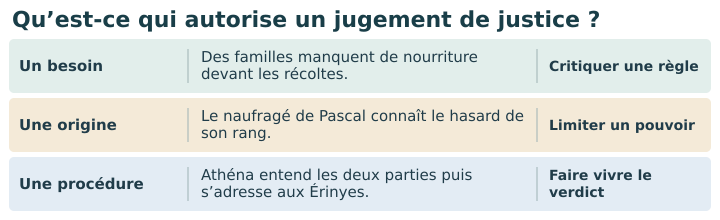

# Banque PT — Français A 2012 · Corrigé guidé

*Corrigé rédigé par IA, non officiel. Signalez toute erreur.*

**Rédaction** · GPT-6.2 Astra Ultra · vitesse non renseignée

**Révision (tour 1)** · GPT-6.2 Astra Ultra · vitesse non renseignée

[Énoncé officiel](https://www.banquept.fr/documents/2012/fr_a_pt_2012.pdf) · [Rapport du jury](https://www.banquept.fr/documents/ecrit/rapport/2012/rapport_fra_a_ecrit_2012.pdf) · [Programme officiel](https://www.education.gouv.fr/bo/2011/24/esrs1100188a.htm) · [Grille de la session](https://www.banquept.fr/documents/livret/2012/Livret_PT_2012.pdf#page=12)

Épreuve de quatre heures sur « La justice ». Eschyle, Les Choéphores et Les Euménides (traduction de Daniel Loayza) · Blaise Pascal, Pensées (fragments prescrits, édition Lafuma) et Trois Discours sur la condition des grands · John Steinbeck, Les Raisins de la colère (traduction de Marcel Duhamel et Maurice-Edgar Coindreau).

## Sujet

Montesquieu, Les Lettres persanes (1721), Usbek à Rhédi.

« Voilà, Rhédi, ce qui m’a fait penser que la Justice est éternelle et ne dépend point des conventions humaines, et, quand, elle en dépendrait, ce serait une vérité terrible qu’il faudrait se dérober à soi-même »

Quelles réflexions vous inspirent ces propos du persan Usbek à son ami Rhédi dans Les Lettres persanes de Montesquieu (1721) ? Vous vous appuierez sur les œuvres au programme et vos lectures personnelles liées au thème.

## Préparer la dissertation

**Qu’est-ce que le mot « quand » change ?**

Remplacez-le par « même si ». Usbek passe d’une conviction à l’examen d’une hypothèse qu’il tient pour redoutable. Se dérober une vérité à soi-même signifie se la cacher.

**Comment mobiliser une lecture personnelle ?**

La référence aux lois non écrites d’Antigone fournit un argument précis en faveur d’Usbek. Passez ensuite au conflit entre deux devoirs également anciens dans l’Orestie, qui complique cet appui.

**Pourquoi continuer après l’acquittement d’Oreste ?**

Examinez ce qui arrive aux Érinyes. Une décision majoritaire ou une règle de partage ne suffisent pas à établir une communauté. L’accueil des puissances anciennes éclaire la portée de l’institution nouvelle.

## Dissertation

Une cour de justice commence par un acte humain. Il faut bien que quelqu’un désigne les juges et dise selon quelle règle ils décideront. Pourtant la première chose qu’on attend de ces juges est qu’ils puissent condamner un acte, même si son auteur a pour lui l’usage et la puissance. Dans sa lettre à Rhédi, Usbek affirme que la justice est éternelle et indépendante des conventions humaines. Il envisage aussitôt la possibilité contraire et mesure l’effroi qu’elle lui inspire. Il faudrait, si elle était vraie, se la cacher à soi-même. Pourquoi la découverte d’une origine humaine de la justice menacerait-elle notre désir d’être justes ? Les œuvres invitent à distinguer ce qui donne autorité à une exigence, ce qui donne forme à une décision et ce qui nous permet de la contester.

Une convention peut fixer le côté de la route où l’on doit passer. Elle ne semble pas pouvoir décider avec la même liberté si une famille doit manger. Dans Les Raisins de la colère, les fruits sont produits en abondance, tandis que des enfants ont faim. L’organisation du marché donne une raison à ce paradoxe. Laisser les affamés se servir ferait tomber le prix du fruit. Steinbeck donne pourtant à voir ces deux réalités ensemble, comme si la seconde suffisait à faire comparaître la première. Le jugement du lecteur ne procède d’aucune décision prise au préalable avec les propriétaires. Il prend au sérieux un besoin indépendant de l’accord de ceux qui ont le pouvoir d’en régler la satisfaction. C’est en ce sens que la justice paraît éternelle. Quel que soit le règlement économique, la prétention d’un enfant à vivre oblige encore.

Les personnes lésées en appellent souvent à une justice qu’elles estiment plus ancienne que leur communauté. Antigone, dans la tragédie de Sophocle, invoque des lois non écrites pour défendre la sépulture de son frère contre l’édit de Créon. Ce recours a le prix que lui donnerait Usbek. Il permet de parler lorsque l’autorité politique a déjà parlé et de juger l’interdiction au lieu d’en mesurer seulement la force. Mais l’Orestie complique cette confiance. Dans Les Choéphores, Oreste entend à la fois l’appel de son père assassiné et la parole de sa mère, dont il reste le fils. Les Érinyes font ensuite valoir le sang maternel, Apollon l’oracle qui ordonnait de venger Agamemnon. Deux exigences plus anciennes que le calcul des intéressés se dressent l’une contre l’autre. La conviction de leur éternité ne fournit pas encore la décision juste.

Qu’y aurait-il donc de terrible à reconnaître le rôle des hommes ? Pascal connaît la diversité presque vertigineuse des coutumes. Une frontière peut séparer deux régions qui jugent différemment des actes comparables. On pourrait en conclure qu’il suffit de déplacer la frontière pour renverser le juste. Le péril touche alors celui qui obéit comme celui qui commande. Le premier risque de ne voir dans la loi qu’un ordre auquel on se soumet tant qu’on manque de force. Le second peut prendre pour une supériorité personnelle le hasard qui l’a élevé. Dans le premier Discours sur la condition des grands, le naufragé pris pour un roi se souvient intérieurement du hasard de sa situation. Cette seconde pensée l’empêche de croire que la déférence de ses sujets prouve une qualité inscrite dans sa nature.

Cette leçon étonne justement par ce qu’elle fait de la connaissance qu’Usbek voudrait peut-être s’interdire. Le grand auquel parle Pascal doit apprendre ce qu’il pourrait être tenté de se dissimuler. Il aura d’autant moins de raisons d’humilier autrui qu’il connaîtra mieux la contingence de son rang. La découverte d’une convention cesse ici d’être une raison de désespérer. Elle limite une prétention injustifiée. Chez Steinbeck aussi, les métayers savent très bien que la terre est passée de main en main et que le titre de la banque ne tombe pas du ciel. Leur rappeler que des hommes disposent des terres ne les réduit pas au silence. Ils peuvent opposer à ce droit la longue histoire de ceux qui ont travaillé et vécu sur place. Le désaccord porte désormais sur les relations qu’un titre humain a le devoir de reconnaître.

Il reste à savoir si les conventions peuvent produire autre chose qu’un rapport des forces. Dans Les Euménides, Athéna institue un tribunal. On y entend les prétentions d’Oreste et de ses poursuivantes. Athéna annonce qu’à égalité des suffrages Oreste l’emportera. Lorsque le compte révèle le partage des voix, une règle instituée a permis de trancher un conflit que les deux partis éprouvaient chacun comme affaire de justice absolue. Rien ne serait plus facile que de lire l’acquittement comme la victoire définitive d’une conception du droit sur l’autre. Or la pièce continue après le vote. Athéna doit encore faire une place aux Érinyes dans la cité. Les anciens droits du sang ne sont pas simplement rayés de la scène. La décision devient supportable parce qu’une institution nouvelle reconnaît à la partie déboutée une dignité et une fonction communes. La cité montre ainsi qu’il existe des formes plus justes que la répétition sans fin de l’offense, alors même que leur naissance a une date.

Le camp gouvernemental de Steinbeck offre une expérience analogue à l’échelle d’un quotidien. Les résidents élisent des responsables et organisent ensemble une part de leur existence. Pour des familles dont les déplacements suffisaient ailleurs à les rendre suspectes, le changement est considérable. Ces règles ont manifestement été faites par des hommes. Elles peuvent cependant être évaluées d’après ce qu’elles permettent à chacun de faire et de dire. L’arbitraire commence lorsque quelqu’un peut décider des autres sans leur répondre. La convention qui se soumet à leur jugement réduit cet arbitraire. La connaître comme une œuvre humaine prépare alors à la maintenir et, au besoin, à la corriger.

L’alternative d’Usbek vaut donc comme épreuve de conscience. Si toute mesure du juste se réduisait aux arrangements des puissants, il y aurait effectivement de quoi trembler. Mais les conventions ne prétendent pas toutes fournir cette mesure. Elles donnent aussi voix aux besoins qu’on ignorait, rendent possible la confrontation de devoirs opposés et empêchent qu’une défaite soit une exclusion. Se cacher leur origine dispenserait de répondre des choix qu’elles engagent. Le pari le plus exigeant consiste au contraire à ne rien dissimuler de leur histoire, tout en gardant devant elles la question à laquelle aucune promulgation ne répond une fois pour toutes : à qui, ici, devons-nous encore rendre justice ?

