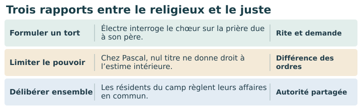

# Banque PT — Français B 2012 · Corrigé guidé

*Corrigé rédigé par IA, non officiel. Signalez toute erreur.*

**Rédaction** · GPT-6.2 Astra Ultra · vitesse non renseignée

**Révision (tour 1)** · GPT-6.2 Astra Ultra · vitesse non renseignée

[Énoncé officiel](https://www.banquept.fr/documents/2012/fr_b_pt_2012.pdf) · [Rapport du jury](https://www.banquept.fr/documents/ecrit/rapport/2012/rapport_fra_b_ecrit_2012.pdf) · [Programme officiel](https://www.education.gouv.fr/bo/2011/24/esrs1100188a.htm) · [Grille de la session](https://www.banquept.fr/documents/livret/2012/Livret_PT_2012.pdf#page=12)

Épreuve de quatre heures sur « La justice ». Eschyle, Les Choéphores et Les Euménides (traduction de Daniel Loayza) · Blaise Pascal, Pensées (fragments prescrits, édition Lafuma) et Trois Discours sur la condition des grands · John Steinbeck, Les Raisins de la colère (traduction de Marcel Duhamel et Maurice-Edgar Coindreau).

## Sujet

Jean Carbonnier, Flexible droit : pour une sociologie du droit sans rigueur, « Codicille », 10e édition, LGDJ, 2001.

Texte des pages 2 à 4, de « S’il me faut aujourd’hui développer ma pensée » à « leur règne provisoire ». Les questions clôturent la page 4. Les deux feuillets suivants sont blancs.

Vous résumerez ce texte en 180 mots (plus ou moins 10%). (8 points)

## Préparer le résumé

Repérez trois renversements. Les Lumières ont pu contester le pouvoir au nom du droit naturel. Luther distingue la justice qui récompense et la grâce qui justifie. Enfin le maintien provisoire des lois peut se fonder sur la méfiance envers la justice humaine. Une phrase doit préserver ce dernier paradoxe. Le décompte distingue les unités séparées par apostrophe ou trait d’union.

## Résumé

Qui récuserait la justice ? Cet accord verbal cache des désaccords que révèlent les changements de lieu ou de siècle. Le droit naturel a pourtant ébranlé des institutions établies. Son défaut tient surtout à son immobilité. Nos contemporains reconnaissent la justice au combat toujours recommencé contre ce qui paraît injuste.

Cette ferveur serait-elle religieuse ? Même les incroyants donnent un visage divin à leur espérance. Certains chrétiens croient entrevoir le jugement divin dans les décisions humaines. Or Luther découvre dans l’Évangile que Dieu rend juste par grâce celui qui ne saurait y prétendre par ses mérites. Comment une justice terrestre prendrait-elle pour règle cette miséricorde souveraine ?

Les hommes doivent instituer des juges pour subsister ensemble. Juger exige donc de trembler, puisque manque toute assurance divine. Nos principes valent par leurs effets limités. L’égalité apaise les jalousies, la règle impersonnelle tempère les passions du commandement et de l’obéissance. Admettre que nos lois seront probablement injustes invite à les maintenir provisoirement pour la paix. Ce pessimisme entreprenant se distingue de la confiance positiviste dans la justice du droit établi.

*180 mots.*

« N’est-il donc pas de justice qui ne soit religieuse ? D’une façon ou d’une autre ? ». Ce point de vue trouve-t-il un écho dans les œuvres du programme ?

## Préparer la dissertation

**Le mot « religieuse » a-t-il un seul sens ?**

Examinez tour à tour la prière adressée à une divinité, le langage d’un ancien pasteur et le statut du jugement humain. Il faut donner à chaque rapprochement des signes précis.

**Comment exploiter les deux pièces d’Eschyle ?**

Commencez par une demande rituelle dans Les Choéphores, puis demandez pourquoi Les Euménides font malgré tout une place à un vote. La pluralité des autorités divines pose un problème qu’aucune interdiction isolée ne règle.

**Comment tester la portée de la généralisation ?**

Demandez si les règles du camp de Steinbeck peuvent être comprises et discutées par des personnes de convictions différentes. Rapprochez ensuite cette modestie du refus d’identifier les lois des hommes à la justice de Dieu.

## Dissertation

Une déesse siège au tribunal d’Athènes. Un prédicateur américain qui a perdu la foi en ses anciens sermons apprend aux migrants à se tenir ensemble. On serait tenté de conclure, devant le premier exemple, que la justice est religieuse et, devant le second, qu’elle a cessé de l’être. Mais Carbonnier demande s’il existe une justice qui ne soit religieuse « d’une façon ou d’une autre ». Sa seconde question invite à distinguer la figure sous laquelle on imagine le juste, l’autorité à laquelle on obéit et ce que des hommes font quand ils cherchent à mieux vivre ensemble. En quel sens la religion peut-elle inspirer cette recherche, et en quel sens pourrait-elle exiger des hommes qu’ils répondent eux-mêmes de leurs jugements ?

Il paraît difficile d’abord de séparer la justice et le sacré dans Les Choéphores. Électre vient sur le tombeau d’Agamemnon verser les libations qu’envoie Clytemnestre. Quelle prière accompagnera ce geste ? Honorer le mort à la demande de celle qui l’a tué ne va nullement de soi. Électre s’adresse au chœur pour apprendre ce qu’il convient de dire, et l’hommage funèbre conduit à demander que le meurtre soit vengé. Le tort subi conserve une voix parce que les morts ont des droits sur les vivants. Le rite ne sert donc pas à donner une apparence solennelle à une résolution déjà prise. Il est le lieu où une fille découvre comment formuler une demande de justice.

Peut-on retrouver quelque chose de ce rapport chez ceux qui ne partagent plus le même culte ? Dans Les Raisins de la colère, Jim Casy, l’ancien pasteur, se demande ce qu’il appelait autrefois l’esprit saint. La fréquentation des autres lui fait pressentir que personne ne se suffit. Ce qui lui semblait relever d’une grâce qui distingue quelques élus prend le visage des personnes qui peinent à ses côtés. Quand Tom partage ensuite avec sa mère l’intuition qu’il a reçue de Casy, il imagine sa présence auprès de tous ceux qui auront à réclamer de quoi vivre dignement. Une parole d’allure prophétique donne à une revendication commune une portée qui dépasse le destin individuel. On comprend pourquoi Carbonnier entend un accent de béatitude dans la faim et la soif de justice.

Cependant le recours aux dieux ne garantit pas que chacun des actes accomplis en leur nom soit juste. Les Érinyes réclament Oreste au nom du sang de sa mère. Apollon, qui lui a ordonné de venger son père, vient défendre son acte devant le tribunal. Les juges entendent ainsi des raisons incompatibles soutenues par des puissances également divines. Le meurtre de la mère est-il effacé par le devoir de venger le père ? À qui voudrait lire dans la religion une règle immédiatement applicable, Eschyle oppose ces deux obligations soutenues avec la même force. Athéna crée une procédure pour que le jugement soit possible. Les suffrages des juges comptent véritablement. Rien ne nous permet de les traiter comme l’enregistrement d’un accord préalable entre les dieux. La présence d’Athéna marque l’importance du jugement sans dispenser les citoyens de l’acte de juger.

Pascal fait apparaître une autre difficulté. Un titre reçu par naissance peut appeler certains égards, même si son titulaire est peu estimable. Dans le deuxième Discours sur la condition des grands, il distingue les grandeurs d’établissement et les grandeurs naturelles. On peut rendre au titulaire d’une charge l’honneur extérieur qui lui est dû. On ne peut par décret commander que soient admirés ses talents ou sa vertu. Cette distinction permet de prendre une décision juste dans un monde de charges et de préséances sans prétendre connaître l’âme du grand. Et la perspective chrétienne qui accompagne cette leçon contribue à limiter les droits qu’un homme pourrait s’arroger sur les autres. Il est des reconnaissances que le pouvoir social ne peut ni acheter ni imposer.

Inversement, il arrive qu’une lecture trop assurée des signes religieux aggrave le poids qui pèse sur les plus faibles. Chez Steinbeck, la grand-mère meurt pendant le voyage. Ma doit continuer de s’occuper des vivants dans des conditions qui ne lui permettent pas de donner aux morts les soins et les cérémonies auxquels elle tient. Que serait ici un jugement prononcé au nom de la seule règle visible ? Il oublierait la charge qui repose sur celle qui protège les siens. Le roman oblige à regarder de près la détresse d’une famille. C’est ainsi qu’un lecteur peut juger de la valeur morale d’une conduite sans devoir se prononcer sur la conformité du geste à un rite. La compassion devient une voie de connaissance de ce que la règle laisse échapper.

« D’une façon ou d’une autre » ne doit donc pas rendre la thèse invérifiable. Prenons les formes quotidiennes de gouvernement du camp où les Joad peuvent se laver, délibérer et danser en paix. Elles ont une justification accessible à des gens qui pourraient fort bien différer sur la foi. Les résidents ont éprouvé ce que font l’humiliation et les soupçons. Ils se donnent des représentants, des règles d’usage et des moyens de prévenir les désordres. Dire que leurs pratiques sont forcément religieuses ferait perdre ce qu’elles ont de précieux, la possibilité de s’en expliquer avec tout nouvel arrivant. Mais ceux qui administrent ce camp sans se prétendre infaillibles rencontrent aussi, par une autre voie, la retenue à laquelle Carbonnier invite le juge croyant. Renoncer à la garantie d’un jugement absolu rend l’attention à ses effets plus nécessaire.

Les œuvres donnent donc plusieurs échos à la question du juriste. Le rite funéraire rend une voix à l’exigence d’un mort. La parole de Casy étend jusqu’aux inconnus le sentiment d’une communauté. La distinction pascalienne des ordres interdit de prendre le prestige pour une justice souveraine. Pourtant un tort peut être reconnu et réparé au terme d’une enquête et d’une délibération communes, par des hommes qui n’ont pas à s’accorder sur Dieu. La relation la plus féconde entre justice et religion pourrait ainsi être celle que suggère le paradoxe de Carbonnier. Une foi peut porter assez haut l’idée du juste pour ôter au juge humain la tentation de parler en son nom.

