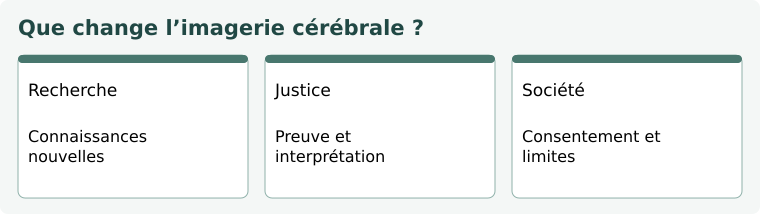
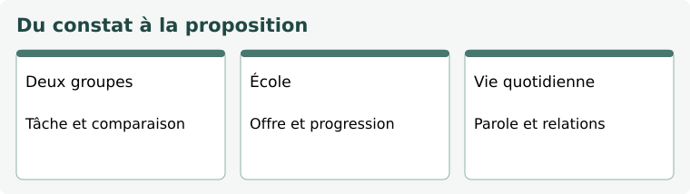

# Banque PT — Langue vivante A 2012 · Corrigé guidé

*Corrigé rédigé par IA, non officiel.*

**Rédaction** · GPT-6.2 Astra Ultra · vitesse non renseignée

L’épreuve dure trois heures. Chaque candidat traite la langue choisie à l’inscription. La version française vaut 10 points. La question a demande 80 à 100 mots pour 4 points. La question b demande 200 à 250 mots pour 6 points.

[Sujet](https://www.banquept.fr/documents/2012/lv_a_pt_2012.pdf) · [Rapport du jury](https://www.banquept.fr/documents/ecrit/rapport/2012/rapport_lv_a_ecrit_2012.pdf) · [Grille du livret](https://www.banquept.fr/documents/livret/2012/Livret_PT_2012.pdf#page=12)

## Allemand

*Warum das Atmen der Bäume so wichtig ist*

Claudia Füßler, Die Zeit, 27 novembre 2011. Article et questions, pages 2–3. Le rapport allemand, pages 1–2 du PDF, porte sur la traduction du vocabulaire botanique et la construction des réponses.

Pour la version, distinguer la surface au sol de la couronne et la surface d’absorption du feuillage. Dans la première réponse, réunir les services rendus par l’arbre. La seconde consigne appelle une société imaginée, ce qui justifie le conditionnel allemand.

### Version française

De « Eine prächtige Grünlilie im Wohnzimmer » à « zum Beispiel durch Schadstoffe in der Luft ».

Un magnifique chlorophytum dans le salon, quelques ficus au bureau… Les plantes vertes, nous l’avons appris à l’école, améliorent la qualité de l’air. Elles le doivent à un processus peu facile à comprendre pour le profane en chimie, la photosynthèse. Ce qui fonctionne à petite échelle avec les plantes d’intérieur remplit aussi son office à grande échelle. Les arbres améliorent l’air des villes.

La contribution d’un arbre à la qualité de l’air dépend avant tout du diamètre de sa couronne. « Pour peu qu’elle soit assez imposante, un arbre de quinze à vingt mètres de haut couvre facilement de 100 à 150 mètres carrés au sol, même si son tronc est mince », explique Edgar Wagner, biologiste et spécialiste de physiologie végétale à Fribourg. « Si, en plus, le feuillage est dense, une surface d’absorption de 1 200 à 1 500 mètres carrés n’a rien d’exceptionnel. » Un vieux hêtre, par exemple, peut produire 1,7 kilogramme d’oxygène par heure, de quoi faire respirer cinquante personnes pendant une heure.

L’arbre lui-même respire par de petits orifices, les stomates, bien visibles sur la face inférieure des feuilles. Ils s’ouvrent ou se ferment selon les besoins. Si l’arbre manque d’eau, ils se referment automatiquement. Lorsqu’il est gorgé de sève, ils s’ouvrent. Grâce à ce mécanisme finement réglé, les arbres s’adaptent avec souplesse aux changements de leur environnement. Cette faculté d’adaptation peut cependant être altérée, par exemple par des polluants présents dans l’air.

### Question a

*Was bringen die Bäume der Welt und der Menschheit?*

Bäume nehmen Kohlendioxid auf und geben Sauerstoff ab. Zugleich befeuchten sie die Luft und halten mit ihren Blättern einen Teil des Feinstaubs sowie Sporen und Bakterien zurück. Besonders in dicht bebauten Städten kommt das den Menschen zugute. Wie viel ein einzelner Baum leisten kann, hängt unter anderem vom Umfang seiner Krone, von der Dichte des Laubs und von den Bedingungen an seinem Standort ab. Den größten Nutzen hätte eine Stadt daher kaum von der Suche nach einer einzigen Wunderart. Sie braucht vielmehr ausreichend viele Bäume, die unter ihren jeweiligen Bedingungen gedeihen können.

**92 mots**

### Question b

*Die Natur ist in unserer industriellen Gesellschaft immer mehr gefährdet. Erfinden Sie eine ideale Welt, in der die Natur geschützt wäre.*

In meiner idealen Stadt würde man den ältesten Baum eines Viertels schon auf dem ersten Bauplan sehen. Wer dort Wohnungen errichten möchte, müsste zunächst mit den Bewohnern und einer Gärtnerin überlegen, wie seine Wurzeln genügend Platz behalten könnten. Die Kinder aus der Schule nebenan wüssten, warum das wichtig ist. Im Sommer würden sie die Temperatur im Schatten und auf dem Asphalt vergleichen, im Herbst die Blätter im Hof untersuchen. Naturschutz wäre damit etwas, das sie beobachten und mitgestalten könnten.

Die Stadt müsste allerdings auch Menschen eine bezahlbare Wohnung bieten. Deshalb würden leer stehende Gebäude umgebaut, bevor neue Flächen versiegelt würden. Ein dichtes Netz öffentlicher Verkehrsmittel würde dafür sorgen, dass weniger Boden für Parkplätze nötig wäre. Wer nachts arbeitet oder weit draußen wohnt, müsste ebenfalls zuverlässig nach Hause kommen. Sonst wäre die schöne grüne Innenstadt nur für einen Teil der Bevölkerung erreichbar.

Auch die Fabriken dieser Stadt hätten ihren Platz. Sie würden offenlegen, wie viel Wasser und Energie sie verbrauchen. Ihre Beschäftigten könnten Vorschläge zur Wiederverwendung von Material machen, ohne um ihren Arbeitsplatz fürchten zu müssen. Nicht jeder Konflikt zwischen einer Werkstatt, einem Wohnhaus und einer Wiese ließe sich vermeiden. Eine gute Entscheidung wäre für mich daran zu erkennen, dass auch diejenigen gehört würden, die später mit ihren Folgen leben müssen. Der alte Baum wäre dann mehr als ein freundliches Zeichen auf einer Zeichnung.

**223 mots**

## Anglais

*The end of the Space Age*

The Economist, 30 juin 2011. Texte et questions, pages 4–5. Le jury d’anglais, pages 3–4, distingue la comparaison précise demandée en a et la prise de position personnelle en b.

Dans la version, conserver la reprise de « viewed this way » et l’ironie des deux titres. Le chiffre de 36 000 km appartient à l’introduction de l’article, hors passage à traduire. Séparer l’orbite au service de la Terre et le rêve d’aller plus loin.

### Version française

De « Viewed this way » à « was of adventure and exploration ».

Vue sous cet angle, la Terre est sensiblement plus grande que ne le laisse entendre la réponse traditionnelle des manuels. Et, vue sous cet angle, l’ère spatiale a été un succès éclatant. Les télécommunications, la prévision météorologique, l’agriculture, la sylviculture et jusqu’à la prospection minière en ont été bouleversées. La conduite de la guerre aussi. Aucune puissance ne peut plus mobiliser ses forces armées en secret. Il est possible de connaître l’emplacement précis de chaque bâtiment sur la planète. Et les systèmes de positionnement mondial par satellite peuvent, sur demande, guider une bombe de précision jusqu’à cet endroit.

Rien de tout cela, pourtant, ne correspondait à l’ère spatiale qu’imaginaient les passionnés de la première heure, ceux qui avaient lancé l’aventure. Certes, des ingénieurs comme Wernher von Braun, qui construisit des fusées aussi bien pour le programme allemand des V2 pendant la Seconde Guerre mondiale que pour le programme américain Apollo pendant la guerre froide, vendirent leur âme aux autorités militaires afin de poursuivre leur rêve de voyage spatial par le seul moyen alors disponible. Mais la plupart visaient un but plus élevé. « Les premiers hommes en orbite géostationnaire » ne sonne pas tout à fait comme « Les premiers hommes sur la Lune », titre d’un livre de von Braun paru en 1958. Dans les années cinquante et soixante, lorsque les premières fusées spatiales prenaient leur envol, la vision que l’on faisait miroiter était celle de l’aventure et de l’exploration.

### Question a

*In what ways are today’s exploitations of space different to the dreams of those involved in the early days of space exploration?*

Early enthusiasts expected people to travel beyond Earth and discover distant worlds. Rockets built with military support seemed to offer a way to pursue that wider ambition. Most practical successes have instead come from looking back towards Earth. Communications, navigation and weather forecasting all rely on satellites, and armed forces also use information from orbit. These services can transform life without taking anyone to another planet. Even the private ventures discussed in the article mainly offer journeys close to Earth or transport to an existing space station.

**87 mots**

### Question b

*To what extent do you consider it important to continue to explore space?*

I think exploration deserves public support when it pursues a question that cannot be answered nearly as well from Earth. A mission that studies an unfamiliar planet, for instance, can tell us something about how planets develop under different conditions. The value of that comparison does not depend on whether a passenger can pay to go there. It does, however, depend on scientists being able to use the observations and explain what they have learned.

That distinction matters because the word exploration can cover very different projects. An expensive flight offering a few minutes of extraordinary scenery may be a remarkable achievement for its passengers. It is a weaker claim on public money than a probe that sends back measurements for years. Sending people can make sense where their judgement and ability to adapt would change what a mission could discover. Where an instrument can perform the task safely, the attraction of a dramatic photograph seems a poor reason to pay the extra cost.

There is also a cost to abandoning exploration entirely. Questions with no immediate commercial return would be left unanswered, and scientific teams could lose skills that take years to acquire. I would therefore favour a sustained programme of carefully chosen missions, with findings shared publicly and costs reviewed honestly. Ambition is worth preserving when it remains possible to say what a journey is for.

**228 mots**

## Arabe

*دبلوماسية تغير المناخ*

Najib Saab, Al-Hayat, 4 novembre 2011, page 6. Les trois consignes figurent page 7. Le rapport d’arabe, page 5 du PDF, rappelle le contexte diplomatique et la portée de l’épreuve.

La version s’arrête au soutien scientifique et matériel, avant la discussion sur les négociations ministérielles. Rendre le contraste entre avertissement et action. La première réponse expose la thèse. La seconde défend des solutions en distinguant les responsabilités des pays.

### Version française

Du début « دبلوماسية تغير المناخ » à « بالدعم العلمي والمادي ».

La diplomatie du changement climatique a fait l’objet à Bonn d’une réunion de concertation accueillie par le ministère allemand des Affaires étrangères, en présence de responsables d’une trentaine de pays. L’Allemagne avait déjà pris l’initiative de mettre le climat à l’ordre du jour des questions de sécurité lorsqu’elle avait saisi le Conseil de sécurité de l’ONU à l’été 2011. La réunion de Bonn s’inscrivait dans le prolongement de cette démarche, en associant au débat sur le changement climatique des diplomates des ministères des Affaires étrangères. Car cette question menace non seulement la stabilité mondiale, mais l’existence humaine elle-même.

La réunion avait pour mot d’ordre « De l’alerte précoce à l’action précoce ». Les scientifiques avaient bel et bien prévenu très tôt des conséquences du changement climatique. Mais le doute entretenu de longues années sur le bien-fondé de leurs avertissements était alimenté par des groupes qui tiraient profit de la situation et craignaient que le changement ne nuise à leurs intérêts. L’alerte donnée de bonne heure n’a donc pas rencontré de conviction tout aussi précoce quant à la réalité des faits, et les mesures sérieuses pour établir des plans d’action ont tardé. On peut dès lors comprendre que l’on craigne un retard dans le passage à l’action. Les défis du changement climatique constituant une menace mondiale, il appartient à la diplomatie de proposer des solutions.

On ne saurait demander à la Chine, à l’Inde et aux pays en développement de laisser des centaines de millions de leurs habitants sans accès suffisant à l’énergie et aux transports dans le but de limiter les émissions. Il n’est pas davantage acceptable que les pays pauvres reproduisent les erreurs des pays industrialisés en se lançant aveuglément dans un développement débridé qui prétendrait rattraper le passé. Aux pays industrialisés avancés d’assumer leur responsabilité historique dans la pollution, de réduire fortement leurs émissions de carbone et d’apporter aux pays en développement un soutien scientifique et matériel pour les aider à passer aux technologies propres.

### Question a

*تحدثوا عن معنى النص العام*

يرى الكاتب أن تغير المناخ لم يعد شأنا بيئيا يخص العلماء وحدهم، لأن نتائجه تهدد أمن الدول وحياة مجتمعات بأكملها. ويوضح اجتماع بون كيف دخلت القضية مجال التفاوض الدبلوماسي بعد سنوات من التحذير الذي لم يصحبه عمل كاف. ويصعب التوصل إلى اتفاق إذا طلب من الدول الفقيرة الحد من الانبعاثات من دون أن تتاح لسكانها الطاقة ووسائل النقل. لذلك يدعو الكاتب البلدان الصناعية إلى تحمل مسؤوليتها التاريخية وتقديم الدعم المالي والعلمي. وتظهر حالة المالديف أن التأخر في تنفيذ التعهدات قد يهدد وجود بلد بأسره.

**84 mots**

### Question b

*ما هي في رأيكم الحلول لمعالجة تحديات تغير المناخ عالميا؟*

أرى أن الاتفاق العالمي يبدأ بالاعتراف بأن للدول حاجات مختلفة، مع أن الغلاف الجوي واحد. فالأسرة التي تحصل على الكهرباء للمرة الأولى لا يمكن أن تتحمل العبء نفسه الذي تتحمله شركة تستهلك كميات كبيرة من الوقود منذ عقود. لذلك أؤيد أن تقدم الدول ذات الموارد الواسعة تمويلا يمكن الاعتماد عليه طوال سنوات، وأن تحدد الدول المستفيدة المشاريع التي تلائم سكانها. وقد يكون تمويل شبكة كهرباء نظيفة أو حافلات عامة منتظمة أنفع لمدينة من شراء أجهزة لا يجد أحد من يتولى صيانتها.

ولا يكفي في رأيي إعلان مبلغ كبير عند انتهاء كل مؤتمر. من حق الناس أن يعرفوا كم وصل فعلا، وأي قرية استفادت منه، وما إذا أصبحت الخدمة ميسورة للأسر الفقيرة. ويمكن أن تشترك جامعات من البلدين في تدريب الفنيين ونشر النتائج بلغة يفهمها الجمهور. عندئذ يتحول التعاون العلمي إلى قدرة محلية تستمر حتى إذا انتهت المنحة الأولى.

وأعتقد أن خفض الانبعاثات يجب أن يسير مع الحماية من التغير الذي بدأ بالفعل. فسكان جزيرة منخفضة يحتاجون إلى إنذار مبكر وخطة لحماية مياه الشرب ومساكنهم، ولا يستطيعون انتظار اكتمال تحول الطاقة في العالم. وفي المقابل لا يجوز أن تصبح مشروعات الحماية ذريعة لتأجيل خفض التلوث. وتستطيع الحكومات أن تجمع المسارين في موازنة واحدة تعلن أهدافها ومواعيدها، ثم تسمح للباحثين وللسكان بمراجعة النتائج. هكذا يقاس نجاح الدبلوماسية بما يتغير في حياة الناس بين مؤتمرين.

**212 mots**

## Espagnol

*La revolución neurocientífica*

Megatendencias, 15 septembre 2011, pages 8–9. La traduction est entièrement page 8. Le rapport d’espagnol, page 6, porte sur la compréhension et l’expression.

Le passage oppose les acquis observables et la transformation des mentalités. Respecter les degrés d’affirmation du texte de 2011 quand il évoque la justice. Dans l’essai, distinguer une information médicale de la décision que prend une institution.

### Version française

De « Cuando se habla de revolución neurocientífica » à « la demencia de los implicados ».

Lorsqu’on parle de révolution neuroscientifique, il faudrait distinguer une révolution objective, qui se manifeste dans ces connaissances nouvelles et leurs applications, d’une révolution des mentalités, bien plus importante.

Parmi les aspects de cette révolution objective, il faudrait mentionner le recours de plus en plus fréquent aux techniques d’imagerie cérébrale, aussi bien pour étudier des maladies que pour étudier des êtres humains en bonne santé ne présentant pas de trouble. Dans le système judiciaire, par exemple, on fait de plus en plus appel à ces techniques, qui remplaceront bientôt les anciens détecteurs de mensonges, car leurs résultats sont plus précis que ceux des détecteurs traditionnels. On espère ainsi qu’il sera bientôt impossible de tromper les juges et les procureurs. Certains estiment que les neurosciences pourraient avoir sur le système juridique des répercussions aussi profondes que les tests ADN. Et le neuroscientifique Michael Gazzaniga, de l’université de Californie, affirme que des éléments de preuve issus des neurosciences ont déjà été utilisés pour convaincre des jurés de rendre certaines décisions et que des tribunaux ont admis des résultats d’imagerie cérébrale à l’appui de demandes visant à justifier des actes criminels par la démence des personnes en cause.

### Question a

*Analice Usted el panorama nuevo que abre la « revolución neurocientífica » según el autor de este texto.*

Según el autor, los avances en el estudio del cerebro anuncian una transformación comparable a las grandes revoluciones anteriores. La novedad no reside únicamente en los conocimientos médicos. Los tribunales utilizan imágenes cerebrales, las empresas investigan cómo decidimos y otras instituciones buscan aplicaciones que pueden afectar a nuestra libertad. Cambia también la manera de interpretar la responsabilidad y la conducta humanas. De ahí que el artículo distinga los descubrimientos y sus usos, que se pueden observar, de una transformación de las mentalidades que considera todavía más importante.

**87 mots**

### Question b

*¿Qué cambios, positivos y negativos, se pueden esperar de las diferentes aplicaciones de la neurociencia en nuestras sociedades?*

Creo que una de las contribuciones más valiosas de la neurociencia consiste en cambiar la conversación entre un paciente y su entorno. Cuando una dificultad para recordar o para controlar un movimiento se comprende mejor, la familia puede ofrecer una ayuda más adecuada. También puede dejar de atribuir a la falta de voluntad lo que en realidad es una consecuencia de una enfermedad. Ese conocimiento merece traducirse en mejores cuidados y en un acceso más justo al diagnóstico.

En cambio, una imagen del cerebro puede adquirir una autoridad que no le corresponde. En un juicio, por ejemplo, un resultado necesita interpretación y debe poder discutirse. Dos personas con una característica semejante no han vivido necesariamente la misma historia ni han tomado la misma decisión. Me preocuparía que una prueba destinada a aclarar un caso acabara convirtiéndose en un veredicto automático.

Algo parecido sucede cuando una empresa quiere conocer las preferencias de sus clientes. Una investigación voluntaria puede servir para diseñar un aviso más comprensible. Utilizar datos personales sin explicar para qué se recogen debilitaría, en cambio, la capacidad de elegir. Por eso exigiría consentimiento, límites de uso y una explicación comprensible del margen de incertidumbre. El progreso social dependerá tanto de los derechos de quienes participan como de la precisión de los instrumentos.

**213 mots**

## Italien

*Bilingui, più rapidi ed efficienti nel prendere decisioni critiche*

Alessia Manfredi, La Repubblica, 13 novembre 2011, pages 10–11. La version est page 10. Le rapport italien est page 7 du PDF.

La comparaison porte sur deux groupes comparables et sur une tâche déterminée. Bien rendre la distinction entre résultat observé et hypothèse des chercheurs. Aborder en a l’école primaire, puis en b les usages du plurilinguisme hors du laboratoire.

### Version française

De « Nello studio » à « chi è monolingue ».

L’étude a comparé deux groupes. Le premier était constitué de personnes du Haut-Adige bilingues depuis la naissance, parlant italien et allemand. Le second rassemblait des personnes monolingues d’âge comparable et de milieu éducatif et socioéconomique semblable. Pour analyser leurs performances lors de tâches cognitives, on a mesuré leur activité cérébrale à l’aide de techniques avancées de neuro-imagerie et de l’imagerie par résonance magnétique fonctionnelle. Résultat ? On a constaté que « les sujets bilingues ont davantage de matière grise dans le cortex cingulaire antérieur, une région essentielle au contrôle de nos actions », explique le docteur Abutalebi, premier auteur de l’étude.

« Les sujets bilingues sont plus rapides lorsqu’il faut prendre des décisions délicates, mais leur cerveau est beaucoup moins sollicité », poursuit le spécialiste. Les personnes bilingues étudiées par les chercheurs ont en effet eu moins besoin que les monolingues de mobiliser leur cortex cingulaire antérieur pour prendre une décision.

Plus rapides, plus efficaces, au prix d’un moindre effort. Selon l’hypothèse des chercheurs, l’explication tiendrait à l’habitude prise dès l’enfance de bien distinguer les deux langues pour éviter de les confondre, une aptitude que les enfants acquièrent généralement à partir de trois ans. Ce processus met en jeu les mêmes structures neuronales que la prise de décision rapide. Les faire travailler davantage dès la naissance procurerait ainsi un double avantage, un développement anatomique plus important et la possibilité de moins les solliciter que les personnes monolingues.

### Question a

*In quale misura il bilinguismo dovrebbe essere imposto in tutte le scuole elementari?*

Introdurrei una seconda lingua in tutte le scuole elementari, perché l’accesso non dipenda dal reddito o dalle lingue già parlate in famiglia. Lo studio suggerisce che l’abitudine precoce a passare da una lingua all’altra può essere vantaggiosa. Sarebbe però eccessivo imporre a ogni bambino lo stesso livello di bilinguismo entro una data prestabilita. Servono insegnanti preparati, occasioni di conversare e tempo per imparare senza paura di sbagliare. Renderei quindi obbligatoria l’offerta della scuola, lasciando agli alunni percorsi adeguati alle loro esperienze e ai loro ritmi.

**85 mots**

### Question b

*Oltre all’aspetto tecnico e neurologico, quali possono essere i vantaggi di praticare il bilinguismo o il plurilinguismo?*

Per me parlare un’altra lingua significa anzitutto poter partecipare a una conversazione che altrimenti si svolgerebbe senza di me. Un ragazzo che conosce anche la lingua dei nonni può ascoltare direttamente la storia della loro infanzia. Se deve sempre aspettare una traduzione, perde talvolta un dettaglio, un soprannome o una battuta che nessuno pensa di spiegargli. La possibilità di rispondere nella stessa lingua cambia anche la relazione: chi ascoltava soltanto diventa un interlocutore.

Nello studio e nel lavoro il vantaggio è altrettanto concreto. Due scuole che collaborano a una ricerca locale possono confrontare i giornali dei rispettivi paesi e accorgersi che descrivono in modo diverso lo stesso evento. Un tecnico che incontra un cliente straniero può chiedere direttamente che cosa si sia rotto, invece di indovinare da una traduzione approssimativa. In entrambi i casi conoscere più lingue aiuta a formulare una domanda migliore, non soltanto a trovare più in fretta una risposta.

Infine, l’esperienza di cercare a lungo una parola rende più facile accogliere chi sta imparando la nostra lingua. Non si diventa automaticamente più aperti per aver studiato una grammatica. Però si può imparare ad aspettare, a riformulare e a verificare di aver compreso. Sono abitudini utili anche fra persone che credono di parlare esattamente allo stesso modo.

**209 mots**
