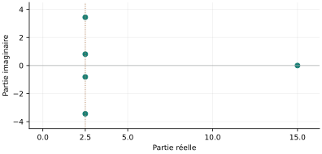
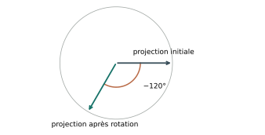

# Banque PT — Mathématiques A 2012 · Corrigé guidé

*Corrigé rédigé par IA, non officiel. Signalez toute erreur.*

**Rédaction** · GPT-6.2 Astra Ultra · vitesse non renseignée

Le sujet contient une question préliminaire et trois parties indépendantes. L’additif du 31 janvier confirme que Maths A et Maths B portent toutes deux sur l’algèbre et la géométrie. [Sujet officiel](https://www.banquept.fr/documents/2012/math_a_pt_2012.pdf) · [Rapport du jury](https://www.banquept.fr/documents/ecrit/rapport/2012/rapport_math_a_ecrit_2012.pdf) · [Grille des coefficients](https://www.banquept.fr/documents/livret/2012/Livret_PT_2012.pdf#page=12) · [Additif du 31 janvier 2012](https://www.banquept.fr/documents/livret/2012/Livret_PT_2012_additif.pdf)

Le jury demande de justifier la trigonalisation, de démontrer la liberté d’une famille propre et de vérifier l’orthogonalité avant de reconnaître une rotation. Ces trois points guident les indications.

## Préliminaire

### Préliminaire · Stabilité d’un sous-espace propre

> [!INDICATION]
> Appliquer la commutation à un vecteur de valeur propre connue.

Pour $x\in E_\lambda(f)$, on a $f(gx)=g(fx)=g(\lambda x)=\lambda gx$. Ainsi $gx\in\ker(f-\lambda I)$, y compris lorsque $gx=0$.

## Partie I

### I.1 · Commutation des deux matrices

> [!INDICATION]
> Calculer les images des trois vecteurs canoniques par les deux composées.

Les produits, dans les deux ordres, donnent
$$AB=BA=\begin{pmatrix}0&1&1\\-1&-1&-3\\1&3&5\end{pmatrix}.$$
La composition étant représentée par le produit, $f$ et $g$ commutent.

### I.2 · Spectres et dimensions des espaces propres

> [!INDICATION]
> Comparer la dimension de chaque espace propre à la multiplicité de sa racine dans le polynôme caractéristique.

Avec $\chi_M(t)=\det(tI-M)$, le bloc inférieur de $A$ donne $\chi_A(t)=(t-1)^3$. L’équation $(A-I)x=0$ se réduit à $y+z=0$. En posant $u=(1,0,0)$ et $v=(0,-1,1)$, on obtient $E_1(A)=\operatorname{Vect}(u,v)$.

Pour $B$, le développement de $\det(tI-B)$ donne $t^3-4t^2+4t=t(t-2)^2$. Résoudre $Bx=0$ donne $y=-z,\ x=-2z$ et donc $E_0(B)=\operatorname{Vect}((-2,-1,1))$. Résoudre $(B-2I)x=0$ donne $x=0,\ y=-z$, donc $E_2(B)=\mathbb Rv$. Dans chaque cas, les dimensions des espaces propres totalisent deux. Aucune des deux matrices n’est diagonalisable. Leurs polynômes caractéristiques sont scindés sur $\mathbb R$, ce qui assure leur trigonalisation réelle.

### I.3 · Une base commune de trigonalisation

> [!INDICATION]
> Chercher un plan stable contenant la droite propre de valeur 2 pour $g$. Le préliminaire fournit un tel plan parmi les espaces propres de $f$.

Tout vecteur $e_1$ demandé est un multiple non nul de $v$. La droite $\mathbb Rv$ est stable sous $g$ et sous $f$, puisque $gv=2v$ et $fv=v$. Prenons $e_2=u$. Le plan engendré est $E_1(f)$, stable sous $f$ et, par le préliminaire, sous $g$. La droite et le plan forment donc un drapeau stable. Tout troisième vecteur hors du plan donne une base commune adaptée à ce drapeau. Par exemple, en posant $e_1=v$ et $e_3=(0,1,0)$, les matrices sont respectivement
$$\begin{pmatrix}1&0&1\\0&1&0\\0&0&1\end{pmatrix},\qquad
\begin{pmatrix}2&1&1\\0&0&1\\0&0&2\end{pmatrix}.$$

## Partie II

### II.1 · Liberté des vecteurs propres

> [!INDICATION]
> Dans une relation entre $r$ vecteurs propres, appliquer $f-\lambda_r I$ pour supprimer son dernier terme.

Choisissons un vecteur non nul $e_i$ pour chaque $\lambda_i$. Par récurrence, une famille de tels vecteurs associés à des valeurs distinctes est libre. Pour un seul vecteur c’est immédiat. Si $\sum_{i=1}^r c_i e_i=0$, l’application de $f-\lambda_r I$ donne $\sum_{i<r}c_i(\lambda_i-\lambda_r)e_i=0$. L’hypothèse de récurrence et les différences non nulles donnent $c_i=0$ pour $i<r$, puis $c_r=0$ dans la relation initiale. Pour $r=n$, cette famille libre est une base de $E$.

### II.2.a · Commutation avec un polynôme

> [!INDICATION]
> Vérifier le résultat sur un monôme puis utiliser la linéarité.

Pour chaque $k\ge0$, $ff^k=f^{k+1}=f^kf$, avec $f^0=I$. En multipliant par $a_k$ et en sommant, on obtient $fP(f)=P(f)f$.

### II.2.b · Diagonalisation simultanée

> [!INDICATION]
> Appliquer chaque puissance de $f$ au même vecteur $e_i$. Les images des valeurs propres peuvent coïncider.

Par récurrence $f^ke_i=\lambda_i^ke_i$, donc $P(f)e_i=P(\lambda_i)e_i$. Dans la base de II.1, $P(f)$ a pour matrice $\operatorname{diag}(P(\lambda_1),\ldots,P(\lambda_n))$. Ses valeurs propres sont les éléments distincts de cette liste, et elle est diagonalisable dans cette base même en cas de répétition.

### II.3.a · Spectre du décalage circulaire

> [!INDICATION]
> Écrire l’équation propre coordonnée par coordonnée et fermer le cycle après cinq pas.

$A(x_1,x_2,x_3,x_4,x_5)=(x_5,x_1,x_2,x_3,x_4)$. Ainsi $A^5=I$ et toute valeur propre satisfait $z^5=1$. Réciproquement, pour tout $z^5=1$, le vecteur $(1,z^{-1},z^{-2},z^{-3},z^{-4})$ est non nul et son image est $z$ fois lui-même. Les cinq valeurs cherchées sont $\exp(2i\pi k/5)$, $0\le k\le4$.

### II.3.b · Écriture de la matrice circulante

> [!INDICATION]
> Les cinq premières colonnes des matrices $I,A,A^2,A^3,A^4$, prises une par matrice, forment la base canonique.

La première colonne de $B$ impose les coefficients $(5,1,2,3,4)$. Pour chaque autre colonne, on retrouve le même décalage cyclique que dans $B$. On a donc $B=5I+A+2A^2+3A^3+4A^4$.

### II.3.c · Images des racines cinquièmes

> [!INDICATION]
> Pour une racine $z\ne1$, dériver la somme géométrique avant d’y substituer $z$.

Avec $P(t)=5+t+2t^2+3t^3+4t^4$, II.2 donne les valeurs $P(z)$ pour $z^5=1$. À $z=1$ on trouve $15$. Pour $z\ne1$, dérivons $\sum_{k=0}^4t^k=(t^5-1)/(t-1)$, puis multiplions par $z$ et évaluons en $t=z$. On trouve $\sum_{k=1}^4kz^k=5/(z-1)$, donc les quatre autres valeurs sont $5z/(z-1)$. Elles sont distinctes par injectivité de cette fraction rationnelle sur son domaine. Leur partie réelle vaut $5/2$ car leurs conjuguées s’obtiennent en remplaçant $z$ par $1/z$ et la somme vaut $5$.

### II.4.a · Dimensions des espaces propres

> [!INDICATION]
> L’expression d’un vecteur dans la base propre permet d’identifier chaque coordonnée.

Dans la base de II.1, $(f-\lambda_i I)x=0$ impose $(\lambda_j-\lambda_i)x_j=0$ pour tout $j$. Seule la coordonnée $i$ peut être non nulle. Ainsi $E_{\lambda_i}(f)=\mathbb C e_i$ a dimension un.

### II.4.b · Action d’un endomorphisme qui commute

> [!INDICATION]
> Combiner stabilité de la droite et dimension un.

Le préliminaire assure que $g(e_i)\in E_{\lambda_i}(f)=\mathbb C e_i$. Il existe donc un scalaire $\mu_i$ tel que $g(e_i)=\mu_i e_i$. Le vecteur $e_i$ est non nul et reste vecteur propre même si $\mu_i=0$.

### II.4.c · Une base propre de l’endomorphisme

> [!INDICATION]
> Compter les vecteurs propres déjà construits.

Les $e_i$ forment une base de $E$ et sont tous propres pour $g$. Donc $g$ est diagonalisable et sa matrice dans cette base est $\operatorname{diag}(\mu_1,\ldots,\mu_n)$.

### II.4.d.i · Linéarité de l’évaluation

> [!INDICATION]
> L’identité à vérifier est coordonnée par coordonnée.

Pour $a,b\in\mathbb C$ et $P,Q$ dans $\mathbb C_{n-1}[X]$, $(aP+bQ)(\lambda_i)=aP(\lambda_i)+bQ(\lambda_i)$. Ainsi $\varphi(aP+bQ)=a\varphi(P)+b\varphi(Q)$.

### II.4.d.ii · Noyau de l’évaluation

> [!INDICATION]
> Comparer le nombre de racines imposées au degré.

Un polynôme du noyau s’annule aux $n$ valeurs distinctes $\lambda_i$. Si son degré est inférieur à $n$, il est nécessairement nul. Le polynôme nul convient, donc $\ker\varphi=\{0\}$.

### II.4.d.iii · Interpolation aux valeurs propres

> [!INDICATION]
> L’injectivité suffit ici pour la surjectivité grâce aux dimensions, y compris pour $n=1$.

Le domaine a pour base $1,X,\ldots,X^{n-1}$ et dimension $n$, comme le but $\mathbb C^n$. L’application linéaire injective est donc bijective. Le $n$-uplet $(\mu_1,\ldots,\mu_n)$ admet un unique antécédent. Explicitement, il vaut
$$P(X)=\sum_{i=1}^n\mu_i\prod_{j\ne i}\frac{X-\lambda_j}{\lambda_i-\lambda_j},$$
avec la convention du produit vide égal à $1$.

### II.4.e · Égalité de deux endomorphismes

> [!INDICATION]
> Tester l’identité sur la base propre commune.

Pour le polynôme précédent, $P(f)e_i=P(\lambda_i)e_i=\mu_i e_i=g(e_i)$ pour tout $i$. Deux applications linéaires coïncidant sur une base sont égales, donc $g=P(f)$ avec $\deg P<n$ ou $P=0$.

### II.5.a · Diagonalisation orthogonale

> [!INDICATION]
> Essayer les directions des bissectrices puis normaliser.

Les vecteurs $(1,1)$ et $(1,-1)$ sont orthogonaux, et $M$ les multiplie respectivement par $1$ et $4$. La matrice
$$Q=\frac1{\sqrt2}\begin{pmatrix}1&1\\1&-1\end{pmatrix}$$
vérifie $Q^\mathsf TQ=I$ et $Q^{-1}MQ=\operatorname{diag}(1,4)$.

### II.5.b · Forme nécessaire d’une racine carrée

> [!INDICATION]
> Une matrice commute toujours avec son carré. Préciser pourquoi les coefficients du polynôme sont réels.

Si $N^2=M$, alors $NM=N^3=MN$. En appliquant II.4 aux deux valeurs propres simples de $M$, on trouve que $Q^{-1}NQ$ est diagonale et que $N=\alpha I+\beta M$. Sur ces deux droites, les valeurs $s,t$ de $N$ satisfont $s^2=1$ et $t^2=4$, donc sont réelles. Le système $\alpha+\beta=s,\ \alpha+4\beta=t$ donne $\beta=(t-s)/3$ et $\alpha=(4s-t)/3$, réels. Cette preuve vaut même si on autorise initialement des matrices complexes.

### II.5.c · Les quatre racines carrées

> [!INDICATION]
> Les deux signes de la diagonale sont indépendants. Vérifier également la réciproque.

Toutes les solutions s’obtiennent par $N=Q\operatorname{diag}(s,t)Q^\mathsf T$ avec $s=\pm1$ et $t=\pm2$, soit
$$N=\tfrac12\begin{pmatrix}s+t&s-t\\s-t&s+t\end{pmatrix}.$$
Ces quatre matrices sont distinctes. Chacune a pour carré $Q\operatorname{diag}(1,4)Q^\mathsf T=M$.

## Partie III

### III.1.a · Rotation dans le plan orthogonal

> [!INDICATION]
> Construire dans le plan orthogonal deux directions à angle droit en respectant l’orientation de l’axe.

Pour $u\perp a$ et $\|a\|=1$, on a $r(u)=\cos\theta\,u+\sin\theta\,(a\times u)$. Si $u\ne0$, les vecteurs $u/\|u\|$ et $(a\times u)/\|u\|$ forment une base orthonormée directe du plan orienté par $a$. Pour $u=0$, la formule donne bien zéro.

### III.1.b · Décomposition orthogonale

> [!INDICATION]
> Prendre le produit scalaire de l’égalité cherchée avec le vecteur unitaire $a$.

Nécessairement $\lambda=\langle v,a\rangle$ puisque $\langle u,a\rangle=0$ et $\|a\|^2=1$. Réciproquement $u=v-\langle v,a\rangle a$ est orthogonal à $a$. Cette formule donne existence et unicité.

### III.1.c · Formule de Rodrigues

> [!INDICATION]
> La rotation fixe la composante parallèle à l’axe.

Par linéarité, $r(v)=r(u)+\lambda a$. En remplaçant $u$ par $v-\lambda a$ dans III.1.a et en utilisant $a\times a=0$, on obtient
$$r(v)=\cos\theta\,v+\sin\theta\,(a\times v)+(1-\cos\theta)\langle v,a\rangle a.$$

### III.2.a · Axe orienté et angle de la composée

> [!INDICATION]
> L’intersection des deux plans est fixée. Pour déterminer le signe de l’angle, calculer un produit mixte avec l’axe orienté.

La composée $R=f\circ g$ de deux réflexions est orthogonale de déterminant $+1$. Elle fixe l’intersection $x=-y=z$, que l’on oriente par $a=(1,-1,1)/\sqrt3$. La formule de réflexion par rapport à un plan de normale $n$, $w\mapsto w-2\langle w,n\rangle n/\|n\|^2$, donne $f(x,y,z)=(-y,-x,z)$ et $g(x,y,z)=(x,-z,-y)$. Ainsi $R(x,y,z)=(z,-x,-y)$ et sa trace est zéro, donc $1+2\cos\theta=0$. Pour $u=(1,0,0)$, $Ru=(0,-1,0)$. On a $\langle a,u\times Ru\rangle=-1/\sqrt3=\|u-\langle u,a\rangle a\|^2\sin\theta$, avec le facteur $2/3$ devant le sinus. D’où $\sin\theta=-\sqrt3/2$ et $\theta=-2\pi/3$ modulo $2\pi$ pour l’axe choisi.

### III.2.b · Matrice canonique de la composée

> [!INDICATION]
> Placer les images des trois vecteurs canoniques en colonnes.

D’après $(x,y,z)\mapsto(z,-x,-y)$, la matrice est
$$R=\begin{pmatrix}0&0&1\\-1&0&0\\0&-1&0\end{pmatrix}.$$

### III.2.c · Ordre des réflexions

> [!INDICATION]
> Comparer les deux produits sur un seul vecteur.

Pour $u=(1,0,0)$, $f(g(u))=(0,-1,0)$ alors que $g(f(u))=(0,0,1)$. Les deux réflexions ne commutent donc pas.

### III.2.d · Valeurs propres complexes des deux compositions

> [!INDICATION]
> La composée inverse est le produit des deux réflexions dans l’ordre inverse.

$R$ fixe sa droite d’axe et induit sur le plan orthogonal la rotation d’angle $-2\pi/3$. Ses valeurs propres complexes sont $1$, $e^{2i\pi/3}$ et $e^{-2i\pi/3}$, chacune simple. Comme $g\circ f=R^{-1}$, ses valeurs propres sont leurs inverses, ce qui donne le même ensemble.

### III.3 · Rotation autour de la deuxième direction canonique

> [!INDICATION]
> Vérifier l’orthogonalité puis lire le signe du sinus dans l’image du premier vecteur canonique.

Les colonnes de la matrice sont orthonormées puisque $(3/5)^2+(4/5)^2=1$ et leurs produits scalaires croisés sont nuls. Son déterminant vaut $1$ et la matrice fixe $j$. Sur $\operatorname{Vect}(i,k)$ elle n’a pas de vecteur fixe non nul, donc son axe est $\mathbb Rj$. Avec cet axe orienté par $+j$, on a $j\times i=-k$ tandis que $r(i)=3i/5+4k/5$. D’où $\cos\theta=3/5,\ \sin\theta=-4/5$ et $\theta=-\arctan(4/3)$ modulo $2\pi$.

### III.4.a · Linéarité de l’application de rang un ajoutée à l’identité

> [!INDICATION]
> Le produit scalaire avec un vecteur fixé est une forme linéaire réelle.

Pour $r,s\in\mathbb R$ et $u,v\in\mathbb R^3$, la linéarité de $\langle\,\cdot\,,a\rangle$ entraîne $\varphi(ru+sv)=r\varphi(u)+s\varphi(v)$. L’image est dans $\mathbb R^3$, donc $\varphi$ en est un endomorphisme.

### III.4.b · Condition d’isométrie et signe du paramètre

> [!INDICATION]
> Tester d’abord le vecteur $a$ lui-même et vérifier la restriction imprimée sur le paramètre.

L’application fixe $a^\perp$ point par point et multiplie la droite $\mathbb Ra$ par $1+\lambda\|a\|^2$. La décomposition orthogonale montre que l’isométrie équivaut à $|1+\lambda\|a\|^2|=1$. Pour $\lambda>0$, comme imprimé, ce facteur est strictement supérieur à un. **Aucune valeur admissible de $\lambda$ ne donne une isométrie.**

### III.4.c · Identification selon le domaine du paramètre

> [!INDICATION]
> Reprendre l’équation précédente pour tout paramètre réel afin d’identifier les deux cas que suggère la dernière demande.

Sous l’hypothèse imprimée $\lambda>0$, il n’existe donc aucune isométrie à identifier. Si l’on examine l’équation sur $\mathbb R$, $\lambda=0$ donne l’identité, et $\lambda=-2/\|a\|^2$ donne la réflexion orthogonale par rapport à $a^\perp$, puisque l’application fixe le plan et inverse sa normale. L’additif du 31 janvier porte sur le programme, sans rectification de cette question.
