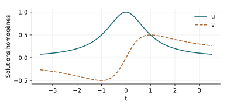
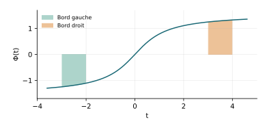

# Banque PT — Mathématiques C 2012 · Corrigé guidé

*Corrigé rédigé par IA, non officiel. Signalez toute erreur.*

**Rédaction** · GPT-6.2 Astra Ultra · vitesse non renseignée · 26 novembre 2026

La Banque PT a programmé cet écrit le mercredi 9 mai 2012, de 14 h à 18 h. La garde interdit la calculatrice. Les questions figurent aux pages 2 à 6 du PDF de 8 pages. En admissibilité, le coefficient de Mathématiques C est de 3 pour l’ENS Cachan et de 6 pour l’École polytechnique. [Sujet](https://www.banquept.fr/documents/2012/math_c_pt_2012.pdf) · [Rapport du jury](https://www.banquept.fr/documents/ecrit/rapport/2012/rapport_math_c_ecrit_2012.pdf) · [Livret de la Banque PT, p. 8, 9 et 12](https://www.banquept.fr/documents/livret/2012/Livret_PT_2012.pdf)

## P. Préambule · Variation des constantes

### Question P.1

> [!INDICATION]
> Résoudre l’équation en la dérivée seconde.

#### Solution

Comme $a(t)\ne0$, $y''=-(c/a)y-(b/a)y'+h/a$. Ainsi pour $Y=(y,y')^{\mathsf T}$ on a $Y'=AY+H$ avec
$$A=\begin{pmatrix}0&1\\-c/a&-b/a\end{pmatrix},\qquad H=\binom0{h/a}.$$
La première ligne restitue l’identité entre la seconde composante et la dérivée de la première.

### Question P.2

> [!INDICATION]
> Prescrire les deux conditions initiales au même point.

#### Solution

Les coefficients de $A$ sont continus sur $\mathbb R$. Le théorème de Cauchy pour les systèmes linéaires donne pour chaque paire $(y(t_0),y'(t_0))$ une unique solution homogène globale. L’application linéaire d’évaluation initiale est donc un isomorphisme vers $\mathbb R^2$. La dimension vaut deux.

### Question P.3

> [!INDICATION]
> Dériver le vecteur W et soustraire AW.

#### Solution

Posons $U=(u,u')^{\mathsf T}$, $V=(v,v')^{\mathsf T}$. Comme $U'=AU$ et $V'=AV$, pour $W=\lambda U+\mu V$ la règle du produit donne $W'-AW=\lambda'U+\mu'V$. Par définition de $(S)$, $W$ en est solution exactement lorsque cette dernière somme vaut $H$ en tout point.

### Question P.4

> [!INDICATION]
> Lire séparément les deux lignes.

#### Solution

Les lignes de l’identité précédente sont $\lambda'u+\mu'v=0$ et $\lambda'u'+\mu'v'=h/a$. Leur déterminant $uv'-u'v$ est partout non nul, car deux solutions homogènes de données proportionnelles en un point seraient dépendantes par unicité.

## I. Résolution d’une équation différentielle

### Question I.1.i

> [!INDICATION]
> Identifier la raison et examiner le terme général aux bornes.

#### Solution

La raison est $-t^2$. Pour $|t|<1$ la somme vaut $1/(1+t^2)$. Pour $|t|\ge1$ son terme général ne tend pas vers zéro. Le rayon est donc $1$.

### Question I.1.ii

> [!INDICATION]
> Extraire le facteur t.

#### Solution

Le produit par $t$ de la série précédente a le même rayon $1$ et vaut $t/(1+t^2)$ pour $|t|<1$. Pour $|t|\ge1$ les termes ne tendent toujours pas vers zéro.

### Question I.2

> [!INDICATION]
> Intégrer deux fois.

#### Solution

Si $y''=0$ sur $\mathbb R$, alors $y'$ est constante, donc $y(t)=A+Bt$ pour deux constantes réelles. Réciproquement toute fonction affine satisfait l’équation.

### Question I.3.a.i

> [!INDICATION]
> Calculer la dérivée seconde du produit indiqué.

#### Solution

Par la formule de Leibniz, $[(1+t^2)f]''=(1+t^2)f''+4tf'+2f=0$. I.2 montre que ce produit est affine sur $\mathbb R$.

### Question I.3.a.ii

> [!INDICATION]
> Vérifier que la réécriture caractérise les solutions.

#### Solution

En divisant par $1+t^2$, on obtient $f(t)=(A+Bt)/(1+t^2)$. Réciproquement le produit de cette expression par $1+t^2$ est affine, donc son second membre différentiel est nul. Les fonctions $u=1/(1+t^2)$ et $v=t/(1+t^2)$ engendrent ainsi l’espace et sont indépendantes puisque $A+Bt\equiv0$ impose $A=B=0$.

### Question I.3.b.i

> [!INDICATION]
> Regrouper les termes de degré n.

#### Solution

À l’intérieur du rayon de convergence, la dérivation terme à terme est licite. Le coefficient de $t^n$ est $(n+2)(n+1)a_{n+2}+[n(n-1)+4n+2]a_n$. Le crochet vaut $(n+1)(n+2)$, même pour $n=0,1$. L’unicité des coefficients donne $a_{n+2}=-a_n$.

### Question I.3.b.ii

> [!INDICATION]
> Itérer le changement de signe.

#### Solution

Par récurrence sur $p$ à partir des deux données libres, $a_{2p}=(-1)^p a_0$ et $a_{2p+1}=(-1)^p a_1$ pour tout $p\ge0$.

### Question I.3.b.iii

> [!INDICATION]
> Réunir les deux séries géométriques.

#### Solution

Pour $|t|<1$, la convergence absolue permet de sommer les termes pairs et impairs séparément. Par I.1, $y(t)=(a_0+a_1t)/(1+t^2)$. Cette expression prolonge la solution réelle à tout $\mathbb R$.

### Question I.4.a

> [!INDICATION]
> Employer le préambule avec le second membre normalisé.

#### Solution

La première condition est $\lambda'+t\mu'=0$, après multiplication par $1+t^2$. L’autre équation de P.4 est $-2t\lambda'+(1-t^2)\mu'=1$, car $u'=-2t/(1+t^2)^2$, $v'=(1-t^2)/(1+t^2)^2$ et $h/a=(1+t^2)^{-2}$.

### Question I.4.b

> [!INDICATION]
> Éliminer la dérivée de lambda.

#### Solution

En remplaçant $\lambda'$ par $-t\mu'$ dans la seconde ligne, on obtient $(1+t^2)\mu'=1$. Ainsi $\mu'=1/(1+t^2)$ et $\lambda'=-t/(1+t^2)$.

### Question I.4.c

> [!INDICATION]
> Reconnaître les dérivées du logarithme et de l’arctangente.

#### Solution

L’intégration sur $\mathbb R$ donne $\lambda(t)=A-\tfrac12\ln(1+t^2)$ et $\mu(t)=B+\arctan t$, où $A,B$ sont indépendantes.

### Question I.4.d

> [!INDICATION]
> Reporter les deux primitives dans la décomposition.

#### Solution

Pour $t\in\mathbb R$, la solution générale est
$$y(t)=\frac{A+Bt+t\arctan t-\frac12\ln(1+t^2)}{1+t^2}.$$
En effet la dérivée seconde du numérateur vaut $1/(1+t^2)$, et la différence de deux solutions appartient à l’espace homogène trouvé en I.3.a.

## II. Arctangente et séries numériques

### Question II.1

> [!INDICATION]
> Calculer une primitive avant d’évaluer en 1/n.

#### Solution

La primitive nulle en zéro de $(1-2t)/(1+t^2)$ est $\arctan t-\ln(1+t^2)$. D’où $\varphi(n)=\arctan(1/n)-\ln(1+n^{-2})$. La définition intégrale a un sens pour tout argument réel strictement positif. Ce prolongement donne son sens à la notation imprimée $\psi(n)=\varphi(1/n)$ et fournit $\psi(n)=\arctan n-\ln(1+n^2)$.

### Question II.2

> [!INDICATION]
> Indiquer le reste et le point vers lequel tend la variable.

#### Solution

Pour $g$ de classe $C^p$ près de $x_0$, lorsque $h\to0$ avec $x_0+h$ dans l’intervalle, $g(x_0+h)=\sum_{k=0}^p g^{(k)}(x_0)h^k/k!+o(h^p)$. À une extrémité de l’intervalle on prend la limite du côté autorisé.

### Question II.3

> [!INDICATION]
> Intégrer une somme géométrique finie avec son reste.

#### Solution

Au voisinage de zéro, $1/(1+x^2)=\sum_{k=0}^p(-1)^kx^{2k}+O(x^{2p+2})$, par la formule géométrique finie. L’intégration de zéro à $x$ donne $\arctan x=\sum_{k=0}^p(-1)^kx^{2k+1}/(2k+1)+O(x^{2p+3})$. Ces restes impliquent les développements aux ordres demandés.

### Question II.4

> [!INDICATION]
> Dériver sur le demi-axe positif.

#### Solution

Sur $x>0$ la dérivée de $\arctan x+\arctan(1/x)$ vaut $1/(1+x^2)-(1/x^2)/(1+x^{-2})=0$. L’intervalle est connexe et la valeur en $1$ est $\pi/2$, donc la somme vaut toujours $\pi/2$.

### Question II.5

> [!INDICATION]
> Simplifier l’angle entier avant de développer.

#### Solution

Les logarithmes vérifient $\ln(1+n^2)=2\ln n+\ln(1+n^{-2})$. L’angle est donc $\pi/2-2\ln(1+n^{-2})$ et son cosinus vaut $\sin(2\ln(1+n^{-2}))$. Avec $z=n^{-2}$, $\ln(1+z)=z+O(z^2)$ et $\sin u=u+O(u^3)$. Ainsi le cosinus vaut $2/n^2+O(n^{-4})$, ce qui donne $\alpha=2$ et l’existence de $\beta$.

### Question II.6

> [!INDICATION]
> Comparer le terme complet à une série de Riemann.

#### Solution

D’après II.5, le terme est équivalent à $2/n^2$ et devient positif. La comparaison à $\sum n^{-2}$ montre la convergence absolue.

### Question II.7

> [!INDICATION]
> Examiner la condition nécessaire sur le terme général.

#### Solution

En II.1, $\varphi(n)\to0$, donc $\cos(\varphi(n))\to1$. Les termes deviennent supérieurs à $1/2$ et la série diverge vers $+\infty$.

## III. Intégrales de différences de translatées

### Question III.1

> [!INDICATION]
> Appliquer le théorème fondamental sur tout segment.

#### Solution

La fonction $t\mapsto1/(1+t^2)$ est continue sur $\mathbb R$. Son intégrale orientée de $0$ à $x$ existe et définit une fonction de classe $C^1$, avec $\Phi' (x)=1/(1+x^2)$. La primitive nulle en zéro est $\Phi(x)=\arctan x$.

### Question III.2.a

> [!INDICATION]
> Utiliser l’image de la tangente sur sa branche principale.

#### Solution

La tangente croît de zéro vers l’infini sur $[0,\pi/2[$. Sa réciproque a donc pour limite $\ell=\pi/2$ à droite à l’infini.

### Question III.2.b

> [!INDICATION]
> Utiliser la parité de la dérivée.

#### Solution

La primitive nulle en zéro d’une fonction paire est impaire. Donc $\Phi(x)\to-\ell=-\pi/2$ lorsque $x\to-\infty$.

### Question III.3

> [!INDICATION]
> Translater la seconde intégrale de b moins a.

#### Solution

Posons $d=b-a>0$ et $F(t)=\Phi(t+a)$. On a $\Phi(t+b)=F(t+d)$. Si $G$ est une primitive de $F$, l’intégrale de $F(t)-F(t+d)$ sur $[X,Y]$ vaut $G(X+d)-G(X)-[G(Y+d)-G(Y)]$. Cela donne $\int_X^{X+d}F-\int_Y^{Y+d}F$, pour tous $X,Y$ grâce aux intégrales orientées.

### Question III.4

> [!INDICATION]
> Translater le seuil de la définition de la limite.

#### Solution

Pour $\varepsilon>0$, la limite en $+\infty$ fournit $M$ tel que $u\ge M$ implique $|\Phi(u)-\ell|\le\varepsilon$. Prendre $Y_0=M-a$ permet d’appliquer cette implication à $u=t+a$.

### Question III.5

> [!INDICATION]
> Intégrer la valeur absolue de l’écart sur une longueur fixe.

#### Solution

Pour $Y\ge Y_0$, tous les $t$ de $[Y,Y+d]$ vérifient III.4. Ainsi $|\int_Y^{Y+d}\Phi(t+a)\,dt-d\ell|\le\int_Y^{Y+d}|\Phi(t+a)-\ell|\,dt\le d\varepsilon$.

### Question III.6

> [!INDICATION]
> Translater le seuil relatif à moins l’infini.

#### Solution

Puisque $\Phi(u)\to-\ell$ lorsque $u\to-\infty$, il existe $M_-$ tel que $u\le M_-$ entraîne $|\Phi(u)+\ell|\le\varepsilon$. Il suffit de prendre $X_0=M_--a$.

### Question III.7

> [!INDICATION]
> Envoyer séparément chaque extrémité à l’infini.

#### Solution

Dans III.3, le terme au bord droit tend vers $d\ell$. Le terme au bord gauche tend vers $-d\ell$ car, pour $X+d\le X_0$, son écart à $-d\ell$ est au plus $d\varepsilon$. En fixant d’abord une extrémité puis l’autre, les deux intégrales impropres existent séparément. Leur somme est $-2d\ell=(a-b)\pi$.

### Question III.8.a

> [!INDICATION]
> Changer de variable dans le premier terme.

#### Solution

Pour $X\ge0$, $\int_0^X\Phi(t+1)\,dt=\int_1^{X+1}\Phi(u)\,du$. En retranchant $\int_0^X\Phi$, l’additivité des intégrales orientées donne $\int_X^{X+1}\Phi-\int_0^1\Phi$, y compris lorsque $X<1$.

### Question III.8.b

> [!INDICATION]
> Intégrer par parties en dérivant l’arctangente.

#### Solution

On trouve $\int_0^1\Phi(t)\,dt=[t\arctan t]_0^1-\int_0^1 t/(1+t^2)\,dt=\pi/4-(\ln2)/2$.

### Question III.8.c

> [!INDICATION]
> Choisir un seuil dans le domaine prescrit.

#### Solution

Par la définition de $\Phi(t)\to\ell$, pour $\varepsilon>0$ il existe un seuil $M$ au-delà duquel $|\Phi(t)-\ell|\le\varepsilon$. Prendre $X_1=\max(0,M)$ assure aussi $X_1\in\mathbb R^+$.

### Question III.8.d

> [!INDICATION]
> Estimer le bord de longueur un.

#### Solution

Pour $X\ge X_1$, $|\int_X^{X+1}\Phi(t)\,dt-\ell|\le\varepsilon$. En passant à la limite dans III.8.a et en appliquant III.8.b, on obtient $\int_0^\infty(\Phi(t+1)-\Phi(t))\,dt=\pi/4+(\ln2)/2$.

### Question III.9

> [!INDICATION]
> Écrire la différence comme une intégrale de la dérivée.

#### Solution

Pour $k\le t\le k+1$, tous les $u\in[t,t+1]$ sont entre $k$ et $k+2$. La fonction $1/(1+u^2)$ décroît pour $u\ge0$. Son intégrale sur $[t,t+1]$, égale à $\Phi(t+1)-\Phi(t)$, est donc entre $1/(1+(k+2)^2)$ et $1/(1+k^2)$. L’intégration en $t$ sur une longueur un conserve ces bornes.

### Question III.10

> [!INDICATION]
> Écrire l’identité pour une somme finie.

#### Solution

Pour les entiers $N\ge1$, l’additivité donne $\sum_{k=0}^{N-1}\int_k^{k+1}(\Phi(t+1)-\Phi(t))\,dt=\int_0^N(\Phi(t+1)-\Phi(t))\,dt$. Le membre droit converge par III.8.d. La limite des sommes partielles fournit l’identité demandée.

### Question III.11

> [!INDICATION]
> Sommer les bornes avant de passer à la limite.

#### Solution

Les deux séries positives de comparaison convergent car leurs termes sont équivalents à $1/k^2$. En sommant III.9 et en utilisant III.10, on obtient
$$\sum_{k=2}^\infty\frac1{1+k^2}\ \le\ \int_0^\infty(\Phi(t+1)-\Phi(t))\,dt\ \le\ \sum_{k=0}^\infty\frac1{1+k^2}.$$
L’écart entre les bornes vaut $1+1/2=3/2$.
