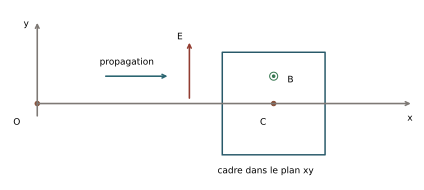
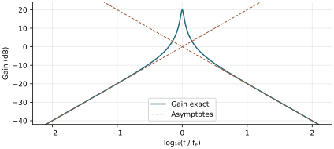
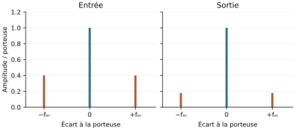
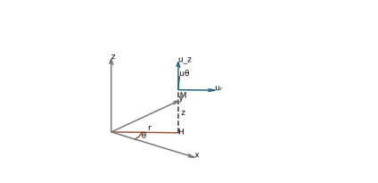
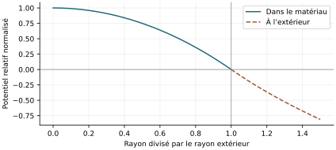

# Banque PT — Physique A 2012 · Corrigé brut

*Corrigé rédigé par IA, non officiel. Signalez toute erreur.*

**Rédaction** · GPT-6.2 Astra Ultra · vitesse non renseignée · 27 novembre 2026

L’écrit dure quatre heures. La calculatrice est interdite et les valeurs numériques demandées ont un chiffre significatif. L’archive officielle réunit le sujet et un document-réponse à rendre, dont les deux pages ont été confrontées aux solutions. Les coefficients d’admissibilité sont 6 à l’École polytechnique et 3 à l’ENS Cachan. [Sujet et document-réponse](https://www.banquept.fr/documents/2012/phys_a_pt_2012.zip) · [Rapport du jury](https://www.banquept.fr/documents/ecrit/rapport/2012/rapport_phys_a_ecrit_2012.pdf) · [Grille de la Banque PT](https://www.banquept.fr/documents/livret/2012/Livret_PT_2012.pdf#page=12).

## A. Détection d’une onde électromagnétique

### Question A.I.1.a

Le vecteur d’onde est perpendiculaire aux plans d’égale phase et orienté dans le sens de propagation. Ici $\vec k=k\vec u_x$ avec $k=2\pi/\lambda$ en radians par mètre.

### Question A.I.1.b

Dans ce modèle $\lambda=c/f$, donc $\omega=ck$ pour la branche se propageant vers les abscisses positives. La célérité est indépendante de la fréquence.

### Question A.I.1.c

Avec l’origine des phases imposée, $\vec E(x,t)=E_0\cos(ckt-kx)\vec u_y$. Faraday donne $\vec B=(\vec u_x\times\vec E)/c=(E_0/c)\cos(ckt-kx)\vec u_z$. Dans l’approximation d’onde plane, l’amplitude utilisée est celle de la zone de réception.

### Question A.I.2.a

Le flux du champ magnétique à travers les spires varie avec le temps. La loi de Faraday fournit la f.é.m. $u=-d\Phi/dt$ pour un sens de parcours positif lié à la normale. L’impédance d’entrée infinie évite une chute de tension due au courant dans le bobinage.

### Question A.I.2.b

La normale doit être parallèle ou antiparallèle à $\vec B$, donc le cadre se place dans un plan parallèle à $Oxy$. Sa direction longitudinale est parallèle à $Ox$, soit $\beta=0$ modulo $\pi$ avec l’angle de la figure 1. L’autre côté se trouve suivant $Oy$.

### Question A.I.2.c

La figure ci-dessous représente la source en O, le centre C à $x=R$, le plan $xy$ du cadre et les trois directions orthogonales au moment où le champ électrique est positif. Le symbole cerclé marque le champ magnétique sortant du plan.

### Question A.I.2.d

Avec une normale $+\vec u_z$ et $\omega=ck$, le flux enlacé vaut $\Phi=Na(E_0/c)\int_{R-a/2}^{R+a/2}\cos(\omega t-kx)\,dx=[2NaE_0/(ck)]\sin(ka/2)\cos(\omega t-kR)$. La dérivée changée de signe donne $u=A\sin(\chi t+\psi)$ avec $A=2NaE_0\sin(ka/2)$, $\chi=ck$ et $\psi=-kR$. Inverser les bornes du voltmètre change le signe de $u$.

### Question A.I.2.e

La moyenne de $u^2$ sur une période est $A^2/2$. Ainsi $U=|A|/\sqrt2=\sqrt2\,NaE_0|\sin(ka/2)|$. La tension efficace ne dépend pas du choix d’origine de la phase.

### Question A.I.3

Pour $\alpha=ka\ll1$, $\sin(\alpha/2)=\alpha/2+O(\alpha^3)$. Il vient $U=NaE_0\,\alpha/\sqrt2+O(NaE_0\alpha^3)$, soit au premier ordre $U\simeq Na^2kE_0/\sqrt2$.

### Question A.I.4.a

La phase initiale au centre vaut $\varphi=-kR$ modulo $2\pi$. D’un bord à l’autre la phase change de $ka\simeq3{,}4\times10^{-4}$ rad, très inférieur à l’unité. On peut donc attribuer cette même phase à tout le cadre à cet ordre.

### Question A.I.4.b

Dans le vide $B_0=E_0/c$. Numériquement $(3\times10^{-3})/(3\times10^8)=1\times10^{-11}$ T.

### Question A.I.4.c

On a $\Phi=Na^2B_0\cos(\omega t+\varphi)$. La f.é.m. est $Na^2B_0\omega\sin(\omega t+\varphi)$ et le voltmètre indique $U=Na^2B_0\omega/\sqrt2=Na^2kE_0/\sqrt2$, en accord avec le développement précédent.

### Question A.I.4.d

Avec $N=10^3$, $a=0{,}1$ m et $\omega\simeq1{,}03\times10^6\ {\rm rad\,s^{-1}}$, on trouve $U\simeq0{,}7\times10^3\times10^{-2}\times10^{-11}\times10^6\simeq7\times10^{-5}$ V, soit 70 microvolts.

### Question A.I.5.a

Au point C, $\vec\Pi=\vec E\times\vec B/\mu_0=[E_0^2/(\mu_0 c)]\cos^2(ckt-kR)\vec u_x$. La moyenne est $\langle\vec\Pi\rangle=E_0^2\vec u_x/(2\mu_0c)$, en watts par mètre carré.

### Question A.I.5.b

Sous les hypothèses d’isotropie et d’absence de pertes, le flux moyen à travers la sphère de rayon $R$ est la puissance émise. On obtient $P_e=4\pi R^2 E_0^2/(2\mu_0c)$. L’onde plane décrit localement une petite zone de cette sphère.

### Question A.II.1.a

En spectre unilatéral d’amplitude, les fréquences $f_p-f_M$, $f_p$ et $f_p+f_M$ portent respectivement $CU_m$, $U_m$ et $CU_m$, avec $f_M=\Omega/(2\pi)$. Les phases initiales sont nulles. La figure de la question A.II.3.c met ces trois raies en regard de celles de sortie.

### Question A.II.1.b

L’identité $\cos(u+v)+\cos(u-v)=2\cos u\cos v$ donne $u_e=U_m[1+2C\cos(\Omega t)]\cos(\omega_p t)$. L’enveloppe algébrique demandée est $A(t)=U_m[1+m\cos(\Omega t)]$ avec $m=2C$. Si $C>1/2$, cette amplitude algébrique change de signe.

### Question A.II.2.a

Écrivons $H=G_0/[1+jQ(x-1/x)]$. Pour $x\gg1$, $|H|\sim G_0/(Qx)$, donc $G_{\rm dB}\sim20\log_{10}(G_0/Q)-20\log_{10}x$. La pente vaut moins 20 dB par décade.

### Question A.II.2.b

Pour $x\ll1$, $|H|\sim G_0 x/Q$. Le gain asymptotique est donc $20\log_{10}(G_0/Q)+20\log_{10}x$. La pente vaut plus 20 dB par décade.

### Question A.II.2.c

À $x=1$, $H=G_0$ réel positif. Le maximum est $20\log_{10}G_0$, soit 20 dB pour $G_0=10$.

### Question A.II.2.d

Le gain exact vaut $20\log_{10}G_0-10\log_{10}[1+Q^2(x-1/x)^2]$. Pour $G_0=Q=10$, les deux asymptotes se rencontrent en $(0,0)$ sur les axes de la feuille. La courbe exacte est symétrique autour de $\log_{10}x=0$. À $x=0{,}01$, $0{,}1$, $0{,}5$, $1$, $2$, $10$, $100$, elle vaut environ $-40$, $-20$, $-3{,}5$, $20$, $-3{,}5$, $-20$, $-40$ dB. Les abscisses $x\simeq0{,}951$ et $1{,}051$ donnent 17 dB, ce qui fixe la largeur étroite du pic. Seul le gain est demandé.

### Question A.II.2.e

Écrivons $x=1+\epsilon$ avec $|\epsilon|\ll1$. Comme $1/x=1-\epsilon+O(\epsilon^2)$, on a $x-1/x=2\epsilon+O(\epsilon^2)$. Au premier ordre dans le dénominateur, $H\simeq G_0/[1+2jQ(x-1)]$.

### Question A.II.3.a

Posons $s=\Omega/\omega_p$, $b=2Qs$, $\Phi=\arctan b$, $A=G_0U_m$ et $D=CA/\sqrt{1+b^2}$. Le tableau est celui de la feuille-réponse, rempli avec l’approximation valable pour $s\ll1$.

| Grandeur | Porteuse | Bande inférieure | Bande supérieure |
|---|---|---|---|
| $x$ | $1$ | $1-s$ | $1+s$ |
| $H$ | $G_0$ | $G_0/(1-jb)$ | $G_0/(1+jb)$ |
| Amplitude | $A$ | $D$ | $D$ |
| Phase | $0$ | $+\Phi$ | $-\Phi$ |
| Sortie | $A\cos(\omega_pt)$ | $D\cos[(\omega_p-\Omega)t+\Phi]$ | $D\cos[(\omega_p+\Omega)t-\Phi]$ |

### Question A.II.3.b

Les deux termes latéraux s’additionnent en $2D\cos(\Omega t-\Phi)\cos(\omega_p t)$. La porteuse fournit donc $u_s=G_0U_m[1+m'\cos(\Omega t-\Phi)]\cos(\omega_p t)$, avec $m'=2C/\sqrt{1+(2Q\Omega/\omega_p)^2}$ et $\Phi=\arctan(2Q\Omega/\omega_p)$.

### Question A.II.3.c

Les trois fréquences sont conservées. Les amplitudes sont désormais $D,A,D$ dans l’ordre croissant. À porteuse ramenée à l’unité, chaque bande passe de $C$ à $C/\sqrt{1+b^2}$. Le filtre sélectionne la porteuse et atténue les bandes plus éloignées du centre. Il réduit la profondeur de modulation et retarde la modulation d’enveloppe de $\Phi/\Omega$.

## B. Distribution volumique de charges au repos

### Question B.I.1

Dans le vide chargé, $\nabla\cdot\vec E=\rho/\varepsilon_0$, $\nabla\times\vec E=0$, $\nabla\cdot\vec B=0$ et $\nabla\times\vec B=\mu_0\vec j=0$. La densité $\rho$ vaut $\rho_0$ dans la couche et zéro en dehors. Un champ magnétique extérieur éventuel est sans rôle dans la suite.

### Question B.I.2.a

Le flux du champ électrique à travers toute surface fermée orientée vers l’extérieur égale la charge totale enfermée divisée par $\varepsilon_0$. Pour la surface frontière de $V$, cela s’écrit $\oint_{\partial V}\vec E\cdot d\vec S=Q_{\rm int}/\varepsilon_0$.

### Question B.I.2.b

L’intégrale de $\nabla\cdot\vec E=\rho/\varepsilon_0$ dans le volume donne à droite $\int_V\rho\,dV/\varepsilon_0$. À gauche, le théorème de la divergence d’Ostrogradski transforme l’intégrale en flux sur la frontière orientée. On retrouve l’énoncé intégral.

### Question B.II.1

La projection H de M sur $Oxy$ donne $r=OH$ et l’angle orienté $\theta=(Ox,OH)$. La coordonnée $z$ est la hauteur signée de M. Au point M, $\vec u_r$ est radial sortant, $\vec u_\theta$ tangent dans le sens croissant et $\vec u_z=\vec u_r\times\vec u_\theta$.

### Question B.II.2

On suppose la hauteur très grande devant les dimensions transverses pertinentes et le point suffisamment éloigné des faces, de sorte que la distribution soit assimilable à un cylindre infini. L’invariance par rotation et translation axiale impose une dépendance en $r$ seul. Les plans de symétrie imposent $\vec E=E_r(r)\vec u_r$.

### Question B.II.3

Une surface de Gauss coaxiale de longueur $\ell$ porte un flux $2\pi r\ell E_r$, car les bases ont un flux nul. Pour $R_1\le r\le R_2$, la charge contenue est $\rho_0\pi(r^2-R_1^2)\ell$, donc $E_r=\rho_0(r-R_1^2/r)/(2\varepsilon_0)$. Dans le trou le champ est nul. À l’extérieur $E_r=\rho_0(R_2^2-R_1^2)/(2\varepsilon_0r)$.

### Question B.III.1

De $E_r=-dV/dr$ et $V(R_2)=V_a$, on tire dans la couche
$$
V(r)=V_a+\frac{\rho_0}{4\varepsilon_0}\left[R_2^2-r^2+2R_1^2\ln(r/R_2)\right].
$$
La dérivation redonne le champ précédent. Le potentiel est constant dans le trou et continu à chaque interface.

### Question B.III.2.a

Pour $R_1=0$, le terme logarithmique disparaît. À l’intérieur $V(r)=V_a+\rho_0(R_2^2-r^2)/(4\varepsilon_0)$. Au-delà du bord, l’intégration du champ extérieur donne $V(r)=V_a-\rho_0R_2^2\ln(r/R_2)/(2\varepsilon_0)$.

### Question B.III.2.b

Sur l’axe $V(0)=V_a+\rho_0R_2^2/(4\varepsilon_0)$. Pour $\rho_0>0$, le maximum du profil est au centre.

### Question B.III.2.c

Dans le matériau le profil est une parabole concave, décroissante à partir de sa tangente horizontale en zéro jusqu’à $V_a$ au bord. La figure montre également le prolongement logarithmique extérieur avec pente continue.

### Question B.IV

Avec $\vec E=-\nabla V$, la loi locale donne $-\nabla\cdot\nabla V=\rho_0/\varepsilon_0$. Ainsi $\Delta V=-\rho_0/\varepsilon_0$ dans la couche. Le second membre s’annule dans les régions vides.

## C. Couplage électrothermique

### Question C.I.1

La puissance électrique reçue par unité de volume vaut $P_{\rm vi}=\vec j\cdot\vec E=j^2/\gamma$ par la loi d’Ohm locale $\vec j=\gamma\vec E$. Elle est positive et se mesure en $\mathrm{W\,m^{-3}}$.

### Question C.I.2.a

Pour un conducteur isotrope, $\vec j_{\rm th}=-\lambda\nabla T$. Le signe indique un flux des zones chaudes vers les zones froides, en watts par mètre carré.

### Question C.I.2.b

En régime stationnaire l’énergie interne de la tranche de section $S$ ne varie pas. Le premier principe donne $0=Sj_x(x)-Sj_x(x+dx)+P_{\rm vi}S\,dx$ pour les apports conduits aux faces et la puissance électrique de Joule. En divisant par $S\,dx$, on trouve $dj_x/dx=P_{\rm vi}$.

### Question C.I.2.c

La divergence est le scalaire $\nabla\cdot\vec j_{\rm th}=\partial_x j_x+\partial_y j_y+\partial_z j_z$.

### Question C.I.2.d

Dans le problème plan, $j_y=j_z=0$ et $j_x$ dépend seulement de $x$. La divergence se réduit à $dj_x/dx$, donc $\nabla\cdot\vec j_{\rm th}=P_{\rm vi}$. Sur un volume quelconque, le flux sortant égale de même la puissance produite dans le volume, ce qui redonne la même loi par le théorème de la divergence.

### Question C.II.1

Lorsque $\lambda$ est uniforme, les correspondances se lisent ligne à ligne.

| Domaine | Loi de gradient | Divergence du flux | Source | Grandeur dérivée |
|---|---|---|---|---|
| Électrostatique | $\vec E=-\nabla V$ | $\nabla\cdot\vec E=\rho/\varepsilon_0$ | $\rho/\varepsilon_0$ | $V$ |
| Thermique | $\vec j_{\rm th}=-\nabla(\lambda T)$ | $\nabla\cdot\vec j_{\rm th}=P_{\rm vi}$ | $P_{\rm vi}$ | $\lambda T$ |

### Question C.II.2

On a $-\lambda\Delta T=P_{\rm vi}$, soit $\Delta T=-P_{\rm vi}/\lambda$. Le facteur de conductivité ne peut sortir de la divergence que s’il est uniforme.

### Question C.III.1.a

L’âme a pour section $S=\pi b^2/4$. Pour $b=5$ mm cela donne $1{,}96\times10^{-5}\ {\rm m^2}$, soit $2\times10^{-5}\ {\rm m^2}$ à un chiffre.

### Question C.III.1.b

On obtient $P_e=P_{\rm vi}SL=P_{\rm vi}\pi b^2L/4$, soit environ $78{,}5$ W avant arrondi, en accord avec les $78{,}4$ W annoncés et de l’ordre de $8\times10^1$ W.

### Question C.III.1.c

La relation $P_{\rm vi}=(I/S)^2/\gamma$ donne $I=S\sqrt{\gamma P_{\rm vi}}$. Avec les données, $I\simeq39$ A, soit environ $4\times10^1$ A.

### Question C.III.2.a

Le rayon du cuivre est $b/2$. Par l’analogie avec le cylindre plein, $T(r)=T_a+[P_{\rm vi}/(4\lambda)](b^2/4-r^2)$ pour $0\le r\le b/2$. La condition au bord et le signe du flux sortant sont vérifiés.

### Question C.III.2.b

Le maximum est $T_0=T_a+P_{\rm vi}b^2/(16\lambda)$. L’écart est positif puisque la chaleur est produite à l’intérieur.

### Question C.III.2.c

Les valeurs donnent $T_0-T_a\simeq3\times10^{-4}$ K, infime devant $T_a=291{,}3$ K. On peut traiter chaque section de cuivre comme isotherme. La température de la gaine et celle de l’ensemble bobiné relèvent d’autres résistances thermiques.

## D. Modélisation thermique d’un câble bobiné

### Question D.I.1.a

Le pas axial est $\delta$. Une couche complète contient $N=d/\delta$, soit 12 spires pour 12 cm de hauteur et 1 cm de pas. On traite ici le modèle jointif du sujet.

### Question D.I.1.b

Le rayon moyen sur lequel court le centre de la première spire est $R_0=R_1+\delta/2$.

### Question D.I.1.c

Pour une couche complète, le tableau demandé est le suivant.

| Couche | Rayon moyen | Longueur bobinée |
|---|---|---|
| $1$ | $R_0$ | $L_1=2\pi NR_0$ |
| $2$ | $R_0+\delta$ | $L_2=2\pi N(R_0+\delta)$ |
| $k$ | $R_0+(k-1)\delta$ | $L_k=2\pi N[R_0+(k-1)\delta]$ |

### Question D.I.1.d

Pour $k$ couches, $L=2\pi N[kR_0+\delta k(k-1)/2]=2\pi N[kR_1+\delta k^2/2]$. Après division par $2\pi N R_1$, on obtient $Ak^2+k-B=0$ avec $A=\delta/(2R_1)$ et $B=L\delta/(2\pi dR_1)$.

### Question D.I.1.e

Avec $A\simeq1/12$, $B\simeq11$, la racine est $k=-6+\sqrt{168}\simeq6{,}96$. Le câble occupe donc sept couches, la dernière étant presque pleine.

### Question D.I.1.f

Les sept épaisseurs donnent $R_2\simeq R_1+7\delta=13$ cm. Ce rayon inclut le dernier demi-diamètre extérieur.

### Question D.I.2.a

La maille de côté $\delta$ contient quatre quarts de spire à ses sommets, soit une spire par maille. Choisir une maille centrée sur un fil donne le même compte.

### Question D.I.2.b

Dans le plan méridien la densité est $n=1/\delta^2$, en nombre de sections de spire par mètre carré.

### Question D.I.2.c

L’élément d’aire méridienne vaut $d\,dr$ (ici $d$ est la hauteur). Il contient $dN_s=d\,dr/\delta^2$ tours de rayon $r$. Leur longueur totale est $dL=2\pi r\,d\,dr/\delta^2$.

### Question D.I.2.d

L’intégration donne $L=\pi d(R_2^2-R_1^2)/\delta^2$. Ainsi $R_2=\sqrt{R_1^2+K}$ avec $K=L\delta^2/(\pi d)$. On retrouve aussi cette égalité à partir de la somme discrète en posant $R_2=R_1+k\delta$.

### Question D.I.2.e

Avec $R_2=12{,}98$ cm, $(R_2-R_1)/\delta=6{,}98$, soit sept couches. La légère différence à un entier correspond à la couche externe incomplète.

### Question D.II.1.a

Le volume de l’anneau cylindrique est $V_c=\pi d(R_2^2-R_1^2)$. Avec les rayons arrondis, il vaut environ $5\times10^{-3}\ {\rm m^3}$.

### Question D.II.1.b

La puissance est $P_e=P'_{\rm vi}V_c$. Les données donnent $(15{,}6\times10^3)(5{,}01\times10^{-3})\simeq78$ W, environ 80 W. On retrouve la puissance du câble déroulé parcouru par la même intensité. La modification de la géométrie change son refroidissement.

### Question D.II.2

L’énergie interne est constante. La puissance électrique reçue compense la puissance convective sortante $2\pi R_2dh(T_a-T_e)$. Ainsi $T_a=T_e+P_e/(2\pi R_2dh)$. Avec les valeurs non arrondies, l’élévation de surface atteint environ 40 K.

### Question D.II.3

L’équation radiale est $(rT')'=-P'_{\rm vi}r/K_e$. Comme $T'(R_1)=0$, on obtient $T'=-(P'_{\rm vi}/2K_e)(r-R_1^2/r)$. En intégrant entre les deux parois,
$$
T(R_1)-T(R_2)=\frac{P'_{\rm vi}}{4K_e}\left[R_2^2-R_1^2+2R_1^2\ln(R_1/R_2)\right].
$$
Les constantes cherchées sont $A=P'_{\rm vi}/(4K_e)$, $B=2R_1^2$. L’écart vaut environ 20 K et le point le plus chaud est du côté du moyeu isolé.

### Question D.III.1.a

Le tableau de la figure 5 est le suivant.

| Fil | 0 | 1 | 2 | 3 | 4 |
|---|---|---|---|---|---|
| $x$ | $x_0$ | $x_0+\delta$ | $x_0$ | $x_0-\delta$ | $x_0$ |
| $y$ | $y_0$ | $y_0$ | $y_0+\delta$ | $y_0$ | $y_0-\delta$ |

### Question D.III.1.b.α

Toutes les dérivées sont prises en $(x_0,y_0)$. À droite, $T_1-T_0=\delta T_x+\delta^2T_{xx}/2+O(\delta^3)$. Les constantes sont $A=\delta$ et $B=\delta^2/2$.

### Question D.III.1.b.β

À gauche $T_3-T_0=-\delta T_x+\delta^2T_{xx}/2+O(\delta^3)$. En additionnant, $T_1+T_3-2T_0=\delta^2T_{xx}+O(\delta^4)$ si la température est quatre fois dérivable. Au second ordre, seule la courbure subsiste.

### Question D.III.1.c

En haut $T_2-T_0=\delta T_y+\delta^2T_{yy}/2+O(\delta^3)$, en bas $T_4-T_0=-\delta T_y+\delta^2T_{yy}/2+O(\delta^3)$. Ainsi $T_2+T_4-2T_0=\delta^2T_{yy}+O(\delta^4)$ sous la même hypothèse.

### Question D.III.2.a

Pour le fil central de longueur $\ell$, le bilan stationnaire est $0=(I/S)^2S\ell/\gamma+\alpha\ell\sum_{i=1}^4(T_i-T_0)$. En substituant les deux sommes précédentes et en divisant par $S\ell$, on obtient $(I/S)^2/\gamma=-C(T_{xx}+T_{yy})$ avec $C=\alpha\delta^2/S$.

### Question D.III.2.b

La somme des deux dérivées secondes est le laplacien plan de la température. L’invariance suivant $z$ la rend également égale à $\Delta T$ du modèle tridimensionnel.

### Question D.III.2.c

La constante $C$ a les unités d’une conductivité thermique. Dans l’équation imprimée, la source $P_{\rm vi}=(I/S)^2/\gamma$ est comptée par volume de cuivre. Dans le milieu équivalent de la partie D.II, $P'_{\rm vi}$ est comptée par volume total de maille. La fraction de cuivre est $\eta=S/\delta^2\simeq0{,}196$, d’où $P'_{\rm vi}=\eta P_{\rm vi}$. En multipliant l’équation précédente par $\eta$, on identifie $K_e=\eta C=\alpha=1{,}5\ {\rm W\,m^{-1}K^{-1}}$. Pour la normalisation effectivement écrite en D.III.2.a, $C=K_e/\eta\simeq8\ {\rm W\,m^{-1}K^{-1}}$. Une identification directe à 1,5 suppose que le membre de gauche ait déjà été moyenné sur toute la maille.
