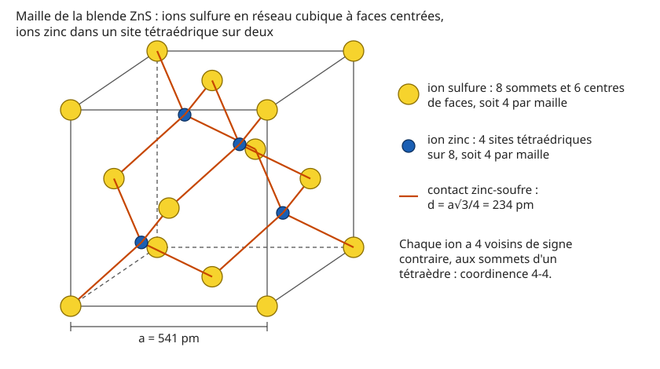
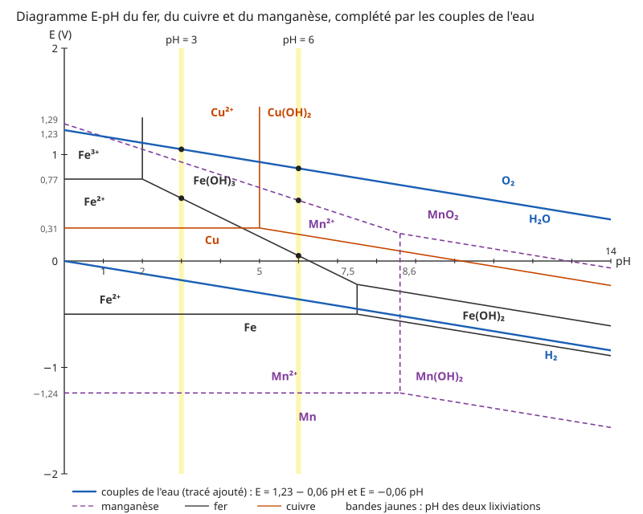
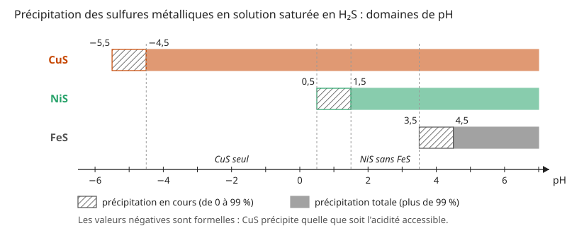

# Banque PT PT — Physique C - Chimie 2012 · Corrigé guidé

*Corrigé rédigé par IA, non officiel. Signalez toute erreur.*

**Rédaction** · modèle exact non renseigné (famille Claude) · effort non renseigné · vitesse non renseignée

## Présentation du sujet

**Thème.** La chimie de quelques composés du soufre, de la blende au sulfure d'hydrogène. L'épreuve dure 2 heures, **calculatrice autorisée**, et comporte 36 questions repérées de I.1.1 à III.3.3, réparties en trois parties indépendantes. Un document-réponse est à rendre avec la copie : le diagramme potentiel-pH simplifié du fer, du cuivre et du manganèse, à compléter par les frontières des couples de l'eau. Les données sont distribuées au fil de l'énoncé, à la suite des questions qui les utilisent.

- *Partie I (13 questions)* : cristallographie de la blende (I.1.1 à I.1.5 : maille, coordinence, masse volumique, condition sur les rayons ioniques, taille des sites), grillage du sulfure de zinc (I.2.1.1 à I.2.1.3), lixiviations acide puis presque neutre lues sur le diagramme potentiel-pH (I.2.2.1 à I.2.2.4), cémentation (I.2.3).
- *Partie II (14 questions)* : piégeage du sulfure d'hydrogène par l'éthanolamine et déplacements d'équilibre (II.1.1 à II.1.4), procédé de rétro-dismutation et approximation d'Ellingham (II.1.5 à II.1.8), combustion du soufre (II.2.1 et II.2.2), oxydation du dioxyde de soufre : lois de Hess et de Kirchhoff, avancement, température finale adiabatique (II.3.1 à II.3.4).
- *Partie III (9 questions)* : structure et propriétés de l'eau et du sulfure d'hydrogène (III.1.1 à III.1.3), solubilité et acidité de $\mathrm{H_2S}$ (III.2.1 à III.2.3), précipitation sélective des sulfures métalliques et solutions tampons (III.3.1 à III.3.3).

**Notions mobilisées.** Cristaux ioniques (contenu d'une maille, coordinence, contacts, masse volumique), thermochimie (lois de Hess et de Kirchhoff, loi de Van't Hoff, approximation d'Ellingham, température de flamme), déplacements d'équilibre par le quotient de réaction, diagrammes potentiel-pH, oxydoréduction, modèle de Lewis et méthode VSEPR, interactions intermoléculaires, équilibres acido-basiques et de précipitation. Le programme est celui en vigueur à la session 2012, antérieur à la réforme de 2013-2014 ; il couvre les deux années de préparation.

**Difficulté.** Aucune question n'est longue, mais le sujet balaie tout le programme et demande des justifications à chaque pas (« justifier », « conclusion ? », « montrer que »). Les points délicats sont la conclusion de la question I.1.5, la seconde lixiviation (I.2.2.4), la température finale adiabatique (II.3.4) et la précipitation des sulfures (III.3.2).

**Gestion du temps.** Environ 45 minutes pour la partie I, 45 minutes pour la partie II et 25 minutes pour la partie III, en gardant 5 minutes pour relire et pour vérifier que le document-réponse est complété. Les parties étant indépendantes, on peut commencer par celle que l'on maîtrise le mieux ; la partie III, très peu traitée par les candidats, contient des questions de cours rapides (III.1.1, III.2.1, III.2.2).

> [!JURY]
> Le rapport 2012 décrit un sujet généraliste, où le programme de chimie des deux années est représenté, ce qui laissait le choix de l'ordre d'attaque ; la plupart des candidats ont pourtant suivi l'ordre de l'énoncé, et la troisième partie a été très peu traitée. Il salue quelques excellentes copies et une présentation générale en net progrès. Ses conseils, renouvelés d'année en année : connaître le cours des deux années et non la seule fin de seconde année, avoir pratiqué les exercices classiques, ne pas s'arrêter à une formule littérale mais mener le calcul jusqu'à l'application numérique, lire l'énoncé en détail et présenter correctement la copie.

[Sujet officiel (archive)](https://www.banquept.fr/documents/2012/phys_c_pt_2012.zip) · [Rapport du jury](https://www.banquept.fr/documents/ecrit/rapport/2012/rapport_phys_c_ecrit_2012.pdf)

Le sujet officiel est une archive qui réunit les deux parties de Physique C ; la partie chimie y occupe le dossier `ph_c_pt_2012_chimie` (énoncé et annexe).

*Mode d'emploi* : chercher chaque question seul, lire la première indication en cas de blocage, réessayer, puis la seconde, et seulement ensuite la solution.

## Partie I — Premier exemple de chaîne de transformation : le minerai de zinc

### Question I.1.1

> [!INDICATION]
> Placer d'abord les anions : sommets et centres des faces. Où sont les sites tétraédriques d'un réseau cubique à faces centrées, et combien y en a-t-il ?

> [!INDICATION]
> Les 8 sites sont les centres des huit petits cubes d'arête $a/2$ ; n'en remplir que 4, en alternance (deux en bas sur une diagonale, deux en haut sur l'autre). Compter ensuite : un sommet compte pour $1/8$, un centre de face pour $1/2$.

#### Solution

Les ions sulfure $\mathrm{S^{2-}}$ occupent les nœuds d'un réseau cubique à faces centrées : les 8 sommets et les centres des 6 faces du cube d'arête $a$. Les 8 sites tétraédriques de cette maille sont les centres des 8 petits cubes d'arête $a/2$ ; les ions zinc $\mathrm{Zn^{2+}}$ en occupent un sur deux, en alternance, aux positions $(\tfrac14,\tfrac14,\tfrac14)$, $(\tfrac34,\tfrac34,\tfrac14)$, $(\tfrac34,\tfrac14,\tfrac34)$ et $(\tfrac14,\tfrac34,\tfrac34)$.

Un ion placé à un sommet appartient à 8 mailles, un ion au centre d'une face à 2 mailles, un ion intérieur à une seule :

$$N(\mathrm{S^{2-}}) = 8 \times \frac18 + 6 \times \frac12 = 4$$

$$N(\mathrm{Zn^{2+}}) = 4 \times 1 = 4$$

$$\boxed{\text{4 ions }\mathrm{S^{2-}}\text{ et 4 ions }\mathrm{Zn^{2+}}\text{ par maille, soit 4 motifs ZnS}}$$

La maille est bien électriquement neutre et respecte la stœchiométrie $\mathrm{ZnS}$.

> [!JURY]
> D'après le rapport, la maille de la blende est assez bien connue et plutôt correctement représentée, mais la question n'a pas été réussie par la très grande majorité comme on pouvait l'espérer : certains candidats ne représentent que les ions sulfure et laissent le correcteur imaginer la position des ions zinc.

> [!METHODE]
> Vérifier le dessin par le décompte : la stœchiométrie $\mathrm{ZnS}$ impose autant de cations que d'anions, donc 4 sites occupés sur 8, ce que dit l'énoncé (« la moitié »).

### Question I.1.2

> [!INDICATION]
> La coordinence d'un ion est le nombre de ses plus proches voisins de signe contraire. Isoler le petit cube d'arête $a/2$ qui entoure un cation.

> [!INDICATION]
> Le cation est au centre du petit cube ; ses voisins en occupent quatre sommets. La distance centre-sommet d'un cube d'arête $a/2$ vaut $\dfrac{a}{2}\cdot\dfrac{\sqrt3}{2}$.

#### Solution

Un ion $\mathrm{Zn^{2+}}$ occupe le centre d'un petit cube d'arête $a/2$ dont quatre sommets, non adjacents, portent un ion $\mathrm{S^{2-}}$ (un sommet de la maille et trois centres de faces) : il a **4** ions sulfure plus proches voisins, aux sommets d'un tétraèdre régulier.

Comme la maille contient autant de cations que d'anions, chaque ion $\mathrm{S^{2-}}$ est lui aussi entouré de **4** ions $\mathrm{Zn^{2+}}$ en tétraèdre (les sites occupés étant pris en alternance, un anion touche 4 des 8 sites qui l'entourent).

$$\boxed{\text{coordinence } 4\text{-}4 \text{ (tétraédrique pour les deux ions)}}$$

La distance correspondante est la demi-diagonale du petit cube d'arête $a/2$, soit le quart de la grande diagonale de la maille :

$$d = \frac{a\sqrt3}{4}$$

$$\boxed{d = \frac{541 \times \sqrt3}{4} \approx 234\ \mathrm{pm}}$$

> [!JURY]
> Le rapport indique que la coordinence est souvent mal comprise.

> [!PIEGE]
> Ne pas compter les voisins de même signe : les 12 anions qui entourent un anion dans le réseau cubique à faces centrées ne sont pas la coordinence demandée ici.

### Question I.1.3

> [!INDICATION]
> Masse volumique = masse du contenu de la maille divisée par le volume de la maille.

> [!INDICATION]
> $\rho = Z\,M/(N_A\,a^3)$ avec $Z = 4$ motifs. Convertir $a$ en mètres et $M$ en kilogrammes par mole avant le calcul.

#### Solution

La maille, de volume $a^3$, contient 4 motifs $\mathrm{ZnS}$ de masse molaire $M = M(\mathrm{Zn}) + M(\mathrm{S}) = 65{,}4 + 32{,}1 = 97{,}5\ \mathrm{g\cdot mol^{-1}}$ :

$$\rho = \frac{4\,\big(M(\mathrm{Zn}) + M(\mathrm{S})\big)}{N_A\,a^3}$$

Avec $a = 541\cdot10^{-12}\ \mathrm{m}$, $a^3 = 1{,}583\cdot10^{-28}\ \mathrm{m^3}$ et $M = 97{,}5\cdot10^{-3}\ \mathrm{kg\cdot mol^{-1}}$ :

$$\rho = \frac{4 \times 97{,}5\cdot10^{-3}}{6{,}02\cdot10^{23} \times 1{,}583\cdot10^{-28}}$$

$$\boxed{\rho \approx 4{,}09\cdot10^{3}\ \mathrm{kg\cdot m^{-3}}}$$

Ordre de grandeur plausible : environ quatre fois la masse volumique de l'eau, valeur conforme à celle de la blende naturelle (environ $4{,}1\ \mathrm{g\cdot cm^{-3}}$).

> [!JURY]
> Le rapport note que ce calcul (qu'il désigne comme celui de la « masse molaire ») est correctement réalisé.

> [!PIEGE]
> Unités : l'énoncé demande des $\mathrm{kg\cdot m^{-3}}$. Avec $M$ en grammes par mole et $a$ en mètres, on obtient des $\mathrm{g\cdot m^{-3}}$, soit un résultat mille fois trop grand.

### Question I.1.4

> [!INDICATION]
> Écrire deux conditions : le cation touche ses voisins anions (le long de quelle direction ?) et deux anions voisins ne se recouvrent pas (le long de quelle direction ?).

> [!INDICATION]
> Contact anion-cation : $R^+ + R^- = a\sqrt3/4$. Anions voisins sur la diagonale d'une face : $4R^- \leqslant a\sqrt2$. Éliminer $a$.

#### Solution

On modélise les ions par des sphères dures, de rayons $R^+$ (cation) et $R^-$ (anion).

*Contact entre ions de signes contraires.* La cohésion du cristal ionique impose le contact anion-cation le long de la grande diagonale du cube :

$$R^+ + R^- = \frac{a\sqrt3}{4}$$

*Non-recouvrement des ions de même signe.* Les anions les plus proches sont un sommet et le centre d'une face, distants de $a\sqrt2/2$ ; ils ne doivent pas s'interpénétrer (au mieux, ils sont tangents) :

$$2R^- \leqslant \frac{a\sqrt2}{2}$$

En éliminant $a = \dfrac{4\,(R^+ + R^-)}{\sqrt3}$ entre les deux relations :

$$2R^- \leqslant \frac{2\sqrt2}{\sqrt3}\,(R^+ + R^-)$$

$$\frac{\sqrt3}{\sqrt2}\,R^- \leqslant R^+ + R^-$$

$$\boxed{\frac{R^+}{R^-} \geqslant \frac{\sqrt3}{\sqrt2} - 1 \approx 0{,}225}$$

L'égalité correspond au cas limite où les anions sont tangents entre eux ; l'inégalité stricte signifie que le cation écarte les anions.

*Application.* Avec les rayons de l'énoncé :

$$\frac{R(\mathrm{Zn^{2+}})}{R(\mathrm{S^{2-}})} = \frac{74{,}0}{184} \approx 0{,}402 > 0{,}225$$

**Conclusion.** La condition est vérifiée : dans ce modèle, les cations écartent les anions, qui ne sont pas tangents entre eux, et la structure est stable. On vérifie d'ailleurs sur la maille réelle que $a\sqrt2/2 \approx 383\ \mathrm{pm}$ dépasse $2R^- = 368\ \mathrm{pm}$. Le rapport reste de plus inférieur à $\sqrt2 - 1 \approx 0{,}414$, seuil à partir duquel le cation pourrait occuper un site octaédrique : la coordinence tétraédrique de la blende est celle que prévoit le modèle.

> [!JURY]
> Selon le rapport, la condition géométrique d'existence du réseau a souvent été mal comprise, et la plupart des candidats se contentent de vérifier le résultat avec les données numériques fournies.

> [!PIEGE]
> « Montrer » appelle la démonstration de l'inégalité à partir des contacts ; la vérification numérique $0{,}402 > 0{,}225$ n'est que la dernière étape.

### Question I.1.5

> [!INDICATION]
> Quelle est la plus grosse sphère qui tient au centre du tétraèdre d'anions, pour la maille réelle de paramètre $a$ ?

> [!INDICATION]
> $r_T = a\sqrt3/4 - R^-$. Comparer ensuite à $R(\mathrm{Zn^{2+}})$ : que dit l'écart sur la validité du modèle ionique ?

#### Solution

Le site tétraédrique est la cavité laissée libre au centre du tétraèdre d'anions. Son rayon $r_T$ est le rayon de la plus grosse sphère qu'on peut y loger sans déplacer les anions : la distance du centre du site au centre d'un anion vaut $a\sqrt3/4$, donc

$$r_T = \frac{a\sqrt3}{4} - R(\mathrm{S^{2-}})$$

$$\boxed{r_T = 234 - 184 \approx 50\ \mathrm{pm}}$$

**Conclusion.** Le rayon ionique du zinc, $R(\mathrm{Zn^{2+}}) = 74{,}0\ \mathrm{pm}$, est nettement supérieur à la taille du site : le cation « ne tient pas » dans la cavité. Dit autrement, la somme des rayons ioniques, $R^+ + R^- = 258\ \mathrm{pm}$, dépasse la distance réelle entre voisins, $d \approx 234\ \mathrm{pm}$ (avec des sphères dures tangentes, le paramètre vaudrait $4 \times 258/\sqrt3 \approx 596\ \mathrm{pm}$ au lieu de 541 pm).

Le modèle des sphères dures ioniques n'est donc pas compatible avec la maille mesurée : les nuages électroniques des deux ions s'interpénètrent, ce qui traduit une mise en commun d'électrons. **La liaison $\mathrm{Zn{-}S}$ n'est pas purement ionique, elle a un caractère covalent marqué** (cristal iono-covalent), en accord avec la coordinence tétraédrique, analogue à celle du carbone dans le diamant.

> [!JURY]
> Le rapport relève que l'incompatibilité entre la taille des sites tétraédriques et celle des cations a rarement été constatée, et que la conséquence de cette observation n'a presque jamais été entrevue.

> [!METHODE]
> Une « conclusion » se formule en deux temps : le constat chiffré ($74 > 50$, ou $258 > 234$), puis ce qu'il dit du modèle (sphères dures ioniques en défaut, donc liaison partiellement covalente).

### Question I.2.1.1

> [!INDICATION]
> Réactifs : $\mathrm{ZnS}$ et $\mathrm{O_2}$ ; produits : $\mathrm{ZnO}$ et $\mathrm{SO_2}$. Fixer le coefficient 1 devant $\mathrm{ZnS}$ et équilibrer l'oxygène en dernier.

#### Solution

Le sulfure de zinc solide réagit avec le dioxygène pour donner l'oxyde de zinc solide et le dioxyde de soufre gazeux. Pour une mole de $\mathrm{ZnS}$ :

$$\boxed{\mathrm{ZnS_{(s)}} + \frac32\,\mathrm{O_{2(g)}} = \mathrm{ZnO_{(s)}} + \mathrm{SO_{2(g)}}}$$

Vérification : 1 Zn, 1 S et 3 O de chaque côté.

> [!PIEGE]
> L'énoncé impose l'écriture pour une mole de $\mathrm{ZnS}$ : le coefficient $3/2$ devant $\mathrm{O_2}$ doit être conservé, car l'enthalpie de réaction de la question suivante en dépend. Préciser l'état physique de chaque espèce.

### Question I.2.1.2

> [!INDICATION]
> Loi de Hess : somme des enthalpies de formation des produits moins celle des réactifs, pondérées par les coefficients stœchiométriques.

> [!INDICATION]
> Le dioxygène est un corps simple dans son état standard de référence : son enthalpie de formation est nulle. Attention au signe devant $-206$.

#### Solution

D'après la loi de Hess, avec les enthalpies standard de formation à 298 K :

$$\Delta_r H^\circ = \Delta_f H^\circ(\mathrm{ZnO_{(s)}}) + \Delta_f H^\circ(\mathrm{SO_{2(g)}}) - \Delta_f H^\circ(\mathrm{ZnS_{(s)}}) - \frac32\,\Delta_f H^\circ(\mathrm{O_{2(g)}})$$

$$\Delta_r H^\circ = -348 - 297 - (-206) - 0$$

$$\boxed{\Delta_r H^\circ(298\ \mathrm{K}) = -439\ \mathrm{kJ\cdot mol^{-1}}}$$

$\Delta_r H^\circ < 0$ : la réaction est **exothermique** (fortement), ce qui permet au grillage de s'entretenir sans apport de chaleur une fois amorcé.

> [!JURY]
> Le rapport constate que le caractère exothermique d'une réaction n'est pas une évidence pour tous : l'erreur de signe commise ici entraînait une erreur sur le sens de déplacement de l'équilibre avec la température, à la question suivante.

### Question I.2.1.3

> [!INDICATION]
> Quelle loi donne le sens de variation de $K^\circ$ avec $T$ ? Son signe est celui de $\Delta_r H^\circ$.

> [!INDICATION]
> $\mathrm{d}\ln K^\circ/\mathrm{d}T = \Delta_r H^\circ/(RT^2) < 0$ : $K^\circ$ diminue quand $T$ augmente.

#### Solution

La loi de Van't Hoff relie la constante d'équilibre à la température :

$$\frac{\mathrm{d}\ln K^\circ}{\mathrm{d}T} = \frac{\Delta_r H^\circ}{R\,T^2}$$

Ici $\Delta_r H^\circ < 0$, donc $K^\circ$ est une fonction **décroissante** de la température. Une élévation de température à pression constante déplace l'équilibre dans le sens endothermique, c'est-à-dire dans le sens inverse (loi de modération).

$$\boxed{\text{La transformation est thermodynamiquement favorisée à basse température.}}$$

Remarque : industriellement le grillage est pourtant mené à haute température (plusieurs centaines de degrés), pour des raisons cinétiques ; la constante d'équilibre reste très grande tant la réaction est exothermique.

> [!JURY]
> Le rapport précise que la loi de Van't Hoff est connue du plus grand nombre, mais qu'elle n'est pas toujours bien écrite ni correctement utilisée.

> [!PIEGE]
> Ne pas confondre l'aspect thermodynamique demandé (position de l'équilibre) et l'aspect cinétique (vitesse), qui explique le choix industriel d'une température élevée.

### Question I.2.2.1

> [!INDICATION]
> Sur l'annexe, repérer la verticale qui sépare $\mathrm{Fe^{3+}}$ de $\mathrm{Fe(OH)_3}$ : à quel pH se trouve-t-elle ?

> [!INDICATION]
> À $\mathrm{pH} = 3$, on est à droite de cette verticale ($\mathrm{pH} = 2$) : dans quel domaine se trouve le fer(III) ? Est-il dissous ou solide ? Comment le sépare-t-on alors des ions $\mathrm{Zn^{2+}}$ ?

#### Solution

*Lecture du diagramme.* Sur l'annexe, la frontière verticale entre $\mathrm{Fe^{3+}}$ et $\mathrm{Fe(OH)_3}$ est repérée à $\mathrm{pH} = 2$. On retrouve cette valeur avec $\mathrm{p}K_s(\mathrm{Fe(OH)_3}) = 38$ et $C_0 = 1{,}0\cdot10^{-2}\ \mathrm{mol\cdot L^{-1}}$ : le précipité apparaît quand $[\mathrm{HO^-}]^3 = K_s/C_0 = 10^{-36}$, soit $[\mathrm{HO^-}] = 10^{-12}\ \mathrm{mol\cdot L^{-1}}$ et $\mathrm{pH} = 2$.

*Conséquence.* À $\mathrm{pH} = 3 > 2$, le point représentatif du fer(III) se trouve dans le domaine d'existence de l'hydroxyde de fer(III) solide : le fer(III) apporté par $\mathrm{Fe_2O_3}$ ne passe pas en solution, il reste engagé dans la phase solide sous forme de

$$\boxed{\mathrm{Fe(OH)_{3(s)}}\ \text{(hydroxyde de fer(III))}}$$

soit, formellement, $\mathrm{Fe_2O_{3(s)}} + 3\,\mathrm{H_2O} = 2\,\mathrm{Fe(OH)_{3(s)}}$. La concentration résiduelle en ions fer(III) vaut $[\mathrm{Fe^{3+}}] = K_s/[\mathrm{HO^-}]^3 = 10^{-38}/10^{-33} = 10^{-5}\ \mathrm{mol\cdot L^{-1}}$ : elle est mille fois plus faible que $C_0$.

Pendant ce temps, l'oxyde de zinc, basique, est dissous par l'acide : $\mathrm{ZnO_{(s)}} + 2\,\mathrm{H^+_{(aq)}} = \mathrm{Zn^{2+}_{(aq)}} + \mathrm{H_2O}$. Une filtration sépare donc la solution de zinc du résidu solide qui contient le fer(III).

À ce même pH, le diagramme montre en revanche que le fer(II) reste en solution sous forme $\mathrm{Fe^{2+}}$ (frontière avec $\mathrm{Fe(OH)_2}$ à $\mathrm{pH} = 7{,}5$), de même que le cuivre sous forme $\mathrm{Cu^{2+}}$ (frontière à $\mathrm{pH} = 5$) et le manganèse(II) sous forme $\mathrm{Mn^{2+}}$ (frontière à $\mathrm{pH} = 8{,}6$) : la première lixiviation ne les élimine pas. Le plomb, lui, est retenu dans le résidu sous forme de sulfate de plomb très peu soluble ($\mathrm{p}K_s = 7{,}8$) en milieu sulfurique.

> [!JURY]
> Le rapport indique que le traitement de l'oxyde de zinc par la première lixiviation a été bien perçu : il fallait pour cela savoir lire le diagramme potentiel-pH joint en annexe.

> [!METHODE]
> Dans un diagramme potentiel-pH, une frontière verticale sépare deux espèces de même degré d'oxydation (ici $+\mathrm{III}$) : elle traduit un équilibre acido-basique ou de précipitation, et sa position se recalcule avec $K_s$ et la concentration de tracé.

### Question I.2.2.2

> [!INDICATION]
> Un oxyde métallique « basique » contient l'ion oxyde $\mathrm{O^{2-}}$ : que donne cette base forte au contact de l'eau ?

> [!INDICATION]
> $\mathrm{O^{2-}} + \mathrm{H_2O} = 2\,\mathrm{HO^-}$ : écrire le bilan avec $\mathrm{ZnO}$ solide, puis dire ce que deviennent les ions $\mathrm{H^+}$ du milieu.

#### Solution

La calcine est l'oxyde de zinc, oxyde basique : l'ion oxyde $\mathrm{O^{2-}}$ est une base forte qui n'existe pas dans l'eau. Sa réaction avec l'eau s'écrit

$$\boxed{\mathrm{ZnO_{(s)}} + \mathrm{H_2O_{(\ell)}} = \mathrm{Zn^{2+}_{(aq)}} + 2\,\mathrm{HO^-_{(aq)}}}$$

Les ions hydroxyde ainsi libérés consomment les ions $\mathrm{H^+}$ de la solution acide ; le bilan en milieu acide est $\mathrm{ZnO_{(s)}} + 2\,\mathrm{H^+_{(aq)}} = \mathrm{Zn^{2+}_{(aq)}} + \mathrm{H_2O_{(\ell)}}$. L'ajout de calcine fait donc **augmenter le pH**, de 3 vers 6.

### Question I.2.2.3

> [!INDICATION]
> Penser au but de l'opération : quelle solution veut-on obtenir à la fin, et que contiendrait-elle de plus si l'on ajoutait de la soude ?

> [!INDICATION]
> Trois angles : pureté (ions $\mathrm{Na^+}$), maîtrise du pH (base forte soluble contre solide peu soluble, risque de précipiter $\mathrm{Zn(OH)_2}$), économie (réactif déjà présent sur le site).

#### Solution

Plusieurs raisons, toutes liées à l'objectif (obtenir une solution de sulfate de zinc aussi pure que possible, destinée à l'électrolyse) :

- la soude introduirait des ions sodium $\mathrm{Na^+}$, **impureté supplémentaire** dans une solution que l'on cherche justement à purifier, alors que la calcine n'apporte que des ions $\mathrm{Zn^{2+}}$, c'est-à-dire l'espèce recherchée, dont elle enrichit la solution ;
- la soude est une base forte soluble : elle provoquerait des **surconcentrations locales** en ions hydroxyde et un pH difficile à maîtriser, avec le risque de précipiter l'hydroxyde de zinc $\mathrm{Zn(OH)_2}$ et de perdre du zinc dans le résidu ; la calcine, solide peu soluble, ne réagit qu'à mesure que l'acide est présent et ne peut pas rendre le milieu franchement basique ;
- la calcine est **disponible sur place** (c'est le produit du grillage) et ne coûte rien de plus, contrairement à un réactif acheté.

$$\boxed{\text{La calcine relève le pH sans polluer la solution ni faire précipiter le zinc.}}$$

### Question I.2.2.4

> [!INDICATION]
> Écrire les demi-équations des couples $\mathrm{O_2/H_2O}$ et $\mathrm{H^+/H_2}$ et appliquer la relation de Nernst avec des pressions de 1 bar : deux droites de pente $-0{,}06$ V par unité de pH.

> [!INDICATION]
> À $\mathrm{pH} = 6$, placer les trois points : droite de $\mathrm{O_2}$, frontière $\mathrm{Fe(OH)_3/Fe^{2+}}$ (prolonger la droite de pente $-0{,}18$ issue de $(2\ ;\ 0{,}77)$), frontière $\mathrm{MnO_2/Mn^{2+}}$. Comparer aussi $\mathrm{pH} = 6$ aux verticales du cuivre (5), du fer(II) (7,5) et du manganèse (8,6).

#### Solution

*Tracé des frontières des couples de l'eau.* Avec $p(\mathrm{O_2}) = p(\mathrm{H_2}) = 1{,}0\ \mathrm{bar}$ et $e^\circ = 0{,}06\ \mathrm{V}$ :

- couple $\mathrm{O_2/H_2O}$, demi-équation $\mathrm{O_{2(g)}} + 4\,\mathrm{H^+} + 4\,e^- = 2\,\mathrm{H_2O}$ :

$$\boxed{E = 1{,}23 - 0{,}06\,\mathrm{pH}\ \ (\mathrm{V})}$$

- couple $\mathrm{H^+/H_2}$ (ou $\mathrm{H_2O/H_2}$), demi-équation $2\,\mathrm{H^+} + 2\,e^- = \mathrm{H_{2(g)}}$ :

$$\boxed{E = -0{,}06\,\mathrm{pH}\ \ (\mathrm{V})}$$

Ce sont deux droites parallèles de pente $-0{,}06\ \mathrm{V}$ par unité de pH, passant par $(0\ ;\ 1{,}23)$ et $(14\ ;\ 0{,}39)$ pour la première, par $(0\ ;\ 0)$ et $(14\ ;\ -0{,}84)$ pour la seconde. Le dioxygène est stable au-dessus de la première, le dihydrogène au-dessous de la seconde, l'eau entre les deux.

*Intérêt des deux opérations.* À l'issue de la première lixiviation, le fer(II) est resté en solution sous forme $\mathrm{Fe^{2+}}$, et il le resterait encore à $\mathrm{pH} = 6$ (la frontière $\mathrm{Fe^{2+}/Fe(OH)_2}$ est à $\mathrm{pH} = 7{,}5$) : relever le pH ne suffit pas. Il faut l'oxyder au degré $+\mathrm{III}$.

- La frontière $\mathrm{Fe(OH)_3/Fe^{2+}}$, de pente $-0{,}18\ \mathrm{V}$ par unité de pH, part de $(2\ ;\ 0{,}77)$ : elle vaut $0{,}77 - 0{,}18 \times 4 = 0{,}05\ \mathrm{V}$ à $\mathrm{pH} = 6$, alors que la droite du dioxygène y vaut $1{,}23 - 0{,}36 = 0{,}87\ \mathrm{V}$. Les domaines de $\mathrm{O_2}$ et de $\mathrm{Fe^{2+}}$ sont disjoints, avec un écart de $0{,}82\ \mathrm{V}$ : le dioxygène oxyde quantitativement les ions fer(II),

$$4\,\mathrm{Fe^{2+}_{(aq)}} + \mathrm{O_{2(g)}} + 10\,\mathrm{H_2O} = 4\,\mathrm{Fe(OH)_{3(s)}} + 8\,\mathrm{H^+_{(aq)}}$$

- Le relèvement du pH par la calcine joue dans le même sens : la frontière $\mathrm{Fe(OH)_3/Fe^{2+}}$ descend vite quand le pH augmente (l'écart avec la droite de $\mathrm{O_2}$ passe de $0{,}46\ \mathrm{V}$ à $\mathrm{pH} = 3$ à $0{,}82\ \mathrm{V}$ à $\mathrm{pH} = 6$), la calcine neutralise les ions $\mathrm{H^+}$ produits par l'oxydation, et le fer(III) est d'autant mieux précipité que le pH est élevé : $[\mathrm{Fe^{3+}}] = K_s/[\mathrm{HO^-}]^3 = 10^{-38}/10^{-24} = 10^{-14}\ \mathrm{mol\cdot L^{-1}}$ à $\mathrm{pH} = 6$.

$$\boxed{\text{Tout le fer est engagé dans le précipité d'hydroxyde de fer(III), }\mathrm{Fe(OH)_{3(s)}}}$$

*Cuivre.* La frontière $\mathrm{Cu^{2+}/Cu(OH)_2}$ est à $\mathrm{pH} = 5$ pour $C_0 = 1{,}0\cdot10^{-1}\ \mathrm{mol\cdot L^{-1}}$. À $\mathrm{pH} = 6$, on est dans le domaine de $\mathrm{Cu(OH)_2}$ : **le cuivre précipite en grande partie sous forme d'hydroxyde de cuivre(II)**, éliminé avec le résidu. Il subsiste $[\mathrm{Cu^{2+}}] = K_s/[\mathrm{HO^-}]^2 = 10^{-19}/10^{-16} = 10^{-3}\ \mathrm{mol\cdot L^{-1}}$, soit 1 % de la concentration de tracé : il reste donc un peu de cuivre dissous.

*Manganèse.* La frontière $\mathrm{Mn^{2+}/Mn(OH)_2}$ est à $\mathrm{pH} = 8{,}6$ : à $\mathrm{pH} = 6$, **le manganèse(II) ne précipite pas sous forme d'hydroxyde**, il reste en solution sous forme $\mathrm{Mn^{2+}}$. Le diagramme montre toutefois que la droite du dioxygène ($0{,}87\ \mathrm{V}$ à $\mathrm{pH} = 6$) passe au-dessus de la frontière $\mathrm{MnO_2/Mn^{2+}}$ ($1{,}29 - 0{,}12 \times 6 = 0{,}57\ \mathrm{V}$) : thermodynamiquement, le dioxygène peut oxyder $\mathrm{Mn^{2+}}$ en dioxyde de manganèse solide, et cela d'autant plus que le pH est élevé (les deux droites se croisent à $\mathrm{pH} = 1$). Cette oxydation est lente et l'élimination du manganèse n'est que partielle : des ions $\mathrm{Mn^{2+}}$ subsistent, ce que confirme la suite de l'énoncé (cémentation).

> [!JURY]
> D'après le rapport, la seconde lixiviation, en présence de calcine et de dioxygène, est restée un mystère pour nombre de candidats.

> [!METHODE]
> Deux espèces dont les domaines sont disjoints à un pH donné réagissent : l'oxydant du couple de frontière la plus haute oxyde le réducteur du couple de frontière la plus basse. Chiffrer l'écart de potentiel au pH considéré rend l'argument vérifiable.

> [!PIEGE]
> Le fer(II) ne précipite pas à $\mathrm{pH} = 6$ : sans dioxygène, relever le pH ne l'éliminerait pas. Les deux opérations sont complémentaires et il faut le dire.

### Question I.2.3

> [!INDICATION]
> Classer les quatre couples par potentiel standard. Quels cations le zinc métallique peut-il réduire ?

> [!INDICATION]
> Le zinc réduit les cations des couples situés au-dessus du sien : écrire les réactions avec $\mathrm{Cu^{2+}}$ et $\mathrm{Ni^{2+}}$ et estimer $\log K^\circ = n\,\Delta E^\circ/0{,}06$. Conclure à part pour $\mathrm{Mn^{2+}}$.

#### Solution

Le zinc métallique est le réducteur du couple $\mathrm{Zn^{2+}/Zn}$, de potentiel standard $-0{,}76\ \mathrm{V}$. Il réduit spontanément tout cation dont le couple a un potentiel standard plus élevé (règle du gamma).

- Cuivre : $E^\circ(\mathrm{Cu^{2+}/Cu}) = 0{,}34\ \mathrm{V} > -0{,}76\ \mathrm{V}$.

$$\mathrm{Cu^{2+}_{(aq)}} + \mathrm{Zn_{(s)}} = \mathrm{Cu_{(s)}} + \mathrm{Zn^{2+}_{(aq)}}$$

$$\log K^\circ_{\mathrm{Cu}} = \frac{2\,\big(0{,}34 - (-0{,}76)\big)}{0{,}06} \approx 36{,}7$$

- Nickel : $E^\circ(\mathrm{Ni^{2+}/Ni}) = -0{,}25\ \mathrm{V} > -0{,}76\ \mathrm{V}$.

$$\mathrm{Ni^{2+}_{(aq)}} + \mathrm{Zn_{(s)}} = \mathrm{Ni_{(s)}} + \mathrm{Zn^{2+}_{(aq)}}$$

$$\log K^\circ_{\mathrm{Ni}} = \frac{2\,\big(-0{,}25 - (-0{,}76)\big)}{0{,}06} = 17$$

Les deux constantes sont immenses ($K^\circ_{\mathrm{Cu}} \approx 5\cdot10^{36}$, $K^\circ_{\mathrm{Ni}} = 10^{17}$) : les réactions sont quantitatives. Le cuivre et le nickel se déposent à l'état métallique sur les grains de zinc (ils « cémentent ») et sont éliminés par filtration, tandis que le zinc consommé passe en solution sous forme $\mathrm{Zn^{2+}}$, sans apporter aucun ion étranger.

- Manganèse : $E^\circ(\mathrm{Mn^{2+}/Mn}) = -1{,}18\ \mathrm{V} < -0{,}76\ \mathrm{V}$. Le zinc ne peut pas réduire $\mathrm{Mn^{2+}}$ (la réaction aurait $\log K^\circ = 2 \times (-0{,}42)/0{,}06 = -14$) : les ions manganèse(II) restent en solution.

$$\boxed{\text{Cu}^{2+}\text{ et Ni}^{2+}\text{ sont réduits et éliminés ; seul Mn}^{2+}\text{ subsiste aux côtés de Zn}^{2+}}$$

D'où la formulation de l'énoncé : la solution est débarrassée de « la plupart » des cations autres que $\mathrm{Zn^{2+}}$. La poudre est choisie fine pour offrir une grande surface de contact, la réaction étant hétérogène.

> [!JURY]
> Le rapport range la cémentation parmi les notions dont les candidats ont seulement entendu parler un jour.

> [!PIEGE]
> « Montrez » : il ne suffit pas de comparer des potentiels, il faut écrire les réactions, donner un argument quantitatif (constantes) et traiter le cas du manganèse, qui n'est pas éliminé.

## Partie II — Second exemple de chaîne de transformation : le soufre

### Question II.1.1

> [!INDICATION]
> Regarder les données : quel est le caractère acido-basique de la fonction amine ? Celui de $\mathrm{H_2S}$ ?

> [!INDICATION]
> Placer les couples $\mathrm{RNH_3^+/RNH_2}$ (9) et $\mathrm{H_2S/HS^-}$ (7) sur un axe de $\mathrm{p}K_a$ : la base la plus forte réagit avec l'acide le plus fort. Que devient la solubilité quand $\mathrm{H_2S}$ est converti en ion ?

#### Solution

L'éthanolamine $\mathrm{HO{-}(CH_2)_2{-}NH_2}$ possède une fonction amine, **basique** : $\mathrm{p}K_a(\mathrm{RNH_3^+/RNH_2}) \approx 9$. Le sulfure d'hydrogène est un **acide** faible : $\mathrm{p}K_{a1}(\mathrm{H_2S/HS^-}) = 7{,}0$.

Comme $\mathrm{p}K_a(\mathrm{RNH_3^+/RNH_2}) > \mathrm{p}K_{a1}$, la base $\mathrm{RNH_2}$ réagit favorablement sur l'acide $\mathrm{H_2S}$ : le gaz dissous est transformé en ions hydrogénosulfure $\mathrm{HS^-}$, espèce ionique, non volatile et très soluble dans l'eau. La consommation de $\mathrm{H_2S}$ dissous entretient la dissolution du gaz. Le méthane, qui n'a aucune propriété acide et qui est très peu soluble dans l'eau, traverse la solution sans être retenu.

La fonction alcool ($\mathrm{p}K_a \approx 16$) n'a pas de propriété acido-basique notable dans l'eau ; elle rend la molécule très soluble dans l'eau (liaisons hydrogène) et peu volatile.

$$\boxed{\text{H}_2\text{S, acide, est retenu sous forme d'ions HS}^-\text{ par la fonction amine, basique.}}$$

> [!JURY]
> Le rapport note que, dans l'ensemble, les propriétés acido-basiques de la solution destinée à piéger l'élément soufre ont été bien vues.

### Question II.1.2

> [!INDICATION]
> C'est une réaction acide-base : un proton passe de $\mathrm{H_2S}$ à l'atome d'azote de l'amine.

> [!INDICATION]
> $K^\circ = K_a(\text{acide qui réagit})/K_a(\text{acide formé}) = 10^{\,\mathrm{p}K_a(\text{base}) - \mathrm{p}K_a(\text{acide})}$.

#### Solution

(La question est numérotée « I.1.2 » sur l'énoncé, par coquille ; il s'agit bien de II.1.2.)

Réaction acido-basique entre l'acide $\mathrm{H_2S}$ et la base éthanolamine :

$$\boxed{\mathrm{H_2S_{(aq)}} + \mathrm{HO{-}(CH_2)_2{-}NH_{2\,(aq)}} = \mathrm{HS^-_{(aq)}} + \mathrm{HO{-}(CH_2)_2{-}NH_{3\,(aq)}^+}\qquad (1)}$$

Sa constante s'obtient en combinant les deux constantes d'acidité :

$$K_1^\circ = \frac{[\mathrm{HS^-}]\,[\mathrm{RNH_3^+}]}{[\mathrm{H_2S}]\,[\mathrm{RNH_2}]} = \frac{K_{a1}}{K_a(\mathrm{RNH_3^+/RNH_2})}$$

$$\boxed{K_1^\circ = 10^{\,9 - 7{,}0} \approx 10^{2}}$$

La réaction est favorable ($K_1^\circ > 1$) sans être totale : c'est l'excès d'amine et la pression élevée qui rendent le piégeage quasi complet. La seconde acidité n'intervient pas : $\mathrm{HS^-} + \mathrm{RNH_2} = \mathrm{S^{2-}} + \mathrm{RNH_3^+}$ a pour constante $10^{\,9-14} = 10^{-5}$.

Si l'on écrit le bilan à partir du gaz, $\mathrm{H_2S_{(g)}} + \mathrm{RNH_{2\,(aq)}} = \mathrm{HS^-_{(aq)}} + \mathrm{RNH_{3\,(aq)}^+}$, la constante est multipliée par celle de la dissolution du gaz (question III.2.1).

> [!JURY]
> Selon le rapport, la valeur de la constante demandée a pu poser quelques difficultés.

> [!PIEGE]
> Sens de l'exposant : la réaction est favorable, la constante doit être supérieure à 1, soit $10^{+2}$ et non $10^{-2}$. La seconde acidité de $\mathrm{H_2S}$ ($\mathrm{p}K_{a2} = 14$) est trop faible pour intervenir.

### Question II.1.3

> [!INDICATION]
> Deux paramètres, deux lois de déplacement : l'effet de $T$ dépend du signe de $\Delta_r H^\circ$ (donné), l'effet de $P$ dépend de la variation de la quantité de gaz.

> [!INDICATION]
> Réaction exothermique : favorisée à basse température. Un gaz consommé, aucun produit : favorisée à haute pression. Le justifier par $Q$ comparé à $K^\circ$.

#### Solution

Le piégeage se résume par $\mathrm{H_2S_{(g)}} + \mathrm{RNH_{2\,(aq)}} = \mathrm{HS^-_{(aq)}} + \mathrm{RNH_{3\,(aq)}^+}$, avec $\Delta_r H^\circ(1) < 0$.

- **Température basse (298 K).** La réaction est exothermique : d'après la loi de Van't Hoff, $K^\circ$ décroît quand $T$ augmente. Une température basse (ici la température ambiante, sans chauffage) favorise donc la formation des ions, c'est-à-dire le piégeage.
- **Pression élevée (75 bar).** La transformation consomme une espèce gazeuse et n'en produit aucune. Le quotient de réaction, $Q = \dfrac{[\mathrm{HS^-}]\,[\mathrm{RNH_3^+}]\,P^\circ}{[\mathrm{RNH_2}]\,c^\circ\,p(\mathrm{H_2S})}$, diminue quand la pression partielle $p(\mathrm{H_2S})$ augmente : on a alors $Q < K^\circ$ et le système évolue dans le sens direct. Une pression élevée favorise la dissolution et la réaction du gaz (loi de modération).

$$\boxed{\text{Basse température et haute pression déplacent l'équilibre vers le piégeage de H}_2\text{S.}}$$

> [!JURY]
> Le rapport observe que les déplacements d'équilibres ont été décrits de manière plutôt succincte, sauf exception, alors qu'ils servaient à justifier les conditions expérimentales industrielles, ce qui n'est pas rien.

### Question II.1.4

> [!INDICATION]
> Les conditions sont exactement inversées par rapport à la question précédente : quel sens de la réaction cherche-t-on à favoriser ?

> [!INDICATION]
> Sens inverse endothermique et producteur de gaz : chauffer et détendre.

#### Solution

On veut cette fois déplacer le même équilibre en sens inverse pour libérer $\mathrm{H_2S}$ gazeux et régénérer l'amine :

- **Température élevée (413 K).** Le sens inverse est endothermique ($-\Delta_r H^\circ(1) > 0$) : une élévation de température fait diminuer $K_1^\circ$ et favorise le retour à $\mathrm{H_2S}$ et à l'amine.
- **Pression basse ($P = P^\circ = 1\ \mathrm{bar}$).** Le sens inverse produit un gaz : en abaissant la pression, donc $p(\mathrm{H_2S})$, on rend $Q > K^\circ$ et le système évolue vers la libération du gaz, qui quitte la solution.

$$\boxed{\text{Haute température et basse pression déplacent l'équilibre vers la libération de H}_2\text{S.}}$$

On récupère ainsi $\mathrm{H_2S}$ concentré d'un côté et la solution d'éthanolamine, recyclée, de l'autre.

> [!METHODE]
> Rédiger les deux questions en miroir : même équilibre, mêmes lois (Van't Hoff pour $T$, quotient de réaction pour $P$), conclusions opposées. Cela montre que le procédé est un cycle absorption-désorption.

### Question II.1.5

> [!INDICATION]
> À quelle température le soufre fond-il, à quelle température bout-il ? Dans quel état est-il entre 113 et 300 °C ?

> [!INDICATION]
> Loi de Hess avec $\mathrm{S_{(\ell)}}$ : son enthalpie de formation à 298 K n'est pas nulle ($1{,}7\ \mathrm{kJ\cdot mol^{-1}}$), car à 298 K l'état de référence est le solide.

#### Solution

*État standard de référence du soufre.* Entre sa température de fusion (113 °C) et sa température d'ébullition (445 °C), le corps simple soufre est stable à l'état liquide : dans le domaine considéré ($113 < T < 300$ °C), l'état standard de référence de l'élément soufre est le **soufre liquide**, $\mathrm{S_{(\ell)}}$, ce qui justifie l'écriture de la réaction (3).

*Calcul.* Loi de Hess appliquée à $2\,\mathrm{H_2S_{(g)}} + \mathrm{SO_{2(g)}} = 2\,\mathrm{H_2O_{(g)}} + 3\,\mathrm{S_{(\ell)}}$, avec les données à 298 K :

$$\Delta_r H^\circ_{298}(3) = 2\,\Delta_f H^\circ(\mathrm{H_2O_{(g)}}) + 3\,\Delta_f H^\circ(\mathrm{S_{(\ell)}}) - 2\,\Delta_f H^\circ(\mathrm{H_2S_{(g)}}) - \Delta_f H^\circ(\mathrm{SO_{2(g)}})$$

$$\Delta_r H^\circ_{298}(3) = 2 \times (-242) + 3 \times 1{,}7 - 2 \times (-20{,}2) - (-297)$$

$$\boxed{\Delta_r H^\circ_{298}(3) = -141{,}5\ \mathrm{kJ\cdot mol^{-1}}}$$

La réaction est exothermique.

> [!PIEGE]
> Ne pas prendre $\Delta_f H^\circ = 0$ pour le soufre : la valeur nulle est celle du solide, alors que l'équation fait intervenir le liquide. L'oubli donne $-146{,}6$ au lieu de $-141{,}5\ \mathrm{kJ\cdot mol^{-1}}$.

### Question II.1.6

> [!INDICATION]
> Calculer le nombre d'oxydation du soufre dans $\mathrm{H_2S}$, $\mathrm{SO_2}$ et $\mathrm{S}$.

> [!INDICATION]
> $-\mathrm{II}$ et $+\mathrm{IV}$ donnent $0$ : deux degrés extrêmes d'un même élément donnent un degré intermédiaire. C'est l'inverse d'une dismutation.

#### Solution

Nombres d'oxydation du soufre dans la réaction (3) :

| Espèce | $\mathrm{H_2S}$ | $\mathrm{SO_2}$ | $\mathrm{S}$ |
|---|---|---|---|
| n.o. du soufre | $-\mathrm{II}$ | $+\mathrm{IV}$ | $0$ |

Une **dismutation** est une réaction d'oxydoréduction dans laquelle une même espèce joue à la fois le rôle d'oxydant et de réducteur : un élément pris à un degré d'oxydation intermédiaire donne deux espèces, l'une de degré plus élevé, l'autre de degré plus bas. La **rétro-dismutation** (ou médiamutation) est la réaction inverse : deux espèces contenant le même élément à deux degrés d'oxydation différents réagissent pour donner une seule espèce où cet élément a un degré intermédiaire.

$$\boxed{\text{Ici l'élément soufre passe des degrés } -\mathrm{II}\ (\mathrm{H_2S}) \text{ et } +\mathrm{IV}\ (\mathrm{SO_2}) \text{ au degré } 0\ (\mathrm{S}).}$$

$\mathrm{H_2S}$ est le réducteur (il est oxydé, $-\mathrm{II} \to 0$) et $\mathrm{SO_2}$ l'oxydant (il est réduit, $+\mathrm{IV} \to 0$). Le bilan électronique est cohérent avec les coefficients : $2 \times 2 = 4$ électrons cédés par deux $\mathrm{H_2S}$, 4 électrons captés par un $\mathrm{SO_2}$.

> [!JURY]
> Le rapport indique que la dismutation, ou la rétrodismutation, a été décrite valablement dans les bonnes copies, et renvoie les candidats aux rapports des années précédentes sur ce point.

### Question II.1.7

> [!INDICATION]
> Énoncer l'approximation en précisant pour quelle réaction et dans quel intervalle de température elle s'applique. Calculer ensuite $\Delta_r S^\circ$ avec les entropies molaires standard.

> [!INDICATION]
> $T_i$ annule $\Delta_r G^\circ$ : $T_i = \Delta_r H^\circ/\Delta_r S^\circ$. Pour $K^\circ \geqslant 10^4$, écrire $\Delta_r H^\circ - T\Delta_r S^\circ \leqslant -RT\ln 10^4$ et isoler $T$ (attention au sens de l'inégalité).

#### Solution

*Approximation d'Ellingham.* Pour une réaction donnée, ici la réaction (3), on considère que l'enthalpie standard de réaction $\Delta_r H^\circ$ et l'entropie standard de réaction $\Delta_r S^\circ$ sont **indépendantes de la température, dans tout intervalle où aucun des constituants ne change d'état physique**. L'enthalpie libre standard de réaction est alors une fonction affine de $T$ sur chaque intervalle :

$$\Delta_r G^\circ(T) = \Delta_r H^\circ - T\,\Delta_r S^\circ$$

Pour la réaction (3), écrite avec le soufre liquide, l'intervalle de validité est celui où le soufre est liquide, de 113 °C à 445 °C (386 K à 718 K).

*Entropie standard de la réaction (3).*

$$\Delta_r S^\circ(3) = 2 \times 188{,}8 + 3 \times 36{,}3 - 2 \times 205{,}7 - 248{,}6$$

$$\Delta_r S^\circ(3) = -173{,}5\ \mathrm{J\cdot K^{-1}\cdot mol^{-1}}$$

Le signe négatif est attendu : la réaction fait passer de 3 moles de gaz à 2. D'où

$$\Delta_r G^\circ_3(T) = -141{,}5\cdot10^{3} + 173{,}5\,T\ \ (\mathrm{J\cdot mol^{-1}})$$

*Température d'inversion.* C'est la température pour laquelle $\Delta_r G^\circ = 0$, soit $K^\circ = 1$ :

$$T_i = \frac{\Delta_r H^\circ}{\Delta_r S^\circ} = \frac{-141{,}5\cdot10^{3}}{-173{,}5}$$

$$\boxed{T_i \approx 816\ \mathrm{K}\ \ (\text{environ } 543\ ^\circ\mathrm{C})}$$

Pour $T < T_i$, $\Delta_r G^\circ < 0$ et $K^\circ > 1$. Cette valeur est supérieure à la température d'ébullition du soufre (718 K) : elle sort du domaine de validité de l'expression utilisée et n'a donc qu'une valeur indicative.

*Domaine où la réaction est « totale ».* La condition $K^\circ_T \geqslant 10^4$ s'écrit $\Delta_r G^\circ(T) = -RT\ln K^\circ \leqslant -RT\ln(10^4)$ :

$$\Delta_r H^\circ - T\,\Delta_r S^\circ \leqslant -RT\ln(10^4)$$

$$T \leqslant \frac{-\Delta_r H^\circ}{-\Delta_r S^\circ + R\ln(10^4)} = \frac{141{,}5\cdot10^{3}}{173{,}5 + 8{,}314 \times 9{,}21}$$

$$\boxed{T \leqslant 566\ \mathrm{K}\ \ (\text{environ } 293\ ^\circ\mathrm{C})}$$

Cette borne est bien dans le domaine du soufre liquide. Comme le soufre doit rester liquide pour être évacué, on opère entre 386 K et 566 K, soit entre 113 °C et un peu moins de 300 °C : c'est exactement l'intervalle annoncé par l'énoncé.

> [!JURY]
> Le rapport reproche à beaucoup de candidats de ne pas indiquer que la linéarisation de l'enthalpie libre de réaction ne vaut qu'entre deux changements d'état, et de ne presque jamais préciser la réaction pour laquelle on linéarise, ce qui donne au correcteur le sentiment que le candidat ne sait pas vraiment de quoi il parle.

> [!PIEGE]
> Unités : $\Delta_r H^\circ$ est en kilojoules par mole, $\Delta_r S^\circ$ en joules par kelvin et par mole. Convertir avant de diviser, sinon $T_i$ sort mille fois trop petit.

> [!METHODE]
> Contrôler chaque température obtenue par rapport aux changements d'état : 566 K est dans le domaine du soufre liquide (résultat exploitable), 816 K n'y est pas (ordre de grandeur seulement).

### Question II.1.8

> [!INDICATION]
> Question de bon sens industriel : que faut-il pour stocker et transporter un liquide qui ne reste liquide qu'au-dessus de 113 °C ?

#### Solution

Le soufre sort du réacteur à l'état liquide, entre 113 °C et 300 °C. Le refroidir sous sa température de fusion le fait passer à l'état solide, ce qui présente plusieurs avantages :

- le soufre solide est **stable, inerte et non volatil** à température ordinaire : il se stocke à l'air libre (en tas, en blocs ou en granulés) et se transporte sans installation chauffée, alors que le soufre liquide exigerait des cuves et des canalisations maintenues au-dessus de 113 °C ;
- sa manipulation est **plus sûre** : pas de risque de brûlure, pas de vapeurs, moins de risque d'inflammation ;
- le soufre condensé est **séparé** du mélange gazeux ($\mathrm{H_2O}$, gaz résiduels), et il peut ensuite être dosé facilement pour l'étape suivante, sa combustion en dioxyde de soufre.

$$\boxed{\text{Le soufre solide est facile à isoler, à stocker et à transporter sans apport d'énergie.}}$$

### Question II.2.1

> [!INDICATION]
> Écrire le quotient de réaction avec les quantités de matière et la quantité totale de gaz, puis regarder comment il varie quand on ajoute du dioxygène à $T$ et $P$ fixées.

> [!INDICATION]
> $Q \propto n/n(\mathrm{O_2})$ : l'ajout fait augmenter le dénominateur relativement plus que le numérateur, donc $Q$ diminue et passe sous $K^\circ$.

#### Solution

Pour la réaction (4), $\mathrm{S_{(g)}} + \mathrm{O_{2(g)}} = \mathrm{SO_{2(g)}}$, le quotient de réaction en phase gazeuse s'écrit, avec $n$ la quantité totale de gaz :

$$Q = \frac{p(\mathrm{SO_2})\,P^\circ}{p(\mathrm{S})\,p(\mathrm{O_2})} = \frac{n(\mathrm{SO_2})\;n}{n(\mathrm{S})\,n(\mathrm{O_2})}\cdot\frac{P^\circ}{P}$$

Un ajout de dioxygène à température et pression constantes, à partir d'un état d'équilibre, fait varier $n(\mathrm{O_2})$ et $n$ de la même quantité $\mathrm{d}n$ :

$$\frac{\mathrm{d}Q}{Q} = \mathrm{d}n\left(\frac1n - \frac{1}{n(\mathrm{O_2})}\right) < 0$$

puisque $n(\mathrm{O_2}) < n$. Le quotient devient inférieur à $K^\circ$ : le système évolue dans le **sens direct**. L'excès de dioxygène déplace donc l'équilibre vers la consommation du soufre.

$$\boxed{\text{L'excès de O}_2\text{ rend la conversion du soufre, réactif limitant, quasi totale.}}$$

On évite ainsi tout soufre imbrûlé (qui se déposerait en aval), et le dioxygène restant sert à l'étape suivante, l'oxydation de $\mathrm{SO_2}$ en $\mathrm{SO_3}$.

> [!PIEGE]
> L'ajout d'un réactif gazeux à $T$ et $P$ constantes ne déplace pas toujours l'équilibre dans le sens de sa consommation : il faut le vérifier sur $Q$, parce que la quantité totale de gaz varie aussi.

### Question II.2.2

> [!INDICATION]
> Le diazote ne réagit pas : par quel terme intervient-il dans le quotient de réaction ?

> [!INDICATION]
> $Q$ est proportionnel à la quantité totale de gaz $n$ parce que la réaction diminue la quantité de gaz ($\sum \nu_i^{\text{gaz}} = -1$). Ajouter un gaz inerte à $T$ et $P$ fixées augmente $n$.

#### Solution

Le diazote est un gaz inerte : il n'apparaît dans le quotient de réaction que par la quantité totale de gaz $n$. À température et pression constantes, avec le quotient de la question précédente,

$$Q = \frac{n(\mathrm{SO_2})\;n}{n(\mathrm{S})\,n(\mathrm{O_2})}\cdot\frac{P^\circ}{P}$$

l'ajout de diazote fait augmenter $n$, donc $Q$, qui devient supérieur à $K^\circ$ : le système évolue dans le **sens inverse**. De façon équivalente, diluer à pression totale constante abaisse les pressions partielles des gaz actifs, ce qui favorise le sens qui augmente la quantité de gaz ; or la réaction (4) la diminue (2 moles de gaz donnent 1 mole).

$$\boxed{\text{À } T \text{ et } P \text{ fixées, la dilution par N}_2 \text{ est défavorable à la formation de SO}_2.}$$

Cet inconvénient reste sans conséquence pratique : la réaction est si exothermique ($\Delta_r H^\circ_{298} = -575{,}6\ \mathrm{kJ\cdot mol^{-1}}$) que sa constante d'équilibre demeure très grande, même à 1100 °C. Le diazote est toléré parce que l'air est gratuit, et il joue le rôle de ballast thermique en limitant l'échauffement.

> [!METHODE]
> Règle à retenir : à $T$ et $P$ constantes, l'ajout d'un constituant inerte gazeux déplace l'équilibre dans le sens d'une augmentation de la quantité de gaz. À $T$ et $V$ constants, il serait sans effet.

### Question II.3.1

> [!INDICATION]
> Loi de Hess, en tenant compte des coefficients 2 devant $\mathrm{SO_3}$ et $\mathrm{SO_2}$.

#### Solution

Loi de Hess pour $2\,\mathrm{SO_{2(g)}} + \mathrm{O_{2(g)}} = 2\,\mathrm{SO_{3(g)}}$ :

$$\Delta_r H^\circ_{(298)} = 2\,\Delta_f H^\circ(\mathrm{SO_{3(g)}}) - 2\,\Delta_f H^\circ(\mathrm{SO_{2(g)}}) - \Delta_f H^\circ(\mathrm{O_{2(g)}})$$

$$\Delta_r H^\circ_{(298)} = 2 \times (-396) - 2 \times (-297) - 0$$

$$\boxed{\Delta_r H^\circ_{(298)} = -198\ \mathrm{kJ\cdot mol^{-1}}}$$

La réaction est exothermique.

### Question II.3.2

> [!INDICATION]
> Quelle loi relie la dérivée de $\Delta_r H^\circ$ par rapport à $T$ aux capacités thermiques molaires ?

> [!INDICATION]
> $\Delta_r C_p^\circ = \sum \nu_i C_{p,m,i}^\circ$ (le diazote n'intervient pas) puis $\Delta_r H^\circ(700) = \Delta_r H^\circ(298) + \Delta_r C_p^\circ \times 402$. Convertir en joules avant d'additionner.

#### Solution

La loi de Kirchhoff donne la variation de l'enthalpie standard de réaction avec la température :

$$\frac{\mathrm{d}\Delta_r H^\circ}{\mathrm{d}T} = \Delta_r C_p^\circ$$

$$\Delta_r C_p^\circ = 2\,C_{p,m}^\circ(\mathrm{SO_3}) - 2\,C_{p,m}^\circ(\mathrm{SO_2}) - C_{p,m}^\circ(\mathrm{O_2}) = 2 \times 50{,}7 - 2 \times 39{,}9 - 29{,}4$$

$$\Delta_r C_p^\circ = -7{,}8\ \mathrm{J\cdot K^{-1}\cdot mol^{-1}}$$

Les capacités thermiques étant indépendantes de la température, l'intégration entre 298 K et 700 K donne :

$$\Delta_r H^\circ_{(700)} = \Delta_r H^\circ_{(298)} + \Delta_r C_p^\circ\,(700 - 298)$$

$$\Delta_r H^\circ_{(700)} = -198\cdot10^{3} - 7{,}8 \times 402 = -201{,}1\cdot10^{3}\ \mathrm{J\cdot mol^{-1}}$$

$$\boxed{\Delta_r H^\circ_{(700)} \approx -201\ \mathrm{kJ\cdot mol^{-1}}}$$

**Conclusion.** Sur 400 K d'écart, l'enthalpie standard de réaction ne varie que de $3\ \mathrm{kJ\cdot mol^{-1}}$, soit 1,6 % : elle dépend très peu de la température. Cela valide, sur cet exemple, l'approximation d'Ellingham. La réaction reste nettement exothermique à 700 K.

> [!JURY]
> Le rapport indique que la loi de Kirchhoff relative à l'enthalpie de réaction est connue.

> [!PIEGE]
> Le diazote n'apparaît pas dans l'équation de réaction : sa capacité thermique n'entre pas dans $\Delta_r C_p^\circ$. Elle servira seulement à la question II.3.4.

### Question II.3.3

> [!INDICATION]
> Dresser un tableau d'avancement pour $2\,\mathrm{SO_2} + \mathrm{O_2} = 2\,\mathrm{SO_3}$, sans oublier le diazote, spectateur.

> [!INDICATION]
> La quantité de $\mathrm{SO_3}$ formée vaut $2\xi$ : $\xi$ est la moitié de 9,0 mol.

#### Solution

Tableau d'avancement (quantités en moles) :

| | $2\,\mathrm{SO_2}$ | $\mathrm{O_2}$ | $2\,\mathrm{SO_3}$ | $\mathrm{N_2}$ | total gaz |
|---|---|---|---|---|---|
| État initial | 10 | 10 | 0 | 40 | 60 |
| Équilibre | $10 - 2\xi$ | $10 - \xi$ | $2\xi$ | 40 | $60 - \xi$ |

On obtient 9,0 mol de $\mathrm{SO_3}$, soit $2\xi = 9{,}0\ \mathrm{mol}$ :

$$\boxed{\xi = 4{,}5\ \mathrm{mol}}$$

Composition du système à l'équilibre :

$$\boxed{n(\mathrm{SO_2}) = 1{,}0\ \mathrm{mol}\quad n(\mathrm{O_2}) = 5{,}5\ \mathrm{mol}\quad n(\mathrm{SO_3}) = 9{,}0\ \mathrm{mol}\quad n(\mathrm{N_2}) = 40\ \mathrm{mol}}$$

soit 55,5 mol de gaz au total. Le taux de conversion du dioxyde de soufre est de 90 %. À titre de contrôle, ces valeurs correspondent, sous 1 bar, à une constante d'équilibre $K^\circ(700\ \mathrm{K}) = \dfrac{n(\mathrm{SO_3})^2\,n}{n(\mathrm{SO_2})^2\,n(\mathrm{O_2})}\cdot\dfrac{P^\circ}{P} = \dfrac{9{,}0^2 \times 55{,}5}{1{,}0^2 \times 5{,}5} \approx 8\cdot10^{2}$.

> [!PIEGE]
> Le coefficient 2 devant $\mathrm{SO_3}$ : l'avancement vaut 4,5 mol et non 9,0 mol. Le diazote fait partie de la composition du système, il faut le citer.

### Question II.3.4

> [!INDICATION]
> Monobare : quelle fonction d'état relie-t-on au transfert thermique ? Adiabatique : que vaut ce transfert ?

> [!INDICATION]
> Décomposer en deux étapes fictives : réaction à $T_0$ (terme $\xi\,\Delta_r H^\circ$), puis échauffement de tout ce que contient le réacteur après réaction, diazote et réactifs en excès compris. Prendre $T_0 = 700$ K et la composition de II.3.3.

#### Solution

*Méthode.* Le réacteur est monobare, donc la variation d'enthalpie du système est égale au transfert thermique reçu ; il est adiabatique, donc ce transfert est nul :

$$\Delta H = Q_p = 0$$

L'enthalpie étant une fonction d'état, on calcule $\Delta H$ sur un chemin fictif en deux étapes entre le même état initial et le même état final :

1. la réaction chimique, d'avancement $\xi$, menée à la température initiale $T_0$ constante : $\Delta H_1 = \xi\,\Delta_r H^\circ(T_0)$ ;
2. l'échauffement du mélange obtenu (produits, réactifs restants et diazote) de $T_0$ à $T_f$ à pression constante : $\Delta H_2 = \displaystyle\sum_i n_i\,C_{p,m,i}^\circ\,(T_f - T_0)$.

La condition $\Delta H_1 + \Delta H_2 = 0$ donne :

$$T_f = T_0 + \frac{-\xi\,\Delta_r H^\circ(T_0)}{\sum_i n_i\,C_{p,m,i}^\circ}$$

Toute la chaleur dégagée par la réaction sert à échauffer le mélange final.

*Calcul.* L'énoncé ne redonne pas les conditions : on prend le mélange de la question précédente, introduit à $T_0 = 700\ \mathrm{K}$, avec le même avancement $\xi = 4{,}5\ \mathrm{mol}$, donc la composition finale de II.3.3, et $\Delta_r H^\circ(700) = -201{,}1\ \mathrm{kJ\cdot mol^{-1}}$.

Capacité thermique du mélange final :

$$\sum_i n_i\,C_{p,m,i}^\circ = 1{,}0 \times 39{,}9 + 5{,}5 \times 29{,}4 + 9{,}0 \times 50{,}7 + 40 \times 29{,}1 = 1822\ \mathrm{J\cdot K^{-1}}$$

Chaleur dégagée par la réaction :

$$-\xi\,\Delta_r H^\circ(700) = 4{,}5 \times 201{,}1\cdot10^{3} = 9{,}05\cdot10^{5}\ \mathrm{J}$$

$$T_f - T_0 = \frac{9{,}05\cdot10^{5}}{1822} \approx 497\ \mathrm{K}$$

$$\boxed{T_f \approx 1{,}20\cdot10^{3}\ \mathrm{K}\ \ (\text{environ } 920\ ^\circ\mathrm{C})}$$

*Commentaire.* L'échauffement est considérable, bien que le diazote absorbe à lui seul près des deux tiers de la chaleur ($40 \times 29{,}1 = 1164$ sur $1822\ \mathrm{J\cdot K^{-1}}$). Or la réaction est exothermique : à 1200 K, sa constante d'équilibre serait bien plus faible qu'à 700 K, et l'avancement de 4,5 mol ne pourrait pas être atteint dans un réacteur réellement adiabatique. C'est pourquoi l'industrie fait passer les gaz sur plusieurs lits de catalyseur successifs, avec un refroidissement entre deux lits.

> [!JURY]
> Le rapport estime que le calcul d'une « température de flamme », mieux traité que lors des sessions précédentes, reste à parfaire, et le qualifie de classique à connaître.

> [!PIEGE]
> Le mélange échauffé est le mélange final complet : oublier les 40 mol de diazote ou les 5,5 mol de dioxygène en excès conduit à une température finale très surestimée. Avec ce chemin, c'est $\Delta_r H^\circ$ à la température initiale (700 K) qu'il faut utiliser.

## Partie III — L'élément soufre en solution aqueuse : le degré (−II)

### Question III.1.1

> [!INDICATION]
> Compter les électrons de valence de chaque molécule ; oxygène et soufre sont dans la même colonne.

> [!INDICATION]
> Quatre doublets autour de l'atome central, dont deux non liants : type $\mathrm{AX_2E_2}$. La géométrie se lit sur la position des atomes, pas sur celle des doublets.

#### Solution

*Électrons de valence.* L'oxygène ($Z = 8$, $1s^2\,2s^2\,2p^4$) et le soufre ($Z = 16$, $1s^2\,2s^2\,2p^6\,3s^2\,3p^4$) appartiennent à la même colonne et possèdent chacun 6 électrons de valence ; l'hydrogène en possède 1. Chaque molécule compte donc $6 + 2 \times 1 = 8$ électrons de valence, soit **4 doublets**.

*Représentations de Lewis.* L'atome central forme deux liaisons simples avec les atomes d'hydrogène et porte deux doublets non liants ; il respecte la règle de l'octet, l'hydrogène celle du duet, et aucune charge formelle n'apparaît :

$$\mathrm{H} - \overline{\underline{\mathrm{O}}} - \mathrm{H} \qquad\qquad \mathrm{H} - \overline{\underline{\mathrm{S}}} - \mathrm{H}$$

(les deux traits au-dessus et au-dessous de l'atome central figurent ses deux doublets non liants).

*Notation VSEPR.* L'atome central A est lié à 2 atomes X et porte 2 doublets non liants E :

$$\boxed{\mathrm{H_2O} \text{ et } \mathrm{H_2S} : \ \mathrm{AX_2E_2}}$$

*Géométrie.* Les quatre doublets se répartissent selon un tétraèdre autour de l'atome central ; seules deux directions sont occupées par des atomes. Les deux molécules sont **coudées** (en V). L'angle est inférieur à l'angle du tétraèdre régulier (109,5°) car les doublets non liants sont plus répulsifs que les doublets liants : environ 104,5° pour l'eau, environ 92° pour le sulfure d'hydrogène (les doublets liants, plus éloignés du soufre, plus gros et moins électronégatif, se repoussent moins).

> [!JURY]
> Le rapport signale que la géométrie des molécules d'eau et de sulfure d'hydrogène a posé des difficultés inattendues, avec des représentations parfois surprenantes ; de nombreux candidats ont ainsi représenté un ion $\mathrm{HS^-}$, sans explication.

> [!PIEGE]
> La figure de répulsion est tétraédrique mais la géométrie de la molécule est coudée : répondre « tétraédrique » est une erreur. Et c'est bien la molécule $\mathrm{H_2S}$ qui est demandée, pas l'ion $\mathrm{HS^-}$.

### Question III.1.2

> [!INDICATION]
> Quelles interactions assurent la cohésion d'un liquide ou d'un solide moléculaire ? Lesquelles existent pour l'eau et pas pour $\mathrm{H_2S}$ ?

> [!INDICATION]
> Comparer les électronégativités de l'oxygène et du soufre : la liaison hydrogène demande un atome d'hydrogène lié à un atome petit et très électronégatif (F, O, N).

#### Solution

Les températures de changement d'état mesurent l'intensité des interactions entre molécules dans les phases condensées : plus elles sont fortes, plus il faut d'énergie pour séparer les molécules.

- **Sulfure d'hydrogène.** Le soufre est peu électronégatif (à peine plus que l'hydrogène) : la molécule est faiblement polaire et ne forme pas de liaisons hydrogène notables. La cohésion n'est assurée que par des interactions de Van der Waals, de faible énergie (quelques kilojoules par mole) : $T_f = -86$ °C et $T_{eb} = -61$ °C, c'est un gaz à température ordinaire.
- **Eau.** L'oxygène est très électronégatif et petit : les liaisons $\mathrm{O{-}H}$ sont fortement polarisées et chaque molécule, coudée et polaire, peut engager ses deux atomes d'hydrogène et ses deux doublets non liants dans des **liaisons hydrogène** avec ses voisines. Ces liaisons, d'énergie nettement plus élevée (une vingtaine de kilojoules par mole), s'ajoutent aux interactions de Van der Waals : $T_f = 0$ °C et $T_{eb} = 100$ °C.

$$\boxed{\text{Les liaisons hydrogène de l'eau, absentes pour H}_2\text{S, expliquent ses températures bien plus élevées.}}$$

L'écart est d'autant plus significatif que la seule considération de la taille irait en sens inverse : $\mathrm{H_2S}$, plus lourd et plus polarisable que $\mathrm{H_2O}$, devrait avoir des interactions de dispersion plus fortes, donc des températures de changement d'état plus hautes.

> [!METHODE]
> Structurer la réponse : (1) ce que mesure une température de changement d'état, (2) interactions présentes dans chaque corps, (3) comparaison des énergies, (4) ce que donnerait la seule taille des molécules. L'argument (4) montre que la liaison hydrogène est indispensable à l'explication.

### Question III.1.3

> [!INDICATION]
> Convertir 2,5 L de gaz en quantité de matière avec le volume molaire dans les conditions normales (0 °C, 1 atm).

> [!INDICATION]
> $S = 2{,}5/22{,}4$. Pour comparer, examiner pour chaque molécule : polarité, possibilité de liaisons hydrogène avec l'eau, réaction chimique avec l'eau.

#### Solution

*Valeur de $S$.* Dans les conditions normales de température et de pression (0 °C, 1 atm), le volume molaire d'un gaz parfait vaut $V_m = 22{,}4\ \mathrm{L\cdot mol^{-1}}$. Un litre d'eau saturée contient donc

$$S = \frac{V}{V_m} = \frac{2{,}5}{22{,}4}$$

$$\boxed{S \approx 0{,}11\ \mathrm{mol\cdot L^{-1}}}$$

*Comparaison.*

| Molécule | $\mathrm{I_2}$ | $\mathrm{H_2S}$ | $\mathrm{HCl}$ | $\mathrm{NH_3}$ |
|---|---|---|---|---|
| Solubilité ($\mathrm{mol\cdot L^{-1}}$) | $1{,}3\cdot10^{-3}$ | $0{,}11$ | $20$ | $50$ |

- **Diiode** : molécule apolaire, sans liaison hydrogène possible avec l'eau, sans réaction avec elle. Son affinité pour un solvant polaire et protique est très faible : solubilité environ cent fois plus petite que celle de $\mathrm{H_2S}$.
- **Sulfure d'hydrogène** : molécule coudée, faiblement polaire, qui n'échange que très peu de liaisons hydrogène avec l'eau et qui est un acide très faible ($\mathrm{p}K_{a1} = 7$), donc très peu dissocié. Solubilité modeste, intermédiaire.
- **Chlorure d'hydrogène** : molécule très polaire qui, surtout, **réagit totalement avec l'eau** (acide fort) : $\mathrm{HCl} + \mathrm{H_2O} \to \mathrm{H_3O^+} + \mathrm{Cl^-}$. Les ions formés sont fortement solvatés : solubilité environ deux cents fois plus grande que celle de $\mathrm{H_2S}$.
- **Ammoniac** : molécule polaire, pyramidale, dont l'azote, petit et très électronégatif, porte un doublet non liant. Elle **forme de nombreuses liaisons hydrogène avec l'eau**, en donnant ($\mathrm{N{-}H\cdots O}$) et en recevant ($\mathrm{O{-}H\cdots N}$), comme l'eau avec elle-même ; s'y ajoute une faible réaction basique. C'est la solubilité la plus élevée du tableau.

$$\boxed{S(\mathrm{I_2}) \ll S(\mathrm{H_2S}) \ll S(\mathrm{HCl}) < S(\mathrm{NH_3})}$$

> [!JURY]
> Le rapport note que la solubilité élevée de l'ammoniac dans l'eau n'a guère été justifiée.

> [!PIEGE]
> Deux mécanismes distincts font les grandes solubilités du tableau : la réaction totale avec l'eau pour $\mathrm{HCl}$, les liaisons hydrogène pour $\mathrm{NH_3}$ (base faible, très peu protonée). Les confondre fait perdre la justification attendue.

### Question III.2.1

> [!INDICATION]
> La solubilité est la concentration du gaz dissous à saturation : appliquer la relation de l'énoncé avec $P(\mathrm{H_2S}) = P^\circ$.

> [!INDICATION]
> Pour l'influence de la pression, écrire le quotient de réaction de l'équilibre (6) et voir comment il varie quand $P(\mathrm{H_2S})$ augmente.

#### Solution

*Solubilité sous $P^\circ$.* Sous une pression de sulfure d'hydrogène $P(\mathrm{H_2S}) = P^\circ = 1\ \mathrm{bar}$, la loi de Henry donne la concentration du gaz dissous à saturation :

$$S = [\mathrm{H_2S}] = k(\mathrm{H})\,P^\circ = 1{,}0\cdot10^{-1} \times 1$$

$$\boxed{S = 1{,}0\cdot10^{-1}\ \mathrm{mol\cdot L^{-1}}}$$

On retrouve bien l'ordre de grandeur de la question III.1.3 ($0{,}11\ \mathrm{mol\cdot L^{-1}}$) ; le petit écart tient aux conditions, qui ne sont pas les mêmes (0 °C et 1 atm d'un côté, 298 K et 1 bar de l'autre). On néglige la part, infime, de $\mathrm{H_2S}$ dissociée en $\mathrm{HS^-}$ (question III.2.2).

*Influence de la pression.* L'équilibre (6), $\mathrm{H_2S_{(g)}} = \mathrm{H_2S_{(aq)}}$, a pour quotient de réaction

$$Q = \frac{[\mathrm{H_2S}]/c^\circ}{P(\mathrm{H_2S})/P^\circ}$$

Une augmentation de $P(\mathrm{H_2S})$ à température constante fait diminuer $Q$, qui devient inférieur à $K^\circ$ : le système évolue dans le sens direct, celui de la dissolution, qui consomme le gaz (loi de modération).

$$\boxed{\text{La concentration dissoute est proportionnelle à } P(\mathrm{H_2S}) : \text{ augmenter la pression augmente la solubilité.}}$$

C'est ce qui justifie la pression de 75 bar de la question II.1.3.

> [!JURY]
> D'après le rapport, l'influence de la pression sur l'équilibre de solubilisation a donné lieu à de bonnes interprétations lorsque la question a été traitée.

### Question III.2.2

> [!INDICATION]
> $\mathrm{H_2S}$ est un acide faible ($\mathrm{p}K_{a1} = 7{,}0$) : quelle est la réaction prépondérante, et quelle formule donne le pH d'un acide faible peu dissocié ?

> [!INDICATION]
> $\mathrm{pH} = \tfrac12(\mathrm{p}K_a - \log c)$, à condition de vérifier après coup que $\mathrm{pH} \leqslant \mathrm{p}K_a - 1$ et $\mathrm{pH} \leqslant 6{,}5$. Dans cette partie, $\mathrm{p}K_{a2} = 13{,}0$.

#### Solution

Solution de concentration $c = 1{,}0\cdot10^{-1}\ \mathrm{mol\cdot L^{-1}}$. La réaction prépondérante est celle de l'acide faible $\mathrm{H_2S}$ sur l'eau :

$$\mathrm{H_2S} + \mathrm{H_2O} = \mathrm{HS^-} + \mathrm{H_3O^+} \qquad K_{a1} = 10^{-7{,}0}$$

*Hypothèses* : acide peu dissocié ($[\mathrm{H_2S}] \approx c$), seconde acidité et autoprotolyse de l'eau négligeables. Alors $[\mathrm{H_3O^+}] = [\mathrm{HS^-}] = h$ et

$$K_{a1} = \frac{h^2}{c}$$

$$\mathrm{pH} = \frac12\left(\mathrm{p}K_{a1} - \log c\right) = \frac12\,(7{,}0 + 1{,}0)$$

$$\boxed{\mathrm{pH} = 4{,}0}$$

*Vérification des hypothèses.* $\mathrm{pH} = 4{,}0 \leqslant \mathrm{p}K_{a1} - 1 = 6{,}0$ : l'acide est très peu dissocié (taux de dissociation $h/c = 10^{-3}$). $\mathrm{pH} \leqslant 6{,}5$ : l'autoprotolyse de l'eau est négligeable. $\mathrm{pH} \ll \mathrm{p}K_{a2} = 13{,}0$ : la seconde acidité est négligeable.

*Composition.*

$$\boxed{[\mathrm{H_2S}] \approx 1{,}0\cdot10^{-1}\ \mathrm{mol\cdot L^{-1}} \qquad [\mathrm{H_3O^+}] = [\mathrm{HS^-}] = 1{,}0\cdot10^{-4}\ \mathrm{mol\cdot L^{-1}}}$$

Les espèces ultra-minoritaires se déduisent des constantes :

$$[\mathrm{S^{2-}}] = \frac{K_{a2}\,[\mathrm{HS^-}]}{[\mathrm{H_3O^+}]} = K_{a2} = 1{,}0\cdot10^{-13}\ \mathrm{mol\cdot L^{-1}}$$

$$[\mathrm{HO^-}] = \frac{K_e}{[\mathrm{H_3O^+}]} = 1{,}0\cdot10^{-10}\ \mathrm{mol\cdot L^{-1}}$$

> [!JURY]
> Le rapport constate que la formule classique donnant une valeur approchée du pH d'un acide faible dans l'eau est ignorée, sauf par quelques candidats.

> [!PIEGE]
> L'énoncé donne $\mathrm{p}K_{a2} = 14{,}0$ dans la partie II et $13{,}0$ dans la partie III : utiliser ici la valeur de la partie III. La « composition » comprend toutes les espèces, y compris $\mathrm{S^{2-}}$ et $\mathrm{HO^-}$.

### Question III.2.3

> [!INDICATION]
> Solution saturée : quelle concentration est fixée par l'équilibre avec le gaz ?

> [!INDICATION]
> Multiplier $K_{a1}$ par $K_{a2}$ : $[\mathrm{HS^-}]$ s'élimine et il reste $[\mathrm{S^{2-}}][\mathrm{H^+}]^2/[\mathrm{H_2S}]$, avec $[\mathrm{H_2S}] = S$.

#### Solution

La solution est saturée en $\mathrm{H_2S}$ sous $P^\circ$ : la concentration de l'acide moléculaire est imposée par l'équilibre avec le gaz, $[\mathrm{H_2S}] = S$, quel que soit le pH. Les deux constantes d'acidité donnent

$$K_{a1}\,K_{a2} = \frac{[\mathrm{HS^-}]\,[\mathrm{H^+}]}{[\mathrm{H_2S}]} \times \frac{[\mathrm{S^{2-}}]\,[\mathrm{H^+}]}{[\mathrm{HS^-}]} = \frac{[\mathrm{S^{2-}}]\,[\mathrm{H^+}]^2}{[\mathrm{H_2S}]}$$

$$\boxed{[\mathrm{S^{2-}}] = \frac{K_{a1}\,K_{a2}\,S}{[\mathrm{H^+}]^2}}$$

En passant au logarithme décimal, avec $\mathrm{p}S = -\log S$ :

$$\boxed{\log[\mathrm{S^{2-}}] = 2\,\mathrm{pH} - \mathrm{p}K_{a1} - \mathrm{p}K_{a2} - \mathrm{p}S}$$

Numériquement, avec $\mathrm{p}K_{a1} = 7{,}0$, $\mathrm{p}K_{a2} = 13{,}0$ et $S = 1{,}0\cdot10^{-1}\ \mathrm{mol\cdot L^{-1}}$ ($\mathrm{p}S = 1{,}0$) :

$$\log[\mathrm{S^{2-}}] = 2\,\mathrm{pH} - 21$$

La concentration en ions sulfure est donc réglée par le pH : elle est multipliée par 100 quand le pH augmente d'une unité.

> [!METHODE]
> Contrôle : à $\mathrm{pH} = 4$, la formule donne $\log[\mathrm{S^{2-}}] = -13$, valeur trouvée à la question précédente.

### Question III.3.1

> [!INDICATION]
> Écrire l'équilibre de dissolution de $\mathrm{MS}$ et son produit de solubilité.

> [!INDICATION]
> Prendre $-\log$ de $K_s$ puis remplacer $\log[\mathrm{S^{2-}}]$ par $2\,\mathrm{pH} - \mathrm{p}K_{a1} - \mathrm{p}K_{a2} - \mathrm{p}S$.

#### Solution

L'équilibre de solubilité du sulfure métallique s'écrit $\mathrm{MS_{(s)}} = \mathrm{M^{2+}_{(aq)}} + \mathrm{S^{2-}_{(aq)}}$. En présence du solide (activité 1) :

$$\boxed{K_s = [\mathrm{M^{2+}}]\,[\mathrm{S^{2-}}]}$$

(concentrations rapportées à $c^\circ = 1\ \mathrm{mol\cdot L^{-1}}$). En prenant l'opposé du logarithme et en reportant l'expression de $\log[\mathrm{S^{2-}}]$ de la question III.2.3 :

$$\mathrm{p}K_s = -\log[\mathrm{M^{2+}}] - \log[\mathrm{S^{2-}}]$$

$$\boxed{\mathrm{p}K_s = -\log[\mathrm{M^{2+}}] - 2\,\mathrm{pH} + \mathrm{p}K_{a1} + \mathrm{p}K_{a2} + \mathrm{p}S}$$

Cette relation n'est valable qu'en présence du précipité, dans une solution saturée en $\mathrm{H_2S}$. Elle donne le pH auquel le sulfure est en équilibre avec une concentration $[\mathrm{M^{2+}}]$ donnée :

$$\mathrm{pH} = \frac12\left(\mathrm{p}K_{a1} + \mathrm{p}K_{a2} + \mathrm{p}S - \mathrm{p}K_s - \log[\mathrm{M^{2+}}]\right)$$

> [!JURY]
> Le rapport indique que la solubilité des sulfures a été rarement abordée et presque jamais traitée correctement.

### Question III.3.2

> [!INDICATION]
> Déduire d'abord les trois concentrations initiales des rapports $R_1$ et $R_2$. Pour chaque sulfure, deux pH sont à calculer : apparition du précipité et précipitation à 99 %.

> [!INDICATION]
> Début : $[\mathrm{M^{2+}}] = [\mathrm{M^{2+}}]_0$ dans la relation de III.3.1. Fin : $[\mathrm{M^{2+}}] = [\mathrm{M^{2+}}]_0/100$, ce qui ajoute une unité de pH. Regarder ensuite si les intervalles se chevauchent.

#### Solution

*Concentrations initiales.* $[\mathrm{Cu^{2+}}]_0 = 1{,}0\cdot10^{-3}\ \mathrm{mol\cdot L^{-1}}$ ; $R_1 = 1$ donne $[\mathrm{Fe^{2+}}]_0 = 1{,}0\cdot10^{-3}\ \mathrm{mol\cdot L^{-1}}$ ; $R_2 = 10$ donne $[\mathrm{Ni^{2+}}]_0 = 1{,}0\cdot10^{-4}\ \mathrm{mol\cdot L^{-1}}$.

*Bornes.* Avec $\mathrm{p}K_{a1} + \mathrm{p}K_{a2} + \mathrm{p}S = 7{,}0 + 13{,}0 + 1{,}0 = 21$, la relation de la question III.3.1 s'écrit, en notant $\mathrm{pM} = -\log[\mathrm{M^{2+}}]$ :

$$\mathrm{pH} = \frac12\left(21 - \mathrm{p}K_s + \mathrm{pM}\right)$$

- le précipité **apparaît** quand le quotient $[\mathrm{M^{2+}}]_0\,[\mathrm{S^{2-}}]$ atteint $K_s$, donc pour $\mathrm{pM} = \mathrm{pM}_0$ ;
- la précipitation est **totale** (99 %) quand il ne reste que 1 % du cation, soit $[\mathrm{M^{2+}}] = [\mathrm{M^{2+}}]_0/100$ et $\mathrm{pM} = \mathrm{pM}_0 + 2$ : le pH correspondant est supérieur d'une unité au pH de début.

| Sulfure | $\mathrm{p}K_s$ | $\mathrm{pM}_0$ | pH de début de précipitation | pH de précipitation totale |
|---|---|---|---|---|
| $\mathrm{CuS}$ | 35 | 3 | $\tfrac12(21 - 35 + 3) = -5{,}5$ | $-4{,}5$ |
| $\mathrm{NiS}$ | 24 | 4 | $\tfrac12(21 - 24 + 4) = 0{,}5$ | $1{,}5$ |
| $\mathrm{FeS}$ | 17 | 3 | $\tfrac12(21 - 17 + 3) = 3{,}5$ | $4{,}5$ |

$$\boxed{\mathrm{CuS} : -5{,}5 \to -4{,}5 \qquad \mathrm{NiS} : 0{,}5 \to 1{,}5 \qquad \mathrm{FeS} : 3{,}5 \to 4{,}5}$$

*Séparation.* Les trois intervalles sont disjoints et rangés dans l'ordre des $\mathrm{p}K_s$ décroissants, ce qui rend la précipitation sélective possible :

1. en milieu **très acide**, $\mathrm{pH} < 0{,}5$ (par exemple $\mathrm{pH} = 0$) : seul $\mathrm{CuS}$ précipite, et totalement ; les valeurs négatives trouvées pour le cuivre sont formelles et signifient que $\mathrm{CuS}$, extrêmement peu soluble, précipite quelle que soit l'acidité accessible. On filtre ;
2. on relève le pH du filtrat **entre 1,5 et 3,5** : $\mathrm{NiS}$ précipite totalement, alors que $\mathrm{FeS}$ n'a pas commencé à se former. On filtre ;
3. on porte le pH du nouveau filtrat **au-dessus de 4,5** : $\mathrm{FeS}$ précipite totalement.

On récupère ainsi séparément les trois sulfures, chacun dans son intervalle de pH.

> [!JURY]
> Pour mémoire, le rapport classe les valeurs limites de pH de précipitation des sulfures parmi les grands classiques du genre, tout en regrettant que ce type de problème ne fasse plus partie de la culture chimique des candidats.

> [!PIEGE]
> Diviser la concentration par 100 ajoute 2 à $\mathrm{pM}$ mais seulement 1 au pH, à cause du facteur $\tfrac12$ (le pH intervient au carré dans $[\mathrm{S^{2-}}]$).

> [!METHODE]
> Présenter les résultats dans un tableau puis sur un axe gradué en pH, comme le demande l'énoncé : la disjonction des intervalles, qui est l'argument de la séparation, se lit alors d'un coup d'œil.

### Question III.3.3

> [!INDICATION]
> Quel type de solution garde un pH presque constant quand on lui ajoute un peu d'acide, un peu de base, ou qu'on la dilue ?

> [!INDICATION]
> Solution tampon : acide faible et base conjuguée en quantités comparables, $\mathrm{pH} = \mathrm{p}K_a + \log([\mathrm{A^-}]/[\mathrm{AH}])$. Choisir un couple dont le $\mathrm{p}K_a$ est proche d'un pH de la question précédente.

#### Solution

On fixe le pH avec une **solution tampon** : un mélange d'un acide faible $\mathrm{AH}$ et de sa base conjuguée $\mathrm{A^-}$, en concentrations voisines et suffisamment élevées. Son pH est donné par

$$\mathrm{pH} = \mathrm{p}K_a + \log\frac{[\mathrm{A^-}]}{[\mathrm{AH}]}$$

*Justification.* Un apport modéré d'acide fort est consommé par la base $\mathrm{A^-}$ ($\mathrm{A^-} + \mathrm{H_3O^+} \to \mathrm{AH} + \mathrm{H_2O}$), un apport de base forte par l'acide $\mathrm{AH}$ ($\mathrm{AH} + \mathrm{HO^-} \to \mathrm{A^-} + \mathrm{H_2O}$). Ces réactions sont quasi totales et ne modifient que peu le rapport $[\mathrm{A^-}]/[\mathrm{AH}]$, dont le pH ne dépend que par un logarithme : le pH varie très peu. Il est de même insensible à une dilution modérée, puisque le rapport n'en dépend pas. Le pouvoir tampon est maximal pour $[\mathrm{A^-}] = [\mathrm{AH}]$, soit $\mathrm{pH} = \mathrm{p}K_a$, et le tampon est efficace dans l'intervalle $\mathrm{p}K_a \pm 1$ : on choisit donc un couple dont le $\mathrm{p}K_a$ est proche du pH visé.

*Exemple concret.* Un mélange équimolaire d'acide éthanoïque et d'éthanoate de sodium ($\mathrm{p}K_a = 4{,}8$), par exemple à $0{,}1\ \mathrm{mol\cdot L^{-1}}$ chacun, impose $\mathrm{pH} \approx 4{,}8$. Ce tampon conviendrait à la dernière étape de la question précédente (précipitation totale de $\mathrm{FeS}$ au-dessus de $\mathrm{pH} = 4{,}5$) : la précipitation $\mathrm{M^{2+}} + \mathrm{H_2S} = \mathrm{MS_{(s)}} + 2\,\mathrm{H^+}$ libère des ions $\mathrm{H^+}$ qui, sans tampon, feraient baisser le pH et arrêteraient la précipitation ; les ions éthanoate les consomment.

$$\boxed{\text{Solution tampon : acide faible et base conjuguée en proportions voisines, } \mathrm{pH} \approx \mathrm{p}K_a.}$$

Pour les milieux très acides de la première étape ($\mathrm{pH}$ voisin de 0), un simple excès d'acide fort concentré suffit : la quantité d'ions $\mathrm{H^+}$ libérée par la précipitation est négligeable devant celle déjà présente.

> [!METHODE]
> Trois éléments attendus : la composition du tampon, la raison de sa stabilité (réactions quasi totales avec l'acide ou la base ajoutés, dépendance logarithmique), un exemple chiffré avec son $\mathrm{p}K_a$. Relier l'exemple au problème montre l'utilité concrète du tampon.

## Bilan

**Ce qu'il faut retenir.**

- *Cristaux ioniques* : contenu d'une maille par partage des positions ($1/8$, $1/2$, $1$) ; coordinence = nombre de plus proches voisins de signe contraire ; dans la blende, contact anion-cation sur le quart de la grande diagonale ($a\sqrt3/4$) ; $\rho = Z\,M/(N_A\,a^3)$ en unités SI ; une condition sur $R^+/R^-$ se démontre en écrivant le contact entre ions opposés et le non-recouvrement des ions de même signe ; un cation plus gros que son site révèle les limites du modèle ionique.
- *Thermochimie* : loi de Hess avec les états physiques exacts ; loi de Van't Hoff pour l'effet de la température ; loi de Kirchhoff pour passer de 298 K à une autre température ; approximation d'Ellingham valable pour une réaction donnée et entre deux changements d'état ; température finale adiabatique par un chemin en deux étapes, en chauffant tout le contenu final du réacteur.
- *Déplacements d'équilibre* : comparer le quotient de réaction à $K^\circ$ après la perturbation ; pression élevée favorable au sens qui consomme du gaz ; gaz inerte ajouté à $T$ et $P$ fixées favorable au sens qui produit du gaz.
- *Diagrammes potentiel-pH* : verticale = précipitation ou acido-basicité, position recalculable avec $K_s$ ; domaines disjoints = réaction ; droites de l'eau $1{,}23 - 0{,}06\,\mathrm{pH}$ et $-0{,}06\,\mathrm{pH}$.
- *Oxydoréduction* : un métal réduit les cations des couples de potentiel plus élevé ; $\log K^\circ = n\,\Delta E^\circ/0{,}06$ ; rétro-dismutation = deux degrés d'oxydation d'un élément qui en donnent un seul, intermédiaire.
- *Structure et propriétés* : $\mathrm{AX_2E_2}$ donne une molécule coudée ; liaisons hydrogène pour expliquer températures de changement d'état et solubilités.
- *Solutions aqueuses* : $\mathrm{pH} = \tfrac12(\mathrm{p}K_a - \log c)$ pour un acide faible peu dissocié, hypothèses à vérifier ; en solution saturée en $\mathrm{H_2S}$, $\log[\mathrm{S^{2-}}] = 2\,\mathrm{pH} - \mathrm{p}K_{a1} - \mathrm{p}K_{a2} - \mathrm{p}S$ ; pH de début et de fin de précipitation séparés d'une unité pour un critère de 99 % ; solution tampon pour fixer le pH.

**Résultats numériques.** Blende : 4 motifs par maille, coordinence 4-4, $d \approx 234\ \mathrm{pm}$, $\rho \approx 4{,}09\cdot10^{3}\ \mathrm{kg\cdot m^{-3}}$, $R^+/R^- \approx 0{,}402 > 0{,}225$, site tétraédrique de 50 pm pour un cation de 74 pm. Grillage : $\Delta_r H^\circ = -439\ \mathrm{kJ\cdot mol^{-1}}$. Cémentation : $\log K^\circ \approx 36{,}7$ (cuivre) et 17 (nickel). Réaction 1 : $K_1^\circ \approx 10^{2}$. Réaction (3) : $\Delta_r H^\circ_{298} = -141{,}5\ \mathrm{kJ\cdot mol^{-1}}$, $\Delta_r S^\circ = -173{,}5\ \mathrm{J\cdot K^{-1}\cdot mol^{-1}}$, $T_i \approx 816\ \mathrm{K}$, $K^\circ \geqslant 10^4$ pour $T \leqslant 566\ \mathrm{K}$. Réaction (5) : $\Delta_r H^\circ = -198\ \mathrm{kJ\cdot mol^{-1}}$ à 298 K et $-201\ \mathrm{kJ\cdot mol^{-1}}$ à 700 K ; $\xi = 4{,}5\ \mathrm{mol}$ ; $T_f \approx 1{,}20\cdot10^{3}\ \mathrm{K}$. Solution aqueuse : $S \approx 0{,}11$ puis $0{,}10\ \mathrm{mol\cdot L^{-1}}$ ; $\mathrm{pH} = 4{,}0$ ; précipitation de $\mathrm{CuS}$ de $-5{,}5$ à $-4{,}5$, de $\mathrm{NiS}$ de $0{,}5$ à $1{,}5$, de $\mathrm{FeS}$ de $3{,}5$ à $4{,}5$.

**Points signalés par le jury.** Maille dessinée sans les ions zinc ; coordinence mal comprise ; condition sur les rayons seulement vérifiée numériquement ; incompatibilité entre site et cation non vue ; erreur de signe sur l'enthalpie de réaction, qui inverse le sens de déplacement ; loi de Van't Hoff mal écrite ou mal utilisée ; seconde lixiviation et cémentation mal connues ; valeur de la constante de la réaction 1 ; déplacements d'équilibre décrits trop succinctement ; approximation d'Ellingham énoncée sans l'intervalle entre deux changements d'état ni la réaction concernée ; température de flamme à parfaire ; géométrie de $\mathrm{H_2O}$ et $\mathrm{H_2S}$, avec un ion $\mathrm{HS^-}$ dessiné à la place de la molécule ; solubilité de l'ammoniac non justifiée ; formule du pH d'un acide faible ignorée ; précipitation des sulfures presque jamais traitée correctement.

**Pour s'entraîner.** Refaire sans aide les questions I.1.4 et I.1.5, puis I.2.2.4 en retraçant le diagramme à main levée, l'enchaînement II.1.5 à II.1.7 en surveillant les unités, la question II.3.4 en justifiant le chemin choisi, enfin III.2.3 à III.3.2 en reconstruisant le tableau des pH de précipitation.
