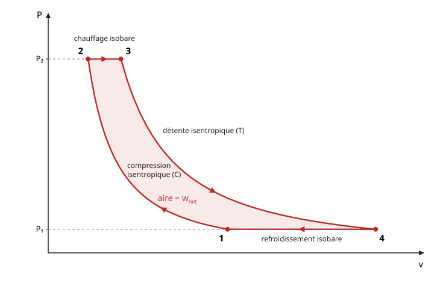
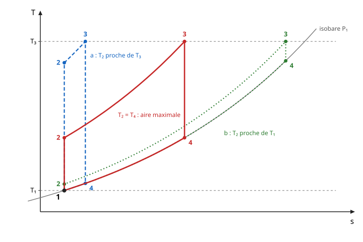
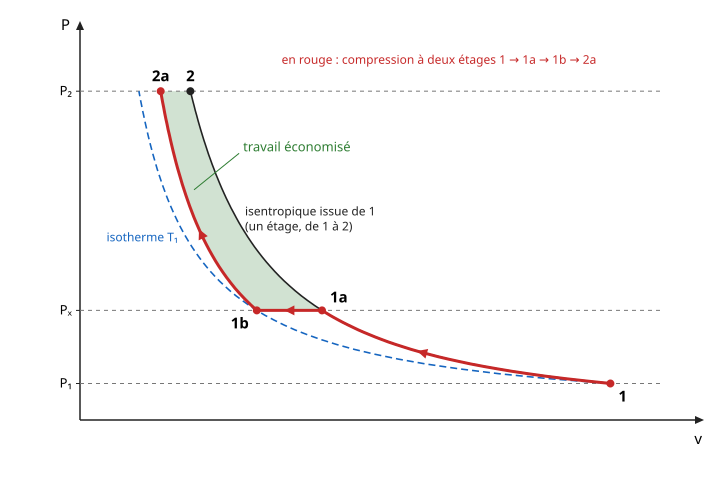
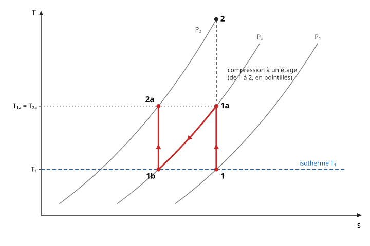
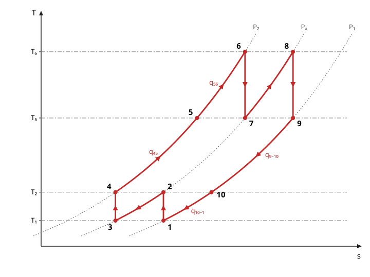
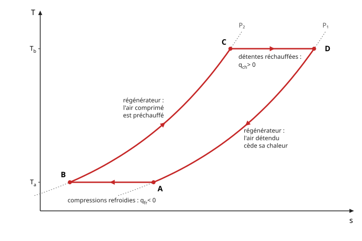

# Banque PT PT — Physique C - Thermodynamique 2012 · Corrigé brut

*Corrigé rédigé par IA, non officiel. Signalez toute erreur.*

**Rédaction** · modèle exact non renseigné (famille Claude) · effort non renseigné · vitesse non renseignée

Épreuve de 2 heures, calculatrice autorisée : étude d'une turbine à gaz, en 40 questions numérotées de 1 à 40 et réparties en quatre parties (préliminaires, cycle de Joule, compression étagée, turbine à deux étages avec régénérateur). Les 40 questions sont traitées. Le sujet ne comporte ni table ni diagramme gradué : les seules données numériques sont $M$, $\gamma$, $R$ (question 4), $T_1 = 300\ \mathrm{K}$ et $T_3 = 1000\ \mathrm{K}$ (questions 17 à 25). Les figures 4, 6 et 8 du sujet sont des schémas sans graduation ; les courbes y sont identifiées par raisonnement (questions 7, 26 et 30). Les six figures du corrigé sont tracées à l'échelle à partir des lois du gaz parfait ; lorsqu'un tracé demande des valeurs que l'énoncé ne donne pas (rapports de pression, températures intermédiaires), elles sont signalées à leur place comme un choix du corrigé. Convention : $w$ et $q$ désignent des grandeurs massiques reçues par l'air, comptées algébriquement.

[Sujet officiel (archive réunissant les deux parties de Physique C)](https://www.banquept.fr/documents/2012/phys_c_pt_2012.zip) · [Rapport du jury](https://www.banquept.fr/documents/ecrit/rapport/2012/rapport_phys_c_ecrit_2012.pdf)

## Partie I — Préliminaires

### Question 1 — Premier principe pour un écoulement permanent

**Système.** La machine délimite un volume de contrôle (système ouvert). On lui associe un système fermé $\Sigma^*$, suivi entre les instants $t$ et $t + \mathrm{d}t$ :

- à l'instant $t$ : le fluide contenu dans la machine, plus la masse $\mathrm{d}m_e$ qui va y entrer pendant $\mathrm{d}t$ ;
- à l'instant $t + \mathrm{d}t$ : le fluide contenu dans la machine, plus la masse $\mathrm{d}m_s$ qui en est sortie pendant $\mathrm{d}t$.

**Régime permanent.** La masse et l'énergie du fluide contenu dans la machine ne dépendent pas du temps. La conservation de la masse de $\Sigma^*$ donne donc

$$\mathrm{d}m_e = \mathrm{d}m_s = \mathrm{d}m = D\,\mathrm{d}t$$

**Variation d'énergie de $\Sigma^*$.** L'énergie totale est la somme de l'énergie interne, de l'énergie cinétique macroscopique et de l'énergie potentielle de pesanteur. L'énergie du contenu de la machine étant la même à $t$ et à $t + \mathrm{d}t$, il ne reste que la différence entre la tranche sortie et la tranche entrée :

$$\mathrm{d}E = \mathrm{d}m\left[\left(u_s + \tfrac{1}{2}c_s^2 + g z_s\right) - \left(u_e + \tfrac{1}{2}c_e^2 + g z_e\right)\right]$$

**Énergie reçue par $\Sigma^*$ pendant $\mathrm{d}t$.**

- Travail des forces de pression en amont : le fluide situé en amont pousse la tranche entrante, de volume $v_e\,\mathrm{d}m$, sous la pression $P_e$. Travail reçu : $+P_e v_e\,\mathrm{d}m$.
- Travail des forces de pression en aval : la tranche sortante, de volume $v_s\,\mathrm{d}m$, repousse le fluide aval sous la pression $P_s$. Travail reçu : $-P_s v_s\,\mathrm{d}m$.
- Travail indiqué fourni par les parties mobiles de la machine : $w\,\mathrm{d}m$.
- Transfert thermique, reçu seulement dans la machine puisque les canalisations sont calorifugées : $q\,\mathrm{d}m$.

Le poids est déjà pris en compte par l'énergie potentielle : on ne le compte pas une seconde fois comme un travail.

**Premier principe appliqué à $\Sigma^*$.**

$$\mathrm{d}E = \left(P_e v_e - P_s v_s\right)\mathrm{d}m + w\,\mathrm{d}m + q\,\mathrm{d}m$$

En divisant par $\mathrm{d}m$ et en regroupant $u + Pv = h$ :

$$\boxed{(h_s - h_e) + \tfrac{1}{2}\left(c_s^2 - c_e^2\right) + g\,(z_s - z_e) = q + w}$$

Chaque terme est une énergie massique, en $\mathrm{J\cdot kg^{-1}}$.

### Question 2 — Cas d'un gaz parfait non pesant

On reprend la relation de la question 1.

- Air non pesant : le terme $g\,(z_s - z_e)$ est négligé.
- Variation d'énergie cinétique négligeable : le terme $\tfrac{1}{2}(c_s^2 - c_e^2)$ est négligé.
- Gaz parfait : l'enthalpie ne dépend que de la température (seconde loi de Joule), $\mathrm{d}h = c_{pm}\,\mathrm{d}T$. Comme $c_{pm}$ est indépendante de la température, $h_s - h_e = c_{pm}\,(T_s - T_e)$.

$$\boxed{c_{pm}\,(T_s - T_e) = q + w}$$

### Question 3 — Capacités thermiques massiques

Relation de Mayer pour un gaz parfait, ramenée à l'unité de masse (une mole a pour masse $M$) :

$$c_{pm} - c_{vm} = \frac{R}{M}$$

Avec $c_{pm} = \gamma\,c_{vm}$, on obtient $c_{vm}\,(\gamma - 1) = R/M$, d'où

$$\boxed{c_{vm} = \frac{R}{M\,(\gamma - 1)}}$$

$$\boxed{c_{pm} = \frac{\gamma R}{M\,(\gamma - 1)}}$$

### Question 4 — Application numérique

Avec $M = 29\times 10^{-3}\ \mathrm{kg\cdot mol^{-1}}$, $\gamma = 1{,}4$ et $R = 8{,}31\ \mathrm{J\cdot K^{-1}\cdot mol^{-1}}$ :

$$c_{vm} = \frac{8{,}31}{29\times 10^{-3}\times 0{,}4} = 716\ \mathrm{J\cdot K^{-1}\cdot kg^{-1}}$$

$$c_{pm} = \gamma\,c_{vm} = \frac{1{,}4\times 8{,}31}{29\times 10^{-3}\times 0{,}4} = 1{,}00\times 10^{3}\ \mathrm{J\cdot K^{-1}\cdot kg^{-1}}$$

$$\boxed{c_{pm} \approx 1{,}00\times 10^{3}\ \mathrm{J\cdot K^{-1}\cdot kg^{-1}} \qquad c_{vm} \approx 7{,}2\times 10^{2}\ \mathrm{J\cdot K^{-1}\cdot kg^{-1}}}$$

Le calcul donne $c_{pm} = 1003\ \mathrm{J\cdot K^{-1}\cdot kg^{-1}}$ ; c'est cette valeur qui sert dans la suite.

## Partie II — Modélisation idéale du cycle : cycle de Joule

### Question 5 — Cycle dans le diagramme de Clapeyron

Dans le plan $(P, v)$ :

- $1 \to 2$, compression isentropique : arc de courbe $P v^{\gamma} = \text{cste}$ (loi de Laplace, gaz parfait en évolution isentropique), parcouru vers les pressions croissantes et les volumes massiques décroissants ;
- $2 \to 3$, chauffage isobare : segment horizontal à $P_2$, parcouru vers la droite car $v = RT/(MP)$ augmente avec $T$ ;
- $3 \to 4$, détente isentropique : second arc $P v^{\gamma} = \text{cste}$, situé à droite du premier, parcouru vers les pressions décroissantes ;
- $4 \to 1$, refroidissement isobare : segment horizontal à $P_1$, parcouru vers la gauche.

Comme $T_3 > T_2$ et $T_4 > T_1$, on a $v_3 > v_2$ et $v_4 > v_1$. **Le cycle est parcouru dans le sens horaire** : c'est un cycle moteur.

La figure est tracée à l'échelle pour les valeurs de la question 25 ($P_2/P_1 \approx 8{,}2$).

### Question 6 — Entropie massique du gaz parfait

Identité thermodynamique pour un kilogramme d'air :

$$\mathrm{d}h = T\,\mathrm{d}s + v\,\mathrm{d}P$$

Pour le gaz parfait, $\mathrm{d}h = c_{pm}\,\mathrm{d}T$ et $v = \dfrac{RT}{MP}$, donc

$$\mathrm{d}s = c_{pm}\,\frac{\mathrm{d}T}{T} - \frac{R}{M}\,\frac{\mathrm{d}P}{P}$$

L'entropie est une fonction d'état et $c_{pm}$ est constante : on intègre de $(T_0, P_0)$ à $(T, P)$.

$$\boxed{s(T, P) = s_0 + c_{pm}\ln\frac{T}{T_0} - \frac{R}{M}\ln\frac{P}{P_0}}$$

Comme $\dfrac{R}{M} = c_{pm}\,\dfrac{\gamma - 1}{\gamma}$, on peut aussi écrire $s = s_0 + c_{pm}\ln\left[\dfrac{T}{T_0}\left(\dfrac{P_0}{P}\right)^{(\gamma-1)/\gamma}\right]$.

Contrôle : à entropie constante on retrouve la loi de Laplace $T^{\gamma}P^{1-\gamma} = \text{cste}$.

### Question 7 — Allure d'une isobare dans le diagramme (T, s)

Sur une isobare de pression $P$, la relation de la question 6 s'inverse en

$$\boxed{T = T_0\left(\frac{P}{P_0}\right)^{(\gamma-1)/\gamma}\exp\left(\frac{s - s_0}{c_{pm}}\right)}$$

À pression fixée, $T$ est une **fonction exponentielle croissante de $s$**. Sa pente, $\left(\dfrac{\partial T}{\partial s}\right)_P = \dfrac{T}{c_{pm}}$, est positive et augmente avec la température : la courbe est convexe.

C'est bien l'allure des arcs $2 \to 3$ et $4 \to 1$ de la figure 4 du sujet. De plus :

- à entropie donnée, la température est multipliée par $(P_2/P_1)^{(\gamma-1)/\gamma} > 1$ quand on passe de l'isobare $P_1$ à l'isobare $P_2$ : l'isobare $P_2$ (arc $2 \to 3$) est au-dessus de l'isobare $P_1$ (arc $4 \to 1$) ; les deux courbes se déduisent l'une de l'autre par une translation parallèle à l'axe des entropies ;
- les deux isentropiques $1 \to 2$ et $3 \to 4$ sont des segments verticaux.

### Question 8 — Transferts thermiques dans les échangeurs

Un échangeur de chaleur est un organe à parois fixes, sans aucune pièce mobile : le travail indiqué y est nul, $w = 0$. La relation de la question 2 (écoulement permanent, gaz parfait, énergies cinétique et potentielle négligées) se réduit à $c_{pm}\,(T_s - T_e) = q$.

$$\boxed{q_{23} = c_{pm}\,(T_3 - T_2)}$$

$$\boxed{q_{41} = c_{pm}\,(T_1 - T_4)}$$

Signes : $q_{23} > 0$ (l'air est chauffé, $T_3 > T_2$) et $q_{41} < 0$ (l'air cède de la chaleur à l'atmosphère, $T_1 < T_4$).

### Question 9 — Travail massique reçu dans le compresseur

**La compression est adiabatique.** L'énoncé la donne à la fois réversible et isentropique. Pour une évolution réversible, le transfert thermique massique élémentaire est $\delta q = T\,\mathrm{d}s$ ; comme $\mathrm{d}s = 0$, on a $q_{12} = 0$. Physiquement, le compresseur n'est pas conçu pour échanger de la chaleur et l'air le traverse trop vite pour que cet échange compte.

La relation de la question 2 donne alors

$$\boxed{w_{12} = c_{pm}\,(T_2 - T_1)}$$

$w_{12} > 0$ : l'air reçoit du travail, sa température augmente ($T_2 > T_1$).

### Question 10 — Travail massique reçu dans la turbine

La détente dans la turbine est réversible et isentropique, donc adiabatique ($\delta q = T\,\mathrm{d}s = 0$). La relation de la question 2 donne

$$\boxed{w_{34} = c_{pm}\,(T_4 - T_3)}$$

$w_{34} < 0$ puisque $T_4 < T_3$ : l'air cède du travail aux aubes de la turbine, donc à l'arbre.

### Question 11 — Travail net en fonction des travaux

$w_{12}$ et $w_{34}$ sont des travaux massiques **reçus par l'air**. Le travail net est celui que l'arbre met à la disposition de l'extérieur : la turbine fournit $-w_{34} > 0$ à l'arbre, qui en cède $w_{12}$ au compresseur monté sur le même arbre.

$$\boxed{w_{net} = -\,(w_{12} + w_{34}) = |w_{34}| - w_{12}}$$

Ce travail est rapporté à un kilogramme d'air admis. Comme l'énoncé le définit pour un kilogramme d'air par seconde, la puissance récupérée pour un débit $D$ est $D\,w_{net}$.

### Question 12 — Travail net en fonction des températures

Avec $w_{12} = c_{pm}\,(T_2 - T_1)$ et $w_{34} = c_{pm}\,(T_4 - T_3)$ :

$$\boxed{w_{net} = c_{pm}\left[(T_3 - T_4) - (T_2 - T_1)\right]}$$

Le premier terme est le travail fourni par la turbine, le second le travail absorbé par le compresseur.

### Question 13 — Définition du rendement

Le rendement est le rapport de la grandeur utile, le travail net récupéré sur l'arbre, à la grandeur coûteuse, la chaleur fournie par la source chaude (la combustion, modélisée par l'échangeur $2 \to 3$) :

$$\boxed{\eta = \frac{w_{net}}{q_{23}}}$$

C'est un nombre sans dimension compris entre 0 et 1.

### Question 14 — Rendement en fonction de T₁ et T₂

**Expression avec les quatre températures.** Sur un cycle, la variation d'enthalpie massique est nulle. La somme des relations de la question 2 écrites pour les quatre organes donne $w_{12} + w_{34} + q_{23} + q_{41} = 0$, soit $w_{net} = q_{23} + q_{41}$. Donc

$$\eta = 1 + \frac{q_{41}}{q_{23}} = 1 - \frac{T_4 - T_1}{T_3 - T_2}$$

**Lien entre les températures.** Pour un gaz parfait en évolution isentropique, la loi de Laplace s'écrit $T^{\gamma}P^{1-\gamma} = \text{cste}$ (elle se lit aussi sur le résultat de la question 6 à $s$ constante). Les évolutions $1 \to 2$ et $3 \to 4$ relient les deux mêmes pressions $P_1$ et $P_2$ :

$$\frac{T_2}{T_1} = \left(\frac{P_2}{P_1}\right)^{(\gamma-1)/\gamma} = \frac{T_3}{T_4}$$

On en tire $\dfrac{T_4}{T_1} = \dfrac{T_3}{T_2}$, donc

$$T_4 - T_1 = T_1\left(\frac{T_3}{T_2} - 1\right) = \frac{T_1}{T_2}\,(T_3 - T_2)$$

**Conclusion.**

$$\boxed{\eta = 1 - \frac{T_1}{T_2}}$$

Ce n'est pas le rendement de Carnot : celui-ci ferait intervenir les températures extrêmes du cycle et vaudrait $1 - T_1/T_3$, valeur plus grande puisque $T_2 < T_3$.

### Question 15 — Rendement en fonction du taux de compression

D'après la loi de Laplace utilisée à la question 14 :

$$\frac{T_2}{T_1} = \left(\frac{P_2}{P_1}\right)^{(\gamma-1)/\gamma} = \tau^{(\gamma-1)/\gamma}$$

Donc $\eta = 1 - \dfrac{T_1}{T_2} = 1 - \dfrac{1}{z}$ avec

$$\boxed{z = \tau^{(\gamma-1)/\gamma} = \frac{T_2}{T_1} = \frac{T_3}{T_4}}$$

Pour l'air, $(\gamma - 1)/\gamma = 0{,}4/1{,}4 \approx 0{,}286$.

### Question 16 — Comment augmenter le rendement

Comme $\gamma > 1$, $z = \tau^{(\gamma-1)/\gamma}$ est une fonction croissante de $\tau$, et $\eta = 1 - 1/z$ est une fonction croissante de $z$. **Pour augmenter le rendement, il faut augmenter le taux de compression $\tau = P_2/P_1$.**

Mais le rendement n'est pas le seul critère de conception :

- la température de fin de compression $T_2 = z\,T_1$ ne peut pas dépasser $T_3$, elle-même limitée par la tenue des matériaux des aubes ;
- quand $T_2$ s'approche de $T_3$, la chaleur reçue $q_{23}$ et le travail net par kilogramme d'air tendent vers zéro : pour une puissance donnée, il faudrait un débit d'air, donc une machine, de plus en plus grands ;
- un compresseur à fort taux de compression est coûteux à construire et à entretenir.

L'étude technico-commerciale doit donc prendre en compte **le travail récupéré par kilogramme d'air** (la puissance de l'installation pour un débit donné) et le **coût** de l'installation, en particulier celui du compresseur. C'est l'objet des questions 17 à 25.

### Question 17 — Aire du cycle dans le diagramme de Clapeyron

**Travail indiqué élémentaire.** Pour un kilogramme d'air traversant un organe, la relation de la question 2 s'écrit, sur une étape élémentaire, $\mathrm{d}h = \delta q + \delta w$. Les évolutions sont réversibles, donc $\delta q = T\,\mathrm{d}s$. En comparant avec l'identité thermodynamique $\mathrm{d}h = T\,\mathrm{d}s + v\,\mathrm{d}P$ :

$$\delta w = v\,\mathrm{d}P$$

Ce résultat est cohérent avec la question 8 : dans un échangeur isobare, $\mathrm{d}P = 0$ et le travail indiqué est nul.

**Sur le cycle.** Le travail total reçu par l'air est

$$w_{12} + w_{34} = \oint v\,\mathrm{d}P$$

Or $\oint \mathrm{d}(Pv) = 0$ sur un cycle ($Pv$ est une fonction d'état), donc $\oint v\,\mathrm{d}P = -\oint P\,\mathrm{d}v$.

**Lien avec l'aire.** Dans le plan $(P, v)$, $\oint P\,\mathrm{d}v$ est l'aire $\mathcal{A}$ délimitée par le cycle, comptée positivement lorsque le cycle est parcouru dans le sens horaire : la branche haute $2 \to 3 \to 4$ est parcourue vers les $v$ croissants, la branche basse $4 \to 1 \to 2$ vers les $v$ décroissants. C'est le cas ici (question 5). Donc

$$\boxed{\mathcal{A}_{(P,v)} = \oint P\,\mathrm{d}v = -\,(w_{12} + w_{34}) = w_{net}}$$

**L'aire du cycle dans le diagramme de Clapeyron représente le travail net massique récupéré sur l'arbre.**

### Question 18 — Aire du cycle dans le diagramme (T, s)

Dans le plan $(T, s)$, l'aire délimitée par le cycle est $\oint T\,\mathrm{d}s$, comptée positivement si le cycle est parcouru dans le sens horaire. C'est le cas sur la figure 4 du sujet : la branche haute $2 \to 3$ est parcourue vers les entropies croissantes, la branche basse $4 \to 1$ vers les entropies décroissantes.

Toutes les évolutions sont réversibles : d'après le second principe, l'entropie créée est nulle et le transfert thermique massique élémentaire reçu par l'air est $\delta q = T\,\mathrm{d}s$. Donc

$$\boxed{\mathcal{A}_{(T,s)} = \oint T\,\mathrm{d}s = q_{23} + q_{41}}$$

**L'aire du cycle dans le diagramme $(T, s)$ représente le transfert thermique massique total reçu par l'air au cours d'un cycle.**

Détail : l'aire sous l'arc $2 \to 3$ (jusqu'à l'axe des entropies) vaut $q_{23} > 0$, l'aire sous l'arc $4 \to 1$ vaut $|q_{41}|$, et les deux isentropiques verticales ne contribuent pas.

### Question 19 — Lecture du travail net sur le diagramme (T, s)

L'enthalpie est une fonction d'état : sur un cycle, $\Delta h = 0$. En sommant la relation de la question 2 sur les quatre organes :

$$0 = (w_{12} + w_{34}) + (q_{23} + q_{41})$$

$$\boxed{w_{net} = -\,(w_{12} + w_{34}) = q_{23} + q_{41} = \mathcal{A}_{(T,s)}}$$

Le travail net récupéré sur l'arbre est donc égal à l'aire du cycle dans le diagramme $(T, s)$ : il se lit directement sur ce diagramme. Les deux aires, dans $(P, v)$ et dans $(T, s)$, représentent la même grandeur.

### Question 20 — Cycles de Joule pour deux rapports de compression

Éléments fixes du tracé : le point 1 (température $T_1$, pression $P_1$), l'isobare $P_1$ issue de 1, qui porte le point 4, et l'horizontale $T = T_3$, qui porte le point 3. Le point 2 est sur la verticale issue de 1 (isentropique), d'autant plus haut que le rapport de compression est grand. Le point 3 est à l'intersection de l'isobare $P_2$ issue de 2 et de l'horizontale $T_3$ ; le point 4 est à la verticale de 3, sur l'isobare $P_1$. D'après la question 14, $T_4 = T_1 T_3 / T_2$.

**a. $T_2$ proche de $T_3$ (grand rapport de compression).** L'isentropique $1 \to 2$ monte presque jusqu'à $T_3$, l'isobare $2 \to 3$ est très courte, et $T_4 = T_1 T_3/T_2$ est proche de $T_1$. Le cycle est une bande verticale très étroite, collée à la verticale issue de 1.

**b. $T_2$ proche de $T_1$ (petit rapport de compression).** L'isentropique $1 \to 2$ est très courte, l'isobare $P_2$ est presque confondue avec l'isobare $P_1$, et $T_4$ est proche de $T_3$. Le cycle est une bande très mince, couchée le long de l'isobare $P_1$.

La figure est tracée à l'échelle pour $T_1 = 300\ \mathrm{K}$ et $T_3 = 1000\ \mathrm{K}$, avec $T_2 = 900\ \mathrm{K}$ (cas a), $T_2 = 330\ \mathrm{K}$ (cas b) et $T_2 = 548\ \mathrm{K}$ (cas de la question 25). Ces valeurs de $T_2$ pour les cas a et b sont un choix du corrigé, l'énoncé ne les chiffrant pas.

### Question 21 — Existence d'un maximum du travail net

D'après la question 19, $w_{net}$ est l'aire du cycle dans le diagramme $(T, s)$.

- Quand $T_2 \to T_1$ (cas b poussé à la limite), les deux isobares se confondent : l'aire tend vers zéro.
- Quand $T_2 \to T_3$ (cas a poussé à la limite), l'isobare $2 \to 3$ se réduit à un point : l'aire tend vers zéro.
- Entre les deux, l'aire est strictement positive et varie continûment avec le rapport de compression.

Une fonction continue, positive, nulle aux deux bornes de l'intervalle, admet un maximum à l'intérieur : **$w_{net}$ passe par un maximum pour une valeur de $T_2$ comprise entre $T_1$ et $T_3$**, c'est-à-dire pour un rapport de compression intermédiaire.

### Question 22 — Travail net en fonction de z

D'après la question 15, $T_2 = z\,T_1$ et $T_4 = \dfrac{T_3}{z}$. En reportant dans le résultat de la question 12 :

$$\boxed{w_{net} = c_{pm}\left[T_3\left(1 - \frac{1}{z}\right) - T_1\,(z - 1)\right]}$$

Contrôle : $w_{net} = 0$ pour $z = 1$ ($T_2 = T_1$) et pour $z = T_3/T_1$ ($T_2 = T_3$), comme attendu à la question 21.

### Question 23 — Valeur de z donnant le travail net maximal

À $T_1$ et $T_3$ fixés :

$$\frac{\mathrm{d}w_{net}}{\mathrm{d}z} = c_{pm}\left(\frac{T_3}{z^2} - T_1\right)$$

Cette dérivée s'annule pour $z^2 = T_3/T_1$. Elle est positive avant et négative après ; la dérivée seconde, $-2\,c_{pm}T_3/z^3$, est négative. Il s'agit bien d'un maximum :

$$\boxed{z_{max} = \sqrt{\frac{T_3}{T_1}}}$$

On a alors $T_2 = z\,T_1 = \sqrt{T_1 T_3}$ et $T_4 = T_3/z = \sqrt{T_1 T_3}$ : **le travail net est maximal quand $T_2 = T_4$**. Cette valeur est bien comprise entre $1$ et $T_3/T_1$.

### Question 24 — Travail net maximal

Avec $z = \sqrt{T_3/T_1}$, on a $T_3/z = z\,T_1 = \sqrt{T_1 T_3}$, donc

$$w_{net,max} = c_{pm}\left(T_3 - \sqrt{T_1 T_3} - \sqrt{T_1 T_3} + T_1\right)$$

$$\boxed{w_{net,max} = c_{pm}\left(T_1 + T_3 - 2\sqrt{T_1 T_3}\right) = c_{pm}\left(\sqrt{T_3} - \sqrt{T_1}\right)^2}$$

### Question 25 — Application numérique

Données : $T_1 = 300\ \mathrm{K}$, $T_3 = 1000\ \mathrm{K}$, $c_{pm} = 1003\ \mathrm{J\cdot K^{-1}\cdot kg^{-1}}$ (question 4).

$$z = \sqrt{\frac{1000}{300}} = 1{,}826$$

$$T_2 = T_4 = \sqrt{T_1 T_3} = \sqrt{300\times 1000} = 548\ \mathrm{K}$$

$$w_{net} = c_{pm}\left(T_1 + T_3 - 2\sqrt{T_1 T_3}\right) = 1003\times(1300 - 2\times 547{,}7) = 2{,}05\times 10^{5}\ \mathrm{J\cdot kg^{-1}}$$

$$\eta = 1 - \frac{1}{z} = 1 - \frac{300}{547{,}7} = 0{,}45$$

$$\boxed{w_{net} \approx 205\ \mathrm{kJ\cdot kg^{-1}} \qquad T_2 = T_4 \approx 548\ \mathrm{K} \qquad \eta \approx 0{,}45}$$

Compléments : le taux de compression correspondant est $\tau = z^{\gamma/(\gamma-1)} = 1{,}826^{3{,}5} \approx 8{,}2$. Pour un kilogramme d'air par seconde, la puissance récupérée est d'environ $205\ \mathrm{kW}$. Le rendement de Carnot entre $300\ \mathrm{K}$ et $1000\ \mathrm{K}$ vaudrait $0{,}70$.

Contrôle : $q_{23} = c_{pm}\,(T_3 - T_2) = 1003\times 452{,}3 = 4{,}54\times 10^{5}\ \mathrm{J\cdot kg^{-1}}$, et $w_{net}/q_{23} = 0{,}45$.

## Partie III — Mise en place d'une compression étagée

### Question 26 — Isotherme et isentropique issues du point 1

**Pentes au même point du plan $(P, v)$.**

- Isotherme d'un gaz parfait : $Pv = \dfrac{RT}{M} = \text{cste}$. En différentiant, $v\,\mathrm{d}P + P\,\mathrm{d}v = 0$ :

$$\left(\frac{\partial P}{\partial v}\right)_T = -\frac{P}{v}$$

- Isentropique d'un gaz parfait (loi de Laplace) : $Pv^{\gamma} = \text{cste}$. En différentiant, $v^{\gamma}\,\mathrm{d}P + \gamma P v^{\gamma-1}\,\mathrm{d}v = 0$ :

$$\left(\frac{\partial P}{\partial v}\right)_s = -\gamma\,\frac{P}{v}$$

D'où la relation demandée :

$$\boxed{\left(\frac{\partial P}{\partial v}\right)_s = \gamma\left(\frac{\partial P}{\partial v}\right)_T}$$

Les deux pentes sont négatives et, comme $\gamma = 1{,}4 > 1$, **l'isentropique est plus raide que l'isotherme** en tout point.

**Identification sur la figure 6 du sujet.** L'axe vertical porte $P$, l'axe horizontal $v$ ; les trois pointillés horizontaux sont les isobares $P_1$ (en bas), $P_x$ et $P_2$ (en haut). Les deux courbes partent du point 1, situé sur le pointillé du bas, et montent vers la gauche. La plus raide atteint une pression donnée avec le volume massique le plus grand : **la courbe de droite est l'isentropique, la courbe de gauche est l'isotherme $T_1$**.

Vérification physique : au cours d'une compression isentropique, la température augmente ; à pression donnée, le volume massique $v = RT/(MP)$ est donc plus grand que sur l'isotherme.

### Question 27 — Compressions à un et à deux étages dans le diagramme de Clapeyron

On reprend la figure 6 avec l'isentropique et l'isotherme identifiées à la question 26.

- **Un étage, $1 \to 2$** : on suit l'isentropique issue de 1 (courbe de droite) de la pression $P_1$ jusqu'à la pression $P_2$.
- **Deux étages** :
  - $1 \to 1a$ : même isentropique, mais seulement de $P_1$ à $P_x$ ; le point 1a est à l'intersection de cette courbe et de l'horizontale $P_x$ ;
  - $1a \to 1b$ : refroidissement isobare, segment horizontal à $P_x$ parcouru vers la gauche (le volume massique diminue avec la température) jusqu'à la température $T_1$, c'est-à-dire jusqu'à l'isotherme issue de 1 ; le point 1b est à l'intersection de l'horizontale $P_x$ et de l'isotherme ;
  - $1b \to 2a$ : isentropique issue de 1b, de $P_x$ à $P_2$. Plus raide que l'isotherme, elle passe à droite de celle-ci, mais à gauche de la première isentropique : le point 2a est sur l'horizontale $P_2$, à gauche du point 2.

La figure est tracée à l'échelle pour $P_x/P_1 = P_2/P_x = 3$ et $\gamma = 1{,}4$ ; ces rapports de pression sont un choix du corrigé pour le dessin.

### Question 28 — Intérêt de la compression à deux étages

Pour une compression réversible d'un fluide en écoulement, le travail indiqué massique est $w = \displaystyle\int v\,\mathrm{d}P$ (question 17). Dans le diagramme de Clapeyron, c'est **l'aire comprise entre la courbe suivie et l'axe des pressions**, entre les horizontales $P_1$ et $P_2$. Le palier $1a \to 1b$ est isobare et ne contribue pas.

- Un étage : aire à gauche de la courbe $1 \to 2$.
- Deux étages : aire à gauche de la ligne $1 \to 1a \to 1b \to 2a$.

Entre $P_1$ et $P_x$ les deux lignes coïncident. Entre $P_x$ et $P_2$, la courbe $1b \to 2a$ est à gauche de la courbe $1a \to 2$ : les volumes massiques y sont plus petits à chaque pression. La différence des deux travaux est l'aire du quadrilatère curviligne $1a$–$2$–$2a$–$1b$ (en vert sur la figure 3).

**La compression à deux étages avec refroidissement intermédiaire demande donc moins de travail que la compression à un étage**, pour les mêmes pressions extrêmes : on comprime un gaz refroidi, donc moins volumineux. De plus l'air sort moins chaud ($T_{2a} < T_2$).

Vérification par le calcul, avec la question 9. En posant $a = (P_x/P_1)^{(\gamma-1)/\gamma}$ et $b = (P_2/P_x)^{(\gamma-1)/\gamma}$ :

$$w_{\text{un étage}} = c_{pm}T_1\,(ab - 1)$$

$$w_{\text{deux étages}} = c_{pm}T_1\,(a - 1) + c_{pm}T_1\,(b - 1)$$

$$w_{\text{un étage}} - w_{\text{deux étages}} = c_{pm}T_1\,(a - 1)(b - 1) > 0$$

À la limite d'un très grand nombre d'étages, la ligne suivie se rapproche de l'isotherme, qui correspond au travail de compression le plus faible.

### Question 29 — Compression à deux étages dans le diagramme (T, s)

**Isobares.** D'après la question 7, ce sont trois exponentielles croissantes qui se déduisent l'une de l'autre par translation horizontale. À température donnée, l'entropie diminue quand la pression augmente (question 6) : de la droite vers la gauche, on trouve $P_1$, $P_x$, $P_2$. Autrement dit, à entropie donnée, l'isobare $P_2$ est la plus haute.

**Isotherme $T_1$.** Droite horizontale. Le point 1 est à son intersection avec l'isobare $P_1$.

**Évolutions.**

- $1 \to 1a$ : compression isentropique, segment vertical montant du point 1 jusqu'à l'isobare $P_x$.
- $1a \to 1b$ : refroidissement isobare, on redescend le long de l'isobare $P_x$ (entropie décroissante) jusqu'à l'isotherme $T_1$.
- $1b \to 2a$ : compression isentropique, segment vertical montant du point 1b jusqu'à l'isobare $P_2$.

La compression à un étage serait le segment vertical issu de 1 prolongé jusqu'à l'isobare $P_2$ (point 2, en pointillés). La figure est tracée pour des rapports de pression égaux, $P_x/P_1 = P_2/P_x$, comme le propose l'énoncé à la fin de la partie III : dans ce cas $T_{1a} = T_{2a}$.

## Partie IV — Turbine à gaz avec compresseur et turbine à deux étages et régénérateur

### Question 30 — Cycle complet sur la figure 8 du document réponse

**Identification des courbes de la figure 8.**

- Les quatre droites horizontales (traits mixtes) sont les isothermes. De bas en haut : $T_1$, $T_2$, $T_5$, $T_6$. En effet la compression donne $T_2 > T_1$, la détente donne $T_6 > T_7 = T_5$, et le préchauffage dans le régénérateur donne $T_5 > T_4 = T_2$.
- Les trois courbes croissantes (pointillés) sont les isobares. D'après la question 29, de la gauche vers la droite : $P_2$, $P_x$, $P_1$.

**Position des dix points.** L'énoncé donne $T_1 = T_3$, $T_4 = T_2 = T_{10}$, $T_5 = T_7 = T_9$ et $T_6 = T_8$.

| Point | Température | Pression | Position sur la figure 8 |
|---|---|---|---|
| 1 | $T_1$ | $P_1$ | isotherme du bas, isobare de droite |
| 2 | $T_2$ | $P_x$ | deuxième isotherme, isobare du milieu, à la verticale de 1 |
| 3 | $T_1$ | $P_x$ | isotherme du bas, isobare du milieu |
| 4 | $T_2$ | $P_2$ | deuxième isotherme, isobare de gauche, à la verticale de 3 |
| 5 | $T_5$ | $P_2$ | troisième isotherme, isobare de gauche |
| 6 | $T_6$ | $P_2$ | isotherme du haut, isobare de gauche |
| 7 | $T_5$ | $P_x$ | troisième isotherme, isobare du milieu, à la verticale de 6 |
| 8 | $T_6$ | $P_x$ | isotherme du haut, isobare du milieu |
| 9 | $T_5$ | $P_1$ | troisième isotherme, isobare de droite, à la verticale de 8 |
| 10 | $T_2$ | $P_1$ | deuxième isotherme, isobare de droite |

**Tracé.**

- $1 \to 2$ et $3 \to 4$ : segments verticaux montants (compressions isentropiques).
- $2 \to 3$ : arc de l'isobare $P_x$ parcouru en descendant (refroidissement).
- $4 \to 5$ puis $5 \to 6$ : arc de l'isobare $P_2$ parcouru en montant (régénérateur, puis chambre de combustion).
- $6 \to 7$ et $8 \to 9$ : segments verticaux descendants (détentes isentropiques).
- $7 \to 8$ : arc de l'isobare $P_x$ parcouru en montant (réchauffement).
- $9 \to 10$ puis $10 \to 1$ : arc de l'isobare $P_1$ parcouru en descendant (régénérateur, puis refroidissement).

Le cycle est parcouru dans le sens horaire (cycle moteur).

Sur la figure 8 du sujet, les courbes sont bien disposées pour que les points 1 et 2, 3 et 4, 6 et 7, 8 et 9 soient à la verticale l'un de l'autre. La figure 5 ci-dessus reproduit cette disposition avec des valeurs choisies par le corrigé pour le dessin ($T_1 = 300\ \mathrm{K}$, $T_5 = 700\ \mathrm{K}$, rapport de pression 3 par étage) ; la figure 8 du sujet ne porte aucune graduation.

### Question 31 — Lecture graphique des transferts thermiques

Les quatre transferts ont lieu dans des échangeurs (ou dans la chambre de combustion), sans pièce mobile : $w = 0$ et la relation de la question 2 donne $q = c_{pm}\,(T_s - T_e)$.

Chaque transfert thermique se lit donc **sur l'axe des ordonnées, comme la différence des températures des deux isothermes qui encadrent l'arc d'isobare parcouru**, au coefficient $c_{pm}$ près :

$$\boxed{\begin{aligned}
q_{45} &= c_{pm}\,(T_5 - T_2) > 0 \\
q_{56} &= c_{pm}\,(T_6 - T_5) > 0 \\
q_{9\,10} &= c_{pm}\,(T_2 - T_5) < 0 \\
q_{10\,1} &= c_{pm}\,(T_1 - T_2) < 0
\end{aligned}}$$

Sur le diagramme de la question 30 (figure 5), ils sont portés le long des arcs correspondants : $q_{45}$ et $q_{56}$ sur l'isobare $P_2$, entre les isothermes $T_2$ et $T_5$ puis $T_5$ et $T_6$ ; $q_{9\,10}$ et $q_{10\,1}$ sur l'isobare $P_1$, entre les isothermes $T_5$ et $T_2$ puis $T_2$ et $T_1$.

On vérifie que $q_{9\,10} = -q_{45}$ : dans le régénérateur idéal, toute la chaleur cédée par l'air détendu est reçue par l'air comprimé. C'est ce qui impose $T_{10} = T_4$ et $T_5 = T_9$.

Remarque : chaque transfert est aussi l'aire sous l'arc d'isobare correspondant, puisque $\delta q = T\,\mathrm{d}s$ ; mais la lecture par simple différence, demandée ici, est celle des températures.

### Question 32 — Rendement de l'installation

**Définition.** Grandeur utile : le travail net récupéré sur l'arbre, $w_{net} = -\,(w_{12} + w_{34} + w_{67} + w_{89})$. Grandeur coûteuse : la chaleur fournie par l'extérieur à haute température, c'est-à-dire dans la chambre de combustion ($q_{56}$) et lors du réchauffement entre les deux turbines ($q_{78}$). Les transferts $q_{45}$ et $q_{9\,10}$ sont échangés à l'intérieur de l'installation, dans le régénérateur, et ne coûtent rien ; $q_{23}$ et $q_{10\,1}$ sont cédés à l'extérieur.

$$\boxed{\eta = \frac{-\,(w_{12} + w_{34} + w_{67} + w_{89})}{q_{56} + q_{78}}}$$

Le premier principe sur le cycle, avec $q_{45} + q_{9\,10} = 0$, donne $w_{net} = q_{56} + q_{78} + q_{23} + q_{10\,1}$, d'où la forme équivalente

$$\eta = 1 + \frac{q_{23} + q_{10\,1}}{q_{56} + q_{78}}$$

**Expression avec les températures.** Avec la relation de la question 2 et les égalités de températures de l'énoncé :

$$\begin{aligned}
w_{12} &= c_{pm}\,(T_2 - T_1) \\
w_{34} &= c_{pm}\,(T_4 - T_3) = c_{pm}\,(T_2 - T_1) \\
w_{67} &= c_{pm}\,(T_7 - T_6) = -\,c_{pm}\,(T_6 - T_5) \\
w_{89} &= c_{pm}\,(T_9 - T_8) = -\,c_{pm}\,(T_6 - T_5) \\
q_{56} &= c_{pm}\,(T_6 - T_5) \\
q_{78} &= c_{pm}\,(T_8 - T_7) = c_{pm}\,(T_6 - T_5)
\end{aligned}$$

$$\eta = \frac{2\,c_{pm}\left[(T_6 - T_5) - (T_2 - T_1)\right]}{2\,c_{pm}\,(T_6 - T_5)}$$

$$\boxed{\eta = 1 - \frac{T_2 - T_1}{T_6 - T_5}}$$

**Simplification.** Les étages ont tous le même rapport de pression, donc, par la loi de Laplace, $\dfrac{T_2}{T_1} = \dfrac{T_6}{T_7} = \dfrac{T_6}{T_5}$. Alors $\dfrac{T_2 - T_1}{T_6 - T_5} = \dfrac{T_1}{T_5}$ et

$$\eta = 1 - \frac{T_1}{T_5} = 1 - \frac{T_2}{T_6}$$

### Question 33 — Taux de compression d'un étage

Soit $r$ le taux de compression commun aux $n$ étages. Les refroidissements intermédiaires sont isobares, donc la pression de sortie d'un étage est la pression d'entrée du suivant. Les taux se multiplient :

$$r^{\,n} = \frac{P_2}{P_1}$$

$$\boxed{r = \left(\frac{P_2}{P_1}\right)^{1/n}}$$

Pour $n = 2$, on retrouve $P_x = \sqrt{P_1 P_2}$.

### Question 34 — Limite d'un nombre infini d'étages

$$r = \exp\left[\frac{1}{n}\ln\frac{P_2}{P_1}\right] \xrightarrow[n \to +\infty]{} 1$$

$$\boxed{\lim_{n \to +\infty} r = 1}$$

Chaque étage ne réalise plus qu'une compression élémentaire. La température en sortie d'un étage, $T_1\,r^{(\gamma-1)/\gamma}$, tend vers $T_1$ : l'air, ramené à $T_1$ après chaque étage, ne s'en écarte plus. **La compression étagée devient une compression isotherme à la température $T_1$.** De même, une détente à nombre infini d'étages avec réchauffements devient une détente isotherme à la température la plus haute.

### Question 35 — Cycle limite dans le diagramme (T, s)

Le cycle est délimité par deux horizontales (isothermes $T_a$ en bas, $T_b$ en haut) et par deux arcs d'exponentielle (isobare $P_2$ à gauche, isobare $P_1$ à droite, d'après les questions 7 et 29). En nommant A, B, C, D ses sommets (notation du corrigé) :

- $A \to B$ : compression isotherme à $T_a$, de $P_1$ à $P_2$ ; segment horizontal parcouru vers la gauche (l'entropie diminue quand la pression augmente à température fixée) ;
- $B \to C$ : chauffage isobare à $P_2$, de $T_a$ à $T_b$ ; arc montant ;
- $C \to D$ : détente isotherme à $T_b$, de $P_2$ à $P_1$ ; segment horizontal parcouru vers la droite ;
- $D \to A$ : refroidissement isobare à $P_1$, de $T_b$ à $T_a$ ; arc descendant.

Le cycle est parcouru dans le sens horaire.

Les deux arcs d'isobare se déduisent l'un de l'autre par translation horizontale : les segments AB et CD ont la même longueur. La figure est tracée pour $T_a = 300\ \mathrm{K}$, $T_b = 1000\ \mathrm{K}$ et $P_2/P_1 = 9$, valeurs choisies par le corrigé pour le dessin.

### Question 36 — Identification des évolutions

Sur le cycle de la question 35 (sommets A, B, C, D de la figure 6) :

- **Régénérateur** : les deux isobares. Sur $B \to C$ (isobare $P_2$), l'air comprimé est préchauffé de $T_a$ à $T_b$ ; la chaleur nécessaire, $c_{pm}\,(T_b - T_a)$, lui est cédée par l'air détendu qui se refroidit de $T_b$ à $T_a$ sur $D \to A$ (isobare $P_1$). Ces deux transferts sont opposés et internes à l'installation.
- **Réchauffement lors des détentes** : l'isotherme haute $C \to D$, à la température $T_b$. C'est la limite de la ligne en dents de scie $6 \to 7 \to 8 \to 9$ de la question 30 ; l'air y reçoit de la chaleur de la source chaude.
- **Refroidissement lors des compressions** : l'isotherme basse $A \to B$, à la température $T_a$. C'est la limite de la ligne $1 \to 2 \to 3 \to 4$ ; l'air y cède de la chaleur à l'extérieur.

### Question 37 — Transfert thermique du réchauffement

L'évolution $C \to D$ est réversible et isotherme à la température $T_b$. Le second principe s'écrit, pour un kilogramme d'air, $\Delta s = s_{\text{échangée}} + s_{\text{créée}}$ avec $s_{\text{créée}} = 0$ (réversibilité) et $s_{\text{échangée}} = q_{ch}/T_b$ :

$$q_{ch} = T_b\,(s_D - s_C)$$

D'après la question 6, à température constante, entre les pressions $P_2$ (point C) et $P_1$ (point D) :

$$s_D - s_C = -\frac{R}{M}\ln\frac{P_1}{P_2} = \frac{R}{M}\ln\frac{P_2}{P_1}$$

$$\boxed{q_{ch} = \frac{R\,T_b}{M}\ln\frac{P_2}{P_1}}$$

$q_{ch} > 0$ : l'air reçoit de la chaleur pendant qu'il se détend.

### Question 38 — Transfert thermique du refroidissement

L'évolution $A \to B$ est réversible et isotherme à la température $T_a$, de la pression $P_1$ à la pression $P_2$. De la même façon :

$$q_{fr} = T_a\,(s_B - s_A) = -\,T_a\,\frac{R}{M}\ln\frac{P_2}{P_1}$$

$$\boxed{q_{fr} = -\frac{R\,T_a}{M}\ln\frac{P_2}{P_1}}$$

$q_{fr} < 0$ : l'air cède de la chaleur à l'extérieur pendant qu'il est comprimé.

### Question 39 — Rendement du cycle limite

Les transferts thermiques sur les deux isobares se compensent, $c_{pm}\,(T_b - T_a)$ et $-\,c_{pm}\,(T_b - T_a)$, et restent internes à l'installation (régénérateur idéal). La seule chaleur fournie par l'extérieur à haute température est $q_{ch}$.

Premier principe sur le cycle ($\Delta h = 0$) :

$$w_{net} = q_{ch} + q_{fr} = \frac{R}{M}\,(T_b - T_a)\ln\frac{P_2}{P_1}$$

$$\eta = \frac{w_{net}}{q_{ch}} = 1 + \frac{q_{fr}}{q_{ch}}$$

$$\boxed{\eta = 1 - \frac{T_a}{T_b}}$$

Ce rendement ne dépend plus des pressions. Avec $T_a = 300\ \mathrm{K}$ et $T_b = 1000\ \mathrm{K}$ (températures $T_1$ et $T_3$ de la partie II), il vaudrait $0{,}70$, contre $0{,}45$ pour le cycle de Joule simple de la question 25.

### Question 40 — Remarque et choix pratique de trois étages

**Remarque.** On reconnaît le **rendement de Carnot** d'un moteur fonctionnant entre deux sources de températures $T_a$ et $T_b$ : c'est le rendement maximal permis par le second principe entre ces deux températures. Le résultat était prévisible : le cycle limite est réversible et n'échange de la chaleur avec l'extérieur qu'à ces deux températures, la chaleur des isobares étant recyclée à l'intérieur par le régénérateur idéal. Le rendement ne dépend alors ni du gaz ni du rapport des pressions. L'étagement des compressions et des détentes, associé à la régénération, fait donc passer du rendement $1 - T_1/T_2$ du cycle de Joule (question 14) au rendement de Carnot.

**Pourquoi trois étages en pratique.** Cette limite suppose un nombre infini d'étages et des échangeurs parfaits. Or :

- le gain apporté par chaque étage supplémentaire décroît vite : l'essentiel du rapprochement vers l'isotherme est obtenu avec les deux ou trois premiers étages ;
- chaque étage ajoute un compresseur ou une turbine et un échangeur, donc du coût, de l'encombrement, de la masse et de la maintenance ;
- chaque échangeur réel introduit des pertes de charge et des écarts de température, c'est-à-dire des irréversibilités qui finissent par annuler le gain théorique.

Trois étages constituent un compromis entre le rendement et le coût de l'installation.
