# Banque PT 2012 — Sciences industrielles A · Corrigé guidé

*Corrigé rédigé par IA, non officiel. Signalez toute erreur.*

**Rédaction** · GPT-6.2 Astra Ultra · vitesse non renseignée · 27 novembre 2026

Le robot aspirateur étudié est un appareil de nettoyage domestique. La correction suit le sujet et son cahier réunis dans un PDF de 48 pages. Un second PDF de l’archive officielle remplace le texte de la question 5 et fixe la masse utilisée aux questions 6 à 8 à 3,6 kg.

[Sujet et cahier officiels](https://www.banquept.fr/documents/2012/si_a_pt_2012.zip) · [Rapport du jury](https://www.banquept.fr/documents/ecrit/rapport/2012/rapport_si_a_ecrit_2012.pdf)

Le jury a accepté plusieurs lectures du dessin de la zone nettoyée, sous réserve d’une conclusion cohérente. Il signale une graduation erronée sur les grilles du cahier et demande de déduire le gain du capteur à partir des trois tops par tour. Les constructions emploient donc la largeur de 300 mm et les rayons du tableau 3. Les sensibilités numériques exactes sont conservées avant les arrondis imposés.

## A — Énergie et déplacement sur une rampe

### Question 1 — Budget de courant

> [!INDICATION]
> Additionner les deux roues, les brosses, le balai et l’électronique.

#### Solution

$I_t=2(500)+150+70+130=1350$ mA. Pour $T_u=120$ min, il faut $Q=1,350\times2=2,70$ Ah, soit 2700 mAh. La batterie nominale fournit 3300 mAh.

[Livret officiel, fichier sujet p. 6 · cahier p. 27 du même PDF](https://www.banquept.fr/documents/2012/si_a_pt_2012.zip)

### Question 2 — Vitesse de rotation maximale

> [!INDICATION]
> Chaque tour de roue fait avancer le robot de la circonférence du pneumatique.

#### Solution

Sans glissement, $n_r=18/(\pi\,0,060)=95,5$ tr/min. Le moteur tourne $k=80$ fois plus vite, donc $n_m\simeq7640$ tr/min, un peu en deçà des 8000 tr/min nominaux.

### Question 3 — Surface utile

> [!INDICATION]
> Distinguer la bande parcourue de la surface effectivement nettoyée.

#### Solution

Pendant 120 min, à 4 m/min, le robot parcourt 480 m. Sa bande de 0,30 m couvre géométriquement 144 m². Avec 66 % de rendement de couverture, il nettoie $0,66\times144=95,04$ m².

### Question 4 — Durée de recharge

> [!INDICATION]
> Le pourcentage résiduel porte sur la capacité complète de l’accumulateur.

#### Solution

Il manque $0,90\times3,30=2,97$ Ah. À 1,50 A et avec un rendement de charge de 80 %, il faut $2,97/(1,50\times0,80)=2,475$ h, environ 2 h 29 min.

### Question 5 — Confrontation aux annonces

> [!INDICATION]
> Comparer séparément autonomie, surface et recharge aux trois limites du premier tableau.

#### Solution

Sous les conditions moyennes du sujet, $3,30/1,35=2,44$ h, soit 147 min pour 120 min au minimum. En 120 min, 95,0 m² dépassent les 80 m² attendus, et la recharge de 2,48 h reste sous 3 h. Les trois critères sont respectés.

### Question 6 — Forces extérieures en pente

> [!INDICATION]
> Orienter la tangente vers le haut de la rampe et la normale hors du sol.

#### Solution

Le poids $M\vec g$ s’applique en G. Les roues motrices reçoivent les réactions $N_g\vec n+T_g\vec t$ et $N_d\vec n+T_d\vec t$, avec $T_g,T_d$ vers le haut. La roue folle peut reprendre une partie de la charge normale. Les efforts tangentiels résistants de la roue folle et des brosses sont négligés. L’équilibre normal donne $\sum N_i=Mg\cos\alpha$. Les efforts entre moteurs et bâti sont intérieurs au système isolé.

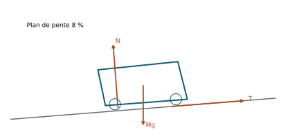

[Livret officiel, fichier sujet p. 6 · cahier p. 28 du même PDF](https://www.banquept.fr/documents/2012/si_a_pt_2012.zip)

### Question 7 — Couple demandé au démarrage

> [!INDICATION]
> La pente en pourcentage est une tangente. Ne pas la lire en degrés.

#### Solution

$\tan\alpha=0,08$. Pour atteindre 18 m/min, soit 0,30 m/s, en 0,50 s sous accélération constante, $a=0,60$ m/s². En ligne droite avec charge motrice partagée, $2T-Mg\sin\alpha=Ma$. Chaque roue doit fournir $C_r=T(D/2)=(3,6/2)(0,60+9,81\sin\alpha)(0,030)=0,0746$ N·m, en négligeant l’inertie propre des roues.

### Question 8 — Couple disponible

> [!INDICATION]
> Partir de la puissance mécanique et appliquer le rapport et le rendement du réducteur.

#### Solution

$C_m=10/(8000\times2\pi/60)=0,01194$ N·m. Chaque réducteur fournit $C_r=0,60\times80C_m\simeq0,573$ N·m, environ 7,7 fois le couple requis. Avec l’adhérence supposée et le modèle de couple constant, la rampe est franchissable.

## B.1 — Géométrie du nettoyage local

### Question 9 — Six rotations et positions des roues

> [!INDICATION]
> Le CIR est du côté intérieur de chaque quart. Faire tourner autour de lui le segment joignant les roues.

#### Solution

Dans les axes du cahier, $G_0=O_i=(0,0)$, la roue droite est au départ à $(0,150)$, et la gauche à $(0,-150)$. Les six arcs sont parcourus en sens horaire. Le tableau donne les coordonnées en millimètres. Pour chaque arc, les points de roue se déduisent du vecteur unitaire radial $\vec u_i$ à sa fin par $G_g=G_i+150\vec u_i$ et $G_d=G_i-150\vec u_i$.

| Arc | Centre instantané | G en fin d’arc | Roue gauche | Roue droite |
|---|---|---|---|---|
| Q1 | (0, 75) | (−75, 75) | (−225, 75) | (75, 75) |
| Q2 | (0, 75) | (0, 150) | (0, 300) | (0, 0) |
| Q3 | (0, 0) | (150, 0) | (300, 0) | (0, 0) |
| Q4 | (0, 0) | (0, −150) | (0, −300) | (0, 0) |
| Q5 | (0, 75) | (−225, 75) | (−375, 75) | (−75, 75) |
| Q6 | (75, 75) | (75, 375) | (75, 525) | (75, 225) |

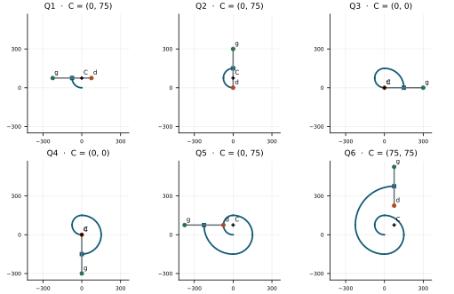

[Livret officiel, fichier sujet p. 9 · cahier p. 30 du même PDF](https://www.banquept.fr/documents/2012/si_a_pt_2012.zip)

### Question 10 — Vitesses de roue sur chaque arc

> [!INDICATION]
> Employer une même vitesse angulaire pour les trois points du robot et regarder de quel côté du CIR se trouve la roue intérieure.

#### Solution

Pour un centre de trajectoire de rayon $r$, les vitesses orientées dans le sens de la marche valent $v_g=4(r+150)/r$ et $v_d=4(r-150)/r$, avec les longueurs en millimètres et les vitesses en m/min. Pour Q1 et Q2, les modules gauche/droite sont 12 et 4, avec la droite en marche arrière. Pour Q3 et Q4, ils valent 8 et 0. Pour Q5, $20/3$ et $4/3$. Pour Q6, 6 et 2. Dans chaque cas, la demi-somme des vitesses signées vaut 4 m/min.

### Question 11 — Hachures du balayage

> [!INDICATION]
> Faire tourner autour de chaque CIR le segment transversal de 300 mm.

#### Solution

Pour chaque quart, balayer le segment radial de rayon signé $[r-150,r+150]$. Si $r<150$ mm, la partie négative du segment balaye aussi le secteur opposé. La figure montre l’union des six secteurs hachurée et la ligne médiane superposée. Cette construction représente la demi-trajectoire demandée sur la grille de la question 11.

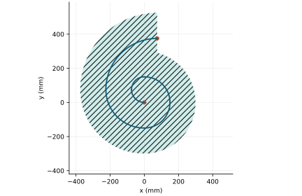

[Livret officiel, fichier sujet p. 9 · cahier p. 33 du même PDF](https://www.banquept.fr/documents/2012/si_a_pt_2012.zip)

### Question 12 — Vérification des zones oubliées

> [!INDICATION]
> Observer les recouvrements entre secteurs de largeur finie, y compris près des deux premiers centres de rotation.

#### Solution

Avec une brosse modélisée par le segment entre roues, l’enveloppe hachurée n’enferme aucun îlot blanc. Les quarts de rayon 150 mm vont jusqu’à leur CIR et rejoignent le balayage central, les quarts suivants chevauchent les précédents. La vérification sur une grille de 2 mm donne zéro cellule intérieure isolée. Cette propriété porte sur la zone balayée dessinée. Le rayon de tout disque que l’on prétendrait intégralement nettoyer doit être vérifié séparément.

## B.2 et B.3 — Boucles de vitesse et de position

### Question 13 — Identification de la boucle de vitesse

> [!INDICATION]
> Une rupture de pente de −20 dB/décade introduit un pôle réel.

#### Solution

Le plateau de 46 dB indique $K_\Omega=10^{46/20}=199,5$, soit environ 200 (rad/s)/V. Le coude vers $10^1$ rad/s donne $\tau_\Omega=0,100$ s. Donc $\Omega_{\rm mot}/U\simeq200/(1+0,100p)$. La figure 9 donne les asymptotes de la boucle de vitesse déjà fermée.

[Livret officiel, fichier sujet p. 9 · cahier p. 34 du même PDF](https://www.banquept.fr/documents/2012/si_a_pt_2012.zip)

### Question 14 — Réponse du moteur en tr/min

> [!INDICATION]
> Multiplier la transmittance par $2,5/p$, puis convertir la vitesse obtenue en rad/s.

#### Solution

$\Omega_{\rm mot}(t)=500(1-e^{-10t})u(t)$ rad/s et $N_{\rm mot}(t)=500[60/(2\pi)](1-e^{-10t})u(t)$ tr/min. Le niveau final est 4775 tr/min, la tangente initiale coupe ce niveau à 0,10 s, et les 95 % sont atteints vers 0,300 s.

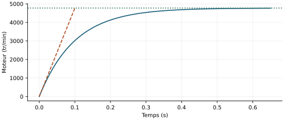

[Livret officiel, fichier sujet p. 10 · cahier p. 34 du même PDF](https://www.banquept.fr/documents/2012/si_a_pt_2012.zip)

### Question 15 — Transmittances de la boucle de position

> [!INDICATION]
> Préciser sur quel arbre est situé le capteur avant de placer le réducteur.

#### Solution

Le moteur fournit la vitesse par $K_\Omega/(1+\tau_\Omega p)$. Le bloc de vitesse vers position moteur est $1/p$. Le réducteur en sortie donne $\theta_r/\theta_{\rm mot}=1/k=1/80$. Le capteur à l’arbre moteur fournit $K_{\rm pos}=3/(2\pi)$ top/rad. Il se branche sur $\theta_{\rm mot}$ en retour négatif. La valeur 0,5 top/rad de la suite est son arrondi.

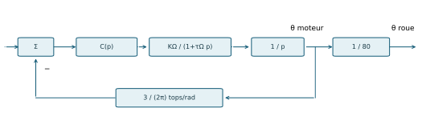

[Livret officiel, fichier sujet p. 10 · cahier p. 35 du même PDF](https://www.banquept.fr/documents/2012/si_a_pt_2012.zip)

### Question 16 — Fonction de position au niveau de la roue

> [!INDICATION]
> Refermer la boucle sur le moteur puis appliquer le rapport de réduction.

#### Solution

Pour $C(p)=K_p$, $\theta_r/\theta_{\rm ref}=(K_pK_\Omega/k)/(\tau_\Omega p^2+p+K_pK_\Omega K_{\rm pos})$. En posant $g=K_pK_\Omega K_{\rm pos}$, le gain statique vaut $1/(kK_{\rm pos})$, la pulsation naturelle $\omega_n=\sqrt{g/\tau_\Omega}$ et $m=1/(2\sqrt{\tau_\Omega g})$. Le sommateur compare des grandeurs exprimées sur l’échelle des tops, d’où le facteur de conversion au gain statique.

### Question 17 — Pôles complexes de la réponse

> [!INDICATION]
> Résoudre le trinôme $p^2+2m\omega_np+\omega_n^2$.

#### Solution

Pour $0<m<1$, $p_{1,2}=-m\omega_n\pm j\omega_n\sqrt{1-m^2}$. Les racines sont les mêmes à l’arbre moteur et à la roue puisque le réducteur est ici un gain pur.

### Question 18 — Orientation à 45° dans le plan complexe

> [!INDICATION]
> Égaler les modules des deux projections d’un pôle sur les axes.

#### Solution

$m\omega_n=\omega_n\sqrt{1-m^2}$ donne $2m^2=1$, soit $m=1/\sqrt2\simeq0,707$. Les pôles stables ont leur partie réelle négative.

### Question 19 — Gain proportionnel

> [!INDICATION]
> Isoler le gain dans l’expression de l’amortissement.

#### Solution

$K_p=1/(4m^2\tau_\Omega K_\Omega K_{\rm pos})=1/[2(0,10)(200)(0,5)]=0,050$ V/top. Ici $\omega_n=1/(2m\tau_\Omega)=7,07$ rad/s et les pôles sont $-5\pm5j$ s⁻¹.

### Question 20 — Temps de réponse initial

> [!INDICATION]
> Lire le produit réduit $\omega_n t_{r5}$ à l’amortissement imposé.

#### Solution

L’abaque du cahier donne environ 3 pour $m=0,707$ (2,93 par la réponse exacte). Donc $t_{r5}\simeq2,93/7,07=0,414$ s, environ 0,42 s graphiquement. Le dépassement de 4,32 % reste dans la bande de 5 %, si bien que le premier franchissement de 95 % est définitif.

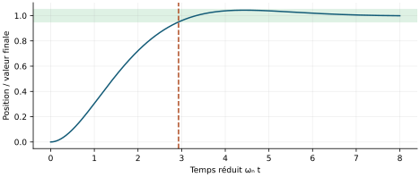

[Livret officiel, fichier sujet p. 11 · cahier p. 37 du même PDF](https://www.banquept.fr/documents/2012/si_a_pt_2012.zip)

### Question 21 — Rapidité de la commande initiale

> [!INDICATION]
> Inclure la tolérance de 10 % sur la durée.

#### Solution

Le temps nominal souhaité est 0,200 s et la limite tolérée est 0,220 s. Le premier correcteur donne environ 0,414 s et doit être modifié.

### Question 22 — Compensation du pôle de vitesse

> [!INDICATION]
> Choisir le zéro du correcteur à la pulsation du pôle compensable.

#### Solution

Avec $C=K_p(1+\tau_1p)/(1+\tau_2p)$, on prend $\tau_1=\tau_\Omega=0,10$ s. On retrouve $\theta_r/\theta_{\rm ref}=(K_pK_\Omega/k)/(\tau_2p^2+p+g)$, où $g=K_pK_\Omega K_{\rm pos}$. La forme canonique a $K=1/(kK_{\rm pos})$, $\omega_n^2=g/\tau_2$, $2m/\omega_n=1/g$.

### Question 23 — Pulsation naturelle visée

> [!INDICATION]
> Le temps réduit de l’abaque ne change pas tant que l’amortissement reste identique.

#### Solution

Pour $t_{r5}=0,200$ s, $\omega_n=2,93/0,200=14,65$ rad/s. La lecture arrondie de l’abaque donne 15 rad/s. On vise le temps nominal et on conserve la tolérance pour l’essai de vérification.

### Question 24 — Gain du correcteur compensé

> [!INDICATION]
> Utiliser $g=\omega_n/(2m)$, indépendant du pôle ajouté.

#### Solution

$K_p=\omega_n/(2mK_\Omega K_{\rm pos})\simeq0,104$ V/top, soit 0,1 V/top à la décimale demandée. Il est préférable de conserver les chiffres intermédiaires pour calculer la constante $\tau_2$.

### Question 25 — Pôle du correcteur

> [!INDICATION]
> Identifier le coefficient de $p^2$ après normalisation du dénominateur.

#### Solution

$\tau_2=g/\omega_n^2=1/(2m\omega_n)\simeq0,0483$ s, environ 0,05 s. En imposant directement le couple arrondi $K_p=0,1$, $m=1/\sqrt2$, on trouve exactement $\tau_2=0,050$ s pour une pulsation de 14,14 rad/s.

### Question 26 — Essai du correcteur compensé

> [!INDICATION]
> Mesurer 95 % de la position finale du moteur, distincte de la valeur de la consigne affichée.

#### Solution

La figure 11 converge vers environ 2,09 rad à l’arbre moteur. Le seuil $0,95\times2,09\simeq1,99$ rad est franchi vers 0,197 à 0,20 s sans sortie ultérieure de la bande. Le temps est compatible avec la limite de 0,22 s.

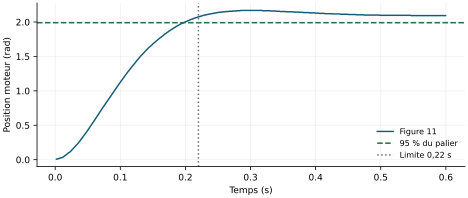

[Livret officiel, fichier sujet p. 11 · cahier p. 39 du même PDF](https://www.banquept.fr/documents/2012/si_a_pt_2012.zip)

## B.4 — Estimation de la vitesse

### Question 27 — Première équation d’état

> [!INDICATION]
> Choisir la position moteur comme premier état.

#### Solution

Avec $x_1=\theta_{\rm mot}$ et $x_2=\Omega_{\rm mot}$, $\dot x_1=x_2$. Sous conditions initiales nulles, $p\theta_{\rm mot}=0\theta_{\rm mot}+1\Omega_{\rm mot}+0U$ et donc $A_1=0,A_2=1,B_1=0$.

[Livret officiel, fichier sujet p. 13 · cahier p. 40 du même PDF](https://www.banquept.fr/documents/2012/si_a_pt_2012.zip)

### Question 28 — Deuxième équation d’état

> [!INDICATION]
> Reprendre le dénominateur du premier ordre de vitesse.

#### Solution

$\tau_\Omega\dot x_2+x_2=K_\Omega u$, donc $p\Omega_{\rm mot}=0\theta_{\rm mot}-(1/\tau_\Omega)\Omega_{\rm mot}+(K_\Omega/\tau_\Omega)U$. Ainsi $A_3=0$, $A_4=-1/\tau_\Omega$, $B_2=K_\Omega/\tau_\Omega$.

### Question 29 — Modèle d’état et sortie mesurée

> [!INDICATION]
> Placer les coefficients dans l’ordre position, vitesse.

#### Solution

On obtient $A_s=\begin{pmatrix}0&1\\0&-1/\tau_\Omega\end{pmatrix}$, $B_s=(0,K_\Omega/\tau_\Omega)^T$ et $C_s=(K_{\rm pos},0)$. La dynamique est $\dot X_s=A_sX_s+B_su$ et la seule sortie mesurée est $y=C_sX_s$ en tops.

### Question 30 — Valeurs propres du processus

> [!INDICATION]
> La matrice d’état est triangulaire.

#### Solution

$\det(pI-A_s)=p(p+1/\tau_\Omega)$. Les valeurs propres sont 0 et $-1/\tau_\Omega=-10$ s⁻¹. On retrouve l’intégrateur de position et le pôle de la boucle de vitesse dans le processus de la figure 13.

### Question 31 — Fonction de la réinjection

> [!INDICATION]
> Comparer la position effectivement lue à celle de la simulation interne.

#### Solution

La correction $L_o(y-\hat y)$ ramène l’estimation vers l’état réel même si l’état initial estimé était inexact. L’évolution de la position mesurée informe sur la vitesse. En effet, les deux lignes $C_s$ et $C_sA_s$ forment une matrice diagonale de diagonale $K_{\rm pos}\ne0$, ce qui assure l’observabilité.

### Question 32 — Équation de l’observateur

> [!INDICATION]
> Utiliser la même commande que le processus et ajouter l’innovation.

#### Solution

On a $p\hat X_s=A_s\hat X_s+B_sU+L_o(C_sX_s-C_s\hat X_s)$. La colonne $L_o=(L_{o1},L_{o2})^T$ pondère la même erreur mesurée dans les deux dérivées d’état.

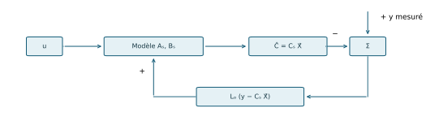

[Livret officiel, fichier sujet p. 14 · cahier p. 41 du même PDF](https://www.banquept.fr/documents/2012/si_a_pt_2012.zip)

### Question 33 — Dynamique de l’erreur

> [!INDICATION]
> Soustraire les équations avec la convention $\epsilon=X_s-\hat X_s$.

#### Solution

Les commandes communes s’éliminent et $p\epsilon=(A_s-L_oC_s)\epsilon$. Au sens temporel, $\dot\epsilon=(A_s-L_oC_s)\epsilon$, y compris pour une erreur initiale non nulle. En Laplace unilatéral, le terme initial se place à droite si l’on écrit l’équation complète.

### Question 34 — Matrice de l’erreur

> [!INDICATION]
> Le produit colonne–ligne $L_oC_s$ a sa deuxième colonne nulle.

#### Solution

$A_o=\begin{pmatrix}-L_{o1}K_{\rm pos}&1\\-L_{o2}K_{\rm pos}&-1/\tau_\Omega\end{pmatrix}$. La diagonale fixe la somme des coefficients de décroissance, tandis que le gain de la seconde ligne agit aussi sur le déterminant.

### Question 35 — Polynôme caractéristique de l’observateur

> [!INDICATION]
> Développer le déterminant en conservant les deux termes constants.

#### Solution

$\det(pI-A_o)=(p+K_{\rm pos}L_{o1})(p+1/\tau_\Omega)+K_{\rm pos}L_{o2}$. Le polynôme est donc $p^2+(1/\tau_\Omega+K_{\rm pos}L_{o1})p+K_{\rm pos}(L_{o1}/\tau_\Omega+L_{o2})$.

### Question 36 — Deux pôles plus rapides

> [!INDICATION]
> Identifier les coefficients avec ceux de $(p+1/\tau_o)^2$.

#### Solution

$\tau_o=\tau_\Omega/5=0,020$ s. On trouve $L_{o1}=(2/\tau_o-1/\tau_\Omega)/K_{\rm pos}$ et $L_{o2}=1/(K_{\rm pos}\tau_o^2)-L_{o1}/\tau_\Omega$. Numériquement $L_{o1}=180$ et $L_{o2}=3200$ dans les unités du modèle.

### Question 37 — Rapidité et coût avec l’observateur

> [!INDICATION]
> Identifier sur la figure 15 la courbe la plus lente et employer sa propre valeur finale.

#### Solution

Le seuil de 1,99 rad environ est atteint vers 0,219 à 0,220 s par la courbe avec observateur. Cela se situe à l’extrémité de la tolérance de 200 ms + 10 %, avec une marge inférieure à la précision de lecture. La boucle se contente d’un capteur de position par roue, donc de moins de deux capteurs. L’économie possible concerne le capteur de vitesse, son montage et son câblage. Elle doit couvrir le développement et le calcul de l’observateur.

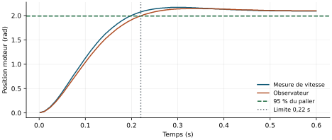

[Livret officiel, fichier sujet p. 14 · cahier p. 43 du même PDF](https://www.banquept.fr/documents/2012/si_a_pt_2012.zip)

## C — Identification des lobes et retour au dock

### Question 38 — Décodage temporel du lobe

> [!INDICATION]
> Séparer le départ de trame puis échantillonner au milieu de chaque case de 4 ms.

#### Solution

Les huit niveaux physiques, du premier au dernier bit, sont 01011110. En logique négative, ils deviennent 10100001, mot de la tourelle. Le niveau haut de repos, la première milliseconde de départ et la dernière milliseconde de fin ne constituent pas des bits de données. La durée des données est 32 ms.

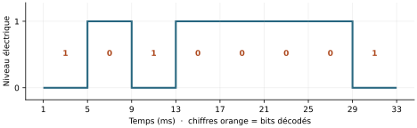

[Livret officiel, fichier sujet p. 17 · cahier p. 44 du même PDF](https://www.banquept.fr/documents/2012/si_a_pt_2012.zip)

### Question 39 — Code droit en hexadécimal

> [!INDICATION]
> Regrouper les huit bits en deux quartets.

#### Solution

$1010_2=A_{16}$ et $0100_2=4_{16}$, donc le code droit est $\mathrm{A4}_{16}$, soit 164 en décimal.

### Question 40 — Code gauche en décimal

> [!INDICATION]
> Additionner les poids des seuls bits à un.

#### Solution

$10101000_2=128+32+8=168$.

### Question 41 — Recouvrement des deux lobes latéraux

> [!INDICATION]
> La règle de l’énoncé est une addition sur huit bits.

#### Solution

$168+164=332=256+76$. La retenue du neuvième bit est perdue. Il reste $01001100_2=76$, soit $\mathrm{4C}_{16}$.

### Question 42 — Table complète des acquisitions

> [!INDICATION]
> Ajouter modulo 256 à partir des trois codes élémentaires.

#### Solution

Dans l’ordre du tableau 6, tourelle $lt=10100001_2=161$, tourelle–gauche $ltg=01001001_2=73$, gauche $lg=10101000_2=168$, gauche–droite $lgd=01001100_2=76$, droite $ld=10100100_2=164$, droite–tourelle $ltd=01000101_2=69$. Chaque code correspond à un seul des six états décodés.

### Question 43 — Activation du retour guidé

> [!INDICATION]
> La demande seule n’implique pas qu’un code de guidage ait été acquis.

#### Solution

Définir $sig=lt\lor ltg\lor lg\lor lgd\lor ld\lor ltd$. La réceptivité en amont est $Dde\_Ret\_Dock\land sig$ et celle en aval est $Rob\_Dock$. En l’absence initiale de signal, la recherche le long des murs relève de l’autre mode mentionné par le sujet.

### Question 44 — Expansion du lobe tourelle

> [!INDICATION]
> Séparer la perte de tout signal de l’apparition d’un obstacle pendant que la tourelle est perçue.

#### Solution

L’étape 100 est activée par l’étape 9. Sous $lt$, on entre en 101, action FW. Après 0,5 s de 101, un autre code ramène au répartiteur 100. Avec $lt$ et $dd$ on commande CCW jusqu’à la disparition de $dd$, avec $lt$ et $dg$ on commande CW jusqu’à la disparition de $dg$, puis on redistribue en 100. Si aucun code n’est reçu, on passe en recherche CW. Quand $lt$ revient sans obstacle, on prolonge CW de 25°, puis on redistribue. S’il revient avec un obstacle, on prend la rotation d’évitement correspondante. Tout autre lobe acquis renvoie à 100.

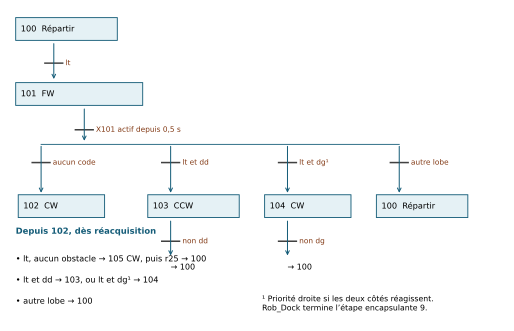

[Livret officiel, fichier sujet p. 20 · cahier p. 46 du même PDF](https://www.banquept.fr/documents/2012/si_a_pt_2012.zip)

### Question 45 — Retour au dock par six macro-étapes

> [!INDICATION]
> Conserver les numéros du cahier, le sens des pivots et le réarmement des mesures d’angle à chaque nouvelle étape.

#### Solution

À l’étape 100, le répartiteur active respectivement M10, M11, M12, M13, M14, M15 pour $lt,ltg,ltd,lg,ld,lgd$. Chaque sortie $S_i$ ramène à 100 par une transition toujours vraie. La macro-étape M10 reprend Q44. Dans chacune des cinq autres expansions on passe de $E_i$ à l’étape d’avance avec la réceptivité 1. Les branches issues de cette avance exigent 0,5 s d’activation. La construction et le tableau ci-dessous donnent, pour chaque case, l’action et sa condition de sortie. Les signaux $r25,r10$ désignent une rotation achevée depuis l’entrée dans l’étape correspondante.

**Macro-étape M11**

| Étape et action | Réceptivité et destination |
|---|---|
| 111 FW | Aucun code → 112. Tourelle → 113. Gauche → S11. |
| 112 CW | Gauche → S11. |
| 113 CCW | Gauche → 114. |
| 114 CCW | 25° atteints ou lgd acquis → S11. |

**Macro-étape M12**

| Étape et action | Réceptivité et destination |
|---|---|
| 121 FW | Aucun code → 122. Tourelle → 123. Droite → S12. |
| 122 CCW | Droite → S12. |
| 123 CW | Droite → 124. |
| 124 CW | 25° atteints ou lgd acquis → S12. |

**Macro-étape M13**

| Étape et action | Réceptivité et destination |
|---|---|
| 131 FW | Aucun code → 132. Tourelle–gauche → 136. Gauche–droite → S13. |
| 132 CW | Gauche → 133. Gauche–droite → 134. Droite → 135. |
| 133 CW | 25° atteints → S13. |
| 134 CW | Gauche → S13. |
| 135 CW | Gauche–droite → S13. |
| 136 CCW | 25° atteints ou lgd acquis → S13. |

**Macro-étape M14**

| Étape et action | Réceptivité et destination |
|---|---|
| 141 FW | Aucun code → 142. Tourelle–droite → 146. Gauche–droite → S14. |
| 142 CCW | Droite → 143. Gauche–droite → 144. Gauche → 145. |
| 143 CCW | 25° atteints → S14. |
| 144 CCW | Droite → S14. |
| 145 CCW | Gauche–droite → S14. |
| 146 CW | 25° atteints ou lgd acquis → S14. |

**Macro-étape M15**

| Étape et action | Réceptivité et destination |
|---|---|
| 151 FW | Aucun code → 152. Gauche → 154. Droite → 156. |
| 152 CCW | 25° atteints → 153. |
| 153 CCW | Gauche–droite → S15. |
| 154 CCW | Droite → 155. |
| 155 CW | 10° atteints → S15. |
| 156 CW | Gauche → 157. |
| 157 CCW | 10° atteints → S15. |

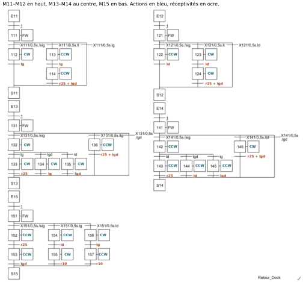

[Livret officiel, fichier sujet p. 20 · cahier p. 47 du même PDF](https://www.banquept.fr/documents/2012/si_a_pt_2012.zip)
