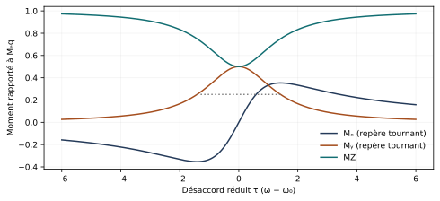
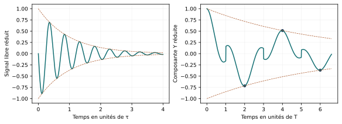
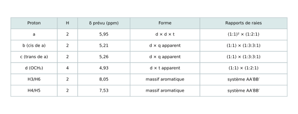

# ENS de Lyon PC 2012 — Physique-chimie (L) · Corrigé guidé

*Corrigé rédigé par IA, non officiel. Signalez toute erreur.*

**Lecture du rapport du jury** · GPT-6.2 Astra Ultra · vitesse non renseignée

**Rédaction** · GPT-6.2 Astra Ultra · vitesse non renseignée

## Résonance magnétique nucléaire et caractérisation de phtalates

**Couverture.** Les rubriques traitées figurent sous leurs numéros imprimés. Restent hors de ce corrigé les questions VI.A.1, VI.A.3, VI.A.6, VI.A.7, VI.A.8, VII.A.1, VII.A.4, VII.A.9.

## I · Moments magnétiques et relaxation

### Question 1 — Moment cinétique orbital

**Indication.** Choisir la normale orientée par le sens de parcours de l’électron.

En prenant $\mathbf v=v\mathbf u_\theta$, $\boldsymbol\ell=(r\mathbf u_r)\times(m_ev\mathbf u_\theta)=m_e rv\mathbf u_z$. Inverser le sens de parcours inverse le moment.

### Question 2 — Courant de boucle

**Indication.** La période d’une révolution vaut le périmètre divisé par la vitesse.

Le courant algébrique dans le sens de parcours vaut $I=q_e/T=q_ev/(2\pi r)$. Comme $q_e=-e$, le courant conventionnel circule dans le sens inverse du déplacement électronique.

### Question 3 — Rapport gyromagnétique classique

**Indication.** Multiplier le courant orienté par le vecteur surface du disque orbital.

$\boldsymbol\mu=I\pi r^2\mathbf u_z=(q_e rv/2)\mathbf u_z=\gamma_e^c\boldsymbol\ell$ avec $\gamma_e^c=q_e/(2m_e)$. Les moments cinétique et magnétique de l’électron sont antiparallèles.

### Question 4 — Facteur deux électronique

**Indication.** Appliquer la consigne numérique puis préciser à quel mouvement correspond physiquement le facteur deux.

La valeur doublée demandée est $2\gamma_e^c=-e/m_e=-1{,}76\times10^{11}\ \mathrm{s^{-1}T^{-1}}$. Cette valeur correspond en réalité au facteur de spin du seul électron (à son anomalie près). Pour son moment orbital pur le facteur de Landé est un, et le rapport orbital vaut $-8{,}78\times10^{10}\ \mathrm{s^{-1}T^{-1}}$. Cette distinction lève l’ambiguïté de la dernière phrase de l’énoncé.

### Question 5 — Moment global des protons

**Indication.** Le moment de l’échantillon est la somme vectorielle des moments élémentaires.

Tous les protons ont le même rapport $\gamma>0$. Ainsi $\mathbf M=\sum_i\boldsymbol\mu_i=\gamma\sum_i\boldsymbol\ell_i$. Dans les notations de ce problème, $\mathbf M$ est un moment total, exprimé en $\mathrm{A\,m^2}$.

### Question 6 — Équation de mouvement

**Indication.** Appliquer le théorème du moment cinétique à chaque proton avant de sommer.

Le champ uniforme n’exerce aucune force de gradient, $\mathbf F_i=0$, mais exerce le couple $\boldsymbol\Gamma_i=\boldsymbol\mu_i\times\mathbf B_0$. Ainsi $\dot{\boldsymbol\ell}_i=\boldsymbol\Gamma_i$ et $\dot{\mathbf M}=\gamma\mathbf M\times\mathbf B_0$ dans le laboratoire.

### Question 7 — Précession de Larmor

**Indication.** Comparer l’équation à la dérivée d’un vecteur en rotation uniforme.

$\dot{\mathbf M}=\boldsymbol\omega_0\times\mathbf M$ avec $\boldsymbol\omega_0=-\gamma B_0\mathbf u_z$. La norme et la projection verticale restent constantes. L’extrémité de $\mathbf M$ décrit un cercle à fréquence positive $\nu_0=\gamma B_0/(2\pi)$.

### Question 8 — Champ pour 300 MHz

**Indication.** Utiliser une fréquence en cycles par seconde et convertir en pulsation.

$B_0=2\pi(300\times10^6)/(2{,}68\times10^8)=7{,}0\ \mathrm T$. C’est plus que le champ usuel fourni dans un volume d’échantillon par un aimant permanent, typiquement d’ordre un tesla ou moins. Les spectromètres de cette classe emploient généralement un aimant supraconducteur.

### Question 9 — Relaxation vers l’équilibre

**Indication.** Ajouter le couple dissipatif à la dynamique des moments cinétiques individuels.

$\dot{\mathbf M}=\boldsymbol\omega_0\times\mathbf M+(\mathbf M_{eq}-\mathbf M)/\tau$, $\mathbf M_{eq}=N\gamma\boldsymbol\ell_{eq}=M_{eq}\mathbf u_z$. Les interactions avec l’environnement moléculaire et ses champs microscopiques fluctuants permettent les échanges d’énergie et le retour à l’équilibre. Un seul $\tau$ est retenu dans le modèle du sujet.

## II · Irradiation continue

### Question 10 — Champ radiofréquence tournant

**Indication.** Additionner les couples associés aux deux champs avant de passer au repère tournant.

Sans relaxation à ce stade, $(d\mathbf M/dt)_0=(\boldsymbol\omega_0+\boldsymbol\omega_1)\times\mathbf M$, avec $\boldsymbol\omega_1=-\gamma\mathbf B_1$ et $\mathbf B_1$ tournant dans le plan horizontal.

### Question 11 — Équation dans le repère entraîné

**Indication.** Soustraire la rotation du repère à la vitesse angulaire instantanée du vecteur.

La formule de transport donne $(d\mathbf M/dt)_1=[(\omega_0-\omega)\mathbf u_Z+\omega_1\mathbf u_X]\times\mathbf M$, avec $\omega_1=-\gamma B_1$. Le vecteur effectif est constant en irradiation circulaire.

### Question 12 — Équations de Bloch du modèle

**Indication.** Projeter le produit vectoriel puis ajouter la relaxation longitudinale et transverse retenue.

Avec $d=\omega-\omega_0$, les équations sont $\dot M_X=dM_Y-M_X/\tau$, $\dot M_Y=-dM_X-\omega_1 M_Z-M_Y/\tau$, $\dot M_Z=\omega_1M_Y+(M^*-M_Z)/\tau$. En particulier, le couple transverse peut faire varier la composante longitudinale.

### Question 13 — Réponse stationnaire et profils

**Indication.** Éteindre le champ tournant avant de comparer les trois composantes à l’équilibre initial.

À $B_1=0$ les formules donnent $(0,0,M^*)$, donc $M^*=M_{eq}$. Posons $x=\tau d$, $b=\tau\omega_1$ et $D=1+b^2+x^2$. Les composantes normalisées sont $-bx/D$, $-b/D$, $(1+x^2)/D$. La première est dispersive impaire, la deuxième est un pic pair de signe positif pour le proton ($b<0$), la troisième présente un creux pair et tend vers un loin de la résonance.

### Question 14 — Intensité optimale en continu

**Indication.** Optimiser la valeur du pic sur résonance par rapport au champ transverse.

Au centre $|M_Y|/M^*=|b|/(1+b^2)$. Sa dérivée par rapport à $|b|$ a le signe de $1-b^2$, donc le maximum vaut $1/2$ pour $|b|=1$. Ainsi $B_1=1/(\gamma\tau)=3{,}73\times10^{-7}\ \mathrm T$ avec $\tau=10\ \mathrm{ms}$.

### Question 15 — Largeur et qualité

**Indication.** L’abscisse à mi-hauteur est obtenue en doublant le dénominateur de la Lorentzienne centrale.

Les deux points sont $x=\pm\sqrt{1+b^2}$, donc $\Delta\nu=\sqrt{1+b^2}/(\pi\tau)$. À l’optimum, $\Delta\nu\simeq45\ \mathrm{Hz}$ et $Q_Y=\nu_0/\Delta\nu\simeq6{,}7\times10^6$. Cette résonance est extrêmement étroite relativement à sa fréquence porteuse.

### Question 16 — Orientation à résonance

**Indication.** Remplacer $x$ par zéro et $b$ par moins un.

Il vient $(M_X,M_Y,M_Z)=M_{eq}(0,1/2,1/2)$. Le vecteur est dans le plan $YZ$, à $45^\circ$ de $+Z$ vers $+Y$, de norme $M_{eq}/\sqrt2$.

### Question 17 — Champ linéaire oscillant

**Indication.** Décomposer le cosinus en deux vecteurs de même norme tournant en sens opposés.

$B'_1\cos(\omega t)\mathbf u_x$ est la somme de deux champs circulaires d’amplitude $B'_1/2$. Celui qui tourne dans le sens de Larmor demeure presque fixe dans le repère résonant, l’autre tourne à environ $2|\omega_0|$ et son effet séculaire est faible. L’optimum nécessite donc $B'_1=2/(\gamma\tau)\simeq0{,}75\ \mathrm{\mu T}$.

## III.A · Excitation pulsée

### Question 18 — Rotation pendant l’impulsion

**Indication.** À résonance, le champ effectif n’a qu’une composante selon X.

Sans relaxation, $\dot M_X=0$, $\dot M_Y=-\omega_1 M_Z$ et $\dot M_Z=\omega_1M_Y$. Avec le moment initial sur $+Z$, $M_X=0$, $M_Y=-M_{eq}\sin(\omega_1t)$ et $M_Z=M_{eq}\cos(\omega_1t)$. Le moment tourne à norme constante autour de $X$, de $+Z$ vers $+Y$ pour $\omega_1<0$.

### Question 19 — Angle de bascule

**Indication.** Intégrer la vitesse angulaire durant tout le créneau.

L’angle algébrique autour de $+X$ est $\omega_1\delta T$, de module $\gamma B_1\delta T$. Pour la première bascule vers $+Y$, $\delta T_{90}=\pi/(2\gamma B_1)=9{,}0\ \mathrm{\mu s}$ à $B_1=0{,}65\ \mathrm{mT}$.

### Question 20 — Après le créneau dans le repère tournant

**Indication.** À l’extinction, l’aimantation démarre sur $+Y$ et le champ effectif de précession s’annule.

Pour $s=t^+$, $\dot M_X=-M_X/\tau$, $\dot M_Y=-M_Y/\tau$ et $\dot M_Z=(M_{eq}-M_Z)/\tau$. Ainsi $M_X=0$, $M_Y=M_{eq}e^{-s/\tau}$ et $M_Z=M_{eq}(1-e^{-s/\tau})$. Dans ce modèle à une constante de temps, l’extrémité parcourt une droite du point $+Y$ au point $+Z$.

### Question 21 — Signal dans le laboratoire

**Indication.** Projeter les deux axes tournants sur les axes fixes et fixer l’origine de phase RF.

Avec la phase $\psi=\omega_0 s+\psi_0$, $M_x=-M_{eq}e^{-s/\tau}\sin\psi$, $M_y=M_{eq}e^{-s/\tau}\cos\psi$, $M_z=M_{eq}(1-e^{-s/\tau})$. Si l’axe X coïncide avec x en fin de créneau, $\psi_0=0$. Le tracé de $M_x$ est une sinusoïde amortie entre les enveloppes $\pm M_{eq}e^{-s/\tau}$.

### Question 22 — Transformée de Fourier du signal libre

**Indication.** Transformer une exponentielle causale modulée à la fréquence de Larmor.

On numérise le signal de précession libre puis on calcule sa transformée de Fourier. Près de la fréquence positive, l’amplitude complexe varie comme $[1/\tau+2\pi i(\nu-\nu_0)]^{-1}$. La partie absorptive et la puissance ont une largeur totale à mi-hauteur $1/(\pi\tau)$. L’analogie avec un train d’onde fini donne l’ordre de grandeur $1/\tau$.

### Question 23 — Séparation minimale de deux raies

**Indication.** Comparer l’écart des fréquences à la largeur d’une raie individuelle.

Pour $\tau\sim1\ \mathrm s$, la largeur de Lorentz vaut environ $0{,}32\ \mathrm{Hz}$. Le seuil exact dépend du critère de séparation et du bruit. La résolution naturelle est ainsi de l’ordre du hertz, sous réserve d’une acquisition suffisamment longue.

### Question 24 — Structure fine de l’éthanol

**Indication.** Convertir une différence de ppm en hertz avec la fréquence du spectromètre.

À $300\ \mathrm{MHz}$ un ppm vaut $300\ \mathrm{Hz}$, et un hertz correspond à $0{,}0033$ ppm. Les séparations des raies fines discernables dans les massifs de la figure 2 (typiquement plusieurs hertz, comme un couplage vicinal d’environ 7 Hz) dépassent cet ordre de résolution. Le spectromètre peut donc les distinguer lorsque le champ est suffisamment homogène.

## III.B · Déphasage statique et échos

### Question 25 — Largeur de champ

**Indication.** La fréquence de Larmor du proton est linéaire en champ local.

Pour un écart total $\delta B_0$, les fréquences extrêmes sont écartées de $\Delta_B\nu=\gamma\delta B_0/(2\pi)$. Il s’agit d’un étalement inhomogène distinct de la largeur de relaxation.

### Question 26 — Tolérance d’homogénéité

**Indication.** Inverser le résultat précédent et le rapporter à la valeur du champ central.

Dix hertz représentent $\delta B_0=2\pi\,10/\gamma\simeq2{,}34\times10^{-7}\ \mathrm T$. À $7\ \mathrm T$, la variation relative est environ $3{,}3\times10^{-8}$. Une très petite inhomogénéité masque donc déjà des couplages fins.

### Question 27 — Précession résiduelle

**Indication.** Soustraire la vitesse de rotation commune réglée sur $B_0$.

Le moment $i$ précesse autour de $Z$ à la vitesse algébrique $\delta\omega_i=-\gamma(B_{0i}-B_0)$ dans $R_1$. Sa projection $Z$ et son module transverse restent constants. Les spins situés de part et d’autre du champ nominal tournent en sens opposés dans ce repère.

### Question 28 — Disparition du signal cohérent

**Indication.** Comparer la phase du spin le plus rapide à celle du plus lent.

Après une impulsion uniforme à $90^\circ$, l’écart de phase total est $\delta\theta=\gamma\delta B_0s=2\pi\Delta_B\nu\,s$. Pour une distribution uniforme l’intégrale des phases donne $\sin(\pi\Delta_B\nu s)/(\pi\Delta_B\nu s)$ et son premier zéro est $\Delta T=1/\Delta_B\nu$. Plus généralement la décroissance intervient à cette échelle, environ $0{,}1\ \mathrm s$ pour 10 Hz.

### Question 29 — Écho de spin

**Indication.** Une rotation de $\pi$ autour de X conjugue l’amplitude transverse complexe et conserve ensuite le signe du désaccord de fréquence.

a) Pour $t\ge T$, $\mu_\pm(t)=\mu\exp\{i[\delta\omega_\pm(t-2T)-\pi/2]\}$. On a conjugué la valeur en $T^-$ avant de reprendre la précession. b) Au premier refocalisage de toute la distribution, $t^*=2T$, tous les moments pointent vers $-Y$. Chacun contribue $-\mu e^{-2T/\tau}$ sur cet axe. c) Les impulsions à $(2k-1)T$ produisent des échos à $2kT$, de signe $(-1)^k$ avec les axes choisis. La valeur absolue des maxima est $M_{eq}e^{-2kT/\tau}$. La pente du logarithme de leurs modules donne $-1/\tau$, sans contribution du déphasage statique refocalisé.

## IV · Circuit de détection et démodulation

### Question 30 — Circuit forcé par le flux

**Indication.** Le flux de l’échantillon s’ajoute au flux propre et fournit une f.é.m. de Faraday.

Avec la convention du schéma, la maille donne $L\dot i+(R+r)i+q/C=-\dot\phi_x$ avec $\dot q=i$. Après dérivation $L\ddot i+(R+r)\dot i+i/C=-\ddot\phi_x$. Le flux variable de l’échantillon est le terme source du circuit passif.

### Question 31 — Accord de la bobine

**Indication.** À fréquence fixée, minimiser le module de l’impédance série.

En convention $e^{i\omega t}$, $U_\omega=-i\omega R\phi_\omega/[R+r+i(\omega L-1/(\omega C))]$. On maximise le module en annulant la partie réactive près de $\nu_0$. Ainsi $C=1/[(2\pi\nu_0)^2L]\simeq2{,}8\times10^{-14}\ \mathrm F$, soit $28\ \mathrm{fF}$ dans le modèle idéal donné.

### Question 32 — Bande passante électrique

**Indication.** Employer la résistance totale $R+r$ dans le facteur de qualité.

Pour $R=r=50\ \Omega$, $Q_s=|\omega_0|L/(R+r)\simeq188$ et $\Delta f=\nu_0/Q_s=(R+r)/(2\pi L)\simeq1{,}6\ \mathrm{MHz}$. La figure 2 couvre environ 11 ppm, soit $3{,}3\ \mathrm{kHz}$. Le circuit laisse donc passer la totalité du spectre utile.

### Question 33 — Signal près de l’accord

**Indication.** La dérivée de la porteuse domine celle des enveloppes lentes.

Sur la bande RMN accordée, $u\simeq-R\dot\phi_x/(R+r)=-\mu_0\dot M_x/(2\ell)$ pour $R=r$. Dériver $M_x=M_X\cos\omega_0t-M_Y\sin\omega_0t$ et négliger les termes relatifs en $1/(|\omega_0|\tau)$ donne $u\simeq(\mu_0\omega_0/2\ell)[M_X\sin\omega_0t+M_Y\cos\omega_0t]$.

### Question 34 — Détection synchrone

**Indication.** Le produit de deux oscillations de même fréquence contient une composante lente et une composante à fréquence double.

Pour un gain de multiplication $k$, $v=k e_0\mu_0\omega_0[ M_X\sin(2\omega_0t)+M_Y(1+\cos(2\omega_0t))]/(4\ell)$. Choisir un passe-bas de coupure au-dessus de la bande des enveloppes à mesurer et très en dessous de $2\nu_0$ isole $s\simeq k e_0\mu_0\omega_0 M_Y/(4\ell)$. Une coupure de $10\ \mathrm{kHz}$ accepte même un spectre utile de quelques kHz.

### Question 35 — Mesure de la composante en quadrature

**Indication.** Changer la phase de l’oscillateur de référence de sorte que le terme en $M_X$ produise une composante continue.

Une référence $e_0\sin(\omega_0t)$, décalée d’un quart de période, donne après filtrage $s\simeq k e_0\mu_0\omega_0 M_X/(4\ell)$. Deux démodulateurs en quadrature permettent de recueillir les deux composantes simultanément.

## V · Identification du diester P₀

### Question V.1 — Degré d’insaturation

**Indication.** Comparer la formule carbonée et hydrogénée à celle d’un hydrocarbure saturé acyclique.

$I=(2\times16+2-22)/2=6$. Un cycle benzénique compte pour quatre (un cycle et trois doubles liaisons). Les deux carbonyles d’ester rendent compte des deux unités restantes.

### Question V.2 — Inventaire des signaux

**Indication.** Normaliser les intégrales aux 22 protons et rechercher les protons aromatiques et les groupes liés à un oxygène.

La figure 18 donne les couples déplacement/intégrale suivants, du champ fort au champ faible : $0{,}90/6{,}00$ (6 H méthyle), $1{,}38/4{,}01$ (4 H méthylène), $1{,}66/4{,}21$ (4 H méthylène), $4{,}25/3{,}95$ (4 H $\mathrm{OCH_2}$), $7{,}47/1{,}99$ et $7{,}66/1{,}90$ (deux paires de H aromatiques). La somme des effectifs entiers est 22. La symétrie des chaînes et la zone des $\mathrm{OCH_2}$ concordent avec un diester aromatique.

### Question V.3 — Chaînes aliphatiques de P₀

**Indication.** Mesurer l’écart entre la première et la dernière raie et diviser par le nombre d’intervalles.

a–b) À $0{,}90$ ppm, triplet avec $J\simeq(276{,}990-262{,}284)/2=7{,}4\ \mathrm{Hz}$. À $1{,}38$, sextuplet apparent, $J\simeq(432{,}697-395{,}451)/5=7{,}4\ \mathrm{Hz}$. À $1{,}66$, quintuplet apparent, $J\simeq(511{,}722-483{,}179)/4=7{,}1\ \mathrm{Hz}$. À $4{,}25$, triplet, $J\simeq(1281{,}045-1267{,}659)/2=6{,}7\ \mathrm{Hz}$. c) Pour un proton de chaîne relié à deux carbones voisins, deux H voisins peuvent se répartir $2+0$ ou $1+1$, quatre $2+2$ ou $3+1$, cinq $3+2$. L’intégration distingue ici les fragments $\mathrm{CH_3{-}CH_2}$, $\mathrm{CH_3{-}\underline{CH_2}{-}CH_2}$, $\mathrm{CH_2{-}\underline{CH_2}{-}CH_2}$ et $\mathrm{O{-}\underline{CH_2}{-}CH_2}$. d–f) Ils s’assemblent en $\mathrm{O{-}CH_2CH_2CH_2CH_3}$. Le tableau 2 place un $\mathrm{CH_2}$ d’ester aromatique vers 4,2 ppm. Le motif compte $2+2+2+3=9$ H et les intégrales en donnent 18. La molécule porte donc deux groupes n-butyle équivalents.

### Question V.4 — Disposition des deux esters sur le noyau

**Indication.** Dénombrer les classes de protons par symétrie, puis additionner les incréments du tableau 5.

a–b) Les isomères ortho (1,2), méta (1,3) et para (1,4) ont respectivement deux classes $2+2$, trois classes $1+2+1$ et une classe de quatre H. c) Avec $\delta_0=7{,}26$ et des corrections $o/m/p=0{,}71/0{,}08/0{,}19$, l’ortho donne $8{,}05$ et $7{,}53$ ppm. Le méta donne $8{,}68$, $8{,}16$ et $7{,}42$ ppm. Le para donne $8{,}05$ ppm. d) Les deux groupes d’intensité 2 observés identifient le benzène-1,2-dicarboxylate de di-n-butyle. Les déplacements additifs sont approximatifs, surtout près de deux substituants.

## VI · Fonctions chimiques et analyse de P₆

### Question VI.A.2 — Acidité de Lewis

**Indication.** Identifier le rôle de l’orbitale acceptrice du fer.

$\mathrm{FeBr_3}$ est un acide de Lewis. L’interaction entre une paire électronique du dibrome et le fer polarise la liaison Br–Br et accroît le caractère électrophile du brome.

### Question VI.A.4 — Orientation des isomères

**Indication.** Analyser l’effet mésomère du brome déjà lié au cycle.

Le brome désactive le noyau par effet inductif, mais son don de doublet favorise les substitutions en ortho et para. Le dibromé para accompagne donc le produit ortho, souvent avec une part significative à cause de la moindre gêne stérique. Le méta est minoritaire. La seule règle d’orientation ne fournit pas de proportions numériques.

### Question VI.A.5 — Distinguer les isomères

**Indication.** Combiner la présence de brome et la symétrie des protons du noyau.

Un spectre de masse renseigne sur le nombre de Br grâce aux abondances voisines de $^{79}\mathrm{Br}$ et $^{81}\mathrm{Br}$. Entre isomères de même formule brute, le nombre de groupes de protons aromatiques, leurs couplages et une comparaison à des spectres de référence distinguent les positions.

### Question VI.A.9 — Structures des intermédiaires dessinés

**Indication.** Suivre le carbone du noyau portant le substituant dans chaque écriture de la figure 6.

P₂ est le 1,2-dibromobenzène. Dans le schéma formel de double insertion P₃ porte deux liaisons aryle–magnésium, soit $o$-$\mathrm{C_6H_4(MgBr)_2}$. Les deux fonctions carboxyliques de P₄ caractérisent l’acide benzène-1,2-dicarboxylique, ou acide phtalique.

### Question VI.A.10 — Famille du produit cyclique

**Indication.** Repérer les deux carbonyles reliés au même oxygène.

Le motif $\mathrm{CO{-}O{-}CO}$ appartient aux anhydrides carboxyliques. La différence de composition par rapport au diacide est une molécule d’eau, ce qui caractérise une déshydratation intramoléculaire cyclisante.

### Question VI.A.11 — Fermeture du cycle anhydride

**Indication.** Décrire les changements de liaisons au carbone carbonylé.

Dans le schéma d’addition–élimination intramoléculaire, un oxygène carboxylique donne un doublet au carbone de l’autre fonction. L’intermédiaire tétraédrique échange des protons, puis le départ formel d’eau et le rétablissement de C=O donnent l’anhydride à cinq chaînons.

### Question VI.A.12 — Connectivité de P₆

**Indication.** Le fragment allylique possède une double liaison terminale et un seul oxygène alcoolique.

Le produit final représenté par l’analyse est le benzène-1,2-dicarboxylate de diallyle, $o$-$\mathrm{C_6H_4[CO_2CH_2CH{=}CH_2]_2}$, de formule $\mathrm{C_{14}H_{14}O_4}$. Les deux groupes allyle sont reliés aux deux oxygènes ester.

### Question VI.A.13 — Formation des liaisons ester

**Indication.** Distinguer le premier transfert d’acyle, qui ouvre un cycle, du second qui est une estérification du monoacide.

L’alcool attaque un carbonyle de l’anhydride. Le retour de l’intermédiaire tétraédrique au carbonyle ouvre la liaison acyle–oxygène et laisse un monoester monoacide après transfert de proton. Une seconde addition de l’alcool au carbonyle de l’acide, des transferts de proton puis l’élimination formelle d’eau rendent compte du second ester. Cette dernière étape est équilibrée.

### Question VI.A.14 — Réactivité relative

**Indication.** Comparer les groupes susceptibles de partir au cours d’un transfert d’acyle.

L’anhydride possède un groupe partant carboxylate stabilisé et un carbonyle électrophile. Son ouverture produit facilement le premier ester sans former d’eau, alors qu’en partant du diacide les deux formations d’ester sont équilibrées. L’ouverture à elle seule ne garantit pas la conversion du second carboxyle.

### Question VI.B.1 — Multiplets d’une chaîne allylique

**Indication.** Reprendre les lettres de la figure 9. Les deux H terminaux de la double liaison n’ont pas la même relation cis/trans au proton central.

a–b) $n$ voisins équivalents de spin $1/2$ produisent $n+1$ raies d’intensités binomiales en régime du premier ordre. Deux familles différentes engendrent $(n_1+1)(n_2+1)$ raies avant superposition, avec produits des intensités. c) Ici $J_{ab}\simeq10$ (cis), $J_{ac}\simeq17$ (trans), $J_{bc}\simeq1{,}5$ (géminé), $J_{ad}\simeq7$ (vicinal), $J_{bd}\simeq J_{cd}\simeq1{,}5\ \mathrm{Hz}$ (longue distance). d) $H_a$ est un doublet de doublets de triplets (un b, un c, deux d). e) $H_b$ est un doublet par a, sous-décomposé par c et deux d en quartet apparent si leurs petits couplages sont égaux. $H_c$ a le même aspect avec le grand écart trans de 17 Hz. Les deux $H_d$ équivalents ne se dédoublent pas entre eux. Chacun donne un doublet par a, puis un triplet apparent par b et c si leurs deux faibles couplages coïncident.

### Question VI.B.2 — Prédiction du spectre de P₆

**Indication.** Les deux bras de l’ortho-diester sont équivalents. Affecter $a$ au CH central, $b,c$ au méthylène terminal et $d$ au méthylène oxygéné.

a) La structure est $o$-$\mathrm{C_6H_4[CO_2CH_d{}_2CH_a{=}CH_bH_c]_2}$. Deux protons terminaux d’un même bras sont non équivalents par la géométrie de la double liaison. b) Les résultats du tableau de prédiction sont détaillés ci-dessous. Les H de la partie aromatique forment un système couplé de type $AA'BB'$ pour lequel le premier ordre est approximatif.

### Question VI.B.3 — Attribution expérimentale de P₆

**Indication.** Utiliser le grand couplage trans pour distinguer les deux H de la double liaison terminale.

La figure 19 donne $H_d$ près de $4{,}73$ ppm (4 H), $H_b$ près de $5{,}22$ ppm (2 H, grand écart voisin de 10 Hz), $H_c$ près de $5{,}33$ ppm (2 H, grand écart voisin de 17 Hz) et $H_a$ vers $5{,}94$ ppm (2 H, multiplet). L’intégration réelle arrondie est $4:2:2:2$. Les deux massifs aromatiques de 2 H chacun, vers 7,47 et 7,66 ppm, reviennent respectivement aux H4/H5 puis H3/H6, ces derniers étant ortho d’un ester.

## VII · Identification de l’isomère P₁₁

### Question VII.A.2 — Spectre du xylène précurseur

**Indication.** Comparer le nombre de protons méthyliques et aromatiques et examiner la possibilité de recouvrement.

Le signal d’environ 2,2 ppm (6 H) et le massif vers 7,1 ppm (4 H) indiquent un xylène, $\mathrm{C_6H_4(CH_3)_2}$. Les méthyles sont équivalents dans les trois isomères. Un unique singulet aromatique véritable désignerait le para, mais l’agrandissement fourni ne résout pas les protons presque isochrones. L’ortho donne deux paires prévues vers $7{,}01$ et $7{,}00$ ppm, facilement confondues. Le méta devrait présenter trois groupes et est moins compatible. La figure 20 du diester final tranche en faveur de l’ortho.

### Question VII.A.3 — Rôle du permanganate

**Indication.** Comparer le degré d’oxydation du manganèse et celui du carbone benzylique.

Le permanganate est un oxydant. Les substituants méthyliques benzyliques peuvent perdre des électrons et former des carboxylates, tandis que le manganèse se réduit.

### Question VII.A.5 — Équation rédox formelle

**Indication.** Équilibrer séparément la perte de douze électrons des deux carbones benzyliques et la réduction du manganèse en milieu basique.

Avec $Ar=\mathrm{C_6H_4}$, les demi-équations sont $Ar(\mathrm{CH_3})_2+14\,\mathrm{OH^-}\to Ar(\mathrm{COO^-})_2+10\,\mathrm{H_2O}+12e^-$ et $\mathrm{MnO_4^-}+2\mathrm{H_2O}+3e^-\to\mathrm{MnO_2}+4\mathrm{OH^-}$. La somme donne $Ar(\mathrm{CH_3})_2+4\,\mathrm{MnO_4^-}\to Ar(\mathrm{COO^-})_2+4\,\mathrm{MnO_2}+2\,\mathrm{H_2O}+2\,\mathrm{OH^-}$. Masse et charge sont conservées.

### Question VII.A.6 — Acide et base conjuguée

**Indication.** Le squelette carboné n’est pas modifié par le transfert de protons.

P₈ est le sel de benzène-1,2-dicarboxylate dans l’hypothèse ortho confirmée par le produit final. P₉ est sa forme diacide, $o$-$\mathrm{C_6H_4(COOH)_2}$.

### Question VII.A.7 — Structure de Lewis d’un composé soufré

**Indication.** Compter les 26 électrons de valence et attribuer les doublets libres.

$\mathrm{SOCl_2}$ est le chlorure de thionyle. Dans la représentation usuelle $\mathrm{Cl{-}S(=O){-}Cl}$, S porte un doublet libre, O deux et chaque Cl trois. Les trois liaisons et le doublet central donnent une géométrie pyramidale autour de S.

### Question VII.A.8 — Pyridine base de Lewis

**Indication.** Distinguer le doublet libre du système aromatique à six électrons.

La pyridine est un cycle aromatique à six sommets dont un N et cinq CH. Son doublet libre, dans une orbitale du plan, peut fixer un proton sans rompre le sextet $\pi$. Elle joue ici le rôle de base pouvant capter l’acide formé sous forme de pyridinium.

### Question VII.A.10 — Structure de l’ester ramifié

**Indication.** La figure 13 apporte un groupe isobutyle et la région aromatique départage les trois dispositions possibles.

Le composé identifié est le benzène-1,2-dicarboxylate de diisobutyle $o$-$\mathrm{C_6H_4[CO_2CH_2CH(CH_3)_2]_2}$, isomère de constitution de P₀. La symétrie des deux chaînes et la structure ortho sont testées dans les deux questions suivantes.

### Question VII.A.11 — Sens thermodynamique de la dernière réaction

**Indication.** Comparer réactivité initiale et réactivité en retour dans une substitution nucléophile d’acyle.

L’alcoolyse d’un chlorure d’acyle est très favorisée car le chlorure est un bon groupe partant et l’ester formé est moins réactif. Dans le modèle du sujet, on considère donc la transformation pratiquement totale pour les fonctions disponibles. Un rendement isolé de 100 % ne se déduit pas de cet argument.

### Question VII.B.1 — Signaux aliphatiques de l’isobutyle

**Indication.** Distinguer les quatre méthyles, les deux méthines et les deux méthylènes oxygénés.

Le doublet $0{,}92$ ppm, 12 H, correspond à quatre $\mathrm{CH_3}$ couplés chacun au CH voisin, $J=279{,}811-273{,}088=6{,}7\ \mathrm{Hz}$. Les deux CH à $1{,}98$ ppm couplent à six H méthyle et deux H méthylène avec $J\simeq6{,}7$ Hz. On lit neuf raies apparentes. Les deux $\mathrm{OCH_2}$ à $4{,}02$ ppm donnent un doublet de 4 H, $J=1210{,}424-1203{,}701=6{,}7\ \mathrm{Hz}$. Le déplacement vers 4 ppm traduit la liaison au groupe ester. Les quatre protons aromatiques complètent les 22 H.

### Question VII.B.2 — Système aromatique couplé

**Indication.** Le noyau ortho-disubstitué de façon identique donne deux couples équivalents par symétrie.

Les massifs à environ 7,47 et 7,66 ppm intègrent chacun pour deux H. Le plus déblindé appartient aux H3/H6, ortho de l’un des carbonyles. L’autre correspond aux H4/H5. Chaque massif porte des couplages aromatiques vicinaux de plusieurs hertz et méta plus faibles, le para étant voisin de zéro. L’annexe donne environ 9 et 3 Hz. À 300 MHz ces protons forment un système $AA'BB'$ avec effets de second ordre. L’étendue des pics visibles est environ 9 Hz et les petits espacements sont de l’ordre de 2 à 3 Hz. La distance entre deux maxima voisins n’identifie pas systématiquement un couplage élémentaire.

## VIII · Dosage des plastifiants par RMN

### Question VIII.1 — Composants présents

**Indication.** Chercher des marqueurs distincts des signaux aromatiques communs aux trois esters.

L’absence de signaux entre 5 et 6 ppm exclut une quantité détectable de P₆. Le doublet oxygéné vers 4,0 ppm et le CH vers 2,0 ppm révèlent P₁₁. Le triplet vers 4,25 ppm et les méthylènes vers 1,4 et 1,7 ppm révèlent P₀. Le massif vers 0,9 ppm superpose les méthyles des deux isomères.

### Question VIII.2 — Fractions molaires et massiques

**Indication.** Diviser chaque intégrale par le nombre de H qu’elle représente avant de former un rapport.

Les seuls pics des $\mathrm{OCH_2}$ fournissent $n_{11}:n_0=(15{,}59/4):(2{,}57/4)$, soit environ $86:14$. Une autre lecture utilise le CH de P₁₁ (7,644 pour deux H) et la normalisation totale (100 pour 22 H par molécule) : $x_{11}=(7{,}644/2)/(100/22)=0{,}841$, $x_0=0{,}159$. Les incertitudes d’intégration des massifs expliquent l’écart. On retient environ 85 % P₁₁ et 15 % P₀. Comme les deux isomères ont la même masse molaire $278\ \mathrm{g\,mol^{-1}}$, ces pourcentages sont aussi massiques.

### Question VIII.3 — Étalonnage par ajout dosé

**Indication.** Conserver le même gain et la même échelle d’intégration avant et après l’ajout.

Le pic à 2 ppm correspond à P₁₁. Son augmentation de $9{,}55-7{,}644=1{,}906$ unités représente $1{,}0\ \mathrm{mg}$ ajouté. Il y avait donc $m_{11}=7{,}644/1{,}906\simeq4{,}0\ \mathrm{mg}$. La normalisation totale donne $m_0=(0{,}159/0{,}841)m_{11}\simeq0{,}76\ \mathrm{mg}$ (environ $0{,}7$ mg par les autres intégrales). Dans 1,0 g de plastique les teneurs sont proches de $0{,}40\,\%$ P₁₁ et $0{,}07$ à $0{,}08\,\%$ P₀.

### Question VIII.4 — Comparaison au seuil posé dans l’épreuve

**Indication.** Traduire 0,1 % en masse de plastifiant dans l’échantillon d’un gramme.

Le seuil rappelé dans le sujet représente $1{,}0\ \mathrm{mg}$ par gramme. P₁₁ seul en représente environ $4{,}0$, et le total des deux est proche de $4{,}7\ \mathrm{mg/g}$. L’échantillon dépasse donc le seuil historique donné dans l’énoncé.
