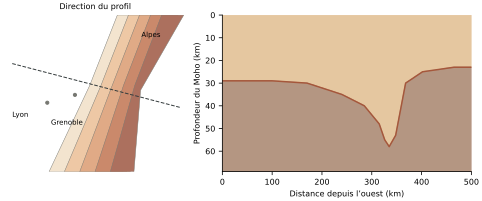
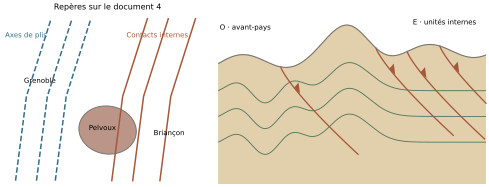
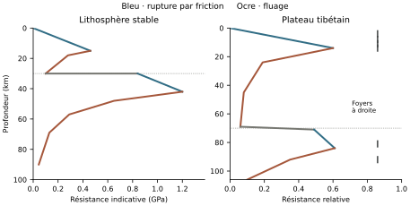
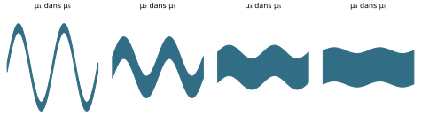

# ENS de Lyon, second concours 2012 — Géosciences · Corrigé guidé

*Corrigé rédigé par IA, non officiel. Signalez toute erreur.*

**Rédaction** · GPT-6.2 Astra Ultra · vitesse non renseignée

Pour chaque coupe, commencer par un axe horizontal orienté et un axe des profondeurs. Reporter les observations avant d’interpoler les interfaces.

## A — Reconnaître un épaississement

### Question A1 — Reconnaître la racine et tracer le Moho

> [!INDICATION]
> Reporter sur une bande de papier les intersections exactes du pointillé avec les courbes, avant de donner à chacune sa profondeur.

#### Solution

Le relief de surface ne représente qu’une partie de l’épaississement. Le document 2 montre les hauts pics de l’Himalaya puis le plateau tibétain, élevé sur plusieurs centaines de kilomètres. Les Alpes présentent une zone haute plus étroite et les Andes associent hauts sommets et domaine élevé plus large. Le niveau horizontal de comparaison est 4 800 m. Le document 1 représente des **profondeurs** du Moho. Sur son pointillé ouest–est, partir d’une croûte voisine de 30 km dans l’avant-pays, atteindre l’isobathe 30 vers le premier tiers du tracé, puis 35 et 40 km en entrant sous les Alpes. Les courbes serrées des zones internes descendent jusque vers 55–60 km sur la carte. À l’est la profondeur remonte rapidement vers 30 puis 25 km et des valeurs localement plus faibles. La barre de 100 km donne près de 500 km de tracé. Le croquis ci-dessous situe la racine vers les deux tiers de la coupe. Le pointillé passe au nord des points de Lyon et Grenoble. La profondeur réelle du Moho peut être discontinue là où deux lithosphères se superposent.

### Question A2 — Techniques de détection

> [!INDICATION]
> Distinguer les observations qui localisent une interface aujourd’hui de celles qui enregistrent un enfouissement ancien.

#### Solution

La réfraction sismique à grands profils utilise les temps des ondes crustales et des ondes réfractées dans le manteau, plus rapide. La réflexion profonde peut imager le contraste d’impédance. Les fonctions récepteur exploitent les conversions P–S au Moho et leur retard pour estimer sa profondeur sous une station. Il faut un modèle de vitesse et plusieurs azimuts pour séparer géométrie et hétérogénéités. Les anomalies de Bouguer aident à détecter un déficit profond de masse, à cause d’une racine crustale moins dense que le manteau. Elles ne fournissent pas seules une profondeur unique. Les mesures topographiques et satellitaires renseignent sur le relief, le GPS sur la convergence contemporaine, et les roches métamorphiques exhumées sur les pressions passées.

### Question A3 — Relief, densité et compensation

> [!INDICATION]
> Écrire le bilan de masse par unité de surface par rapport à une colonne de plaine au même niveau de compensation.

#### Solution

De la croûte continentale peu dense est empilée et remplace en profondeur du manteau plus dense. À l’échelle régionale, une racine compense une partie de la charge des reliefs. Dans un modèle d’Airy à colonnes d’égale pression à grande profondeur, une topographie $h$ et une racine supplémentaire $r$ vérifient $\rho_c h=(\rho_m-\rho_c)r$. Pour $\rho_c=2\,800$ et $\rho_m=3\,300\ \mathrm{kg\,m^{-3}}$, 4 km de relief donnent environ 22 km de racine. Une croûte de référence à 30 km peut ainsi dépasser 50 km d’épaisseur. La rigidité en flexion répartit la charge. Érosion, sédimentation, densification métamorphique et forces dynamiques peuvent décaler relief et racine.

### Question A4 — Contextes d’épaississement

> [!INDICATION]
> Associer chacun des trois reliefs figurés à un type de convergence et au matériel qui s’empile.

#### Solution

La convergence continent–continent provoque sous-charriage, plis et empilements de nappes, comme dans le système Inde–Asie ou dans les Alpes. À une marge continentale au-dessus d’une subduction océanique, raccourcissement de la plaque supérieure et apport magmatique peuvent épaissir ensemble la croûte, comme dans les Andes. Les ajouts magmatiques basaux constituent aussi un mécanisme d’épaississement local. Une haute altitude peut avoir d’autres causes, notamment un soutien thermique ou dynamique. Le diagnostic doit donc associer relief, profondeur du Moho et structures.

## B — Structures tectoniques

### Question B1 — Couche repère plissée et raccourcissement

> [!INDICATION]
> Le dénominateur est la longueur restaurée du niveau que l’on suit et non la distance actuelle entre ses extrémités.

#### Solution

Le niveau noir, dans la série jurassique près de l’Alpe d’Huez, change de pendage et comporte des charnières successives reliées par des flancs. Il reste suivi sur le cliché à travers des variations de longueur d’onde et d’inclinaison. Les termes **antiforme** et **synforme** décrivent une convexité et une concavité vers le haut. Identifier anticlinal et synclinal au sens stratigraphique exige le sens de rajeunissement. Le flambage sous compression parallèle aux couches, le glissement entre bancs et la déformation interne accommodent un raccourcissement. L’observation d’un pli à cette échelle ne suppose pas que chaque grain ait flué.
Pour estimer le raccourcissement, choisir deux extrémités sur le même niveau, mesurer la longueur curviligne $L_0$ entre elles au fil ou par numérisation, puis leur séparation horizontale présente $L_f$ dans une coupe approximativement perpendiculaire à l’axe. En supposant une couche initialement horizontale de longueur conservée, le raccourcissement positif vaut $100(L_0-L_f)/L_0$. À titre d’étalonnage de la méthode, $L_0=120$ unités et $L_f=96$ donneraient 20 %. Une photo oblique, le glissement hors du plan, un niveau déjà incliné ou étiré rendent cette estimation approximative.

### Question B2 — Reporter les structures sur la carte alpine

> [!INDICATION]
> Pour distinguer une répétition par pli et une répétition par chevauchement, chercher le retournement continu du contact ou au contraire sa troncature.

#### Solution

À l’ouest de Grenoble, suivre les bandes sédimentaires alternantes des massifs subalpins et souligner leur allongement grossièrement NNE–SSO. Les retours et répétitions de limites autour d’une bande permettent de tracer un axe de pli dans la direction des couches. Entre Grenoble et le massif cristallin externe du Pelvoux, des bandes mésozoïques redressées se pincent ou contournent les affleurements de socle. Le Pelvoux, indiqué sur la carte, affleure au cœur d’un ensemble soulevé. Vers Briançon, les unités internes forment des bandes repétées parallèles au faisceau de contacts. Identifier un chevauchement sur les tracés tectoniques et la répétition de la série, puis placer les dents du côté de l’unité supérieure. Une simple différence de couleur identifie une limite lithologique, pas à elle seule une faille inverse.
La coupe ouest–est place donc à l’ouest des plis et des chevauchements de couverture, vers le centre un socle externe soulevé et sa couverture, et à l’est des unités internes empilées. Le transport dominant des nappes est dirigé vers l’avant-pays occidental dans cette lecture régionale. Les failles inverses abaissent le compartiment inférieur par rapport au supérieur et empilent deux épaisseurs de matériel. Les pendages profonds et l’épaisseur de chaque nappe sont schématiques. Le trait de coupe est régional. Grenoble et Briançon n’étant pas à la même latitude, leurs positions sont projetées.

## C — Résistance et déformation

### Question C1a — Ductile et cassant

> [!INDICATION]
> Préciser l’échelle d’observation et distinguer une déformation permanente continue d’une rupture localisée.

#### Solution

Une rupture cassante localise une discontinuité de déplacement sur une fracture ou une faille. Le glissement rapide peut rayonner des ondes sismiques. La déformation ductile accumule une déformation permanente continue à l’échelle considérée, par exemple par fluage à l’état solide ou dissolution–recristallisation. La température, le confinement, la pression des fluides, la minéralogie, la taille des grains et la vitesse de déformation déterminent le régime accessible. Une même roche peut se fracturer rapidement et fluer sur des millions d’années.

### Question C1b — Contrainte déviatorique

> [!INDICATION]
> Une même addition aux trois contraintes principales augmente le confinement mais laisse leur différence inchangée.

#### Solution

Le tenseur des contraintes se décompose en une pression moyenne isotrope et une partie déviatorique responsable des changements de forme. Avec les compressions principales positives $\sigma_1\geq\sigma_2\geq\sigma_3$, la quantité tracée est la différence $\sigma_1-\sigma_3$, en MPa, qui mesure l’intensité de la sollicitation différentielle. La partie déviatorique tensorielle s’obtient en soustrayant $(\mathrm{tr}\,\sigma/3)I$. Une pression lithostatique isotrope seule ne donne aucune différence principale.

### Question C1c — Colorer et légender l’enveloppe de résistance

> [!INDICATION]
> À profondeur fixée, le premier mécanisme activé est celui qui exige la plus petite contrainte.

#### Solution

Les abscisses donnent la contrainte différentielle nécessaire à la rupture ou au fluage, la profondeur croît vers le bas. Le seuil cassant augmente avec le confinement effectif, approximativement selon une loi de friction. À vitesse de déformation fixée, la contrainte nécessaire au fluage chute lorsque la température s’élève. L’enveloppe est le plus faible des deux seuils dans chaque matériau. Marquer en bleu les portions cassantes et en ocre les portions ductiles. Sur le document 5, le quartz représente la croûte. La partie supérieure se renforce jusque vers 15 km, la croûte inférieure s’affaiblit jusqu’au Moho à 30 km. Le manteau à olivine est résistant juste sous le Moho sur ce modèle froid. Puis le fluage réduit fortement sa résistance au-dessous d’environ 40–45 km. La discontinuité de composition explique le saut au Moho. La valeur de 1 000 MPa repère l’échelle horizontale, pas un niveau uniforme de contrainte réelle.

### Question C2 — Du séisme au profil du Tibet

> [!INDICATION]
> Reporter séparément le niveau du Moho et les deux profondeurs de sismicité avant d’esquisser une courbe de résistance.

#### Solution

Le document 6 localise de nombreux foyers $M>5$ peu profonds le long du front himalayen et dans le plateau. Les hypocentres plus profonds dans certaines régions de la carte ne doivent pas tous être projetés sous le même profil tibétain. Le document 7 situe de nombreux foyers dans les premiers 10–15 km pour différentes longitudes, très peu au milieu de la croûte et deux concentrations vers 80–95 km aux environs de 89–90° E. Le Moho du schéma est proche de 70 km. La couverture et la croûte supérieure se raccourcissent par plis et chevauchements, avec des séismes brefs séparés par une accumulation de contrainte. En dessous, un domaine plus chaud en grande partie asismique peut épaissir par cisaillement ductile, plis et écoulement réparti à l’échelle géologique. Le sous-charriage de lithosphère indienne apporte de la matière sous le plateau et rend possible un domaine profond assez froid pour des séismes du manteau supérieur. L’absence locale de séismes n’est pas une mesure directe d’une viscosité.
Le profil demandé présente un maximum superficiel, un long niveau crustal à résistance moindre et un regain local de résistance sous le Moho, puis le fluage mantellique. Il est qualitatif, dépend du géotherme et de la vitesse de déformation, et diffère selon la longitude. Il ne suffit pas de déplacer à 70 km une copie rigide de la courbe stable du document 5.

### Question C3 — Expériences de plis et évolution en profondeur

> [!INDICATION]
> Comparer amplitude, épaisseur et continuité du lit noir, puis préciser ce qu’une analogie de viscosité autorise à transposer à la croûte.

#### Solution

Le document 8 impose une compression latérale entre les deux flèches. Dans une matrice de viscosité $\mu_5$, le niveau noir de la première expérience ($\mu_1$) décrit de grands plis sinueux à flancs raides, forte amplitude et épaisseur relativement conservée. Avec $\mu_2$, les plis sont plus trapus et l’amplitude diminue. Avec $\mu_3$, ce sont de faibles ondulations d’un niveau épais. Avec $\mu_4$, on distingue surtout une bande épaissie aux limites faiblement festonnées. Les matériaux et conditions identiques par ailleurs, un fort contraste de compétence favorise le flambage dominant d’un niveau visqueux résistant dans une matrice plus faible. En réduisant ce contraste, le raccourcissement peut être repris davantage par épaississement réparti du niveau. La figure ne donne ni valeurs absolues ni vitesses de déformation.
Au début d’un enfouissement rapide, des écailles relativement froides retiennent des contrastes de viscosité. Au cours de l’évolution thermique du domaine épaissi, échauffement par relaxation conductive et production radiogénique, transferts de fluides ou fusion partielle peuvent affaiblir certaines couches. Les niveaux ductiles inférieurs plissent, cisaillent et s’étalent latéralement sous les gradients de pression. Si la convergence cesse, la gravité peut participer à l’extension et à l’amincissement. Les quatre expériences comparent des paramètres matériels et ne constituent pas en elles-mêmes quatre âges mesurés du même orogène.

[Sujet officiel de l’ENS de Lyon](https://banques-ecoles.fr/cms/wp-content/data/filieres-universitaires/annales-du-second-concours-de-lens-lyon/session-2012/Ecrit_geosciences2012.pdf)
