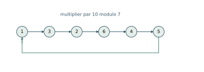
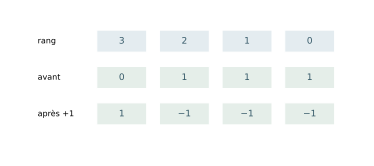

# ENS de Lyon · Second concours · Informatique 2012 · Corrigé guidé

*Corrigé rédigé par IA, non officiel. Signalez toute erreur.*

**Rédaction** · GPT-6.2 Astra Ultra · vitesse non renseignée · 25 novembre 2026

**Représentations des nombres.** Les machines de la partie II lisent d’abord le chiffre des unités. Un tableau de la partie IV est rangé dans le même ordre. Le symbole barré désigne le chiffre moins un.

## Repères

Suivre le reste après chaque chiffre et préciser le rang où commence une période. Pour la division longue, une répétition de reste détermine tous les chiffres suivants. En ternaire équilibré, la retenue peut aussi être négative.

## I · Généralités

### Question I.1 · Longueur de la plus petite écriture

**Indication.** Encadrer un nombre par deux puissances consécutives de sa base.

#### Solution

Pour $n\ge1$, si $L=L_B(n)$, on a $B^{L-1}\le n<B^L$, donc $L=1+\lfloor\log_B n\rfloor$. La longueur tend vers l’infini et, pour tout $\alpha>0$, $0\le L/n^\alpha\le(1+\log_B n)/n^\alpha\to0$ par comparaison des croissances. La convention $L_B(0)=0$ ne concerne aucune de ces limites.

### Question I.2 · Périodicité des puissances modulo d

**Indication.** Un reste détermine le suivant sans autre information.

#### Solution

Posons $r_0=1\bmod d$ et $r_{i+1}=Br_i\bmod d$. Parmi les $d+1$ premiers termes, deux coïncident, $r_j=r_k$, $0\le j<k\le d$. Une récurrence donne $r_{j+t}=r_{k+t}$ pour tout $t\ge0$. La suite est périodique à partir de $j$, au sens du préambule. Si $d=1$, tous les termes sont déjà nuls.

### Question I.3 · Trois périodes minimales

**Indication.** Repérer le premier retour au même reste et distinguer l’éventuel préfixe.

#### Solution

Pour $(B,d)=(2,3)$, les restes depuis l’exposant zéro sont $1,2,1,\ldots$ : période $2$. Pour $(10,7)$, le cycle est $1,3,2,6,4,5$ puis $1$ : période $6$. Pour $(10,6)$, on obtient $1,4,4,\ldots$ : période $1$ à partir de l’exposant 1.



### Question I.4 · Lorsque le module est premier

**Indication.** La multiplication par une classe non nulle est une permutation.

#### Solution

Dans le groupe multiplicatif des classes non nulles modulo le premier $d$, la classe de $B$ est inversible. La suite commence directement sur un cycle dont la longueur est l’ordre de $B$. Le théorème de Lagrange donne $\operatorname{ord}_d(B)\mid d-1$. Équivalemment, le petit théorème de Fermat donne $B^{d-1}\equiv1$ et la division euclidienne de $d-1$ par l’ordre fournit la divisibilité.

## II · Automates de divisibilité

### Question II.1 · Parité des écritures ternaires

**Indication.** Toutes les puissances de 3 ont le même reste modulo 2.

#### Solution

La valeur modulo 2 est la somme des chiffres modulo 2. En figure 1, $E_0$ est initial et final ; un $0$ ou un $2$ laisse l’état inchangé et un $1$ échange les deux états. On accepte donc exactement les mots ayant un nombre pair de $1$, y compris le mot vide. En posant $D=(0\mid2)^*$, l’expression régulière $D(1D1D)^*$ convient.

### Question II.2 · De zéro à dix en binaire

**Indication.** Les chiffres sont présentés dans l’ordre habituel puis lus des unités vers la gauche.

#### Solution

Pour la figure 2, le premier indice est la parité du nombre de chiffres lus et le second le reste modulo 3. Le tableau utilise les plus petites représentations, avec le mot vide pour zéro.

| Entier | Écriture binaire | Mot lu | État final du parcours |
|---|---|---|---|
| 0 | $\varepsilon$ | $\varepsilon$ | $E_{0,0}$ |
| 1 | 1 | 1 | $E_{1,1}$ |
| 2 | 10 | 01 | $E_{0,2}$ |
| 3 | 11 | 11 | $E_{0,0}$ |
| 4 | 100 | 001 | $E_{1,1}$ |
| 5 | 101 | 101 | $E_{1,2}$ |
| 6 | 110 | 011 | $E_{1,0}$ |
| 7 | 111 | 111 | $E_{1,1}$ |
| 8 | 1000 | 0001 | $E_{0,2}$ |
| 9 | 1001 | 1001 | $E_{0,0}$ |
| 10 | 1010 | 0101 | $E_{0,1}$ |

Si l’on écrit zéro avec le chiffre $0$, au lieu de son écriture minimale, l’état devient $E_{1,0}$, lui aussi acceptant.

### Question II.3 · Parité du premier indice

**Indication.** Regarder toutes les flèches partant des lignes d’indice 0 et d’indice 1.

#### Solution

L’état initial est $E_{0,0}$. Chacune des transitions de la figure, quel que soit le chiffre, passe de $E_{i,j}$ à un état de premier indice $1-i$. Par induction sur le nombre $\ell$ de lettres lues, $i=\ell\bmod2$.

### Question II.4 · Reste mémorisé par le second indice

**Indication.** Le chiffre suivant vaut sa valeur multipliée par la prochaine puissance de 2.

#### Solution

Après $\ell$ lettres $a_0,\ldots,a_{\ell-1}$, posons $N_\ell=\sum_{t<\ell}a_t2^t$. Comme $2^\ell\equiv(-1)^\ell\bmod3$, la transition sur $a$ doit être $E_{i,j}\to E_{1-i,(j+(-1)^ia)\bmod3}$. On retrouve les douze transitions de la figure 2. L’invariant donne $j=N_\ell\bmod3$. Les états $E_{0,0}$ et $E_{1,0}$ acceptent donc toutes les longueurs de représentations multiples de 3.


### Question II.5 · Trois états pour la même divisibilité

**Indication.** Normaliser le reste par le poids de la prochaine position.

#### Solution

Prenons pour état $s_\ell=(-1)^\ell N_\ell\bmod3$. Le reste initial vaut zéro et le seul état final est zéro. En lisant $a\in\{0,1\}$, le nouvel état est $s_{\ell+1}=-s_\ell-a\bmod3$. Cela définit trois états, avec transitions sur $0$ : $0\to0$, $1\to2$, $2\to1$, et sur $1$ : $0\to2$, $1\to1$, $2\to0$. La multiplication par un signe préserve la nullité du reste.

### Question II.6 · Trois états pour la base dix

**Indication.** Les positions décimales ont toutes poids 1 modulo 3.

#### Solution

Utilisons les états $0,1,2$, avec $0$ initial et seul final. La transition sur le chiffre $a$ est $j\mapsto(j+a)\bmod3$. Les chiffres $0,3,6,9$ maintiennent l’état, $1,4,7$ ajoutent une unité et $2,5,8$ en ajoutent deux. L’état final de lecture représente le reste de l’entier.

### Question II.7 · Construction si B vaut 1 modulo d

**Indication.** Généraliser l’invariant de la base dix.

#### Solution

Pour tout rang $i$, $B^i\equiv1\bmod d$. Prenons les $d$ classes de restes, zéro initial et acceptant, et $\delta(j,a)=(j+a)\bmod d$. À chaque étape l’état est la somme des chiffres déjà lus modulo $d$, égale au reste de leur contribution à l’entier.

### Question II.8 · Divisibilité par une puissance de la base

**Indication.** Un mot plus court que m peut représenter zéro.

#### Solution

On lit les chiffres des poids faibles en premier. Les états $q_0,\ldots,q_{m-1}$ signifient « seuls des zéros ont été lus, et ils sont au nombre indiqué ». Un état $q_m$ signifie que les $m$ premiers chiffres étaient nuls, et un puits $\bot$ un chiffre non nul trop tôt. De $q_i$, $i<m$, un zéro mène à $q_{i+1}$ et tout autre chiffre à $\bot$. Les deux états $q_m,\bot$ bouclent sur tout chiffre. Tous les $q_i$ sont finaux, y compris $q_0$, puisque le mot vide et les mots courts tout à zéro valent zéro. On a exactement $m+2$ états et la règle des $m$ derniers chiffres en écriture usuelle.

### Question II.9 · Poids périodiques dès le départ

**Indication.** Stocker simultanément la phase du poids et le reste accumulé.

#### Solution

Pour $r_i=B^i\bmod d$ sur un cycle de période $p$, prenons $dp$ états $E_{i,j}$ avec $i$ modulo $p$, $j$ modulo $d$. Le départ est $E_{0,0}$ et les finaux tous les $E_{i,0}$. La transition est

$$
E_{i,j}\xrightarrow{a}E_{(i+1)\bmod p,\ (j+a r_i)\bmod d}.
$$

L’induction sur les lettres lues donne $i=\ell\bmod p$ et $j=N_\ell\bmod d$. Certains états peuvent être inaccessibles ou équivalents.

### Question II.10 · Traiter le préfixe avant le cycle

**Indication.** Le poids lui-même contient toute l’information requise pour le prochain calcul.

#### Solution

Une construction valable pour tous $B,d$ utilise les états $(w,j)$ de restes modulo $d$, initialement $(1\bmod d,0)$. La transition sur $a$ est $(w,j)\mapsto(Bw\bmod d,(j+aw)\bmod d)$. Tous les états $(w,0)$ sont finaux. L’invariant est $w=B^\ell\bmod d$ et $j=N_\ell\bmod d$. Il y a au plus $d^2$ états. En se limitant aux valeurs accessibles de $w$, on garde exactement les phases du préfixe et du cycle décrits en I.2.

### Question II.11 · Lecture dans le sens usuel

**Indication.** Ajouter un chiffre à droite d’une écriture multiplie la valeur précédente par B.

#### Solution

Oui. On prend les $d$ états de reste avec zéro initial et seul final. Si le préfixe lu vaut $N$, l’ajout du chiffre $a$ forme $BN+a$. La transition $j\mapsto(Bj+a)\bmod d$ conserve donc l’invariant pour une lecture du poids fort vers le poids faible. Cela inclut les zéros initiaux et le mot vide.

## III · Représentations des réels

### Question III.1 · Deux écritures pour un même réel

**Indication.** Comparer un chiffre suivi de zéros à la somme d’une série géométrique.

#### Solution

Oui. En base $B$, les chiffres $1,0,0,\ldots$ représentent $1/B$ ; les chiffres $0,B-1,B-1,\ldots$ le représentent aussi, car $\sum_{j=2}^\infty(B-1)B^{-j}=1/B$. Il s’agit de deux suites distinctes, y compris pour $B=2$.

### Question III.2 · Valeur d’un bloc répété

**Indication.** Identifier la valeur de chaque copie du bloc dans la partie fractionnaire.

#### Solution

Si le bloc de $k\ge1$ chiffres représente $n$, alors $0,\overline{a_1\cdots a_k}$ vaut $\sum_{j=1}^\infty n B^{-kj}=n/(B^k-1)$. Les éventuels zéros initiaux font partie du bloc et comptent dans $k$.

### Question III.3 · Erreur de la division longue

**Indication.** Sommer les relations de division après les avoir divisées par la bonne puissance de B.

#### Solution

De $Br_{k-1}=vq_k+r_k$ suit $q_k B^{-k}=r_{k-1}/(vB^{k-1})-r_k/(vB^k)$. Les intermédiaires s’annulent dans la somme ; par conséquent

$$
\sum_{k=1}^n q_kB^{-k}=\frac uv-\frac{r_n}{vB^n},\qquad
0\le\frac uv-\sum_{k=1}^nq_kB^{-k}<B^{-n}.
$$

Comme $0\le r_{k-1}<v$, $0\le q_k<B$ ; ce sont bien des chiffres. L’inégalité implique la convergence à $u/v$.

### Question III.4 · Période des restes et des chiffres

**Indication.** Mémoriser le rang de première apparition de chaque reste.

#### Solution

Construire une table associant au reste sa première position. Partir de $r=u$, $i=0$. Tant que $r$ est absent, enregistrer $(r,i)$, calculer $(q,r')=\operatorname{divmod}(Br,v)$, conserver le chiffre, puis remplacer $r$ par $r'$ et incrémenter $i$. Au premier retour $r=r_j$, la prépériode des restes vaut $j$ et la période $i-j$ ; le bloc périodique des chiffres est $q_{j+1}\ldots q_i$. La boucle termine après au plus $v$ nouveaux restes. Cette période des restes est aussi minimale pour les chiffres : le développement infini de la queue représente $r_j/v$ par III.3. Deux queues de chiffres identiques à un décalage $d$ imposent donc les mêmes restes à ce décalage. Le reste nul boucle avec chiffre zéro.

### Question III.5 · Caractériser les rationnels

**Indication.** Séparer le préfixe et le bloc périodique.

#### Solution

Pour tout rationnel de $[0,1)$, la division longue de III.4 construit une représentation ultimement périodique. Pour $1$, les chiffres constants $B-1$ ont pour somme $1$. Réciproquement, si les $k$ premiers chiffres représentent $P$ et le bloc répété de longueur $p$ représente $C$, la valeur est $P/B^k+C/[B^k(B^p-1)]$. C’est un rationnel.

### Question III.6 · Période du développement de 1/p

**Indication.** Le reste initial vaut un, et tous les restes ultérieurs sont des puissances de B.

#### Solution

Les restes valent $r_j=B^j\bmod p$, sans prépériode puisque $B$ est inversible. Leur période $k=\operatorname{ord}_p(B)$ divise $p-1$. Ainsi $1/p=0,\overline{a_1\cdots a_k}$. Si $n$ est la valeur du bloc entier de $k$ chiffres, III.2 donne $1/p=n/(B^k-1)$, donc $np=B^k-1$.

### Question III.7 · Multiplier un nombre cyclique

**Indication.** Vérifier les bornes et le produit effectivement imprimés avant la preuve.

#### Solution

La version imprimée demande $2\le k'\le k-1$ et une écriture de $kp$. Dès $k=2$ cet intervalle est vide. De plus les puissances de $B$ modulo $p$ parcourent les restes **non nuls**, jamais zéro. La propriété qui donne III.8 est la suivante : pour $2\le k\le p-1$, une rotation du bloc représente **$kn$**, avec un départ $2\le k'\le p-1$.
En effet, posons $h=p-1$ et $D=B^h-1=pn$. Puisque $B$ est d’ordre $h$, il existe un unique $t\in\{1,\ldots,h-1\}$ tel que $B^t\equiv k\bmod p$. Une rotation à gauche de $t$ chiffres remplace l’entier du bloc par le représentant de $B^t n$ modulo $D$, dans l’intervalle $[0,D-1]$. Or $B^tn\equiv kn\bmod D$ et $0<kn<D$. Le bloc tourné vaut donc $kn$ et commence à la position $k'=t+1$. Cette démonstration couvre aussi les blocs commençant par zéro.

### Question III.8 · Le bloc décimal à six chiffres

**Indication.** Chercher une période six pour l’inverse d’un petit nombre premier.

#### Solution

Avec $p=7$ et $B=10$, la période a six chiffres et $(10^6-1)/7=142857$. Les six multiples sont $142857$, $285714$, $428571$, $571428$, $714285$, $857142$. Chacun est une rotation circulaire du premier bloc.

## IV · Ternaire équilibré

### Question IV.1 · Onze entiers en ternaire équilibré

**Indication.** La barre sur un chiffre désigne moins un.

#### Solution

Écrivons les chiffres les plus significatifs à gauche et notons $\bar1=-1$. Les représentations minimales sont

| Entier | Écriture | Entier | Écriture |
|---|---|---|---|
| $-5$ | $\bar1 11$ | $1$ | $1$ |
| $-4$ | $\bar1\bar1$ | $2$ | $1\bar1$ |
| $-3$ | $\bar1 0$ | $3$ | $10$ |
| $-2$ | $\bar1 1$ | $4$ | $11$ |
| $-1$ | $\bar1$ | $5$ | $1\bar1\bar1$ |
| $0$ | $\varepsilon$ | | |

Par exemple $1\bar1\bar1$ vaut $9-3-1=5$ et le changement de tous les signes représente son opposé.

### Question IV.2 · Algorithme de conversion et unicité

**Indication.** Choisir le seul chiffre autorisé congru à n modulo 3.

#### Solution

Les chiffres $0,1,-1$ représentent les trois classes modulo 3. Choisir $c=0$ si $n\bmod3=0$, $c=1$ si le reste est 1, et $c=-1$ si le reste est 2. Écrire $c$ puis remplacer $n$ par $(n-c)/3$. Répéter jusqu’à zéro. Les chiffres sont émis du poids faible au poids fort, précisément dans l’ordre du tableau du sujet. Pour $|n|\ge2$, le quotient a un module au plus $(|n|+1)/3<|n|$ ; pour $n=\pm1$, il devient nul immédiatement. L’algorithme termine sans zéro de tête, et donne le tableau vide pour zéro. L’unicité résulte du chiffre des unités imposé par le reste, puis de l’unicité de l’écriture du quotient par récurrence.

```python
def equilibre(n):
    chiffres = []
    while n:
        reste = n % 3
        chiffre = -1 if reste == 2 else reste
        chiffres.append(chiffre)
        n = (n - chiffre) // 3
    return chiffres
```

La restriction aux seules additions concerne les quatre questions suivantes. Le nombre de divisions de cette conversion est $O(1+\log(1+|n|))$.

### Question IV.3 · Opposé chiffre par chiffre

**Indication.** Retourner le signe de chaque contribution sans déplacer les poids.

#### Solution

La sortie a au rang $i$ le chiffre opposé à celui de l’entrée. La suppression de zéros de poids fort rend aussi le résultat minimal pour une entrée non minimale. Les routines suivantes, en Python, n’utilisent aucune multiplication ni exponentiation pour les opérations sur les chiffres.

```python
def normalise(chiffres):
    while chiffres and chiffres[-1] == 0:
        chiffres.pop()
    return chiffres

def oppose(tableau):
    resultat = []
    for chiffre in tableau:
        if chiffre == 1:
            resultat.append(-1)
        elif chiffre == -1:
            resultat.append(1)
        else:
            resultat.append(0)
    return normalise(resultat)
```

La valeur de chaque chiffre change de signe à poids inchangé. Le temps est linéaire en la longueur du tableau ; l’entrée est préservée.

### Question IV.4 · Successeur et propagation de retenue

**Indication.** Déterminer d’abord ce que devient un chiffre 1 lorsqu’on lui ajoute une unité.

#### Solution

La retenue initiale vaut un. Si un chiffre vaut $1$, l’addition donne $2=-1+3$, donc on laisse $\bar1$ et on propage la retenue. Sinon on peut ajouter un sans retenue ultérieure.

```python
def successeur(tableau):
    resultat = list(tableau)
    i = 0
    while i < len(resultat) and resultat[i] == 1:
        resultat[i] = -1
        i += 1
    if i == len(resultat):
        resultat.append(1)
    else:
        resultat[i] += 1
    return normalise(resultat)
```

Le tableau vide devient $[1]$, et $[-1]$ devient le tableau vide. Une chaîne de $k$ chiffres positifs initiaux propage la retenue sur ces $k$ rangs. La copie et la normalisation portent le coût total à $O(n+1)$.



### Question IV.5 · Addition à retenue signée

**Indication.** La somme de deux chiffres et d’une retenue est comprise entre moins trois et trois.

#### Solution

Soit $t$ la somme des deux chiffres disponibles et de la retenue. Pour $t\ge2$, écrire $t-3$ et retenir $1$. Pour $t\le-2$, écrire $t+3$ et retenir $-1$. Sinon écrire $t$ et annuler la retenue. Une case manquante vaut zéro.

```python
def somme(gauche, droite):
    resultat = []
    i = 0
    retenue = 0
    while i < len(gauche) or i < len(droite) or retenue != 0:
        total = retenue
        if i < len(gauche):
            total += gauche[i]
        if i < len(droite):
            total += droite[i]
        if total >= 2:
            resultat.append(total + (-3))
            retenue = 1
        elif total <= -2:
            resultat.append(total + 3)
            retenue = -1
        else:
            resultat.append(total)
            retenue = 0
        i += 1
    return normalise(resultat)
```

À chaque rang, $t=c+3r$ avec $c,r\in\{-1,0,1\}$. Le préfixe produit et la retenue au rang suivant conservent la somme. Une fois les entrées épuisées, une éventuelle retenue est émise en un tour. Le coût est $O(1+\max(|T|,|U|))$.

### Question IV.6 · Soustraction de deux tableaux

**Indication.** Réutiliser le changement de signe démontré en IV.3 et l’addition directe.

#### Solution


```python
def difference(gauche, droite):
    return somme(gauche, oppose(droite))
```

Si les deux tableaux représentent $x$ et $y$, le tableau interne représente $-y$ et la sortie représente $x+(-y)=x-y$. Les signes sont traités chiffre par chiffre et le résultat est minimal, y compris pour $x=y$. Les deux passages réunis restent linéaires en la plus grande des longueurs.
