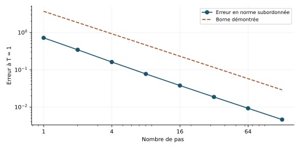

# ENS de Lyon, second concours — Mathématiques 2012 · Corrigé brut

*Corrigé rédigé par IA, non officiel. Signalez toute erreur.*

**Rédaction** · GPT-6.2 Astra Ultra · vitesse non renseignée · 25 novembre 2026

**Révision** · GPT-6.2 Astra Ultra · vitesse non renseignée · 26 novembre 2026

**Approximation d’exponentielles et fonctions mid-convexes.** Le premier exercice évalue l’erreur de la formule du produit de Lie. Le second examine le rôle de la continuité dans le passage de l’inégalité des milieux à la convexité. Le sommaire institutionnel rattache un rapport de mathématiques à l’oral et fournit le sujet de l’écrit sans rapport associé.

## I.A. Une norme sur les matrices

### Question I.A.1

Par homogénéité du quotient, $\|A\|=\sup_{\|x\|_\infty=1}\|Ax\|_\infty$. Cette quantité est finie car la sphère unité est compacte en dimension finie et l’application continue. Elle est positive ou nulle. Si elle est nulle, $Ae_j=0$ pour chaque vecteur canonique, donc $A=0$, et la réciproque est immédiate. L’homogénéité $\|tA\|=|t|\|A\|$ et l’inégalité triangulaire $\|A+B\|\le\|A\|+\|B\|$ suivent de celles sur les vecteurs, puis du passage au supremum.

### Question I.A.2

Pour tout vecteur $y$, $\|Ay\|_\infty\le\|A\|\|y\|_\infty$, y compris si $y=0$. Ainsi $\|ABx\|_\infty\le\|A\|\|Bx\|_\infty\le\|A\|\|B\|\|x\|_\infty$. Prenons le supremum sur les $x$ de norme 1.

### Question I.A.3

Pour $\|x\|_\infty=1$, $|(Ax)_i|\le\sum_j |a_{ij}|$, donc $\|A\|\le\max_i\sum_j|a_{ij}|$. Prenons une ligne $i_0$ qui atteint le maximum et choisissons $x_j=1$ si $a_{i_0j}\ge0$, $x_j=-1$ sinon. Ce vecteur a norme 1 et $(Ax)_{i_0}=\sum_j|a_{i_0j}|$. La borne supérieure est donc atteinte.

## I.B. Exponentielle de matrice

### Question I.B.1

Pour tout $j\ge0$, $\|A^j/j!\|\le\|A\|^j/j!$ (en particulier $\|I\|=1$). La série des majorants a pour somme $e^{\|A\|}$. Comme $M_n(\mathbb R)$ est complet en dimension finie, la série de matrices converge et $\|e^A\|\le e^{\|A\|}$.

### Question I.B.2

La série double de termes $A^p B^q/(p!q!)$ est absolument convergente, majorée en norme totale par $e^{\|A\|+\|B\|}$. On peut donc la sommer par degrés $j=p+q$. Si $AB=BA$, le binôme donne $\sum_{p+q=j} A^p B^q/(p!q!)=(A+B)^j/j!$. La somme double valant aussi le produit (par passage à la limite des sommes rectangulaires), on obtient $e^{A+B}=e^Ae^B$.

### Question I.B.3

$A$ et $-A$ commutent. Par I.B.2, $e^Ae^{-A}=e^{-A}e^A=e^0=I$. Ainsi $e^A$ est inversible et $e^{-A}=(e^A)^{-1}$.

### Question I.B.4

Sur $[-R,R]$, la série des dérivées des termes $t^jA^j/j!$ est uniformément convergente, par le majorant sommable $\|A\|^j R^{j-1}/(j-1)!$ pour $j\ge1$. La série initiale converge en 0. On peut donc dériver terme à terme et on trouve $(e^{tA})'=Ae^{tA}=e^{tA}A$. Par récurrence la dérivée d’ordre $k$ vaut $A^ke^{tA}$. L’application est de classe $C^\infty$ sur $\mathbb R$.

## I.C. Approximation du produit d’exponentielles

### Question I.C.1

L’énoncé donne $u_0\in\mathbb R^n$ et $F(t)\in M_n(\mathbb R)$. Pour $n>1$, la somme $Au(t)+F(t)$ n’est pas définie avec $u(t)$ vecteur. Dans le problème vectoriel cohérent, $F$ est à valeurs dans $\mathbb R^n$. Pour un second membre matriciel comme celui de la question suivante, on prend une inconnue et une condition initiale matricielles, et on applique le calcul colonne par colonne.

Dans les deux cas, pour toute solution on a $(e^{-tA}u(t))'=e^{-tA}F(t)$ par I.B.4. En intégrant puis en multipliant par $e^{tA}$,
$$u(t)=e^{tA}u_0+\int_0^t e^{(t-s)A}F(s)\,ds.$$
Cette formule impose l’unicité. Réciproquement, la primitive de la fonction continue $s\mapsto e^{-sA}F(s)$ est différentiable, et sa multiplication par $e^{tA}$ redonne bien l’équation et la condition initiale. Cela établit l’existence.

### Question I.C.2

Soit $K(t)=e^{tA}B-Be^{tA}$. On a $K(0)=0$ et $K'(t)-AK(t)=(AB-BA)e^{tA}$. La formule de I.C.1 appliquée colonne par colonne donne
$$[e^{tA},B]=\int_0^t e^{(t-s)A}[A,B]e^{sA}\,ds.$$

### Question I.C.3

Posons $S=A+B$. En dérivant $L=e^{tS}-e^{tA}e^{tB}$ dans l’ordre des facteurs,
$$L'-SL=(Be^{tA}-e^{tA}B)e^{tB},\qquad L(0)=0.$$
I.C.1 donne l’intégrale à un paramètre. Or I.C.2 donne $[B,e^{sA}]=\int_0^s e^{(s-r)A}[B,A]e^{rA}\,dr$. En substituant,
$$L(t)=\int_0^t\int_0^s e^{(t-s)S}e^{(s-r)A}[B,A]e^{rA}e^{sB}\,dr\,ds.$$

Le développement au voisinage de zéro vérifie le signe. Dans $e^{t(A+B)}$, le terme mixte d’ordre deux vaut $t^2(AB+BA)/2$. Dans $e^{tA}e^{tB}$, il vaut $t^2AB$. Leur différence est donc $t^2[B,A]/2+O(t^3)$, conforme à l’intégrale sur le triangle.

### Question I.C.4

Pour $0\le r\le s\le t$, la norme de l’intégrande est au plus
$$e^{(t-s)(\|A\|+\|B\|)}e^{(s-r)\|A\|}\|[B,A]\|e^{r\|A\|}e^{s\|B\|}=e^{t(\|A\|+\|B\|)}\|[A,B]\|.$$
L’aire du triangle d’intégration est $t^2/2$. On obtient bien $\|L(t)\|\le (t^2/2)e^{t(\|A\|+\|B\|)}\|[A,B]\|$.

### Question I.C.5

Prenons $h=T/m$, $X=e^{h(A+B)}$, $Y=e^{hA}e^{hB}$, $K=\|A\|+\|B\|$. On a $X^m=e^{T(A+B)}$ et $\|X\|,\|Y\|\le e^{hK}$. L’identité $X^m-Y^m=\sum_{j=0}^{m-1}X^{m-1-j}(X-Y)Y^j$ résulte d’une somme télescopique dans cet ordre. I.C.4 donne
$$\|X^m-Y^m\|\le m e^{(m-1)hK}\frac{h^2}{2}e^{hK}\|[A,B]\|=\frac{T^2}{2m}e^{TK}\|[A,B]\|.$$
Ainsi le produit demandé converge vers $e^{T(A+B)}$. Pour la figure, $A$ a pour seul coefficient non nul $a_{12}=1$ et $B=A^\mathsf{T}$. Comme $A^2=B^2=0$, le produit d’un pas vaut $(I+hA)(I+hB)$. De plus $(A+B)^2=I$, donc la valeur exacte à $T=1$ est $\cosh(1)I+\sinh(1)(A+B)$.

Pour les matrices de la figure, un pas s’écrit explicitement $Y=\left(\begin{smallmatrix}1+h^2&h\\h&1\end{smallmatrix}\right)$. Dans la norme du sujet, $\|A\|=\|B\|=\|[A,B]\|=1$. Pour $T=1$, le majorant représenté est donc $e^2/(2m)$, ce qui fournit une vérification indépendante de son échelle.

## II. Fonctions mid-convexes

### Question II.1

Pour $\lambda=1/2$, l’inégalité de convexité devient $f((x+y)/2)\le(f(x)+f(y))/2$. Toute fonction convexe est donc mid-convexe.

### Question II.2.a

Supposons $f$ mid-convexe. Pour $n=0$, $s=0$ ou $1$ et l’égalité est exacte. À l’étape suivante, si le numérateur de $s=k/2^{n+1}$ est pair, on applique le résultat précédent. S’il est impair, $s$ est le milieu de deux voisins $s_-,s_+\in D_n$. Le point $sx+(1-s)y$ est le milieu des deux points de paramètres $s_-,s_+$. Par mid-convexité puis par l’hypothèse de récurrence, sa valeur est au plus la moyenne des deux interpolations affines en $s_-,s_+$, soit $sf(x)+(1-s)f(y)$. Cela prouve l’inégalité à tous les niveaux.

### Question II.2.b

Pour $0\le t\le1$, posons $t_n=2^{-n}\lfloor2^nt\rfloor\in D_n\subset D$. Comme $0\le t-t_n<2^{-n}$, cette suite converge vers $t$, y compris aux deux extrémités.

### Question II.2.c

Pour tout $t\in[0,1]$, appliquons II.2.a à $t_n$ de II.2.b. Par continuité, $f(t_nx+(1-t_n)y)\to f(tx+(1-t)y)$. Le membre droit tend vers $tf(x)+(1-t)f(y)$. D’où l’inégalité de convexité pour $x<y$, et l’échange des points ou leur égalité traite les autres cas.

### Question II.3.a

En ajoutant les deux développements finis, l’unicité donne $w_h(x+y)=w_h(x)+w_h(y)$ pour chaque $h$. De même, les coordonnées sont homogènes sur $\mathbb Q$. Pour $q\in\mathbb Q$, le développement $q=q\cdot1$ donne $w_1(q)=q$. Si $w_1$ était continue, elle coïnciderait avec l’identité sur toute la droite par densité de $\mathbb Q$. Mais il existe un $h\in H\setminus\{1\}$ puisque $\mathbb R\ne\mathbb Q$ et alors $w_1(h)=0\ne h$. La fonction est donc discontinue.

La discontinuité se manifeste à chaque point. Si $w_1$ était continue en un point $a$, l’identité $w_1(a+t)-w_1(a)=w_1(t)$ donnerait la continuité en zéro, puis partout par translation.

### Question II.3.b

Par additivité et homogénéité rationnelle, $w_1((x+y)/2)=(w_1(x)+w_1(y))/2$. Ainsi $w_1$ est mid-convexe. Prenons $h\in H\setminus\{1\}$ et $r\in\mathbb Q$ tel que $0<r<|h|$. On a $w_1(0)=w_1(|h|)=0$ mais $w_1(r)=r>0$. Le graphe dépasse la corde entre 0 et $|h|$, donc $w_1$ n’est pas convexe.

### Question II.4.a

Prenons $a,b$ tels que $f(b)>f(a)$ (leur ordre sur la droite est indifférent). Pour un entier $m\ge1$, posons $x_m=a+m(b-a)$. Comme $b=(1-1/m)a+x_m/m$, la convexité donne $f(x_m)\ge f(a)+m(f(b)-f(a))$. Le membre droit tend vers $+\infty$. Ainsi une fonction convexe non constante sur toute la droite n’est même pas majorée.

### Question II.4.b

Oui. Prenons encore $a,b$ avec $f(b)>f(a)$ et posons $x_j=a+2^j(b-a)$. On a $x_0=b$ et $x_j=(a+x_{j+1})/2$. La mid-convexité donne $f(x_{j+1})-f(a)\ge2(f(x_j)-f(a))$, donc
$$f(x_j)\ge f(a)+2^j(f(b)-f(a))\longrightarrow +\infty.$$
Ce raisonnement n’utilise aucune continuité.
