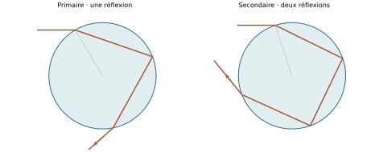
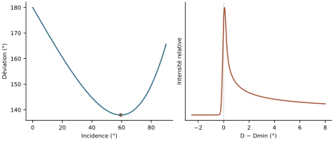
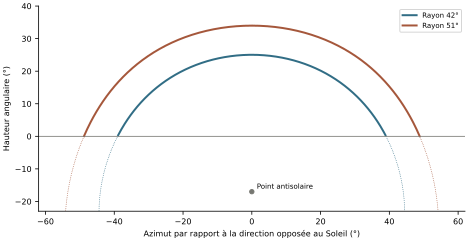
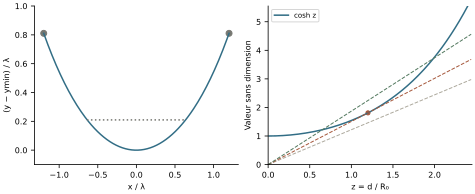

# ENS de Lyon, second concours 2012 — Physique · Corrigé guidé

*Corrigé rédigé par IA, non officiel. Signalez toute erreur.*

**Rédaction** · GPT-6.2 Astra Ultra · vitesse non renseignée

Suivre le sens de déviation du rayon avant de passer au rayon angulaire apparent. Pour la corde puis le film, préciser les conditions aux extrémités et la nature de la grandeur à minimiser.

## I — Optique des arcs-en-ciel

### Question I.1 — Additionner les déviations

> [!INDICATION]
> Suivre le prolongement du rayon précédent à chaque point et prendre l’angle avec la direction qui suit.

#### Solution

Pour la réfraction d’entrée le changement de direction vaut $i-r$, pour la réflexion interne $\pi-\alpha-\alpha'$, et pour la sortie $i'-r'$. Les trois changements se font ici dans le même sens. La déviation totale est donc $D=(i-r)+(\pi-\alpha-\alpha')+(i'-r')$.

### Question I.2 — Réduire à deux angles

> [!INDICATION]
> Les angles aux extrémités d’une même corde, mesurés par rapport aux rayons de la goutte, sont égaux.

#### Solution

Les normales passent par le centre. Chaque corde détermine avec deux rayons de la sphère un triangle isocèle. Il en résulte $\alpha=r$ et $r'=\alpha'$. La réflexion donne $\alpha'=\alpha$, puis Snell-Descartes aux deux réfractions donne $i'=i$. Ainsi $D=\pi+2i-4r$, avec $\sin i=n\sin r$.

### Question I.3 — Condition du minimum

> [!INDICATION]
> Tester les signes de la dérivée à incidence normale et rasante après avoir éliminé le cosinus de réfraction.

#### Solution

On a $r'=dr/di=\cos i/(n\cos r)$ et $dD/di=2-4\cos i/\sqrt{n^2-\sin^2 i}$. Le quotient au carré est $\cos^2 i/(n^2-1+\cos^2 i)$. Il décroît strictement de $1/n^2$ à zéro pour $n>1$. Pour l’eau, $1<n<2$, la dérivée de $D$ passe une seule fois de négative à positive. Au minimum $2\cos i_m=n\cos r_m$ et $\cos^2 i_m=(n^2-1)/3$. Ici le prime sur $r$ dans la dérivation désigne une dérivée, à distinguer de l’angle de sortie de I.1.

### Question I.4 — Valeurs pour l’eau

> [!INDICATION]
> La déviation est mesurée depuis la direction de propagation incidente. Faire la conversion en degrés après l’évaluation de la formule.

#### Solution

Avec $n=4/3$, $\cos i_m=\sqrt{7/27}$, donc $i_m=59,39°$. La réfraction donne $r_m=\arcsin(\sin i_m/n)=40,20°$. On obtient **$D_m=137,97°$**. Le rayon apparent autour du point antisolaire sera son supplémentaire, $42,03°$.

### Question I.5 — Accumulation des rayons émergents

> [!INDICATION]
> Suivre non seulement un rayon mais deux rayons voisins lorsqu’ils approchent du rayon stationnaire.

#### Solution

Les rayons incidents parallèles rencontrent la goutte à des hauteurs différentes. Presque tous ressortent dans des directions différentes mais, près de $i_m$, un intervalle d’incidences produit un très petit intervalle de déviations car $D'(i_m)=0$. L’enveloppe des directions émergentes, ou caustique, se voit comme une concentration sur la figure 1b. Aucun rayon du trajet considéré ne sort à $D<D_m$.

### Question I.6 — Séparer les couleurs

> [!INDICATION]
> Comparer les lois de Snell pour une seule incidence et deux indices proches.

#### Solution

Dans l’eau et dans le visible, l’indice augmente du rouge au violet. À incidence donnée le violet se réfracte davantage vers la normale, donc son angle $r$ est moindre et sa déviation $D$ plus grande. Le minimum dépend lui aussi de l’indice. Les maxima d’intensité des différentes couleurs ne coïncident plus angulairement.

### Question I.7 — Intensité en fonction de D

> [!INDICATION]
> Une même quantité de lumière répartie sur un plus petit intervalle angulaire produit une intensité directionnelle plus forte.

#### Solution

La contribution de ce trajet à une couleur donnée est nulle pour $D<D_m$. Juste au-dessus de $D_m$, elle est forte puis décroît. Localement $D-D_m\simeq D''(i_m)(i-i_m)^2/2$. À flux incident régulier la densité de directions est donc proportionnelle à $1/\sqrt{D-D_m}$ du côté éclairé. La largeur angulaire du Soleil, la diffraction et la taille des gouttes arrondissent le pic réel. Le dessin représente l’allure locale sans lui attribuer une hauteur absolue.

### Question I.8 — Pourquoi un arc se détache

> [!INDICATION]
> Se placer à l’œil et faire tourner une direction de visée autour de l’axe antisolaire en conservant son angle.

#### Solution

Pour l’observateur, les gouttes qui envoient le maximum d’une couleur sont vues sous un angle fixe $\beta=\pi-D_m$ autour de la direction antisolaire. Elles peuvent se trouver à des distances très différentes. Leurs directions appartiennent à un cône de sommet l’œil. L’intersection angulaire de ce cône avec le ciel est un cercle dont l’horizon masque généralement une partie. Les autres gouttes contribuent à un fond plus diffus.

### Question I.9 — Placer l’arc dans le repère

> [!INDICATION]
> Porter le centre du cercle angulaire sous l’horizon avant de tracer son bord supérieur.

#### Solution

Sur la figure 2, le Soleil est du côté $+x$, la verticale vers $+z$. L’axe antisolaire est dans le plan $Oxz$ du côté $-x$, à l’altitude angulaire $-\alpha$. En plaçant l’œil à l’origine du dessin des directions, son vecteur unitaire est $\vec b=(-\cos\alpha,0,-\sin\alpha)$. L’arc primaire satisfait $\hat u\cdot\vec b=\cos\beta$, $\beta\simeq42°$. Son point le plus haut, dans le plan vertical opposé au Soleil, est à $\beta-\alpha$ au-dessus de l’horizon. Les deux extrémités visibles sont symétriques de part et d’autre de ce plan. Depuis un sol horizontal, cet arc disparaît au-dessus d’une hauteur solaire d’environ 42°.

### Question I.10 — Le trajet à deux réflexions

> [!INDICATION]
> Garder la déviation orientée au-delà de 180° puis ramener la direction de vision au voisinage de l’axe antisolaire.

#### Solution

La déviation totale orientée avant réduction modulo un tour devient $D_2=2\pi+2i-6r$. L’extrémum donne $3\cos i=n\cos r$, d’où $\cos^2 i_{m2}=(n^2-1)/8$. Pour $n=4/3$, $i_{m2}\simeq71,83°$, $r_{m2}\simeq45,45°$ et $D_{2m}\simeq230,98°$. Comme $D_{2m}>180°$, le rayon angulaire autour du point antisolaire est $D_{2m}-180°\simeq51,0°$. Une deuxième caustique se voit donc à l’extérieur de l’arc primaire et partage son centre.

### Question I.11 — Moindre luminosité

> [!INDICATION]
> Suivre une fraction de la puissance incidente après chacune des rencontres avec l’interface.

#### Solution

À chaque réflexion interne partielle, une partie du flux sort de la goutte. Le trajet secondaire subit une réflexion supplémentaire, à laquelle s’ajoutent les pertes de transmission aux interfaces d’entrée et de sortie. Les rayons disponibles pour former cette caustique ne représentent qu’une faible fraction du flux incident.

### Question I.12 — Ordre des couleurs

> [!INDICATION]
> Suivre le côté de l’axe de retour où débouche le rayon après une puis deux réflexions.

#### Solution

Une hausse de l’indice accroît la déviation orientée pour les deux trajets. Le primaire émerge d’un côté de l’axe de retour et son écart apparent est $180°-D_1$. Le secondaire a dépassé cet axe et son écart est $D_2-180°$. Le violet est donc vers l’intérieur de l’arc primaire et vers l’extérieur du secondaire. Le rouge leur fait face de part et d’autre de la bande intermédiaire plus sombre.

## II — Équilibre d’une corde pesante

### Question II.1 — Tension variable

> [!INDICATION]
> Isoler d’abord la moitié droite, puis seulement sa partie la plus proche du centre.

#### Solution

La résultante des tensions sur un tronçon équilibre son poids. Au point le plus bas la tangente est horizontale. Plus près d’un appui, la composante verticale de la tension soutient le poids du tronçon compris depuis le milieu, et augmente en valeur absolue. La composante horizontale reste constante. Le module de la tension est donc plus grand près des crochets.

### Question II.2 — Tangente et angle

> [!INDICATION]
> Prendre le rapport entre la variation verticale et la variation horizontale le long de la corde.

#### Solution

L’équilibre d’un fil sans raideur impose une tension tangentielle. Pour une orientée vers les $x$ croissants, $\tan\alpha(x)=df/dx=f'(x)$. L’angle est négatif à gauche et positif à droite du point bas.

### Question II.3 — Élément de longueur

> [!INDICATION]
> Remplacer la corde localement par la tangente et utiliser Pythagore.

#### Solution

Le déplacement élémentaire vaut $(dx,df)$, d’où $dl=\sqrt{dx^2+df^2}=\sqrt{1+f'(x)^2}\,dx$ pour $dx>0$. L’approximation de premier ordre porte sur l’intervalle, sans supposer que la pente est petite.

### Question II.4 — Constante horizontale

> [!INDICATION]
> Choisir la projection du bilan des forces où la pesanteur ne figure pas.

#### Solution

Sur l’élément de corde les tensions aux deux extrémités ont des sens opposés. Le poids est vertical. La projection horizontale donne $d(T\cos\alpha)=0$, donc $T\cos\alpha=T_0$ et $T=T_0/\cos\alpha$.

### Question II.5 — Sens de la constante

> [!INDICATION]
> Une translation verticale des deux appuis modifie l’origine de l’énergie potentielle mais aucune force.

#### Solution

$T_0$ est la tension horizontale constante et le module minimal de la tension au bas de la corde. C’est une force. Sa valeur dépend du poids linéique $\mu g$, de la distance horizontale $a$ et de la longueur $L$ disponible. Déplacer ensemble les deux crochets à une autre hauteur $H$ traduit la courbe verticalement et laisse les tensions inchangées dans un champ $g$ uniforme.

### Question II.6 — Équation de la corde

> [!INDICATION]
> Écrire la composante verticale de la tension comme le produit de sa composante horizontale et de la pente.

#### Solution

L’équilibre vertical sur $dx$ donne $d(T\sin\alpha)=\mu g\,dl$. Avec $T\sin\alpha=T_0\tan\alpha=T_0 f'$, il vient $f''=(\mu g/T_0)\sqrt{1+f'^2}$. Le coefficient $A=\mu g/T_0$ a la dimension d’un inverse de longueur et est positif pour la corde suspendue.

### Question II.7 — Séparer les variables

> [!INDICATION]
> L’inconnue qui apparaît avec sa dérivée est la pente.

#### Solution

Avec $F(x)=f'(x)$, on obtient $dF/\sqrt{1+F^2}=A\,dx$. La dérivée cherchée est celle de la fonction réciproque du sinus hyperbolique.

### Question II.8 — La chaînette

> [!INDICATION]
> Après la deuxième intégration, utiliser les deux conditions aux extrémités pour situer le minimum dans le repère donné.

#### Solution

L’intégration donne $\operatorname{arsinh}F=A(x-x_0)$ et $F=\sinh((x-x_0)/\lambda)$ avec $\lambda=1/A=T_0/(\mu g)$. Donc $f(x)=\lambda\cosh((x-x_0)/\lambda)+C$. $x_0$ est l’abscisse du point le plus bas. Les deux extrémités à la même hauteur imposent $x_0=0$ par symétrie et $C=H-\lambda\cosh(a/(2\lambda))$. Le bilan local seul ne fixe pas la constante de position $x_0$.

### Question II.9 — Rôle de la longueur et de la masse

> [!INDICATION]
> Remplacer la pente dans l’intégrale de longueur en utilisant $1+\sinh^2 z=\cosh^2 z$.

#### Solution

La longueur impose $L=\int_{-a/2}^{a/2}\cosh(x/\lambda)\,dx=2\lambda\sinh(a/(2\lambda))$. Pour $L>a$ il existe une unique valeur positive de $\lambda$, car $\sinh z/z$ croît de 1 à l’infini. Elle dépend de $a$ et $L$ seuls. $H$ règle uniquement la translation verticale. Doubler $\mu$ double $T_0$ et toutes les tensions, en conservant exactement la même forme. $L<a$ est impossible, et $L=a$ est la limite du fil droit sous tension arbitrairement grande.

## Énergie potentielle

### Question II.10 — Énergie potentielle

> [!INDICATION]
> Le poids linéique est défini par longueur réelle de corde.

#### Solution

Un élément de masse $\mu\,dl$ à l’altitude $f(x)$ possède l’énergie $\mu g f(x)\,dl$ pour le zéro de l’altitude choisi. Ainsi $E_p[f]=\mu g\int_{-a/2}^{a/2}f(x)\sqrt{1+f'(x)^2}\,dx$, à une constante additive indépendante de la forme près.

### Question II.11 — Minimiser une fonctionnelle

> [!INDICATION]
> Indiquer ce qui reste fixé lorsque l’on déforme la corde entre les mêmes appuis.

#### Solution

À l’équilibre stable, l’énergie potentielle est minimale parmi les profils admissibles, de longueur $L$ et à extrémités fixées. Comme $E_p=\mu g S$ et $\mu g>0$, $S$ a le même minimum. On fait varier **la fonction entière $f$**. La variable $u$ dans l’intégrale est une variable muette. La contrainte exclut les profils qui gagneraient en énergie simplement en rallongeant la corde.

## Film de savon

### Question II.12 — Aire du film de révolution

> [!INDICATION]
> La largeur pertinente de la bande circulaire est sa longueur oblique et son périmètre vaut $2\pi r$.

#### Solution

Une tranche de génératrice a pour longueur $ds=\sqrt{1+r'^2}\,dx$. Sa révolution engendre la bande $dA=2\pi r\,ds$ et l’aire géométrique est $A=2\pi\int_{-d}^d r(x)\sqrt{1+r'(x)^2}\,dx$. Un film savonneux à deux interfaces porte l’énergie $2\gamma A$ si chaque face a la tension $\gamma$. Le facteur deux conserve les mêmes profils minimisants.

### Question II.13 — Quelle chaînette réutiliser

> [!INDICATION]
> Faire la différence entre un changement d’origine des altitudes de la corde et un changement de rayon du film.

#### Solution

L’intégrande est celui de $S$, mais le film n’a pas de contrainte de longueur de la génératrice. Un multiplicateur pour la corde transforme son intégrande en $(f+\text{constante})\sqrt{1+f'^2}$. Pour le film, le rayon est fixé par l’axe de révolution et aucune constante libre ne s’ajoute au rayon. Plus explicitement, l’intégrande sans dépendance explicite en $x$ vérifie la première intégrale $r/\sqrt{1+r'^2}=R_0$. Par intégration sur les deux côtés du col, $r=R_0\cosh((x-x_0)/R_0)$. Les deux anneaux égaux imposent $x_0=0$. La chaînette se réutilise donc avec $C=0$.

### Question II.14 — Rayon du col

> [!INDICATION]
> Localiser le minimum de la fonction cosinus hyperbolique.

#### Solution

$R_0=r(0)$ est le rayon minimal du film, à mi-distance des deux anneaux. Pour un film connecté non dégénéré et $d>0$, $0<R_0<R$. L’égalité à $R$ est une limite d’anneaux rapprochés et de profil presque cylindrique sur la branche large. Un col nul correspond à une rupture ou à une limite singulière.

### Question II.15 — Équation sans dimension

> [!INDICATION]
> Utiliser la condition du bord avant de substituer la variable adimensionnée.

#### Solution

Au bord $R=R_0\cosh(d/R_0)$. En divisant par $R_0$ puis en posant $z=d/R_0>0$, on obtient $(R/d)z=\cosh z$. La pente de la droite à comparer à la courbe ne dépend que du rapport des longueurs.

### Question II.16 — Compter les intersections

> [!INDICATION]
> Chercher la droite issue de l’origine tangente à la courbe, puis faire pivoter cette droite.

#### Solution

La courbe $\cosh z$ part de 1 avec une pente nulle et finit par dépasser toute droite de pente finie. Le quotient $\cosh z/z$ diverge aux deux extrémités du demi-axe et admet un unique minimum en $z_*$ tel que $z_*\tanh z_*=1$ (le membre de gauche est strictement croissant). Si $R/d$ est supérieur au minimum, deux rayons positifs conviennent. À la tangence il y en a un et au-dessous aucun. La seule existence des deux solutions stationnaires ne prouve pas leur stabilité.

### Question II.17 — Distance critique

> [!INDICATION]
> Distinguer la demi-distance $d$ utilisée dans l’équation et la séparation physique des anneaux.

#### Solution

À rayon $R$ fixé, écarter les anneaux diminue la pente $R/d$ jusqu’à la tangence. Au-delà il n’existe plus de solution connectée de révolution de ce type. Pour contrôler l’ordre de grandeur, $z_*\simeq1,200$ et $d_{\rm crit}/R=z_*/\cosh z_*\simeq0,663$. La distance totale entre anneaux vaut $2d$, soit une limite géométrique d’environ $1,33R$. Le film peut rompre en pratique avant cette disparition de la solution.

[Sujet officiel de l’ENS de Lyon](https://banques-ecoles.fr/cms/wp-content/data/filieres-universitaires/annales-du-second-concours-de-lens-lyon/session-2012/Ecrit_physique2012.pdf)
