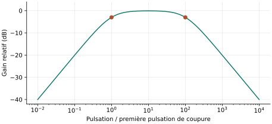
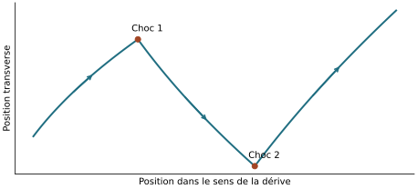
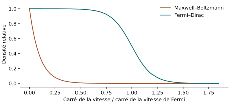
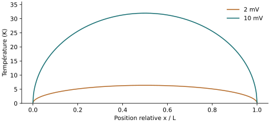
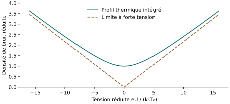
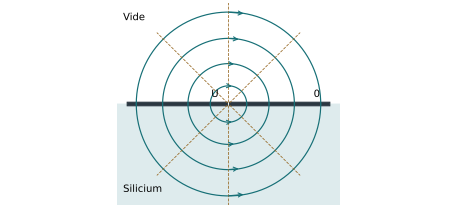

# ENS de Paris (Ulm) PC 2012 — Physique C · Corrigé brut

*Corrigé rédigé par IA, non officiel. Signalez toute erreur.*

**Rédaction** · GPT-6.2 Astra Ultra · vitesse non renseignée

**Lecture du rapport du jury** · GPT-6.2 Astra Ultra · vitesse non renseignée

**Rédaction (tour 2)** · GPT-6.2 Astra Ultra · vitesse non renseignée

Le premier brouillon des questions 1 à 40 est signé physique_a_pc_x. La session reprise_physique_ulm a revu ces réponses, rédigé les questions 41 à 92 et tracé les figures.

## Transport électronique à l’échelle mésoscopique

## I. Mesurer le bruit électrique

### Question 1 — Sources et amplificateur idéaux

La source idéale impose $I$ quelle que soit sa tension, avec une résistance interne infinie. L’amplificateur opérationnel idéal possède un gain différentiel et une résistance d’entrée infinis, une résistance de sortie nulle et une réponse instantanée. Ses courants d’entrée sont nuls ; en régime linéaire ses deux potentiels d’entrée sont égaux.

### Question 2 — Réaction négative

La sortie est reliée à l’entrée inverseuse par $R_2$ en parallèle avec $C_2$. Une hausse de sortie augmente le potentiel inverseur et réduit la tension différentielle : la rétroaction est négative. Sous réserve de rester dans la plage de sortie, le régime linéaire est cohérent.

### Question 3 — Transfert de l’inverseur

$Z_1=R_1+1/(j\omega C_1)$ et $Z_2=R_2/(1+j\omega R_2 C_2)$. Ainsi $H=-Z_2/Z_1=g/[(1+\omega_1/(j\omega))(1+j\omega/\omega_2)]$, avec $g=-R_2/R_1$, $\omega_1=1/(R_1C_1)$ et $\omega_2=1/(R_2C_2)$. Les deux extrémités du spectre sont bloquées : c’est un passe-bande.

### Question 4 — Séparer les coupures

$\omega_1\ll\omega_2$ revient à $R_2C_2\ll R_1C_1$, soit $C_1\gg|g|C_2$.

### Question 5 — Maximum du module

$|H|^2=g^2/[(1+\omega_1^2/\omega^2)(1+\omega^2/\omega_2^2)]$. Le terme variable est minimal pour $\omega_m=\sqrt{\omega_1\omega_2}$. Alors $|H_m|=|g|/(1+\omega_1/\omega_2)\simeq|g|$.

### Question 6 — Diagramme de Bode

Le niveau vaut $20\log_{10}|g|-10\log_{10}(1+\omega_1^2/\omega^2)-10\log_{10}(1+\omega^2/\omega_2^2)$. Sous $\omega_1$, la pente est $+20$ dB/décade ; entre les coupures le plateau est voisin de $20\log_{10}|g|$ ; au-dessus de $\omega_2$ la pente est $-20$ dB/décade. Pour des coupures éloignées, chaque coude est à environ $-3$ dB du plateau.

### Question 7 — Tension à l’entrée

Dans le sens des flèches de la figure 2, $I(\omega)+\delta i(\omega)=e(\omega)(1/R+1/Z_1)$. Ainsi $e=RZ_1(I+\delta i)/(R+Z_1)$.

### Question 8 — Spectre du courant imposé

Le coefficient d’indice zéro vaut $I$, et tous les coefficients aux pulsations non nulles valent zéro par orthogonalité.

### Question 9 — Coefficient continu du bruit

$i_0$ est la moyenne de $\delta i$ sur le temps d’observation. Elle tend vers zéro pour une mesure longue, et est prise nulle par l’hypothèse du sujet.

### Question 10 — Spectre de la tension mesurée

Pour $n\ne0$, $e_n=Ri_n[1+j\omega_nR_1C_1]/[1+j\omega_n(R+R_1)C_1]$. Au continu le condensateur d’entrée est ouvert, donc $e_0=RI$.

### Question 11 — Mesure sans charge sensible

Si $R_1\gg R$, alors $|Z_1|\ge R_1\gg R$ à toutes les fréquences et $e_n\simeq Ri_n$ pour $n\ne0$.

### Question 12 — Coefficients de sortie

Pour $n\ne0$, $s_n=H(\omega_n)e_n\simeq RH(\omega_n)i_n$. Au continu $H(0)=0$, donc $s_0=0$.

### Question 13 — Variance de sortie

La moyenne $\bar s=s_0=0$. Donc $\Delta s^2=\sum_{n\ne0}|s_n|^2=2\sum_{n\ge1}|s_n|^2$, puisque $s_{-n}=s_n^*$.

### Question 14 — Bande équivalente de bruit

Comme $|i_n|^2=S_{ii}/(2T)$, $\Delta s^2\simeq (gR)^2 S_{ii}\int_0^\infty (|H|^2/g^2)d\omega/(2\pi)$. La décomposition en fractions simples du produit des deux filtres donne l’intégrale $\omega_2^2/[4(\omega_1+\omega_2)]$. Pour $\omega_1\ll\omega_2$ elle vaut $(\omega_2-\omega_1)/4$ au premier ordre, d’où la relation annoncée. Il faut en outre $2\pi/T$ petit devant les échelles de variation du filtre.

### Question 15 — Limite du bruit blanc

$[S_{ii}]=\mathrm{A^2/Hz}$. Une largeur indéfiniment grande ferait diverger $\Delta s^2$ à gain fixé. Un spectre blanc à toute fréquence entraînerait aussi une puissance $R\overline{\delta i^2}$ infinie dans le fil, physiquement impossible.

### Question 16 — Régularisation du spectre

Remplacer $S_{ii}$ par une fonction $S_{ii}(f)$ approximativement constante dans la bande de mesure puis décroissante assez vite pour que $\int_0^\infty S_{ii}(f)df$ soit finie. Un temps de corrélation finit par limiter les variations rapides.

### Question 17 — Facteur de Fano observé

La partie quasi linéaire donne environ $6\,10^{-8}\,\mathrm{V^2}$ pour une augmentation de $55$ à $60\,\mu\mathrm A$, soit une pente proche de $1{,}0$ à $1{,}1\,10^{-3}\,\mathrm{V^2/A}$. De $d(\Delta s^2)/dI=(gR)^2\Delta f\,2eF$, on tire $F\simeq0{,}42$ à $0{,}45$. Les petites intensités présentent un pied de bruit.

### Question 18 — Blocage de la composante continue

Si $C_1$ est remplacé par un fil, la tension $RI$ est amplifiée avec le gain continu voisin de $-1000$. Pour $I=60\,\mu\mathrm A$ on demanderait environ $-20\,\mathrm V$, ce qui dépasse les tensions de sortie de nombreux amplificateurs. La saturation compromettrait la mesure alternative ; le condensateur supprime ce décalage continu.

## II. Relaxation électronique et limites du modèle classique

### Question 19 — Survie sans choc

$P(t+dt)=P(t)[1-dt/\tau_e+o(dt)]$, le taux de collision étant constant et indépendant de l’histoire. Donc $P'(t)=-P(t)/\tau_e$.

### Question 20 — Loi de survie

$P(0)=1$, donc $P(t)=\exp(-t/\tau_e)$ pour $t\ge0$.

### Question 21 — Distribution du temps de vol

$\rho(t)=-P'(t)=\exp(-t/\tau_e)/\tau_e$ pour $t\ge0$, et zéro autrement. Cette densité normalisée donne $\langle t\rangle=\tau_e$ et $\langle t^2\rangle=2\tau_e^2$.

### Question 22 — Vol libre dans le champ

Entre deux chocs $m_e\dot{\mathbf V}=-e\mathbf E$. Ainsi $\mathbf V_n(t)=\mathbf V_n(0)-e\mathbf Et/m_e$.

### Question 23 — Vitesse moyenne avant un choc

$\langle\mathbf V_n\rangle=0-e\mathbf E\langle t\rangle/m_e=-e\tau_e\mathbf E/m_e$, indépendamment de $n$.

### Question 24 — Loi d’Ohm locale

Le taux de collision étant constant, les électrons observés juste avant choc échantillonnent sans biais la population ; équivalemment l’âge d’un vol à un instant arbitraire a la même loi exponentielle. Dès lors $\mathbf j_e=-en_e\langle\mathbf V\rangle=\sigma\mathbf E$, avec $\sigma=n_e e^2\tau_e/m_e$.

### Question 25 — Résistance du fil

En module $I=\sigma sU/L$, donc $R=L/(\sigma s)=m_eL/(n_e e^2\tau_es)$.

### Question 26 — Densité de l’or

À raison d’un électron par atome, $n_e=N_A\mu/M=(6{,}02\,10^{23})(19300)/(0{,}1969)\simeq5{,}90\,10^{28}\,\mathrm{m^{-3}}$.

### Question 27 — Mesure du temps de relaxation

$s=2{,}40\,10^{-15}\,\mathrm{m^2}$ et $L=9{,}10\,10^{-7}\,\mathrm m$. La question 25 donne $\tau_e=m_e L/(n_e e^2Rs)=6{,}95\,10^{-16}\,\mathrm s$.

### Question 28 — Trajectoire avec chocs élastiques

Chaque vol est un arc de parabole d’accélération $-e\mathbf E/m_e$ ; au choc la direction change aléatoirement tandis que le module de la vitesse est conservé instantanément. L’ensemble dérive en sens opposé au champ.

### Question 29 — Croissance de l’énergie cinétique

Avec $b=e|E|/m_e$, le terme croisé moyen est nul par isotropie et indépendance des durées. La conservation de la norme au choc donne $\langle V_{n+1}^2\rangle=\langle V_n^2\rangle+b^2\langle t^2\rangle=\langle V_n^2\rangle+2b^2\tau_e^2$.

### Question 30 — Nombre de collisions pour une dérive donnée

Le déplacement moyen orienté pendant $t$ vaut $|\langle\mathbf V\rangle|t$, et le nombre moyen de chocs est $t/\tau_e$. Pour un déplacement de dérive $x$, $N(x)=x/(|\langle\mathbf V\rangle|\tau_e)$.

### Question 31 — Température électronique dans le modèle élastique

Pour $N\gg1$, $u^2=\langle V^2\rangle-|\langle\mathbf V\rangle|^2\simeq2Nb^2\tau_e^2=2e|U|x/(m_eL)$. L’identification classique $m_e u^2/2=3k_BT_e/2$ donne $T_e(x)\simeq2e|U|x/(3k_BL)$ pour une énergie initiale nulle.

### Question 32 — Échauffement de bout en bout

Pour $U=10\,\mathrm{mV}$, $\Delta T_e=2e|U|/(3k_B)\simeq77\,\mathrm K$. Le modèle transfère toute l’énergie fournie aux électrons sans relaxation thermique et prévoit une accumulation jusqu’au contact de sortie ; il ne décrit pas le profil stationnaire réel entre deux contacts froids.

### Question 33 — Vitesses thermique et de dérive classiques

À $T_0=0{,}3\,\mathrm K$, $u=\sqrt{3k_BT_0/m_e}\simeq3{,}7\,10^3\,\mathrm{m/s}$. À 10 mV la dérive $e|U|\tau_e/(m_eL)\simeq1{,}34\,\mathrm{m/s}$ est près de 2800 fois plus petite.

### Question 34 — Libre parcours moyen

La dérive contribue peu à la longueur du trajet entre deux chocs. En utilisant la vitesse caractéristique $u$ comme le demande le modèle, $l_e\simeq u\tau_e$. Une moyenne exacte des normes utiliserait $\langle|\mathbf V|\rangle$ au lieu de la vitesse quadratique.

### Question 35 — Test du modèle thermique classique

$l_e\simeq2{,}6\,10^{-12}\,\mathrm m$, environ cent fois plus petit que le diamètre atomique $0{,}274\,\mathrm{nm}$. L’idée de vols entre des centres distincts devient incohérente : l’estimation classique des vitesses est inadaptée au métal froid.

### Question 36 — Destination de la puissance électrique

Dans H1 les chocs conservent l’énergie électronique : la source accélère le gaz et l’énergie excédentaire est emportée aux contacts. Dans H2 les électrons rendent cette énergie au réseau ou au bain lors des chocs inélastiques, sous forme de chaleur.

### Question 37 — Distributions en fonction de la vitesse carrée

À $T_e>0$, $f_{MB}$ est une exponentielle décroissante en $v^2$. $f_{FD}$ présente un plateau suivi d’une chute centrée sur $v_F^2$, de largeur d’ordre $2k_BT_e/m_e$. À $v=v_F$ il vaut la moitié du facteur de plateau $2(m_e/h)^3/n_e$. La figure montre les formes normalisées à leur maximum.

### Question 38 — Limite de température nulle

La distribution classique tend vers une masse de Dirac tridimensionnelle en $\mathbf v=0$. La distribution de Fermi–Dirac tend vers une constante dans la sphère $v<v_F$ et zéro au-delà. Le principe d’exclusion de Pauli interdit à tous les électrons fermioniques d’occuper le même état quantique.

### Question 39 — Normalisation de la sphère de Fermi

$1=[2(m_e/h)^3/n_e](4\pi v_F^3/3)$. En isolant $v_F$ on obtient $v_F=(\hbar/m_e)(3\pi^2n_e)^{1/3}$.

### Question 40 — Libre parcours quantique

$v_F\simeq1{,}39\,10^6\,\mathrm{m/s}$, d’où $l_e\simeq v_F\tau_e=0{,}97\,\mathrm{nm}$. Ce parcours dépasse plusieurs espacements atomiques et reste très inférieur à la longueur du fil. Dans la sphère remplie, la vitesse quadratique exacte est $\sqrt{3/5}\,v_F$ ; l’identification demandée fournit l’échelle pertinente.

## III. Du diffuseur élémentaire au fil d’or

### Question 41 — Temps entre deux émissions

$eU$ est une énergie et $h$ une action. Le seul temps construit à partir de ces données est proportionnel à $h/(eU)$. L’analyse dimensionnelle laisse le facteur numérique libre. Le modèle du sujet adopte $\tau=h/(eU)$, pour un seul canal de spin.

### Question 42 — Nombre transmis

Sur $N=T/\tau$ tentatives, chacune transmet un électron avec la probabilité $D$. La linéarité de l’espérance donne $\langle n\rangle=ND=TeUD/h$.

### Question 43 — Courant et résistance mesurée

En valeur absolue, $\langle I\rangle=e\langle n\rangle/T=(e^2/h)DU$. Ainsi $R(D)=h/(e^2D)$.

### Question 44 — Quantum de résistance

$R_K=h/e^2\simeq25{,}9\,\mathrm{k}\Omega$. La convention d’émission de l’énoncé compte un électron par période.

### Question 45 — Un canal sans réflexion

Pour $D=1$ toute particule incidente passe. On attendrait une résistance intrinsèque nulle. La résistance entre réservoirs vaut pourtant $R_K$ car ils n’injectent qu’un courant fini pour la tension appliquée.

### Question 46 — Réflexions multiples

La traversée directe a la probabilité $D_1D_2$. Chaque aller-retour apporte le facteur $q=(1-D_1)(1-D_2)$. En additionnant les probabilités, $D_{12}=D_1D_2/(1-q)$, donc $1/D_{12}=1/D_1+1/D_2-1$. Cette somme suppose des parcours incohérents. Si l’un des diffuseurs est fermé, la transmission est nulle par continuité.

### Question 47 — Loi d’addition des résistances

$(1/D_{12}-1)=(1/D_1-1)+(1/D_2-1)$. Le choix $r(D)=1/D-1=(1-D)/D$ assure donc l’additivité de $R_d(D)=R_Kr(D)$, où $R_d$ est la résistance intrinsèque.

### Question 48 — Résistance d’un contact

$2R_c=R(D)-R_d(D)=R_K$. Chaque contact contribue $R_K/2\simeq12{,}9\,\mathrm{k}\Omega$.

### Question 49 — Chaîne de diffuseurs identiques

Pour $M$ diffuseurs, $D_{1M}^{-1}-1=M(D^{-1}-1)$. Donc $D_{1M}=1/[1+M(1-D)/D]$. On retrouve $D$ quand $M=1$.

### Question 50 — Longueur caractéristique

Avec $M=\lambda L$, $D(L)=1/(1+L/l_0)$, où $l_0=D/[\lambda(1-D)]$. Pour $L=l_0$, un électron sur deux est transmis. Un diffuseur transparent fait diverger cette longueur.

### Question 51 — Section d’un canal

Quand $L\gg l_e$, $R(D(L))\simeq R_KL/l_e=\rho L/s_0$. Avec $l_e=v_F\tau_e$, $s_0=m_ev_F/(hn_e)=(3\pi^2)^{1/3}/(2\pi n_e^{2/3})\simeq3{,}24\,10^{-20}\,\mathrm{m^2}$.

### Question 52 — Nombre de canaux

$N_{\rm canaux}=s/s_0=2{,}40\,10^{-15}/(3{,}24\,10^{-20})\simeq7{,}4\,10^4$. En parallèle, les conductances s’ajoutent dans la même proportion.

### Question 53 — Nombre de diffuseurs

$M=\lambda L\simeq910/0{,}274\simeq3{,}32\,10^3$ par canal.

### Question 54 — Transmission d’un diffuseur

$D=\lambda l_e/(1+\lambda l_e)=0{,}97/(0{,}97+0{,}274)\simeq0{,}78$.

### Question 55 — Façons de transmettre un nombre fixé

Il y a $\binom Nn=N!/[n!(N-n)!]$ choix des $n$ positions transmises pour $0\le n\le N$.

### Question 56 — Probabilité de transmission multiple

Par indépendance, chaque configuration a la probabilité $D^n(1-D)^{N-n}$. D’où $P_T(n)=\binom Nn D^n(1-D)^{N-n}$, la loi binomiale.

### Question 57 — Variance du comptage

Pour $X$ valant 1 avec probabilité $D$, $\langle X^2\rangle=\langle X\rangle=D$. Les $N$ essais indépendants donnent $\mathrm{Var}(n)=ND(1-D)$.

### Question 58 — Fluctuations d’intensité

Comme $I_T=en/T$, sa variance vaut $e^2ND(1-D)/T^2=e\langle I\rangle(1-D)/T$.

### Question 59 — Bruit de partition

$S_{ii}=2T\,\mathrm{Var}(I_T)=2e\langle I\rangle(1-D)$ et $F=1-D$. Le canal ouvert a un débit régulier. Le canal très peu transparent tend vers le bruit de grenaille de facteur unité.

### Question 60 — Source équivalente d’une chaîne

Chaque cellule de la figure 7b équivaut à $R(D)\Delta I_n$ en série avec $R(D)$. Le Norton de l’ensemble a donc $R(L)=M R(D)$ et $\Delta I(L)=M^{-1}\sum_n\Delta I_n$, avec les orientations identiques. Il s’agit ici du modèle électrique de la figure, qui réintroduit la résistance de chaque cellule.

### Question 61 — Moyenne des sources indépendantes

Pour une variance individuelle $v_I=2e\langle I\rangle(1-D)\Delta f$, $\langle\Delta I(L)^2\rangle=v_I/M$. La même intensité moyenne traverse chaque cellule. Ainsi $F(L)=(1-D)/M=1/[\lambda L(1+\lambda l_0)]$.

### Question 62 — Association en parallèle

Le courant total et sa densité de bruit sont chacun multipliés par $N_{\rm canaux}$ pour des canaux identiques indépendants. Leur rapport $S_{ii}/(2e\langle I\rangle)$ reste $F(L)$.

### Question 63 — Test de l’hypothèse de diffuseurs indépendants

$F(L)=(1-0{,}78)/3320\simeq6{,}7\,10^{-5}$. L’expérience donne environ $0{,}43$, soit plus de six mille fois cette estimation. Ce modèle oublie le bruit de l’agitation thermique électronique.

## IV. Énergie électronique, température et bruit thermique

### Question 64 — Symétrie des vitesses

$f(x,v)=f(x,-v)$ assure l’égalité locale des populations se déplaçant dans les deux sens. Leur vitesse moyenne d’agitation est nulle, même si les électrons de deux régions voisines transportent des énergies différentes.

### Question 65 — Nombre d’électrons traversant la section

Pour une vitesse de module $v>0$, ce volume vaut $sv\,\delta t$. Avec $f_-=f(x-l_e/2,v)$ et $f_+=f(x+l_e/2,v)$, les nombres comptés positivement sont $\delta N^+=n_esv\,\delta t\, f_-\,dv$ et $\delta N^-=n_esv\,\delta t\, f_+\,dv$. La parité permet d’employer $v>0$ dans les deux densités.

### Question 66 — Énergie transférée vers la droite

Un électron transporte $m_ev^2/2$. L’énergie nette vers $+x$ vaut donc $\delta E_c=(m_e/2)n_es\,\delta t\,v^3(f_--f_+)\,dv$.

### Question 67 — Puissance surfacique et gradient

$\delta\phi_{\rm th}=\delta E_c/(s\delta t)$. Sur une distance petite devant l’échelle de température, $f_--f_+=-l_e\partial_x f+o(l_e)$. Il vient $\delta\phi_{\rm th}=-(m_en_e l_e/2)v^3\partial_x f\,dv$ au premier ordre.

### Question 68 — Intégration sur les vitesses

La seule dépendance en $x$ passe par $T_e$. Avec $J(T_e)=\int_0^\infty v^3f(x,v)\,dv$, le flux total est $A(dT_e/dx)dJ/dT_e$, où $A=-m_en_e l_e/2$.

### Question 69 — Loi de Fourier

Le formulaire, avec $b=v_F$ et $a=k_BT_e/m_e$, donne $J\simeq v_F^3/4+\pi^2(k_BT_e/m_e)^2/(3v_F)$. Le terme constant disparaît par dérivation. Alors $\phi_{\rm th}=-\kappa\,dT_e/dx$ avec $\kappa=\pi^2 n_e l_e k_B^2T_e/(3m_ev_F)>0$.

### Question 70 — Rapport des conductivités

Le remplacement $l_e=v_F\tau_e$ donne $\kappa=(\pi^2/3)n_e\tau_e k_B^2T_e/m_e$. En divisant par $\sigma=n_e e^2\tau_e/m_e$, on obtient $\kappa/\sigma=\mathcal L T_e$, où $\mathcal L=(\pi k_B/e)^2/3\simeq2{,}45\,10^{-8}\,\mathrm{V^2/K^2}$.

### Question 71 — Chauffage d’une tranche

Le champ uniforme est de module $|U|/L$. Donc $dP_J=\sigma(U/L)^2s\,dx$.

### Question 72 — Bilan de puissance orienté

$s[\phi_{\rm th}(x+dx)-\phi_{\rm th}(x)]=dP_J$. Avec $\phi_{\rm th}=-\sigma\mathcal L T_eT'_e$, on obtient $(T_eT'_e)'=-U^2/(\mathcal L L^2)$, soit $(T_e^2)''=-2U^2/(\mathcal L L^2)$. Le signe impose un intérieur plus chaud que les contacts.

### Question 73 — Température le long du fil

Avec $y=x/L$, $T_e^2=T_0^2+(U^2/\mathcal L)y(1-y)$ par les conditions $T_e(0)=T_e(L)=T_0$. On prend la racine positive.

### Question 74 — Forme du profil

Le profil est symétrique autour de $y=1/2$, croît sur la première moitié puis décroît jusqu’à $T_0$. C’est le carré de la température qui est une parabole. La figure utilise les données de l’expérience.

### Question 75 — Maximum d’échauffement

$T_{\max}=\sqrt{T_0^2+U^2/(4\mathcal L)}$. À $10\,\mathrm{mV}$, avec $T_0=0{,}3\,\mathrm K$, le centre atteint environ $32\,\mathrm K$.

### Question 76 — Borne sur les pertes au substrat

$P_{\rm sub}\le\alpha L(T_{\max}^4-T_0^4)=\alpha L[U^2T_0^2/(2\mathcal L)+U^4/(16\mathcal L^2)]$. À 10 mV cela donne $2{,}85\,\mathrm{nW}$.

### Question 77 — Tension admissible

Il suffit que $\alpha LR[T_0^2/(2\mathcal L)+U^2/(16\mathcal L^2)]\ll1$. Le premier terme vaut $1{,}7\,10^{-6}$. Le second demande $|U|\ll4\mathcal L/\sqrt{\alpha LR}\simeq0{,}103\,\mathrm V$. Même à $80\,\mu\mathrm A$, $|U|\simeq26\,\mathrm{mV}$ et le rapport majoré reste inférieur à $0{,}07$. À $10\,\mathrm{mV}$ il est inférieur à $0{,}01$.

### Question 78 — Spectre du bruit thermique

Posons $a=|U|/(\sqrt{\mathcal L}T_0)$. Alors $S_{ii}=(4k_BT_0/R)J_0(a)$, où $J_0(a)=\int_0^1\sqrt{1+a^2y(1-y)}\,dy=1/2+(1/a+a/4)\arctan(a/2)$. La limite en zéro vaut 1.

### Question 79 — Courbe de bruit réduite

Pour $z=eU/(k_BT_0)$, l’ordonnée est $J_0(\sqrt3|z|/\pi)$. Cette fonction paire démarre à 1 avec tangente horizontale, comme $1+z^2/(4\pi^2)$. À grande tension elle tend vers la droite $\sqrt3|z|/8$.

### Question 80 — Limite fortement polarisée

$J_0(a)\sim\pi a/8$. On a donc $S_{ii}\sim[\pi k_B/(2R\sqrt{\mathcal L})]|U|=(\sqrt3/2)e|I|$. Pour un courant positif, $F=S_{ii}/(2eI)=\sqrt3/4$.

### Question 81 — Comparaison à la pente mesurée

La prédiction $\sqrt3/4\simeq0{,}433$ se trouve dans l’intervalle de lecture de la question 17. Elle rend compte de la pente avec les contacts froids et des électrons qui évacuent la chaleur le long du fil.

## V. Capacité des contacts et limite du modèle de bruit

### Question 82 — Champ des électrodes coplanaires

Une équipotentielle est une demi-droite $|\theta|=\mathrm{constante}$. Les lignes de champ sont des demi-cercles de rayon constant autour de l’entrefer. Elles partent de l’électrode $\theta=\pm\pi$ au potentiel $U$ vers celle de droite à $\theta=0$ au potentiel nul, aussi bien dans le silicium que dans le vide.

### Question 83 — Charge de surface dans les deux milieux

Dans le domaine indiqué, $\mathbf E=-[U/(\pi r)]\operatorname{sgn}(\theta)\,\mathbf e_\theta$. Sur la face supérieure du contact droit, $\mathbf n=\mathbf e_y$, d’où $\Sigma^+=\epsilon_0\mathbf E\cdot\mathbf n=-\epsilon_0U/(\pi r)$. Sur la face inférieure $\mathbf n=-\mathbf e_y$, donc $\Sigma^-=-\epsilon_0\epsilon_rU/(\pi r)$. Le silicium augmente la valeur absolue de la densité pour un même champ.

### Question 84 — Capacité entre électrodes

Sur une face rectangulaire $dS=W\,dr$. La charge totale du contact droit vaut $Q=W\int_{L/2}^{L/2+W}(\Sigma^++\Sigma^-)dr$. La capacité positive est $C=|Q|/U=\epsilon_0(1+\epsilon_r)(W/\pi)\ln(1+2W/L)$.

### Question 85 — Ordre de grandeur de la capacité

$W=150\,\mu\mathrm m$, $L=0{,}91\,\mu\mathrm m$ donnent $\ln(1+2W/L)=5{,}80$. Ainsi $C\simeq9{,}6\,10^{-15}\,\mathrm F$, soit environ $10\,\mathrm{fF}$.

### Question 86 — Puissance fournie par la source idéale

Avec le bruit injecté vers le nœud supérieur, $I+\delta i=u/R+C\dot u$. En régime stationnaire la moyenne de la dérivée est nulle, celle de $\delta i$ également. Donc $U=RI$ et $\overline P_{\rm source}=I\overline u=RI^2$.

### Question 87 — Filtrage des fluctuations de tension

Pour $n\ne0$, $(1/R+j\omega_n C)u_n=i_n$, soit $u_n=Ri_n/(1+j\omega_nRC)$. La composante continue de $\delta u$ est nulle par définition.

### Question 88 — Puissance instantanée

$P_J=(U+\delta u)^2/R=RI^2+2I\delta u+(\delta u)^2/R$. Le terme à une fréquence a pour coefficient $p_{0,n}=2IRi_n/(1+j\omega_nRC)$. Celui à $\omega_n+\omega_m$ a pour coefficient $p_{n,m}=Ri_ni_m/[(1+j\omega_nRC)(1+j\omega_mRC)]$, pour $n,m\ne0$.

### Question 89 — Moyenne d’un produit d’harmoniques

Seules les paires $m=-n$ contribuent à la moyenne du terme quadratique. La réalité des signaux impose $i_{-n}=i_n^*$. Ainsi $\overline P_J=RI^2+2\sum_{n\ge1}\mathrm{Re}(p_{n,-n})$, où $p_{n,-n}=R|i_n|^2/[1+(\omega_nRC)^2]$.

### Question 90 — Excès de dissipation

Pour un bruit blanc unilatéral $|i_n|^2=S_{ii}/(2T)$. Avec le pas de fréquence $1/T$, on trouve $\Delta P=RS_{ii}\int_0^\infty df/[1+(2\pi fRC)^2]=S_{ii}/(4C)$. La coupure du circuit rend l’intégrale convergente.

### Question 91 — Cohérence du bilan énergétique

Dès que $S_{ii}>0$, le modèle à source de bruit indépendante donne $\overline P_J=RI^2+\Delta P>\overline P_{\rm source}$. Le bilan de la partie IV exige $\Delta P\ll RI^2$. Il supposait implicitement que la puissance de Joule se calculait avec la tension continue seule. À très faible courant, il faut inclure les échanges d’énergie avec l’environnement pour utiliser une source de bruit effective.

### Question 92 — Seuil en courant

Dans la limite basse tension $S_{ii}\to4k_BT_0/R$. L’égalité d’ordre de grandeur $RI^{\star2}=S_{ii}/(4C)$ donne $I^\star\simeq\sqrt{k_BT_0/C}/R=6{,}3\,10^{-8}\,\mathrm A$. Le rapport $eRI^\star/(k_BT_0)\simeq0{,}8$ justifie de vérifier avec la formule complète de la question 78, qui donne environ $6{,}4\,10^{-8}\,\mathrm A$. Ce seuil de $0{,}064\,\mu\mathrm A$ se situe au voisinage immédiat de l’origine sur la figure 3, dont les graduations sont de plusieurs dizaines de microampères. La pente à courant élevé est bien en dehors de cette zone. Prolonger la loi de fort courant jusqu’au seuil donnerait environ $11\,\mathrm{nA}$ et violerait sa condition $eR|I|\gg k_BT_0$.
